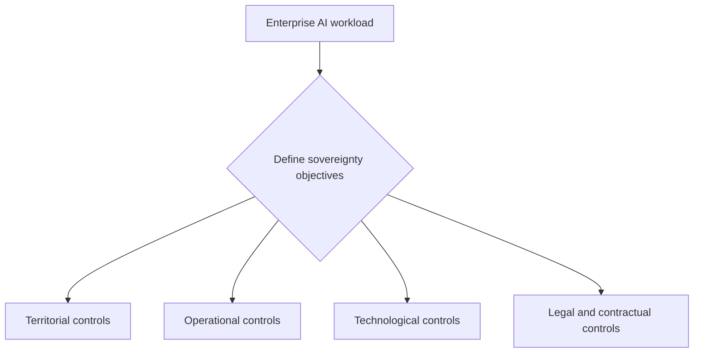

# Chapter Template — Sovereign AI Mastery

> **How to use:** Copy to `chapters/part-XX-name/NN-short-title.md`. Replace bracketed prompts, keep learner answers out of this file, and create a separate `assessments/solutions/NN-short-title-solutions.md`. [`TOC.md`](./TOC.md) is the course contract; [`STYLE_GUIDE.md`](./STYLE_GUIDE.md) defines the editorial and evidence rules. The length of each section is **adaptive** to complexity.

<!--
CHAPTER METADATA (author-maintained, not official certification metadata)
Module: NN
Part: I–VII
Week: NN
Status: outline | draft | technical review | legal review | published
Author:
Last updated: YYYY-MM-DD
Source review date: YYYY-MM-DD
Audience: intermediate AI PM with deep technical goals
Est. study time: Variable; weekly program budget approx. 10 hours
Prerequisites:
Reviewers:
-->

# Module NN — [Precise, benefit-led chapter title]

> **Executive thesis:** [In 1–2 sentences: the essential conclusion, the enterprise decision it changes, and the conditions under which it holds.]

**At a glance**

| Field | Value |
|---|---|
| Part / week | [Part], Week [N] |
| Difficulty | Intermediate / Advanced |
| Study effort | [N] hours reading + [N] hours lab + [N] hours PM work |
| Prerequisites | [Links to prior chapters or knowledge] |
| Key artifact | [Deliverable with link] |
| Lab environment | [OS/CPU/RAM/GPU, cloud/on-prem, budget] |
| Source review | [YYYY-MM-DD] |

## 1. Executive brief: the decision that matters

[Open with the recommendation, rationale, key trade-off, and a concrete business impact. Make the decisive point before detailed theory. Use a UAE/GCC scenario without assuming universal legal applicability.]

### Opening scenario

> **Scenario — [Short name]**  
> [3–5 sentences introducing an enterprise decision. State assumptions explicitly.]

**Decision question:** [One concrete question to revisit at the end.]  
**Executive recommendation:** [Conditional recommendation and the evidence that could reverse it.]  
**Bottom line:** [Three short facts or trade-offs a PM must retain.]

## 2. Learning objectives

By the end of this chapter, you should be able to:

1. **Explain** [core concept] without conflating adjacent concepts.
2. **Classify** [options/dimensions] using defensible criteria.
3. **Design or implement** [specific architecture/control].
4. **Evaluate** [trade-offs, costs, risks].
5. **Communicate** [decision] to technical and executive stakeholders.

## 3. Taxonomy, ontology & the mental model

> **Ontology spotlight:** Which entities, classes, properties, relationships, and invariants matter to this module? Link to [`taxonomy/ONTOLOGY.md`](../taxonomy/ONTOLOGY.md) using a path valid from the actual chapter file. Label all course-authored models as **not official standards**.

**New vocabulary:** [Definitions with scope, parent classes, and disambiguation.]  
**Entities and relations:** [Example: Authority → issues → Regulation → governs → ProcessingActivity; Control → mitigates → Risk; Test → verifies → Control.]  
**Invariants:** [Rules a valid classification must obey. State exceptions and open questions.]  
**Cross-links:** [Links to prerequisite and follow-on taxonomies.]


[Explain the intuition in plain language in 2–4 paragraphs, then increase rigor.]

### 3.1 Core definitions

| Term | Precise meaning | Common misconception | Evidence / source |
|---|---|---|---|
| [Term] | [...] | [...] | [Primary source] |

### 3.2 What it is — and is not

- **It is:** [boundary].
- **It is not:** [adjacent, often-confused concept].
- **It depends on:** [workload, regulatory, contractual, or control assumptions].

### 3.3 Taxonomy / architecture / mechanism

[If relevant, include a Mermaid diagram that renders in GitHub. Every diagram gets one sentence of alt-style explanation below it.]



*Diagram: A sovereignty assessment begins with the workload and explicit objectives, not a marketing label.*

## 4. How it works — technical deep dive

### 4.1 System components

[Name all components, owners, trust boundaries, data stores, model artifacts, APIs, and control planes.]

### 4.2 Data and control flows

[Provide step-by-step flow; identify where information leaves a trust boundary, where keys are held, and who can administer the system.]

### 4.3 Architectural patterns

| Pattern | Benefits | Limitations | Control implications | When to choose |
|---|---|---|---|---|
| [Option A] | | | | |
| [Option B] | | | | |

### 4.4 Failure modes and troubleshooting

[Discuss failures and realistic mitigations, including provider/control dependencies. Avoid claiming zero risk.]

## 5. UAE/GCC case study and global comparison

**Situation:** [Named or anonymized, with date and verified sources.]  
**Sovereignty requirement:** [What was actually required?]  
**Architecture / choice:** [Verified facts and explicitly marked assumptions.]  
**Outcomes and limitations:** [Evidence only; label speculation.]  
**PM lessons:** [3–5 transferable insights.]  
**Global comparison:** [How a different jurisdiction/market approaches the same problem.]

> **Evidence status:** [Confirmed by primary source / vendor-reported / analyst interpretation / illustrative scenario].

## 6. Hands-on lab — [Outcome]

### Lab objective and acceptance criteria

- **Build:** [Concrete working system or artifact].
- **Verify:** [Observable tests and output].
- **Sovereignty evidence:** [Logs, rules, deployment location, access proof, etc.]
- **Safety:** Use synthetic or public data; do not upload confidential data.

### Prerequisites and expected cost

| Dependency | Required version | Free/local option | Notes |
|---|---|---|---|
| [Tool] | [Pinned/version range] | [Yes/no] | [Security or platform notes] |

**Time:** [N] minutes  
**Default target:** Apple Silicon M4 Pro, 16 GB unified RAM; Python 3.x and Docker Desktop/compatible container runtime.  
**Model execution:** Prefer native Apple Metal-compatible local backends when GPU acceleration is needed; Docker-based GPU access is not assumed.  
**Compute:** [CPU/RAM/GPU requirements, memory constraints, and CPU fallback]  
**Network policy:** [Expected downloads and outbound endpoints; identify offline stage explicitly]  
**Optional cloud/GPU extension:** [Clearly optional, account prerequisites, spend limit, cleanup]  
**Estimated cost:** [Assumptions, currency, dated estimate; do not invent exact prices]

### Step-by-step procedure

1. [Action and exact command/configuration.]
2. [Expected result; where to look if it fails.]
3. [Validation command and interpretation.]

```bash
# Replace this fenced block with tested and annotated commands.
# Keep secrets out of committed code and screenshots.
echo 'Replace with tested lab steps'
```

### Tests / evidence checklist

- [ ] Functional output meets the declared acceptance criteria.
- [ ] Data flows and network egress are documented.
- [ ] Identity and privileged access are controlled and tested.
- [ ] Logs and test evidence are redacted and reproducible.
- [ ] Resource usage and operational caveats are recorded.

### Extension challenge

[Advanced optional exercise for learners with access to GPUs or cloud labs.]

## 7. The AI PM decision playbook

### Decision to make

[One realistic decision with a written recommendation and rationale.]

### Stakeholder questions

- **CTO / architect:** [Question]
- **CISO / privacy / legal:** [Question]
- **Finance / procurement:** [Question]
- **End user / buyer:** [Question]

### Prioritization or scoring matrix

| Criterion | Weight | Option A | Option B | Evidence needed |
|---|---:|---:|---:|---|
| [Criterion] | [%] | [Score] | [Score] | [Source] |

**Recommendation:** [Conditional choice and the assumptions that could reverse it.]

## 8. Economics, operating model, and trade-offs

[Identify cost drivers, CAPEX/OPEX, utilization, dependencies, SLA obligations, staffing, and change management. Use worked estimates with dated inputs; show formulas and sensitivity.]

## 9. Anti-patterns, common mistakes, and failure cases

1. **[Anti-pattern].** [Why it fails; what to do instead.]
2. **[Anti-pattern].** [Why it fails; what to do instead.]
3. **[Anti-pattern].** [Why it fails; what to do instead.]

## 10. PM deliverable and capstone connection

**Deliverable:** [e.g., architecture decision record, sovereignty matrix, PRD section, deployed demo, risk register].

**Definition of done:**

- [ ] [Evidence-based success criterion 1]
- [ ] [Evidence-based success criterion 2]
- [ ] [Review criterion 3]

**Capstone connection:** [How the work feeds the ongoing enterprise sovereign AI platform.]

## 11. Knowledge check

**Six decision questions**

1. [Core definition and misconception]
2. [Classification, boundary, or evidence]
3. [Architecture/design reasoning]
4. [Security, regulatory, or operational judgment]
5. [**Named, real-world example** drawn from a dated primary-source product document, official case report, regulator decision, or actual published incident. Provide a source footnote. If applying a real product to a hypothetical customer, label the customer situation hypothetical rather than claiming a real incident. Ask what technical evidence would change the decision.]
6. [**Evidence-state and root-cause analysis**. Give an explicit pre-test state, observed adverse or ambiguous result, and proposed fix. Ask for status transitions, probable root cause, contributing gap, accountable owner, mitigation and a dated retest before closure.]

**Scenario challenge:** [Ambiguous real-world situation requiring a justified recommendation.]

**Answer key / rubric:** `assessments/solutions/NN-short-title-solutions.md` — a **separate file**. Do not put solutions, model answers, or hints that reveal the answer here. Solutions must include lab verification; a cited, worked answer to Question 5 that distinguishes genuine documented product behavior from invented deployment facts; and a **step-by-step Question 6 RCA** with observation, direct cause, systemic cause, validation, remediation owner, retest, residual risk and bounded closure decision. Include all other quiz rationales, scenario trade-offs and a PM-deliverable rubric.

## 12. Key takeaways

- [Takeaway: what matters and why]
- [Takeaway: when the choice changes]
- [Takeaway: a testable PM habit]

## 13. Evidence ledger, quoted sources & further reading

> **Mandatory:** Every material source-backed assertion must cite a primary source **and display a short exact source quotation** in running text or this ledger, including the specific article, clause, section or version. Attribution without a direct quote is insufficient. Do not invent quotes; verify exact wording against the original. Minimize quotations (e.g. ≤ 25 words in aggregate from any one original source in the reader-facing extract); link to the full official source. Separate the author's inference from the quotation.

| Claim ID | Exact short quotation | Issuer and pinpoint URL | Interpretation | Limits / caveat | Verified |
|---|---|---|---|---|---|
| C-01 | “...” | [...] | [...] | [...] | YYYY-MM-DD |


Cite significant legal, technical, factual, price, and vendor-specific claims **at the sentence** using GitHub-flavored academic footnotes, e.g., `...[^nist-ai-rmf]`. For every referenced source give publisher/author, title, version, publication or update date if established, a stable URL, and `Verified: YYYY-MM-DD`. Do not invent a publication date.

- **Primary laws / regulations:** [Source title + applicable articles] — [regulator/publisher; effective/version date; verified date].
- **Standards and guidance:** [Source + specific section] — [issuer; edition; verified date].
- **Engineering docs and research:** [Versioned original documentation; method/limitations; verified date].
- **Vendor claims:** Label as marketing/provider statement and state whether independently verified.

Example footnote syntax (replace when authoring a real chapter):

```markdown
NIST provides an AI risk management framework.[^nist-ai-rmf]

[^nist-ai-rmf]: National Institute of Standards and Technology, *AI Risk
    Management Framework (AI RMF 1.0)* (2023),
    https://www.nist.gov/itl/ai-risk-management-framework.
    Verified: 2026-11-17.
```

> **Source integrity:** Do not fabricate links, quotes, legal obligations, product specifications, or case results. Link to authoritative URLs and flag uncertainty. A reference list does not replace claim-level evidence.

## 14. Publish to website + LinkedIn, and what comes next

**Website shipping checklist:** [Website URL/route], [sidebar/nav], [source-review status], [accessible diagram], [mobile preview], [internal/external link test], [full text and search]. The website, not an unstyled Markdown page, is the final reader format.

**Question-led social derivative (mandatory):**

- `social/module-NN/SLIDES.md` — 7–9 slides with a question as **every slide headline**.
- `social/module-NN/CAROUSEL.html` — source-of-truth, **4:5 portrait editorial layout** built in semantic HTML/CSS. Every slide has a question headline, one distinct insight, strong text contrast, a meaningful visual or evidence extract when useful, and a real source for any product or legal claim.
- `social/module-NN/NN-questions.pdf` — optional derived export after screenshot review. Print must preserve text, links, colors and page breaks. **Never make the PDF the primary design source.**
- `social/module-NN/POST.md` — a concise LinkedIn post built around substantive questions, with the website chapter as the intended destination.

**Review record:** [Primary-source check and reviewer], [editorial anti-slop pass], [technical lab verification], [different-model critique: completed / NOT COMPLETED with model/version and evidence link].

### What comes next

[2–3 sentences connecting this chapter to the next module and the evolving capstone.]

---

### Editorial review checklist (remove before publication)

- [ ] Section titles are concrete and parallel in style.
- [ ] Technical statements and legal claims cite current primary sources and show verified, minimal direct quotations with pinpoint links.
- [ ] The SCOPE anti-slop edit has removed vagueness, filler, hype, and unsupported claims.
- [ ] Ontology spotlight defines meaningful entities/relationships and links to the shared model.
- [ ] The published output is a responsive website page with accessible navigation, footnotes, diagrams and mobile preview.
- [ ] Question-led HTML carousel and POST.md exist and have been visually/source checked. Check each slide for legibility, hierarchy, overflow, accurate citations, and **zero em dashes (—)** in social copy. Remove filler, faux profundity, generic endings, and undeclared fictional examples.
- [ ] Second-model-review status is truthful and independent output is stored if completed.
- [ ] Each major concept has a definition, worked example, and trade-off.
- [ ] UAE/GCC treatment distinguishes federal, free-zone, and sector-specific applicability.
- [ ] Architecture and data-flow diagrams have explanatory captions.
- [ ] Lab was tested on a declared environment and uses no secrets or confidential data.
- [ ] Cost assumptions, versions, dates, and vendor claims are explicit.
- [ ] The PM deliverable has measurable acceptance criteria.
- [ ] Six-question quiz includes a sourced real-world case in Q5 and a root-cause exercise in Q6.
- [ ] Separate solution key contains answer rationales, tested lab expected results, scenario trade-offs, and PM rubric.
- [ ] The first screen communicates executive takeaway, decision, and conditions.
- [ ] Accessibility and Markdown rendering were checked.


---

## Website/book-rendering requirements for this chapter

- Render as a book chapter with the 24-module left-hand table of contents, long-form serif reading column, and personal annotation margin.
- Ensure every H2 becomes an accessible in-page anchor and every technical diagram is **rendered as an image/SVG on the final website**, not exposed as an unrendered Mermaid code fence. Retain downloadable or expandable `mermaid` source for inspectability, plus caption and text equivalent. Test diagram display on mobile and with scripts disabled.
- Ensure all evidence quotations are truly verbatim, precisely footnoted, and checked against the original primary source. No filler, generic AI prose, or unverified vendor claims.
- Explicitly link to the course taxonomy/ontology and state the entities, relationships and constraints this chapter introduces.
- Test that selecting any substantive text can create a highlight or note; check local reload and optional GitHub-backed cross-device sync.
- Ship a separate **HTML-authored question-led carousel** at `social/module-NN/CAROUSEL.html`; export a PDF derivative only after visual QA. Every slide headline must be a question and the post must point back to this chapter.
- Keep answer keys out of the public reader build even if the source repository itself is public; source availability is not answer confidentiality.

### Dynamic learning companion (required when decisions depend on configurable constraints)

- Create or link a low-friction **questionnaire with immediate feedback**. Each input maps to taxonomy dimensions, controls, evidence requirements, and alternative architecture patterns.
- Show a **provisional** recommendation, counterfactual comparison when one input changes, unresolved evidence, and chapter links. A quiz that collects answers without teaching the decision mechanism does not qualify.
- Never generate a legal-compliance status, a sovereignty certification percentage, or a promise of location/control from unspecified vendor details. Label every assumption and provide human-review gates.
- Keep inputs in browser storage by default; make public GitHub sync explicit and warn against entering confidential information.


## 15. Adaptive learning companion specification

> **Required when the chapter introduces a consequential architecture choice.** Link to the shared [Architecture & Learning Studio](learning/index.html) or contribute a module-specific challenge to its source. Do not add a decorative questionnaire.

- **Onboarding inputs:** [Which workload attributes and ontology relations determine the recommendation?]
- **Decision rules:** [Explain each branch and its exclusions. Reject impossible operating/compute combinations.]
- **Rendered output:** [Architecture components, claims, owner, test procedure, evidence state and approval gates.]
- **Adaptive challenge:** [A genuinely plausible wrong option, the misconception it reveals, an evidence-backed explanation, an RCA when appropriate, and the next module.]
- **Counterfactual:** [Which single constraint should the learner change to expose a non-obvious trade-off?]
- **Portable learning artifact:** [What Markdown/JSON record can be reviewed, sourced, and committed to GitHub?]
- **Safety and transparency:** [Explain whether the reasoning is rules-driven or model-driven, what is stored, what is public, and where a qualified human must review.]
- **Verification:** [Unit tests for major branches, browser interactions, accessible labels and export checks; explicitly record any unavailable visual or deployment test.]

**No AI slop rule:** Never claim the interactive engine is intelligent, personalized by an LLM, or legally authoritative when it is a deterministic learning tool. The depth of feedback matters more than animated UI. Do not use em dashes or generic thought-leadership filler in any LinkedIn derivative.


### Physical-site-only and air-gapped case authoring (v1.1)

When a scenario says data cannot leave the premises, distinguish the **physical building/site** from a country, cloud region, or colocation facility. Document where prompts, model weights, vector indices, diagnostics, logs, backups, telemetry, updates, removable media, remote support, and recovery copies can exist. Require physically on-site compute, an explicit operator model, and a separately testable connectivity/egress rule. An internet-enabled or remotely managed alternative must be recorded as a conflict, not quietly selected as an architecture. For air-gapped cases include offline updates and media transfer controls. The learner should see a blocked design when assumptions cannot all be satisfied. These course scenarios are not proof of legal compliance or actual facility capability.
