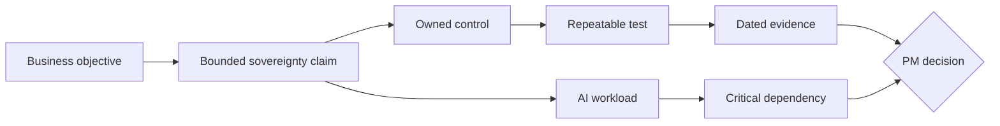

# Module 01 — Who controls the intelligence?

> **Executive thesis:** Sovereign AI is best treated as a **bounded claim about control over an AI workload**, supported by evidence. A company can pursue sovereign AI at enterprise or workload level. Local hosting may help territorial control, but says little by itself about operational power, technological dependency, or legal exposure.

| Course context | Detail |
|---|---|
| Part / week | I — Foundations / Week 1 |
| Reader | AI PM with product delivery experience; technical implementation follows |
| Effort | 2.5 h reading + 2.5 h lab + 2 h PM deliverable + 1 h review |
| Prerequisites | None; familiarity with cloud products helps |
| Output | Claim register, architecture/control diagram, go/no-go memo |
| Environment | Python 3.10+; no GPU, network credentials or cloud budget required |
| Source review | Official sources checked 17 November 2026 |
| Status | Learning material; **not** a certification or legal opinion |

## 1. Executive brief — what decision are you making?

A UAE enterprise wants an employee knowledge assistant. Three implementation proposals arrive:

- **A. Foreign-hosted API:** fast to launch, little operational responsibility, but the enterprise must verify data routing, log handling, provider access and contractual terms.
- **B. Managed AI service in an approved UAE region:** potentially improved territorial control, but region selection does not resolve provider access, model portability, or legal obligations.
- **C. Enterprise-operated small model in its own environment:** greater direct operational visibility, but more capacity, security, maintenance and model-quality responsibility.

**The PM decision is not “Which one is sovereign?”** It is: *What sovereignty objectives apply to this workload, which candidate can meet them, what evidence is available, and what trade-offs are acceptable?*

**Recommendation:** Create a claim register before writing the product requirements document. For each claim capture scope, owner, acceptance criterion, dependency, control, test, evidence and exception. This avoids buying an adjective instead of a capability.

## 2. Learning objectives

After this chapter, you should be able to:

1. Explain sovereign AI without conflating it with privacy, security, compliance or national ownership.
2. Distinguish national, sectoral, enterprise and workload scopes.
3. Classify an AI system along territorial, operational, technological and legal/contractual dimensions.
4. Identify deployment and lifecycle boundaries that make sovereignty claims incomplete.
5. Write a falsifiable sovereignty claim and define a repeatable validation test.
6. Make a defensible PM decision under uncertainty without presenting unverified claims as facts.

## 3. Taxonomy first: what are we classifying?

> **Taxonomy spotlight.** A system is not simply “sovereign” or “not sovereign.” The label omits *who requires control, of what, for which purpose, and how we know*.

### 3.1 Four independent classification axes

| Axis | Choices | Why PMs need it |
|---|---|---|
| **Scope** | National; sectoral; enterprise; workload | Sets whose objectives count |
| **Control dimension** | Territorial; operational; technological; legal/contractual | Prevents one strong control being mistaken for complete sovereignty |
| **Deployment** | Public; managed sovereign; private; hybrid; air-gapped; edge | Exposes infrastructure and operating-model assumptions |
| **Lifecycle** | Data collection; training; adaptation; evaluation; inference; monitoring; retirement | Prevents an inference-only claim covering the entire lifecycle |

**Classification example:** “Enterprise scope / territorial + operational dimensions / managed sovereign cloud / inference and monitoring stages.” This is already more useful in a PRD than “sovereign AI platform.”

### 3.2 Can a company have sovereign AI?

**Yes**, in an operationally meaningful, context-dependent sense. An enterprise can control selected AI workloads and dependencies through architecture, ownership, access policies, contracts and testing. It may still rely on external chips, open-weight models, software vendors and support providers. *Autonomy* means the organization can make and enforce relevant decisions—not that it manufactures every component.

A **bank-specific AI assistant**, for example, can have stricter access, location and exit requirements than an internal marketing draft assistant. Both can sit within the same enterprise platform with differentiated policies.

### 3.3 Sovereign AI ≠ four adjacent ideas

| Neighboring concept | What it answers | What it does not prove |
|---|---|---|
| Data residency | Where identified data is stored or processed | Who can access it, or whether other derivatives move elsewhere |
| Privacy | How personal data is handled and rights are respected | Model portability or hardware independence |
| Security | How systems protect confidentiality, integrity and availability | Sufficient legal authority or business exit options |
| Compliance | Whether applicable obligations are met | All desired degrees of strategic autonomy |

An enterprise may be secure and compliant yet dependent on a sole external model provider. It may operate a private model yet still have weak key custody. Avoid treating these properties as synonyms.

## 4. The ontology: how does a claim become credible?

An ontology maps entities and relations rather than only naming categories. The course uses the chain **BusinessObjective → SovereigntyClaim → Workload → Dependency / Control → Test → Evidence → Decision**. See the [course taxonomy and ontology](../taxonomy/ONTOLOGY.md) and its [machine-readable vocabulary](../taxonomy/ontology.yaml).

**Example claim:** “For workload EMP-001, inference request payloads and prompt logs stay within approved UAE locations under normal operation and support procedures.”

This claim is **testable**, but it is not yet **proven**. Confirm the model endpoint, observability routing, backup destination, privileged support paths, failover behavior and network egress. A vendor slide is not a substitute for a dated configuration review and repeatable test.

### 4.1 A claim register that can fail

| Field | Example |
|---|---|
| Claim ID | TERR-001 |
| Workload | EMP-001 — fictional employee assistant |
| Dimension | Territorial |
| Owner | Platform engineering lead |
| Acceptance criterion | No designated request content or prompt logs leave approved locations |
| Test | Record destinations, inspect access/egress logs, exercise support and failover paths |
| Evidence | **Missing at kickoff** |
| Decision | **Pending**, not “compliant” |

A useful claim must be capable of failing. If no observation could prove it wrong, rewrite it.

## 5. What primary sources actually establish

This section deliberately separates **direct quotation** from **course interpretation**.

| Primary source | Short direct quotation | What it establishes—and does not |
|---|---|---|
| OECD, revised AI-system definition | “a machine-based system” [^oecd] | A formal AI-system framing; **not** a sovereign-AI certification framework |
| NIST AI RMF 1.0 | “GOVERN, MAP, MEASURE, and MANAGE” [^nist] | Risk-management functions we can use for governance; **not** four dimensions of AI sovereignty |
| UAE AI Office, AI Strategy 2031 | “world leaders in A.I. by 2031” [^uae] | A national strategy ambition; **not** evidence that a particular enterprise AI service is sovereign |

**Course synthesis:** Enterprise sovereign AI is a control-and-evidence question applied to a defined system. That statement is a practical teaching definition, *not* a quotation from the sources above.

[^oecd]: OECD, *Updated OECD Definition of an AI System*, explanation of revised definition (2024); [official OECD resource](https://oecd.ai/en/dashboards/policy-initiatives/updated-oecd-definition-of-an-ai-system-4108). Accessed 17 Nov 2026.
[^nist]: NIST, *AI Risk Management Framework (AI RMF 1.0)*, NIST AI 100-1 (2023); [publication](https://www.nist.gov/publications/artificial-intelligence-risk-management-framework-ai-rmf-10) and [AI RMF Core](https://airc.nist.gov/airmf-resources/airmf/5-sec-core/). Accessed 17 Nov 2026.
[^uae]: UAE Artificial Intelligence Office, *UAE National Strategy for Artificial Intelligence 2031*; [official strategy page](https://ai.gov.ae/strategy/). Accessed 17 Nov 2026.

## 6. Architecture decisions: identify boundaries before vendors

For each option, ask these questions before assigning any label:

1. **Data and derivatives:** Where are prompts, attachments, vector embeddings, fine-tuning files, feedback, logs and backups stored?
2. **Administrative power:** Which people and automation identities can read, alter, export, suspend or delete them?
3. **Model control:** Are weights deployable, licenses transferable, and inference interfaces portable? What would migration cost?
4. **Contractual protection:** What has the vendor actually promised, and what is excluded? Which jurisdiction and processors matter?
5. **Evidence:** Can those claims be tested at onboarding and again after a platform update?

### 6.1 Comparing three illustrative architectures

| Factor | External API | Managed in-region | Self-operated model |
|---|---|---|---|
| Speed to MVP | Often high | Medium–high | Medium–low |
| Capacity burden | Lower for customer | Shared | Higher for customer |
| Provider operational dependency | Usually significant | Varies by contract and platform | Lower at serving layer; other dependencies remain |
| Portability | Depends on API/model | Depends on export and contracts | Depends on weights, licensing and infrastructure |
| Assurance work | Needed | Needed | Needed |

These are **illustrative tendencies**, not rankings of actual vendors. Do not infer sovereignty from a deployment category alone.

## 7. Worked enterprise scenario: the claim that was too broad

**Fictional company:** Al Noor Services, operating an internal assistant for UAE-based staff. It stores PDF policies locally, queries a hosted model, and uses a third-party analytics tool. The marketing team wants to publish “100% sovereign AI.”

**Architecture review findings:** Document storage is in a chosen location; model requests and analytics destination have not been mapped; support identities are undocumented; there is no verified model-exit plan.

**PM decision:** **Do not approve the unqualified claim.** Approve a narrower, evidenced statement such as “policy documents are stored in [verified location]” only after checking it. Create backlog items for model routing, telemetry destination, key custody, support access, and portability tests. Route legal interpretations to counsel.

**What would change the decision?** Documented boundaries, successful tests, signed contractual controls where needed, and an explicit exception process. Being “in the UAE” is not enough information.

## 8. Hands-on lab — test the claim chain locally

The companion [Module 01 lab](../labs/module-01/README.md) uses Python only, so it runs on a 16 GB M4 Pro without GPU access.

**Task:** Add two sovereignty claims to `claims.json`: one territorial and one operational. Each must have an owner, scope, a measurable criterion, a control, a test and evidence status. Run `python3 validate.py claims.json` and inspect the report.

**Expected learning:** Missing evidence must produce `UNVERIFIED`, not `PASS`. Invalid or incomplete claim fields must be reported without inventing compliance status. A syntactically complete claim is not automatically true.

**Security boundary:** The lab uses fictional organizations and data only. Never put real secrets, access tokens, regulated documents or customer information into public coursework.

## 9. PM deliverable — a one-page sovereignty decision memo

Write one page for a hypothetical UAE enterprise with the following headings:

- **Decision to be made:** exact workload and customer problem.
- **Scope and dimensions:** who requires what level of control, at which lifecycle stage.
- **Candidate architectures:** three options and their dependencies.
- **Claims and evidence:** what is demonstrated, unknown, or contractually asserted.
- **Trade-offs and cost:** engineering ownership, inference quality, speed and exit options.
- **Recommendation:** approved, deferred, or approved with explicitly owned exceptions.

**Acceptance:** A CTO should be able to trace every significant claim to the responsible owner and an evidence-gathering action. Avoid an undifferentiated sovereignty percentage.

## 10. Knowledge check — answer before reading the solutions

1. A company stores embeddings in the UAE but a foreign team has privileged support access. Which dimensions require further examination, and why?
2. Is “open-source model” synonymous with “sovereign AI”? Explain two dependencies that could remain.
3. Give a useful enterprise/workload sovereignty classification for an HR copilot.
4. What makes a sovereignty claim falsifiable? Rewrite “fully sovereign” into a specific acceptance criterion.
5. Why might a vendor contract be strong evidence for one claim and weak evidence for another?
6. When should a PM record `UNVERIFIED` rather than `FAIL`?

Solutions are maintained separately for facilitators in the repository and deliberately omitted from the learner website.

## 11. Decision checklist

- [ ] Scope and lifecycle stages explicitly named
- [ ] Four control dimensions assessed separately
- [ ] Data flows, privileged access and dependencies mapped
- [ ] Each material claim has an owner, test and dated evidence or named gap
- [ ] Legal interpretation reviewed by the correct specialist
- [ ] Vendor exit and operational responsibility considered
- [ ] Claims in launch materials limited to demonstrated facts

## 12. LinkedIn discussion prompt

**Question:** *If a model runs inside your country, who still controls the intelligence?* Use the [HTML question carousel](../social/module-01/CAROUSEL.html) to structure a discussion around territorial, operational, technological and legal control—not an unsupported claim of national or enterprise independence.

## 13. Further reading

Start with the [OECD revised AI definition](https://oecd.ai/en/dashboards/policy-initiatives/updated-oecd-definition-of-an-ai-system-4108), [NIST AI RMF](https://www.nist.gov/publications/artificial-intelligence-risk-management-framework-ai-rmf-10), [UAE AI Strategy 2031](https://ai.gov.ae/strategy/), and the [course ontology](../taxonomy/ONTOLOGY.md). Read these for their *actual* scope, not as authorities endorsing the course's new classification framework.