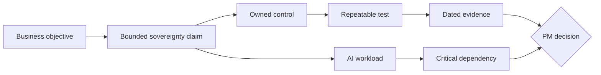

# Module 01 — Who controls the intelligence?

> **Executive thesis:** Sovereign AI is best treated as a **bounded claim about control over an AI workload**, supported by evidence. A company can pursue sovereign AI at enterprise or workload level. Local hosting may help territorial control, but says little by itself about operational power, technological dependency, or legal exposure.

| Course context | Detail |
|---|---|
| Part / week | I — Foundations / Week 1 |
| Reader | AI PM with product delivery experience; technical implementation follows |
| Effort | 2.5 h reading + 2.5 h lab + 2 h PM deliverable + 1 h review |
| Prerequisites | None; familiarity with cloud products helps |
| Output | Claim register, architecture/control diagram, go/no-go memo |
| Environment | Python 3.10+; no GPU, network credentials or cloud budget required |
| Source review | Official sources checked 17 November 2026 |
| Status | Learning material; **not** a certification or legal opinion |

## 1. Executive brief — what decision are you making?

A UAE enterprise wants an employee knowledge assistant. Three implementation proposals arrive:

- **A. Foreign-hosted API:** fast to launch, little operational responsibility, but the enterprise must verify data routing, log handling, provider access and contractual terms.
- **B. Managed AI service in an approved UAE region:** potentially improved territorial control, but region selection does not resolve provider access, model portability, or legal obligations.
- **C. Enterprise-operated small model in its own environment:** greater direct operational visibility, but more capacity, security, maintenance and model-quality responsibility.

**The PM decision is not “Which one is sovereign?”** It is: *What sovereignty objectives apply to this workload, which candidate can meet them, what evidence is available, and what trade-offs are acceptable?*

**Recommendation:** Create a claim register before writing the product requirements document. For each claim capture scope, owner, acceptance criterion, dependency, control, test, evidence and exception. This avoids buying an adjective instead of a capability.

### 1.1 What is sovereign AI? Start with the boundary

**Working definition:** For a defined AI workload, sovereign AI means the organization can demonstrate the decision rights, technical controls and operating arrangements needed to meet its stated sovereignty objectives. Those objectives may concern where processing happens, who can administer it, which dependencies can be replaced, or which contractual and legal exposures require review. The claim is only as strong as its **scope, test and dated evidence**. This is a course-authored decision framework, not a legal definition or certification.

**Worked field case (fictional): A manufacturer's maintenance assistant that cannot send data off-site.** Technicians want an assistant to search machine manuals and summarize incident notes. The enterprise's requirement is narrower and stronger than “host in the UAE”: no restricted source document, prompt, embedding, generated answer, telemetry, diagnostic bundle or backup copy may leave the factory premises.

A vendor proposes a model endpoint in a nearby cloud region. That may be a credible choice for a country-level residency requirement, but it **does not meet this physical-premises requirement**. The product team instead evaluates a small, locally served model, on-premises retrieval index, local audit logging, enterprise-held access controls, and an approved process for importing software and model updates. The team must still test usefulness, latency and the site's compute capacity. A premises-only network may permit approved local connectivity; it is not automatically air-gapped.

| Design question | Observable proof to request | PM release decision |
|---|---|---|
| Do prompts or derived data leave the factory? | Network destination inventory, egress-deny test, packet or proxy evidence across inference and retrieval | Block real factory data until the tests are reviewed |
| Can an external operator read or export restricted material? | Named-admin access review, remote-support path test, privileged session records | Reject unapproved remote support paths |
| What happens during logging, backup, failure and recovery? | Local telemetry and backup configuration, failover drill, restore destination evidence | Treat untested paths as open gaps |
| Can the team maintain the model without bypassing the boundary? | Signed artifact intake, malware scan, license review, rollback rehearsal | Approve an explicit, auditable update process |

**Failure drill and root cause:** During an acceptance test, the backup agent uploads diagnostic logs to an off-site storage endpoint. The requirement is **failed**, even if primary inference was local. The direct cause is an overlooked backup destination; the process gap is that the data-flow inventory excluded support and recovery tooling. The platform owner disables that route, investigates and contains any exported material, updates the inventory, then reruns normal, failover and restore tests. Only the newly observed result can be recorded as evidence; installing a fix alone is not a pass.

**What the PM may say after review:** “In the tested factory-assistant configuration, the reviewed inference, retrieval, logging and recovery paths showed no restricted off-premises data flow on the recorded test date.” Do not replace that bounded finding with “100% sovereign” or infer legal compliance.

**Try the counterfactual:** Change **single premises** to **two approved enterprise campuses** in the [Architecture & Learning Studio](../learning/index.html). Which inter-site connections, support paths and backup destinations would now need evidence? Which single-site assumptions would no longer apply?

### 1.2 From digital sovereignty to data, cloud, and AI sovereignty

**Decision first:** Treat these as *nested but non-equivalent control questions*, not four interchangeable labels. A company may control its documents without controlling the cloud administrators, and may control its cloud tenancy without controlling the model provider, training artifacts or inference telemetry. Record the specific boundary that matters before selecting a vendor.

| Layer | Decision the PM must make | Illustrative control and proof | What it does not establish |
|---|---|---|---|
| **Digital sovereignty** | Which digital capabilities, infrastructure and critical dependencies must remain governable or replaceable? | Documented authority over identity, networks, software supply chain and exit plans; tested provider migration | That all data or AI operations stay in a chosen territory |
| **Data sovereignty** | Who may collect, access, process, retain, transfer and delete each data class? | Data-flow inventory, processing locations, encryption/key custody, access logs and deletion tests | Control over model weights, serving runtime or privileged cloud operators |
| **Cloud sovereignty** | Who operates the infrastructure and control plane, where, and with what administrative privileges? | Region and service configuration, privileged-access audit, backup/support routing, contractual rights, operational exit rehearsal | That a third-party model's telemetry, updates and downstream tools respect the same boundary |
| **AI sovereignty** | Who can govern the *AI workload lifecycle*, including models, prompts, embeddings, evaluation, inference, agents and monitoring? | Model/license inventory, inference and tool-call tracing, update approvals, reproducible evaluations, operator and vendor dependency tests | Universal independence, regulatory approval or certified sovereignty |

These four definitions are a **course-authored teaching taxonomy**. They are not statutory terms or maturity levels. They overlap: the same access-control defect may undermine data, cloud and AI claims simultaneously. For related entities and relations, consult the [course ontology](../taxonomy/ONTOLOGY.md). A useful chain is **BusinessObjective → Workload → DataAsset / Model / InfrastructureDependency → Control → Test → Evidence → Decision**; each link must have an accountable owner.

#### Worked UAE enterprise decision: a policy assistant (fictional)

A UAE-based enterprise wants to search confidential internal policy documents with retrieval-augmented generation (RAG). The product brief says, “Keep our AI sovereign.” The PM instead separates four requirements:

1. **Digital:** The organization must retain identity administration and be able to export its policy corpus and access rules within an agreed recovery window. *Evidence:* identity configuration, export format and a timed restoration rehearsal.
2. **Data:** Policy files, extracted text, embeddings, prompts, logs and backups must follow a documented permitted-location and access policy. *Evidence:* a complete data-flow map plus observed destinations during normal operation and recovery.
3. **Cloud:** Named provider personnel may administer only approved layers under recorded access controls. *Evidence:* privileged-role matrix, support-session records and an operator escalation test.
4. **AI:** The organization must be able to change the model endpoint without losing retrieval authorization or auditability. *Evidence:* model gateway interface, license review, regression evaluation and a measured substitution test.

**Architecture options:** A foreign-hosted API may minimize initial operations but requires close scrutiny of inference routing, retention, tool calls and exit. An approved in-region managed platform may reduce some location concerns but cannot be assumed to restrict provider support or all telemetry. An enterprise-operated model offers more direct runtime control at the price of compute, patching, evaluation and incident-response ownership. The choice depends on the actual requirement and verified service configuration, not on the provider's “sovereign” branding.

**Physical-boundary override:** If the requirement is **nothing restricted may leave one factory premises**, neither a country-resident managed endpoint nor off-site colocation qualifies. Evaluate local inference, local retrieval, local logs, approved on-site administrators and controlled artifact intake; verify backup, diagnostics and failover. If the requirement is **air-gapped**, disallow *all* inbound and outbound networking, including remote support and automated updates. A premises-only design with a local network is **not** automatically air-gapped. In both cases, an underpowered local device is a feasibility blocker, not permission to silently switch to a cloud API.

#### Failure drill: the cloud region was correct, but the AI claim was not

**Scenario assumption:** The managed inference endpoint is configured in the approved region, but an evaluation service exports sampled prompts to an unapproved analytics destination. **Observed symptom in the fictional acceptance test:** outbound evaluation traffic includes restricted prompt content. **Impact:** the data-location acceptance criterion fails despite correct primary endpoint configuration. **Direct cause:** an evaluation connector used a default remote destination. **Contributing process gap:** the architecture inventory covered inference and storage but omitted evaluation and monitoring. **Owner:** platform engineering for containment and routing; security/privacy reviewers for impact and disposition; PM for the launch gate. **Corrective action:** disable the connector, investigate and contain any transmitted data, inventory all derived-data paths, configure a permitted evaluation destination or remove the feature. **Retest:** trace representative synthetic prompts through inference, evaluation, logs, failover and deletion, and independently inspect destination evidence. **Closure:** recorded, reviewed test results and explicit exception disposition. A configuration change without retesting is **not** evidence of success.

#### PM artifact: four-layer sovereignty requirements register

Create one row per **requirement**, rather than a single “sovereign: yes/no” field:

| Field | Example entry |
|---|---|
| Requirement ID / owner | AI-LOC-02 / AI platform lead |
| Layer and workload stage | AI sovereignty / evaluation and monitoring |
| Boundary and acceptance test | No restricted prompt, embedding or evaluation payload leaves the approved processing locations; inspect destination traces under normal, failure and support paths |
| Dependencies | Model service, evaluation connector, observability pipeline, backup target |
| Current evidence / status | Design diagram only / **UNVERIFIED** |
| Decision and next action | **Block restricted-data launch** until reviewed runtime evidence is available |

A dependency can support multiple requirements, but **a cloud region setting must never be copied into an AI-lifecycle evidence field as if it proved every path**. Attach dated evidence, a responsible reviewer and a reopening trigger for service or configuration changes.

**Learner challenge:** In the [Architecture & Learning Studio](../learning/index.html), compare (A) an approved-country policy assistant using a managed platform, (B) a premises-only factory assistant, and (C) a disconnected factory assistant. Identify which changes are **data**, **cloud** and **AI** control changes, which are operational feasibility blockers, and which claims remain provisional even after the design looks plausible. Write one acceptance test that would falsify each architecture's most important claim.

**Facilitator check (not a quiz answer key):** A defensible response names prompt derivatives and non-inference flows, rejects off-premises compute for B and all network links for C, and does not turn vendor assertions into a verified sovereignty pass. For the primary-source distinction between governance and sovereignty, the [NIST AI RMF Core](https://airc.nist.gov/airmf-resources/airmf/5-sec-core/) provides risk-management functions, **not** this four-layer sovereignty taxonomy; see the chapter's source ledger in Section 5. No new regulatory applicability or vendor behavior is asserted here.

### 1.3 Sovereign vs. private vs. secure vs. compliant AI

**Decision first:** Do not approve a system because it is described as *private*, *secure*, *compliant* or *sovereign*. These are four different propositions. A product can satisfy one while failing another. The PM's question is: *Which requirement does each adjective represent, which test could refute it, and who can accept the evidence?*

| Claim | Specific question | Evidence to request | What the claim does not establish |
|---|---|---|---|
| **Private AI** | Is the workload deployed within an organization-selected isolation or tenancy boundary? | Runtime inventory, network routes, identity and privileged-access map, storage location | An on-site model may still upload diagnostic logs off-site |
| **Secure AI** | Are confidentiality, integrity, availability and AI-specific misuse risks controlled against a defined threat model? | Access-control tests, key custody, patching, adversarial evaluations, incident and recovery drills | Encryption alone says nothing about location or provider independence |
| **Compliant AI** | Does the actual organization, use case and processing activity satisfy identified applicable obligations? | Applicability matrix, contractual analysis, required notices/approvals, operational tests and accountable legal/privacy review | Neither a provider badge nor a control framework automatically proves workload-specific legal compliance |
| **Sovereign AI** | Are defined territorial, operational, technological and legal/contractual control objectives enforceable and evidenced? | Claim register, control and dependency graph, egress and operator tests, portability rehearsal | A country-hosted endpoint does not prove data-derivative containment or full autonomy |

This is a **course-authored comparison**, not an official regulatory classification. The properties intersect but are **not a hierarchy**: a private deployment can be insecure; a secure one can break a sovereignty boundary; a sovereignty claim can remain unverified while compliance analysis is still open. A sovereign design does not excuse poor security or applicable legal obligations.

#### Why control categories cannot substitute for each other

**Security** evaluates a specified threat model. **Sovereignty** evaluates whether named decision rights, data flows, administrators and dependencies stay within agreed boundaries. **Privacy** governs permitted information handling, while **compliance** is an assessment against *specific* applicable obligations. The same workload may need all four lines of evidence.

NIST SP 800-207 says there is “no implicit trust granted to assets or user accounts based solely on their physical or network location.” A private network is therefore not a proof of safe access.[^nist-zero-13] NIST SP 800-53 Rev. 5 catalogs security and privacy controls, but it does not certify that an AI deployment is sovereign.[^nist-controls-13] NIST AI RMF 1.0 discusses AI trustworthiness, including being “secure and resilient”; it is a risk-management framework, not a sovereignty attestation.[^nist-airmf-13]

| Fictional architecture | Private? | Security status | Sovereignty status | Compliance status |
|---|---|---|---|---|
| Factory-owned inference server with remote vendor diagnostics | Yes at the serving layer | Other controls **unverified** | **Failed** if derivatives may not leave the factory | Specialist review pending |
| Managed in-country inference service with reviewed encryption | Depends on tenancy design | Narrow controls may be verified | **Unverified** until support, telemetry and failover paths are tested | Specialist review pending |
| Air-gapped local model with untested media-handling and restore procedures | Local, disconnected | Recovery and physical controls **untested** | **Provisional** until offline media, admin and backup controls pass | Specialist review pending |

A vendor name, industry badge or hosting geography is not evidence of any particular legal regime's applicability. Avoid a single “sovereignty score” that hides a failing constraint.

#### Worked decision: a private factory assistant with a forbidden support route

**Scenario (fictional UAE manufacturer):** An operations team pilots a maintenance assistant on its own rack-mounted server. Manuals, embeddings and inference run locally; staff authenticate with enterprise identities. The team demonstrates storage encryption, multifactor admin access and vulnerability scans. Procurement describes the system as “private, secure and sovereign.”

**The actual requirement:** No restricted prompt, document, embedding, answer, telemetry, backup or diagnostic may leave the physical plant. Acceptance testing discovers a crash-reporting agent that sends application traces and supposedly sanitized prompt fragments to a remote vendor service. “Sanitized” is not an automatic exemption: the data owner must approve the transformation and residual risk. This design is **private at the inference layer**, and may have useful security controls, but it **fails the premises-only sovereignty claim**.

**Recommendation:** Stop restricted-data release. Remove or locally redirect the support path, inspect historical destinations, validate physical-site egress, then retest under failure conditions. Do not substitute a cloud-region endpoint simply because it is located in the same country. Compliance assessment remains a separate task for legal and privacy owners.

**Air-gap counterfactual:** If the factory's requirement changes to *no network connectivity at all*, even a restricted outbound allowlist or temporary remote-maintenance tunnel is disallowed. Use controlled offline artifact intake, signature/integrity checks, removable-media custody and rollback rehearsals. If local compute cannot serve the required model, classify the current proposal as **not feasible**, rather than silently relaxing the boundary.

#### Failure drill: the hidden diagnostic egress

| RCA stage | Fictional test evidence and response |
|---|---|
| **Symptom and impact** | Synthetic restricted-label strings appear in outbound HTTPS crash reports. The egress acceptance criterion **FAILS**; this test does not by itself prove a real customer-data breach |
| **Direct cause** | Crash reporter shipped with a vendor-managed upload destination enabled |
| **Contributing process gap** | The security checklist covered login and encryption; the sovereignty inventory excluded exception, support and recovery flows |
| **Containment and owners** | Platform owner disables export and restricts the route; security lead examines historical traffic and handles incident triage; PM blocks launch |
| **Corrective actions** | Replace with a local diagnostic sink or remove the agent; update data-flow and support inventories; add a deny-by-default egress policy |
| **Verification test** | Inject synthetic failures in normal, degraded and restored states; examine DNS, firewall and packet evidence, local logs, backups and support routes |
| **Closure** | Dated, independently reviewed results plus explicit issue/exception disposition. A configuration fix alone is not a passing test |

**Root-cause lesson:** The failure is not merely a bad default. The product team defined its boundary around *primary model inference* rather than the **whole AI lifecycle**. Treat support software and its updates as dependencies, and add an egress regression test to the release gate.

#### PM artifact: four-claim release card

Create four records, each with owner, claim boundary, acceptance test, evidence date, reviewer and disposition. This illustrative card shows why one passing claim must not overwrite another:

| ID / owner | Falsifiable requirement | Status in this fictional case |
|---|---|---|
| PRI-01 / infrastructure lead | Only approved plant roles and processes can read model and vector stores | **TEST REQUIRED** |
| SEC-01 / security lead | Named threat-model tests, access/key controls, recovery and adversarial cases pass | **PARTIAL**, with work outstanding |
| SOV-01 / platform lead | No restricted data or derivative leaves the site during inference, logging, support, backups or failure | **FAILED**, evidenced by synthetic egress test |
| CMP-01 / legal and privacy | Applicable obligations and contract restrictions are mapped, reviewed and evidenced | **LEGAL REVIEW PENDING** |

**Release decision:** Block the intended restricted-data use until SOV-01 has an accepted retest. Do not mark SEC-01 as fully passed merely because encryption and MFA were demonstrated. Do not represent CMP-01 as “compliant” before the relevant expert review.

**Learner practice (20 minutes):** Open the [Architecture & Learning Studio](../learning/index.html). Choose the **Strict on-premises IP research assistant** preset with single-premises processing, on-site operator and local compute. Change only the network connectivity from local-only to general internet; predict whether the engine should block the proposal and explain why encryption cannot undo a forbidden route. Next try the **Air-gapped factory operations** preset and propose an offline update, integrity-check and rollback acceptance test. In your decision memo, state one observable result that would *falsify* each claim.

**Exit question:** Procurement offers “a private model, ISO-aligned security controls and in-country hosting.” Which of the four claims can be approved from that sentence alone? **None.** These are design assertions. Ask for a scoped architecture, claim owners, independent test evidence and a workload-specific legal review.

[^nist-zero-13]: NIST, *Zero Trust Architecture*, SP 800-207, abstract and Section 2.1 (2020), [official publication](https://csrc.nist.gov/pubs/sp/800/207/final). Source checked 19 November 2026. The quoted principle concerns security architecture, not sovereign-AI certification.
[^nist-controls-13]: NIST, *Security and Privacy Controls for Information Systems and Organizations*, SP 800-53 Rev. 5 (2020), [official control catalog](https://csrc.nist.gov/pubs/sp/800/53/r5/final). Source checked 19 November 2026.
[^nist-airmf-13]: NIST, *Artificial Intelligence Risk Management Framework (AI RMF 1.0)*, NIST AI 100-1, Section 3, trustworthy AI characteristics (2023), [official NIST text](https://airc.nist.gov/airmf-resources/airmf/3-sec-characteristics/). Source checked 19 November 2026.

## 2. Learning objectives

After this chapter, you should be able to:

1. Explain sovereign AI without conflating it with privacy, security, compliance or national ownership.
2. Distinguish national, sectoral, enterprise and workload scopes.
3. Classify an AI system along territorial, operational, technological and legal/contractual dimensions.
4. Identify deployment and lifecycle boundaries that make sovereignty claims incomplete.
5. Write a falsifiable sovereignty claim and define a repeatable validation test.
6. Make a defensible PM decision under uncertainty without presenting unverified claims as facts.

## 3. Taxonomy first: what are we classifying?

> **Taxonomy spotlight.** A system is not simply “sovereign” or “not sovereign.” The label omits *who requires control, of what, for which purpose, and how we know*.

### 3.1 Four independent classification axes

| Axis | Choices | Why PMs need it |
|---|---|---|
| **Scope** | National; sectoral; enterprise; workload | Sets whose objectives count |
| **Control dimension** | Territorial; operational; technological; legal/contractual | Prevents one strong control being mistaken for complete sovereignty |
| **Deployment** | Public; managed sovereign; private; hybrid; air-gapped; edge | Exposes infrastructure and operating-model assumptions |
| **Lifecycle** | Data collection; training; adaptation; evaluation; inference; monitoring; retirement | Prevents an inference-only claim covering the entire lifecycle |

**Classification example:** “Enterprise scope / territorial + operational dimensions / managed sovereign cloud / inference and monitoring stages.” This is already more useful in a PRD than “sovereign AI platform.”

### 3.2 Can a company have sovereign AI?

**Yes**, in an operationally meaningful, context-dependent sense. An enterprise can control selected AI workloads and dependencies through architecture, ownership, access policies, contracts and testing. It may still rely on external chips, open-weight models, software vendors and support providers. *Autonomy* means the organization can make and enforce relevant decisions—not that it manufactures every component.

A **bank-specific AI assistant**, for example, can have stricter access, location and exit requirements than an internal marketing draft assistant. Both can sit within the same enterprise platform with differentiated policies.

### 3.3 Sovereign AI ≠ four adjacent ideas

| Neighboring concept | What it answers | What it does not prove |
|---|---|---|
| Data residency | Where identified data is stored or processed | Who can access it, or whether other derivatives move elsewhere |
| Privacy | How personal data is handled and rights are respected | Model portability or hardware independence |
| Security | How systems protect confidentiality, integrity and availability | Sufficient legal authority or business exit options |
| Compliance | Whether applicable obligations are met | All desired degrees of strategic autonomy |

An enterprise may be secure and compliant yet dependent on a sole external model provider. It may operate a private model yet still have weak key custody. Avoid treating these properties as synonyms.

## 4. The ontology: how does a claim become credible?

An ontology maps entities and relations rather than only naming categories. The course uses the chain **BusinessObjective → SovereigntyClaim → Workload → Dependency / Control → Test → Evidence → Decision**. See the [course taxonomy and ontology](../taxonomy/ONTOLOGY.md) and its [machine-readable vocabulary](../taxonomy/ontology.yaml).

**Example claim:** “For workload EMP-001, inference request payloads and prompt logs stay within approved UAE locations under normal operation and support procedures.”

This claim is **testable**, but it is not yet **proven**. Confirm the model endpoint, observability routing, backup destination, privileged support paths, failover behavior and network egress. A vendor slide is not a substitute for a dated configuration review and repeatable test.

### 4.1 A claim register that can fail

| Field | Example |
|---|---|
| Claim ID | TERR-001 |
| Workload | EMP-001 — fictional employee assistant |
| Dimension | Territorial |
| Owner | Platform engineering lead |
| Acceptance criterion | No designated request content or prompt logs leave approved locations |
| Test | Record destinations, inspect access/egress logs, exercise support and failover paths |
| Evidence | **Missing at kickoff** |
| Decision | **Pending**, not “compliant” |

A useful claim must be capable of failing. If no observation could prove it wrong, rewrite it.

## 5. What primary sources actually establish

This section deliberately separates **direct quotation** from **course interpretation**.

| Primary source | Short direct quotation | What it establishes—and does not |
|---|---|---|
| OECD, revised AI-system definition | “a machine-based system” [^oecd] | A formal AI-system framing; **not** a sovereign-AI certification framework |
| NIST AI RMF 1.0 | “GOVERN, MAP, MEASURE, and MANAGE” [^nist] | Risk-management functions we can use for governance; **not** four dimensions of AI sovereignty |
| UAE AI Office, AI Strategy 2031 | “world leaders in A.I. by 2031” [^uae] | A national strategy ambition; **not** evidence that a particular enterprise AI service is sovereign |

**Course synthesis:** Enterprise sovereign AI is a control-and-evidence question applied to a defined system. That statement is a practical teaching definition, *not* a quotation from the sources above.

[^oecd]: OECD, *Updated OECD Definition of an AI System*, explanation of revised definition (2024); [official OECD resource](https://oecd.ai/en/dashboards/policy-initiatives/updated-oecd-definition-of-an-ai-system-4108). Accessed 17 Nov 2026.
[^nist]: NIST, *AI Risk Management Framework (AI RMF 1.0)*, NIST AI 100-1 (2023); [publication](https://www.nist.gov/publications/artificial-intelligence-risk-management-framework-ai-rmf-10) and [AI RMF Core](https://airc.nist.gov/airmf-resources/airmf/5-sec-core/). Accessed 17 Nov 2026.
[^uae]: UAE Artificial Intelligence Office, *UAE National Strategy for Artificial Intelligence 2031*; [official strategy page](https://ai.gov.ae/strategy/). Accessed 17 Nov 2026.

## 6. Architecture decisions: identify boundaries before vendors

For each option, ask these questions before assigning any label:

1. **Data and derivatives:** Where are prompts, attachments, vector embeddings, fine-tuning files, feedback, logs and backups stored?
2. **Administrative power:** Which people and automation identities can read, alter, export, suspend or delete them?
3. **Model control:** Are weights deployable, licenses transferable, and inference interfaces portable? What would migration cost?
4. **Contractual protection:** What has the vendor actually promised, and what is excluded? Which jurisdiction and processors matter?
5. **Evidence:** Can those claims be tested at onboarding and again after a platform update?

### 6.1 Comparing three illustrative architectures

| Factor | External API | Managed in-region | Self-operated model |
|---|---|---|---|
| Speed to MVP | Often high | Medium–high | Medium–low |
| Capacity burden | Lower for customer | Shared | Higher for customer |
| Provider operational dependency | Usually significant | Varies by contract and platform | Lower at serving layer; other dependencies remain |
| Portability | Depends on API/model | Depends on export and contracts | Depends on weights, licensing and infrastructure |
| Assurance work | Needed | Needed | Needed |

These are **illustrative tendencies**, not rankings of actual vendors. Do not infer sovereignty from a deployment category alone.

## 7. Worked enterprise scenario: the claim that was too broad

**Fictional company:** Al Noor Services, operating an internal assistant for UAE-based staff. It stores PDF policies locally, queries a hosted model, and uses a third-party analytics tool. The marketing team wants to publish “100% sovereign AI.”

**Architecture review findings:** Document storage is in a chosen location; model requests and analytics destination have not been mapped; support identities are undocumented; there is no verified model-exit plan.

**PM decision:** **Do not approve the unqualified claim.** Approve a narrower, evidenced statement such as “policy documents are stored in [verified location]” only after checking it. Create backlog items for model routing, telemetry destination, key custody, support access, and portability tests. Route legal interpretations to counsel.

**What would change the decision?** Documented boundaries, successful tests, signed contractual controls where needed, and an explicit exception process. Being “in the UAE” is not enough information.

## 8. Hands-on lab — test the claim chain locally

The companion [Module 01 lab](../labs/module-01/README.md) uses Python only, so it runs on a 16 GB M4 Pro without GPU access.

**Task:** Add two sovereignty claims to `claims.json`: one territorial and one operational. Each must have an owner, scope, a measurable criterion, a control, a test and evidence status. Run `python3 validate.py claims.json` and inspect the report.

**Expected learning:** Missing evidence must produce `UNVERIFIED`, not `PASS`. Invalid or incomplete claim fields must be reported without inventing compliance status. A syntactically complete claim is not automatically true.

**Security boundary:** The lab uses fictional organizations and data only. Never put real secrets, access tokens, regulated documents or customer information into public coursework.

## 9. PM deliverable — a one-page sovereignty decision memo

Write one page for a hypothetical UAE enterprise with the following headings:

- **Decision to be made:** exact workload and customer problem.
- **Scope and dimensions:** who requires what level of control, at which lifecycle stage.
- **Candidate architectures:** three options and their dependencies.
- **Claims and evidence:** what is demonstrated, unknown, or contractually asserted.
- **Trade-offs and cost:** engineering ownership, inference quality, speed and exit options.
- **Recommendation:** approved, deferred, or approved with explicitly owned exceptions.

**Acceptance:** A CTO should be able to trace every significant claim to the responsible owner and an evidence-gathering action. Avoid an undifferentiated sovereignty percentage.

## 10. Knowledge check — answer before reading the solutions

1. A company stores embeddings in the UAE but a foreign team has privileged support access. Which dimensions require further examination, and why?
2. Is “open-source model” synonymous with “sovereign AI”? Explain two dependencies that could remain.
3. Give a useful enterprise/workload sovereignty classification for an HR copilot.
4. What makes a sovereignty claim falsifiable? Rewrite “fully sovereign” into a specific acceptance criterion.
5. **Real-product case: Microsoft Foundry Models.** Microsoft's deployment-type documentation distinguishes stored data from inference processing and states that Global deployments may process prompts in any Azure region.[^ms-foundry] A hypothetical UAE enterprise signs a vendor agreement covering deletion, access, and subprocessors, then selects a Global deployment. Which claims could the signed agreement support? Which location claim still needs deployment configuration and runtime evidence? What must the PM obtain before launch? Treat this as an analysis of documented product behavior, **not a reported customer incident**.
6. **Evidence-status and root-cause challenge.** Your declared requirement says prompt logs must stay in the approved geography. At kickoff, nobody has inspected the telemetry destinations. Later, a controlled failover test records logs flowing to an endpoint outside the approved set. What status is appropriate **before** the test, **after** the adverse result, and **after** a proposed fix but before retesting? Provide an RCA: observed impact, direct cause, contributing process gap, corrective control, accountable owner, verification test, and closure criterion.

Solutions are maintained separately for facilitators in the repository and deliberately omitted from the learner website.

[^ms-foundry]: Microsoft Learn, *Understanding deployment types in Microsoft Foundry Models*, data residency and data processing location sections; [official Microsoft documentation](https://learn.microsoft.com/azure/ai-foundry/foundry-models/concepts/deployment-types). Verified 17 Nov 2026. The page states: “Global types: May be processed in any Azure region”. The quote describes a product capability, not observed traffic for this fictional organization.

## 11. Decision checklist

- [ ] Scope and lifecycle stages explicitly named
- [ ] Four control dimensions assessed separately
- [ ] Data flows, privileged access and dependencies mapped
- [ ] Each material claim has an owner, test and dated evidence or named gap
- [ ] Legal interpretation reviewed by the correct specialist
- [ ] Vendor exit and operational responsibility considered
- [ ] Claims in launch materials limited to demonstrated facts

## 12. Learning by changing the constraints

Use the [Sovereignty Decision Studio](../onboarding/index.html) to answer eight onboarding questions and generate a provisional architecture, control-test checklist, gaps, and relevant chapters. Change just one assumption and document which part of the proposed solution changed and why. The studio is a **course-authored learning simulation**, not a certification, vendor assessment, or automated legal determination. Use synthetic scenarios only.

## 13. LinkedIn discussion prompt

**Question:** *If a model runs inside your country, who still controls the intelligence?* Use the [HTML question carousel](../social/module-01/CAROUSEL.html) to structure a discussion around territorial, operational, technological and legal control—not an unsupported claim of national or enterprise independence.

## 14. Further reading

Start with the [OECD revised AI definition](https://oecd.ai/en/dashboards/policy-initiatives/updated-oecd-definition-of-an-ai-system-4108), [NIST AI RMF](https://www.nist.gov/publications/artificial-intelligence-risk-management-framework-ai-rmf-10), [UAE AI Strategy 2031](https://ai.gov.ae/strategy/), and the [course ontology](../taxonomy/ONTOLOGY.md). Read these for their *actual* scope, not as authorities endorsing the course's new classification framework.