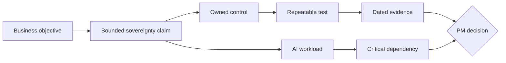

# Module 01 — Who controls the intelligence?

> **Executive thesis:** Sovereign AI is best treated as a **bounded claim about control over an AI workload**, supported by evidence. A company can pursue sovereign AI at enterprise or workload level. Local hosting may help territorial control, but says little by itself about operational power, technological dependency, or legal exposure.

| Course context | Detail |
|---|---|
| Part / week | I — Foundations / Week 1 |
| Reader | AI PM with product delivery experience; technical implementation follows |
| Effort | 2.5 h reading + 2.5 h lab + 2 h PM deliverable + 1 h review |
| Prerequisites | None; familiarity with cloud products helps |
| Output | Claim register, architecture/control diagram, go/no-go memo |
| Environment | Python 3.10+; no GPU, network credentials or cloud budget required |
| Source review | Official sources checked 17 November 2026 |
| Status | Learning material; **not** a certification or legal opinion |

## 1. Executive brief — what decision are you making?

A UAE enterprise wants an employee knowledge assistant. Three implementation proposals arrive:

- **A. Foreign-hosted API:** fast to launch, little operational responsibility, but the enterprise must verify data routing, log handling, provider access and contractual terms.
- **B. Managed AI service in an approved UAE region:** potentially improved territorial control, but region selection does not resolve provider access, model portability, or legal obligations.
- **C. Enterprise-operated small model in its own environment:** greater direct operational visibility, but more capacity, security, maintenance and model-quality responsibility.

**The PM decision is not “Which one is sovereign?”** It is: *What sovereignty objectives apply to this workload, which candidate can meet them, what evidence is available, and what trade-offs are acceptable?*

**Recommendation:** Create a claim register before writing the product requirements document. For each claim capture scope, owner, acceptance criterion, dependency, control, test, evidence and exception. This avoids buying an adjective instead of a capability.

### 1.1 What is sovereign AI? Start with the boundary

**Working definition:** For a defined AI workload, sovereign AI means the organization can demonstrate the decision rights, technical controls and operating arrangements needed to meet its stated sovereignty objectives. Those objectives may concern where processing happens, who can administer it, which dependencies can be replaced, or which contractual and legal exposures require review. The claim is only as strong as its **scope, test and dated evidence**. This is a course-authored decision framework, not a legal definition or certification.

**Worked field case (fictional): A manufacturer's maintenance assistant that cannot send data off-site.** Technicians want an assistant to search machine manuals and summarize incident notes. The enterprise's requirement is narrower and stronger than “host in the UAE”: no restricted source document, prompt, embedding, generated answer, telemetry, diagnostic bundle or backup copy may leave the factory premises.

A vendor proposes a model endpoint in a nearby cloud region. That may be a credible choice for a country-level residency requirement, but it **does not meet this physical-premises requirement**. The product team instead evaluates a small, locally served model, on-premises retrieval index, local audit logging, enterprise-held access controls, and an approved process for importing software and model updates. The team must still test usefulness, latency and the site's compute capacity. A premises-only network may permit approved local connectivity; it is not automatically air-gapped.

| Design question | Observable proof to request | PM release decision |
|---|---|---|
| Do prompts or derived data leave the factory? | Network destination inventory, egress-deny test, packet or proxy evidence across inference and retrieval | Block real factory data until the tests are reviewed |
| Can an external operator read or export restricted material? | Named-admin access review, remote-support path test, privileged session records | Reject unapproved remote support paths |
| What happens during logging, backup, failure and recovery? | Local telemetry and backup configuration, failover drill, restore destination evidence | Treat untested paths as open gaps |
| Can the team maintain the model without bypassing the boundary? | Signed artifact intake, malware scan, license review, rollback rehearsal | Approve an explicit, auditable update process |

**Failure drill and root cause:** During an acceptance test, the backup agent uploads diagnostic logs to an off-site storage endpoint. The requirement is **failed**, even if primary inference was local. The direct cause is an overlooked backup destination; the process gap is that the data-flow inventory excluded support and recovery tooling. The platform owner disables that route, investigates and contains any exported material, updates the inventory, then reruns normal, failover and restore tests. Only the newly observed result can be recorded as evidence; installing a fix alone is not a pass.

**What the PM may say after review:** “In the tested factory-assistant configuration, the reviewed inference, retrieval, logging and recovery paths showed no restricted off-premises data flow on the recorded test date.” Do not replace that bounded finding with “100% sovereign” or infer legal compliance.

**Try the counterfactual:** Change **single premises** to **two approved enterprise campuses** in the [Architecture & Learning Studio](../learning/index.html). Which inter-site connections, support paths and backup destinations would now need evidence? Which single-site assumptions would no longer apply?

### 1.2 From digital sovereignty to data, cloud, and AI sovereignty

**Decision first:** Treat these as *nested but non-equivalent control questions*, not four interchangeable labels. A company may control its documents without controlling the cloud administrators, and may control its cloud tenancy without controlling the model provider, training artifacts or inference telemetry. Record the specific boundary that matters before selecting a vendor.

| Layer | Decision the PM must make | Illustrative control and proof | What it does not establish |
|---|---|---|---|
| **Digital sovereignty** | Which digital capabilities, infrastructure and critical dependencies must remain governable or replaceable? | Documented authority over identity, networks, software supply chain and exit plans; tested provider migration | That all data or AI operations stay in a chosen territory |
| **Data sovereignty** | Who may collect, access, process, retain, transfer and delete each data class? | Data-flow inventory, processing locations, encryption/key custody, access logs and deletion tests | Control over model weights, serving runtime or privileged cloud operators |
| **Cloud sovereignty** | Who operates the infrastructure and control plane, where, and with what administrative privileges? | Region and service configuration, privileged-access audit, backup/support routing, contractual rights, operational exit rehearsal | That a third-party model's telemetry, updates and downstream tools respect the same boundary |
| **AI sovereignty** | Who can govern the *AI workload lifecycle*, including models, prompts, embeddings, evaluation, inference, agents and monitoring? | Model/license inventory, inference and tool-call tracing, update approvals, reproducible evaluations, operator and vendor dependency tests | Universal independence, regulatory approval or certified sovereignty |

These four definitions are a **course-authored teaching taxonomy**. They are not statutory terms or maturity levels. They overlap: the same access-control defect may undermine data, cloud and AI claims simultaneously. For related entities and relations, consult the [course ontology](../taxonomy/ONTOLOGY.md). A useful chain is **BusinessObjective → Workload → DataAsset / Model / InfrastructureDependency → Control → Test → Evidence → Decision**; each link must have an accountable owner.

#### Worked UAE enterprise decision: a policy assistant (fictional)

A UAE-based enterprise wants to search confidential internal policy documents with retrieval-augmented generation (RAG). The product brief says, “Keep our AI sovereign.” The PM instead separates four requirements:

1. **Digital:** The organization must retain identity administration and be able to export its policy corpus and access rules within an agreed recovery window. *Evidence:* identity configuration, export format and a timed restoration rehearsal.
2. **Data:** Policy files, extracted text, embeddings, prompts, logs and backups must follow a documented permitted-location and access policy. *Evidence:* a complete data-flow map plus observed destinations during normal operation and recovery.
3. **Cloud:** Named provider personnel may administer only approved layers under recorded access controls. *Evidence:* privileged-role matrix, support-session records and an operator escalation test.
4. **AI:** The organization must be able to change the model endpoint without losing retrieval authorization or auditability. *Evidence:* model gateway interface, license review, regression evaluation and a measured substitution test.

**Architecture options:** A foreign-hosted API may minimize initial operations but requires close scrutiny of inference routing, retention, tool calls and exit. An approved in-region managed platform may reduce some location concerns but cannot be assumed to restrict provider support or all telemetry. An enterprise-operated model offers more direct runtime control at the price of compute, patching, evaluation and incident-response ownership. The choice depends on the actual requirement and verified service configuration, not on the provider's “sovereign” branding.

**Physical-boundary override:** If the requirement is **nothing restricted may leave one factory premises**, neither a country-resident managed endpoint nor off-site colocation qualifies. Evaluate local inference, local retrieval, local logs, approved on-site administrators and controlled artifact intake; verify backup, diagnostics and failover. If the requirement is **air-gapped**, disallow *all* inbound and outbound networking, including remote support and automated updates. A premises-only design with a local network is **not** automatically air-gapped. In both cases, an underpowered local device is a feasibility blocker, not permission to silently switch to a cloud API.

#### Failure drill: the cloud region was correct, but the AI claim was not

**Scenario assumption:** The managed inference endpoint is configured in the approved region, but an evaluation service exports sampled prompts to an unapproved analytics destination. **Observed symptom in the fictional acceptance test:** outbound evaluation traffic includes restricted prompt content. **Impact:** the data-location acceptance criterion fails despite correct primary endpoint configuration. **Direct cause:** an evaluation connector used a default remote destination. **Contributing process gap:** the architecture inventory covered inference and storage but omitted evaluation and monitoring. **Owner:** platform engineering for containment and routing; security/privacy reviewers for impact and disposition; PM for the launch gate. **Corrective action:** disable the connector, investigate and contain any transmitted data, inventory all derived-data paths, configure a permitted evaluation destination or remove the feature. **Retest:** trace representative synthetic prompts through inference, evaluation, logs, failover and deletion, and independently inspect destination evidence. **Closure:** recorded, reviewed test results and explicit exception disposition. A configuration change without retesting is **not** evidence of success.

#### PM artifact: four-layer sovereignty requirements register

Create one row per **requirement**, rather than a single “sovereign: yes/no” field:

| Field | Example entry |
|---|---|
| Requirement ID / owner | AI-LOC-02 / AI platform lead |
| Layer and workload stage | AI sovereignty / evaluation and monitoring |
| Boundary and acceptance test | No restricted prompt, embedding or evaluation payload leaves the approved processing locations; inspect destination traces under normal, failure and support paths |
| Dependencies | Model service, evaluation connector, observability pipeline, backup target |
| Current evidence / status | Design diagram only / **UNVERIFIED** |
| Decision and next action | **Block restricted-data launch** until reviewed runtime evidence is available |

A dependency can support multiple requirements, but **a cloud region setting must never be copied into an AI-lifecycle evidence field as if it proved every path**. Attach dated evidence, a responsible reviewer and a reopening trigger for service or configuration changes.

**Learner challenge:** In the [Architecture & Learning Studio](../learning/index.html), compare (A) an approved-country policy assistant using a managed platform, (B) a premises-only factory assistant, and (C) a disconnected factory assistant. Identify which changes are **data**, **cloud** and **AI** control changes, which are operational feasibility blockers, and which claims remain provisional even after the design looks plausible. Write one acceptance test that would falsify each architecture's most important claim.

**Facilitator check (not a quiz answer key):** A defensible response names prompt derivatives and non-inference flows, rejects off-premises compute for B and all network links for C, and does not turn vendor assertions into a verified sovereignty pass. For the primary-source distinction between governance and sovereignty, the [NIST AI RMF Core](https://airc.nist.gov/airmf-resources/airmf/5-sec-core/) provides risk-management functions, **not** this four-layer sovereignty taxonomy; see the chapter's source ledger in Section 5. No new regulatory applicability or vendor behavior is asserted here.

### 1.3 Sovereign vs. private vs. secure vs. compliant AI

**Decision first:** Do not approve a system because it is described as *private*, *secure*, *compliant* or *sovereign*. These are four different propositions. A product can satisfy one while failing another. The PM's question is: *Which requirement does each adjective represent, which test could refute it, and who can accept the evidence?*

| Claim | Specific question | Evidence to request | What the claim does not establish |
|---|---|---|---|
| **Private AI** | Is the workload deployed within an organization-selected isolation or tenancy boundary? | Runtime inventory, network routes, identity and privileged-access map, storage location | An on-site model may still upload diagnostic logs off-site |
| **Secure AI** | Are confidentiality, integrity, availability and AI-specific misuse risks controlled against a defined threat model? | Access-control tests, key custody, patching, adversarial evaluations, incident and recovery drills | Encryption alone says nothing about location or provider independence |
| **Compliant AI** | Does the actual organization, use case and processing activity satisfy identified applicable obligations? | Applicability matrix, contractual analysis, required notices/approvals, operational tests and accountable legal/privacy review | Neither a provider badge nor a control framework automatically proves workload-specific legal compliance |
| **Sovereign AI** | Are defined territorial, operational, technological and legal/contractual control objectives enforceable and evidenced? | Claim register, control and dependency graph, egress and operator tests, portability rehearsal | A country-hosted endpoint does not prove data-derivative containment or full autonomy |

This is a **course-authored comparison**, not an official regulatory classification. The properties intersect but are **not a hierarchy**: a private deployment can be insecure; a secure one can break a sovereignty boundary; a sovereignty claim can remain unverified while compliance analysis is still open. A sovereign design does not excuse poor security or applicable legal obligations.

#### Why control categories cannot substitute for each other

**Security** evaluates a specified threat model. **Sovereignty** evaluates whether named decision rights, data flows, administrators and dependencies stay within agreed boundaries. **Privacy** governs permitted information handling, while **compliance** is an assessment against *specific* applicable obligations. The same workload may need all four lines of evidence.

NIST SP 800-207 says there is “no implicit trust granted to assets or user accounts based solely on their physical or network location.” A private network is therefore not a proof of safe access.[^nist-zero-13] NIST SP 800-53 Rev. 5 catalogs security and privacy controls, but it does not certify that an AI deployment is sovereign.[^nist-controls-13] NIST AI RMF 1.0 discusses AI trustworthiness, including being “secure and resilient”; it is a risk-management framework, not a sovereignty attestation.[^nist-airmf-13]

| Fictional architecture | Private? | Security status | Sovereignty status | Compliance status |
|---|---|---|---|---|
| Factory-owned inference server with remote vendor diagnostics | Yes at the serving layer | Other controls **unverified** | **Failed** if derivatives may not leave the factory | Specialist review pending |
| Managed in-country inference service with reviewed encryption | Depends on tenancy design | Narrow controls may be verified | **Unverified** until support, telemetry and failover paths are tested | Specialist review pending |
| Air-gapped local model with untested media-handling and restore procedures | Local, disconnected | Recovery and physical controls **untested** | **Provisional** until offline media, admin and backup controls pass | Specialist review pending |

A vendor name, industry badge or hosting geography is not evidence of any particular legal regime's applicability. Avoid a single “sovereignty score” that hides a failing constraint.

#### Worked decision: a private factory assistant with a forbidden support route

**Scenario (fictional UAE manufacturer):** An operations team pilots a maintenance assistant on its own rack-mounted server. Manuals, embeddings and inference run locally; staff authenticate with enterprise identities. The team demonstrates storage encryption, multifactor admin access and vulnerability scans. Procurement describes the system as “private, secure and sovereign.”

**The actual requirement:** No restricted prompt, document, embedding, answer, telemetry, backup or diagnostic may leave the physical plant. Acceptance testing discovers a crash-reporting agent that sends application traces and supposedly sanitized prompt fragments to a remote vendor service. “Sanitized” is not an automatic exemption: the data owner must approve the transformation and residual risk. This design is **private at the inference layer**, and may have useful security controls, but it **fails the premises-only sovereignty claim**.

**Recommendation:** Stop restricted-data release. Remove or locally redirect the support path, inspect historical destinations, validate physical-site egress, then retest under failure conditions. Do not substitute a cloud-region endpoint simply because it is located in the same country. Compliance assessment remains a separate task for legal and privacy owners.

**Air-gap counterfactual:** If the factory's requirement changes to *no network connectivity at all*, even a restricted outbound allowlist or temporary remote-maintenance tunnel is disallowed. Use controlled offline artifact intake, signature/integrity checks, removable-media custody and rollback rehearsals. If local compute cannot serve the required model, classify the current proposal as **not feasible**, rather than silently relaxing the boundary.

#### Failure drill: the hidden diagnostic egress

| RCA stage | Fictional test evidence and response |
|---|---|
| **Symptom and impact** | Synthetic restricted-label strings appear in outbound HTTPS crash reports. The egress acceptance criterion **FAILS**; this test does not by itself prove a real customer-data breach |
| **Direct cause** | Crash reporter shipped with a vendor-managed upload destination enabled |
| **Contributing process gap** | The security checklist covered login and encryption; the sovereignty inventory excluded exception, support and recovery flows |
| **Containment and owners** | Platform owner disables export and restricts the route; security lead examines historical traffic and handles incident triage; PM blocks launch |
| **Corrective actions** | Replace with a local diagnostic sink or remove the agent; update data-flow and support inventories; add a deny-by-default egress policy |
| **Verification test** | Inject synthetic failures in normal, degraded and restored states; examine DNS, firewall and packet evidence, local logs, backups and support routes |
| **Closure** | Dated, independently reviewed results plus explicit issue/exception disposition. A configuration fix alone is not a passing test |

**Root-cause lesson:** The failure is not merely a bad default. The product team defined its boundary around *primary model inference* rather than the **whole AI lifecycle**. Treat support software and its updates as dependencies, and add an egress regression test to the release gate.

#### PM artifact: four-claim release card

Create four records, each with owner, claim boundary, acceptance test, evidence date, reviewer and disposition. This illustrative card shows why one passing claim must not overwrite another:

| ID / owner | Falsifiable requirement | Status in this fictional case |
|---|---|---|
| PRI-01 / infrastructure lead | Only approved plant roles and processes can read model and vector stores | **TEST REQUIRED** |
| SEC-01 / security lead | Named threat-model tests, access/key controls, recovery and adversarial cases pass | **PARTIAL**, with work outstanding |
| SOV-01 / platform lead | No restricted data or derivative leaves the site during inference, logging, support, backups or failure | **FAILED**, evidenced by synthetic egress test |
| CMP-01 / legal and privacy | Applicable obligations and contract restrictions are mapped, reviewed and evidenced | **LEGAL REVIEW PENDING** |

**Release decision:** Block the intended restricted-data use until SOV-01 has an accepted retest. Do not mark SEC-01 as fully passed merely because encryption and MFA were demonstrated. Do not represent CMP-01 as “compliant” before the relevant expert review.

**Learner practice (20 minutes):** Open the [Architecture & Learning Studio](../learning/index.html). Choose the **Strict on-premises IP research assistant** preset with single-premises processing, on-site operator and local compute. Change only the network connectivity from local-only to general internet; predict whether the engine should block the proposal and explain why encryption cannot undo a forbidden route. Next try the **Air-gapped factory operations** preset and propose an offline update, integrity-check and rollback acceptance test. In your decision memo, state one observable result that would *falsify* each claim.

**Exit question:** Procurement offers “a private model, ISO-aligned security controls and in-country hosting.” Which of the four claims can be approved from that sentence alone? **None.** These are design assertions. Ask for a scoped architecture, claim owners, independent test evidence and a workload-specific legal review.

[^nist-zero-13]: NIST, *Zero Trust Architecture*, SP 800-207, abstract and Section 2.1 (2020), [official publication](https://csrc.nist.gov/pubs/sp/800/207/final). Source checked 19 November 2026. The quoted principle concerns security architecture, not sovereign-AI certification.
[^nist-controls-13]: NIST, *Security and Privacy Controls for Information Systems and Organizations*, SP 800-53 Rev. 5 (2020), [official control catalog](https://csrc.nist.gov/pubs/sp/800/53/r5/final). Source checked 19 November 2026.
[^nist-airmf-13]: NIST, *Artificial Intelligence Risk Management Framework (AI RMF 1.0)*, NIST AI 100-1, Section 3, trustworthy AI characteristics (2023), [official NIST text](https://airc.nist.gov/airmf-resources/airmf/3-sec-characteristics/). Source checked 19 November 2026.

### 1.4 National sovereignty versus enterprise-level sovereign AI

**Decision first:** A national AI sovereignty strategy and an enterprise sovereign-AI workload answer different questions. National programs concern capability, institutions and strategic dependencies across a jurisdiction. Enterprise claims concern **who can control a specified workload** and whether that authority can be demonstrated. A domestic data center is not proof of a particular company's operational sovereignty. Conversely, a company can establish bounded sovereign-AI controls without manufacturing its own chips or owning a national cloud.

The [course-authored ontology](../taxonomy/ONTOLOGY.md) separates **scope** (national, sectoral, enterprise, workload) from **control dimensions** (territorial, operational, technological, legal/contractual). These are analytical categories, **not** a government certification or a statement of UAE legal obligations.

| Scope | Accountable decision-makers | Unit of analysis | Appropriate evidence |
|---|---|---|---|
| **National** | Relevant state institutions, within their mandates | National capability, infrastructure, institutions, strategic dependencies | Dated program outcomes, supplier dependencies, operational resilience and independent verification |
| **Sectoral** | Sector participants and competent authorities, as applicable | Shared sector systems and governance | Applicable obligations, contracts, controls and system-level assurance |
| **Enterprise** | Board, executives, security, data and platform owners | Organization-wide AI estate and supplier relationships | Decision-rights matrix, vendor contracts, key custody, operator access and tested exit |
| **Workload** | Delegated business and control owners | One AI workflow across its lifecycle | Prompt/embedding/log destinations, access tests, backups, support paths and evidence of failure handling |

**Not a hierarchy of quality:** A country may offer domestic AI infrastructure while a particular customer still permits remote vendor support. An enterprise may use third-party infrastructure while retaining enforceable contractual and technical rights for its defined requirements. A company can apply a flexible policy to public marketing copy and a strict physical-site policy to confidential industrial documents.

#### National capability is not the same as enterprise decision rights

National capability questions include who can access compute, develop and maintain models, sustain energy and network supply, train specialists, and manage dependencies during disruptions. They concern strategic resilience at a scale beyond any one deployment. A government announcement is evidence of **intent**, not proof of achieved capacity or customer-specific controls.

Enterprise decision rights ask who can approve a processing destination, revoke a privileged operator, hold keys, inspect telemetry, stop a service, export model and data artifacts, and recover during supplier failure. The party paying a provider is not necessarily the party with technical power to execute these actions.

| Decision | National-scale question | Enterprise acceptance evidence |
|---|---|---|
| Compute | What capacity is available to priority institutions? | Reserved quota, workload benchmark, failover drill |
| Operator | Who may govern or operate strategic services? | Named administrators, support access and revocation test |
| Location | What processing and infrastructure geography is sought? | Stage-by-stage egress trace, backup and evaluation destinations |
| Models | What domestic model capabilities and dependencies exist? | License, weight custody, substitution and serving test |
| Continuity | Can critical capabilities survive disruption? | Restore rehearsal, exit clauses, portable artifacts and migration timing |

A national or provider label cannot replace any row's enterprise evidence. Actual regulatory applicability must be assessed for the specific entity, sector, data and processing activity by the responsible legal/privacy specialists; this table does not purport to interpret a particular UAE law.

#### Worked UAE decision: two assistants, two different boundaries

**Fictional scenario:** A UAE manufacturer has a public-product translation assistant and a restricted factory-maintenance assistant. A domestically hosted managed AI service is available. The first workload may use approved managed compute after security, contract and cost review. The second has a non-negotiable rule: **no restricted documents, prompts, embeddings, answers, logs, telemetry, backups or diagnostic artifacts may leave one named plant premises**.

The PM compares three options:

1. **Managed in-country inference for both:** A plausible option for public content, but **reject for the factory**. Domestic geography does not make a remote data center part of the plant.
2. **Managed service for public content, enterprise-run on-site model and retrieval for factory:** **Conditionally preferred** if local compute, quality, maintenance, privileged access, backup, telemetry and egress tests pass. This carries higher equipment and operating responsibilities.
3. **Enterprise-owned regional data center for both:** May provide greater operational authority, but **reject for the factory** if the regional center is not on the named premises. Ownership does not erase the location requirement.

**Cost and reliability trade-off:** The on-site candidate needs a measured model-quality benchmark, concurrency and latency targets, power and cooling assessment, maintenance staffing, update and recovery plan. Do not invent a five-year TCO or claim a capacity level without measurements. If the hardware cannot serve the required workload, report **NOT FEASIBLE UNDER CURRENT CONSTRAINTS**, rather than silently switching to cloud inference.

**Air-gap override:** If the factory instead requires a physically disconnected network, even an approved outbound allowlist, temporary support tunnel or remote-monitoring channel is prohibited. Model updates require approved offline artifact intake, signature/integrity verification, removable-media custody and rollback rehearsal. A local network with egress filtering is not an air gap.

#### Ontology: map national context to workload evidence

The following relationships extend the course's [ontology](../taxonomy/ONTOLOGY.md): **NationalObjective influences SupplierEcosystem; EnterpriseGovernance authorizes Workload; Workload dependsOn Supplier; Requirement appliesTo Workload; Test verifies Requirement.** They are course-authored, not normative ontology terms.

The inference chain is: *national capability → available suppliers → enterprise workload*. A **separate** chain is required for assurance: *enterprise requirement → control owner → implementation → test → dated evidence*. An infrastructure announcement cannot jump from the first chain to the final node of the second. **Invariant:** Evidence is valid only for the named workload, version, lifecycle stages, test conditions and review date.

#### Failure drill: “domestic cloud” was mistaken for “factory sovereign”

**Symptom (fictional design review):** Procurement labels the factory assistant sovereign because the model endpoint is in the same country. The system diagram reveals prompts leave the plant for remote inference, and a provider support path can access diagnostic metadata.

**Impact:** The premises-only acceptance criterion **FAILS** before restricted-data launch. The **direct cause** is an off-premises inference destination. The **contributing process gap** is an approval checklist that tested national location but not the enterprise's physical boundary, derived data or support flows.

**Containment and ownership:** The PM blocks restricted-data onboarding; platform engineering disables the remote path and assesses an on-site alternative; security examines egress, privileged access and incident handling; legal/privacy separately determine applicable obligations. **Correction:** Replace the route with feasible on-site serving, update the full data-flow inventory and contracts, or explicitly record an unsatisfied requirement.

**Retest and closure:** Send synthetic restricted-label strings through normal inference, retrieval, evaluation, diagnostics, simulated failure and restore. Inspect DNS, firewall and packet traces, operator sessions and local backup destinations. Close only with dated artifacts, reviewed results and named sign-off. Changing a presentation slide or cloud region is not remediation.

#### PM artifact: scope-to-authority decision memo

| Decision field | Fictional factory-assistant entry |
|---|---|
| Scope and claim owner | Workload / factory operations executive; enterprise platform lead owns technical proof |
| National context | Domestic managed compute available, but not accepted as a site-level substitute |
| Hard boundary | No restricted content or derivative leaves plant premises; air gap only if separately required |
| Decision rights | Data owner classifies; security validates controls; operations accepts service levels; PM owns release gate |
| Options | Domestic managed endpoint: **REJECT**; regional enterprise data center: **REJECT**; on-site serving: **CONDITIONAL** |
| Evidence | Egress test, operator review, restore drill, model-quality benchmark, dated reviewer sign-off |
| Economics | Compare equipment, power, staff, maintenance and resilience with managed-service costs; record unknowns |
| Release disposition | **NO RESTRICTED-DATA RELEASE** until hard constraints pass |

**Learner challenge (25 minutes):** Open the [Architecture & Learning Studio](../learning/index.html). First set location to **Selected country only** with **Approved managed AI platform** compute for a synthetic-data assistant. Then set location to **Single premises only; no data or derivatives may leave**, leaving managed compute unchanged. Explain why country-level infrastructure cannot meet the second boundary. Next use **On-prem production GPU servers inside the premises** with **Local network only; no external egress**. List three pieces of evidence still required for operator, backup and support control. Finally compare **Single premises, physically air-gapped (no network)** with **Air-gapped: no inbound or outbound network**. Draft a memo that names each decision authority and one falsifiable test per claim. The Studio is a teaching aid, not a certification.

**Exit check:** Can an enterprise achieve a bounded sovereign-AI posture without owning national infrastructure? **Yes, if** it can demonstrate the decision rights and controls needed for its scoped objectives. Does national infrastructure automatically make an enterprise workload sovereign? **No.** The next section (1.5) examines control without owning every stack component.

**Source discipline, 19 November 2026:** The scope categories and control dimensions are from the course-authored [ontology](../taxonomy/ONTOLOGY.md). For primary-source background on governance and security evaluation, consult NIST [AI RMF 1.0 Core](https://airc.nist.gov/airmf-resources/airmf/5-sec-core/) (2023) and [SP 800-207 Zero Trust Architecture](https://csrc.nist.gov/pubs/sp/800/207/final) (2020). Neither establishes this taxonomy or certifies sovereign AI. This section makes no claim that a particular national program has achieved a stated capacity or that a particular UAE law mandates this architecture.

### 1.5 Can a company build or operate sovereign AI without owning everything?

**Decision first: Yes, within a defined workload boundary.** Ownership of every chip, model, library, building or network is neither necessary for every enterprise sovereignty objective nor sufficient to prove one. The enterprise must instead identify the decisions it cannot delegate, the dependencies it can accept, and the evidence that external parties cannot bypass its boundaries. If the required control cannot be secured through operating procedures, architecture and enforceable arrangements, the design is **not qualified**, regardless of the vendor's marketing label.

**Five questions before buying or building:** Who owns the physical asset? Who can operate and reconfigure it? Who can see or export restricted content and derivatives? Who can replace a failed component or supplier? Who has the contractual and technical right to stop or audit the service? Different parties may answer each question. An enterprise that leases a server but controls local access may have stronger site control than one that owns the software but sends all requests to a remote endpoint.

#### Ownership, control and evidence are separate columns

| Dependency | Ownership need not be enterprise-held | Critical control or decision right | Proof and failure condition |
|---|---|---|---|
| **Facilities, power and compute** | Building ownership and chip fabrication | Approved processing geography, physical access, boot/firmware authority, capacity and replacement plan | Visit/access record, asset map, configuration inspection, capacity test; **fail** if the only recovery compute is outside a mandatory premises boundary |
| **Model weights and licenses** | Original model training or intellectual property | Right to run the chosen model in the required environment, retain authorized copies, update and replace it | License and redistribution/usage review, artifact digest, offline install and a substitution rehearsal; **fail** if a license or service restriction prevents the required use |
| **Serving, retrieval and orchestration** | Every open-source package or serving runtime | Network egress policy, API interfaces, prompt and embedding custody, key and identity authority | Data-flow inventory, denied-egress tests, role review and integration test; **fail** if an unapproved connector sends content elsewhere |
| **Operations and support** | Every worker need not be an employee | Named administrators, approved location and mode of access, escalation, monitoring and termination rights | Identity access records, supervised support drill, credential revocation test; **fail** if a vendor can independently establish an unapproved remote session |
| **Backups, observability and exit** | Every storage device or monitoring tool | Destinations, retention and deletion, log access, disaster recovery, restore and export | Traced destinations, restore rehearsal, sample export and deletion evidence; **fail** if required recovery creates forbidden off-site copies |

*Ontology link:* Under the course-authored [sovereignty ontology](../taxonomy/ONTOLOGY.md), **Workload dependsOn Supplier**, **Supplier operates Component**, **Enterprise owns Control**, and **Test produces Evidence for Claim**. These are learning-model relationships, not terms established by a regulator. Ownership of a component does not automatically imply ownership of the relevant control.

The risk-management approach is consistent with **NIST AI RMF 1.0, Govern 6.2**, which calls for “Contingency processes ... to handle failures or incidents” in high-risk third-party AI systems.[^nist-airmf-thirdparty-15] NIST **SP 800-161 Rev. 1**, as updated 1 November 2024, addresses “identifying, assessing, and mitigating cybersecurity risks throughout the supply chain.”[^nist-scrm-15] Neither source creates a sovereign-AI certification, endorses this course's taxonomy, or means every enterprise must own its infrastructure.

#### Architecture choices when an enterprise depends on suppliers

| Deployment option | Legitimate reason to choose it | What must be evidenced | Hard limitation |
|---|---|---|---|
| **Enterprise-operated on-site compute; externally sourced hardware/model** | A single facility requires strict site-level control and can operate local inference | Asset and firmware custody, model license, onsite administrators, denied external egress, local backup/restore and offline patch workflow | May be infeasible if local compute, staff, power or disaster recovery cannot meet measured workload demand |
| **Vendor-owned or leased equipment installed in the enterprise's premises** | The enterprise wants a managed asset lifecycle without transferring restricted processing off-site | Contractual access boundaries, physical/key custody, remote management disabled or constrained, service-media handling, on-site maintenance and exit rights | Ownership by the vendor is acceptable **only if** delegated operations do not violate the stated control requirement |
| **Managed in-country platform with contractual and runtime controls** | The workload permits named off-premises processing locations and accepts a managed operating model | Exact service/deployment type, prompts/logs/backup destinations, provider support, subcontractors, key custody, failover, portability and applicable legal review | **Cannot satisfy** a non-negotiable single-physical-premises rule when inference or derivatives leave that premises |

**Not all external dependencies are equal.** A spare GPU delivered into the site creates different risks from a support platform that can read prompts or initiate exports. Prioritize by the potential to break a hard requirement, the supplier's decision rights, the blast radius if it fails, and the measured feasibility of an alternative. Supplier nationality or branding alone is not a technical acceptance test.

#### Worked case: the plant owns the controls, not the entire supply chain

**Fictional case: a UAE industrial parts manufacturer.** A maintenance assistant retrieves restricted engineering procedures. The contract for the workload says that documents, prompts, embeddings, outputs, logs and diagnostic bundles must remain inside **one named factory premises**. The manufacturer can procure a server and a licensed, deployable open-weight model, but has neither the budget nor the ability to fabricate chips or train a general-purpose foundation model. Those missing ownership claims do not by themselves disqualify the design.

**Option A, remote managed inference:** Reject for restricted use because requests leave the named premises, even if the provider processes them inside the same country. **Option B, leased on-site server plus an approved local-serving model:** Conditionally viable if capacity, model use rights, vendor access, network policies and every derivative path pass review. **Option C, enterprise-owned on-site server with unsupervised remote support:** Not automatically better than B; the remote support control may still fail.

For Option B, the PM requests a bill of dependencies: physical server and firmware, model and tokenizer artifacts, retrieval index, runtime packages, admin identities, key storage, telemetry agents, backup destinations, maintenance tools and exit procedures. The supplier may replace faulty hardware during an approved **on-site** service visit, while the enterprise retains authority over disks, encryption keys and data-bearing media. If the contract requires the vendor to take restricted drives off-site, that conflicts with the boundary and must be redesigned or the option rejected.

**Air-gap variation:** If an additional rule requires **no inbound or outbound network connectivity**, disable even allowlisted outbound updates and private links. Supply a documented offline software and model intake process with integrity verification, malware assessment, removable-media custody, local logs and tested rollback. On-site compute capacity remains mandatory. A firewall permitting a support tunnel does not constitute an air gap.

**Cost and capacity decision:** Compare acquisition or lease cost, facility power, cooling, staffing, replacement inventory, model throughput, latency and realistic recovery procedures with a managed option. Do not invent production throughput or total cost of ownership. Benchmark representative synthetic workloads on the selected local hardware. If the model cannot meet the measured quality and service requirement locally, record **NOT FEASIBLE UNDER CURRENT CONSTRAINTS**; do not silently move restricted processing to a cloud API.

#### Failure drill: the supplier's recovery path crosses the boundary

**Synthetic test:** The leased on-site server fails during a controlled maintenance exercise. The supplier's default recovery script launches a remote support tunnel and packages a diagnostic archive containing prompt fragments. The network firewall blocks the upload, but the exercise reveals that the proposed maintenance procedure requests an unauthorized external path.

| RCA element | Owner and disposition |
|---|---|
| **Observed impact** | Premises-only support-control acceptance test **FAILS**; investigate whether any data left. A blocked synthetic test is not evidence of a real data breach |
| **Direct technical cause** | Supplier's recovery script assumes a remote diagnostics endpoint |
| **Contributing root cause** | Procurement and architecture reviews described equipment location, but omitted vendor break-glass access, service scripts and log bundles from the dependency register |
| **Immediate containment** | Platform owner keeps remote tunnel denied and quarantines support artifacts; security lead checks firewall/endpoint traces and historical access |
| **Corrective design** | Vendor and enterprise operations agree an offline, on-site recovery runbook, sanitized local diagnostic bundle, supervised administrator session and explicit data-media handling |
| **Retest and closure** | Reproduce server failure, repair and rollback using synthetic prompts. Collect network traces, role audit, checksum and on-site restore evidence. Close only on a dated independently reviewed test and supplier contract/runbook acceptance |

**RCA lesson:** Purchasing or leasing a physical asset is not the same as controlling **its support lifecycle**. The fault is not fixed merely by declaring the supplier “trusted” or by leaving the blocking firewall rule in place without testing the revised runbook.

#### PM artifact: delegated-control and exit decision record

Create one record per external dependency, then attach the four sovereignty dimensions and the release gate.

| Field | Example for the fictional plant |
|---|---|
| **Requirement / owner** | SITE-15 / platform owner: no restricted derivative or supplier-session export may leave the factory |
| **Supplier dependency** | Leased GPU server, firmware update utility, on-site support contractor and licensed model artifact |
| **Who can decide what** | Enterprise: data keys, workload policy, access grants, outbound routes, recovery approval; supplier: hardware repair **only under approved on-site controls** |
| **Verification / evidence** | Contract and access matrix, asset inventory, offline-update receipt, failure/recovery egress trace, model license review, timed model-replacement drill |
| **Exit path / trigger** | Revoke supplier credentials, recover and verify media, export authorized model/data artifacts, substitute compatible runtime; trigger on support-policy change, outage or contract exit |
| **Launch decision** | **CONDITIONAL**, blocked until premises egress, supplier recovery, capacity and rights tests are accepted |

**Rehearse, do not merely promise, exit:** Set an agreed recovery objective, disconnect a fictional supplier dependency, and demonstrate that the team can restore the service or document the exact limitation. Log measured migration effort, artifacts needed, license restrictions, safety/quality regressions and residual dependencies. An untested contractual promise of portability is not demonstrated independence.

**Learner challenge (30 minutes):** Open the [Architecture & Learning Studio](../learning/index.html) and choose **Strict on-premises IP research assistant**. Compare enterprise-operated local compute with the same workload on **Approved managed AI platform** while holding **Single premises only; no data or derivatives may leave** constant. Identify which option is blocked and which supplier-owned components might still be acceptable onsite. Next choose **Air-gapped factory operations** and outline a fully offline vendor-support and model-update process. For each scenario submit a three-line claim register: (1) non-negotiable boundary, (2) externally sourced dependency and delegated rights, and (3) evidence and failure gate.

**Exit question:** Can an enterprise make a defensible sovereign-AI claim using rented servers, supplier-sourced chips and licensed model weights? **Potentially yes**, for a specifically bounded workload, if the crucial controls and tests demonstrate that outside suppliers cannot violate its requirements. Can it claim unrestricted sovereignty simply because the equipment sits inside its premises? **No.** The conclusion is a **conditional, evidence-limited architecture decision**, not legal compliance or certification.

[^nist-airmf-thirdparty-15]: NIST, *Artificial Intelligence Risk Management Framework (AI RMF 1.0)*, NIST AI 100-1 (2023), **AI RMF Core, Govern 6.1–6.2, Map 4.1–4.2 and Manage 3.1–3.2**; [official Core text](https://airc.nist.gov/airmf-resources/airmf/5-sec-core/). The short quotation above is a fragment of Govern 6.2, verified 19 November 2026.
[^nist-scrm-15]: NIST, *Cybersecurity Supply Chain Risk Management Practices for Systems and Organizations*, **SP 800-161 Rev. 1**, May 2022, updated 1 November 2024; [official updated final publication](https://csrc.nist.gov/pubs/sp/800/161/r1/upd1/final), abstract. Quotation verified 19 November 2026. This is general supply-chain cybersecurity guidance, not an AI-sovereignty standard.

### 1.6 Sovereignty, control, independence, self-sufficiency, and jurisdiction

**Decision first:** A system can keep its data inside a factory while depending on an external service to start, update or recover. It can also be technically isolated without resolving applicable laws or contractual access rights. Evaluate **sovereignty, control, independence, self-sufficiency and jurisdiction separately**. Each term answers a different procurement and architecture question.

The distinction changes what you test. “All data is local” is a processing-location claim. “We can run without the model vendor for 72 hours” is a continuity claim. “No external operator can read the logs” is an access-control claim. “We satisfy applicable legislation” is a legal conclusion that requires an assessment of the actual organization and processing activities. A successful test for one cannot stand in for the others.

#### Five distinct concepts, five different acceptance tests

| Concept | What it means for a defined AI workload | Evidence that could support it | False inference to reject |
|---|---|---|---|
| **Sovereignty** | Ability to meet declared territorial, operational, technological and legal/contractual control objectives for the named workload | Scoped claim register, effective controls, dated test evidence and accountable approval | An in-country server proves everything is sovereign |
| **Control** | Ability to authorize, monitor, restrict, revoke, configure or recover specific actions *now* | Key-custody review, denied-egress test, admin revocation, support-session records | Owning hardware proves the enterprise controls supplier diagnostics |
| **Independence** | Ability to keep operating or substitute a dependency when a supplier fails, withdraws access or changes terms | Offline cold start, timed failover, model/runtime replacement, restore and measured exit drill | A signed exit clause proves migration is workable |
| **Self-sufficiency** | Ability to provision and sustain the required capabilities internally for an explicit duration | Compute and energy budget, staff and spares inventory, signed artifacts, recovery rehearsal | An enterprise must fabricate every chip and train every model to make a bounded sovereignty claim |
| **Jurisdiction** | Potentially relevant legal authority, contractual obligations, dispute forums, disclosure and processing questions | Entity/processor map, processing activity inventory, contracts, governing law, transfer and support-path analysis for counsel | Physical location by itself determines which laws apply |

**These are course-authored distinctions, not official legal definitions or a certification model.** Control is about immediate power. Independence is about functioning when that power is tested by an outage or withdrawal. Self-sufficiency is a resource and capability strategy, and absolute self-sufficiency is usually not a practical enterprise design objective. Jurisdiction raises a separate set of legal and contractual questions.

The [course ontology](../taxonomy/ONTOLOGY.md) makes the distinction concrete: **Workload dependsOn Supplier; Supplier operates Component; Enterprise owns Control; Test evaluates Requirement; Evidence supports Decision**. The relationships are educational modeling choices. A design document cannot skip from the name of a supplier to a verified claim.

#### Why geography and authority cannot be merged

NIST SP 800-207 warns against implicit trust “based solely on their physical or network location.”[^nist-zero-16] Even on-site infrastructure needs identity and authorization controls. NIST AI RMF 1.0 **Govern 2.3** places decisions about deployment risks with executive leadership, and **Govern 6.2** addresses contingency processes for failures involving high-risk third-party AI systems.[^nist-rmf-16] Both are risk/security guidance, not certification of AI sovereignty.

For **potentially applicable EU personal-data processing**, the European Commission describes safeguards “to ensure that the protection travels with the data” for international transfers.[^ec-transfer-16] The European Data Protection Board's **Guidelines 3/2018** address GDPR territorial scope under Article 3.[^edpb-16] Their existence demonstrates why legal scope, international transfers and physical storage must be examined as separate issues. Neither source establishes that GDPR applies to the fictional UAE plant below, or that local storage alone satisfies any EU, UAE or other legal requirement.

A **jurisdiction review request** should record the contracting entity and governing terms; jurisdictions in which people, controllers, processors or service operators act; processing locations, access paths and transfers; the relevant data types; and any request for disclosure. Counsel should determine applicability and required responses. Vendor nationality, a jurisdiction dropdown, or cloud-region selection cannot substitute for that analysis.

#### Worked enterprise scenario: local data, external runtime dependence

**Fictional UAE industrial group:** The group proposes *Factory-Site*, an assistant for restricted plant manuals, and *Corporate-Policy*, an assistant for synthetic staff policies. Factory-Site requires **one physical premises only**. All source text, prompts, embeddings, generated answers, diagnostic archives, telemetry and backups must remain at that site. Corporate-Policy may use approved named locations, subject to its own controls and legal review.

Factory-Site's PM adds an illustrative, fictional requirement: the on-site service must cold-start and process its synthetic acceptance set for **72 hours after all supplier connections are disconnected**. The chosen licensed runtime is assumed to need periodic online entitlement renewal. This is a scenario assumption, **not a claim about a real product**. The group may own every GPU while still failing the independence requirement.

| Architecture candidate | Factory-Site decision | Corporate-Policy decision | Evidence or limitation |
|---|---|---|---|
| Local server and model, with an approved offline licence | **CONDITIONAL**, pending testing | Viable but operationally heavier | Licence rights, local cold start, 72-hour capacity/quality test, no-egress evidence and offline restore |
| Enterprise data center in another city | **REJECT** for single-premises data | Possible if explicitly approved | Geographic authorization, key and operator review, observed support/backup routes |
| In-country managed model API | **REJECT**: requests leave the factory | **CONDITIONAL** if approved processing and support boundaries are proven | Exact service deployment configuration, runtime traces, logs, failover, contracts and exit terms |
| Disconnected air-gapped enclave | Appropriate **only when disconnection is actually required** | Extra burden for a flexible synthetic pilot | No inbound/outbound network, controlled removable media, offline updates and local recovery |

For an **air-gapped** requirement, **no inbound or outbound network path** is allowed, including remote support tunnels, licence servers and “temporary” cloud failover. Offline artifact intake needs signature/hash checks, malware review, removable-media custody, rollback images and local logs. Strict **premises-only** processing does not automatically require an air gap: an approved local network can remain in use, while data and derivatives must not leave the physical site.

If the local model is too slow, too inaccurate or cannot restart without an external licence service, report **NOT FEASIBLE UNDER CURRENT CONSTRAINTS**. Do not silently switch Factory-Site to a managed endpoint, reclassify it as a country-only requirement, or relabel the failing test as an acceptable exception.

#### Failure drill: a disconnected restart exposes a hidden dependency

**Fictional test:** Factory-Site passes its sampled synthetic no-egress checks. The team then disables all supplier links, simulates an expired licence token and attempts a cold restart. The serving service refuses to start because it requires online entitlement renewal. **No data egress is observed in this particular test.** The operational-independence claim fails even though the location claim did not fail in the same way.

| RCA element | Finding and corrective action |
|---|---|
| **Symptom and impact** | Cold restart fails during the synthetic offline exercise; the specified 72-hour continuity requirement is **FAILED** |
| **Direct cause** | Expired online licence token is a startup dependency |
| **Contributing process gap** | Procurement reviewed rights to deploy but omitted activation/expiry behavior, vendor withdrawal and offline disaster recovery from the dependency inventory |
| **Containment** | Platform owner blocks restricted-data release, keeps the environment isolated, preserves logs and tests a known-good rollback path |
| **Corrective solution** | Obtain and verify a permitted offline entitlement, substitute an appropriately licensed local model/runtime, or retain an explicit infeasibility decision |
| **Retest and closure** | Repeat cold boots after simulated expiry, keep all supplier links disabled, measure the 72-hour synthetic run, test local restore, record licence and version evidence, and obtain review sign-off |

**Root cause:** Supplier dependence was assessed as a procurement-contract issue rather than as an executable startup dependency. The release review mapped physical data flows but did not test **whether the service could operate during supplier unavailability**. A passing firewall rule does not close this failure. Likewise, a passing independence drill does not settle jurisdictional questions.

#### PM artifact: five-claim decision and assurance record

Record five independent questions with owners and evidence states, rather than an aggregate “sovereign score”:

| Claim / accountable owner | Acceptance criterion | Current fictional status |
|---|---|---|
| **SOV-16 / PM and data owner** | All restricted data and derivatives remain at the factory in normal, support, backup and failure paths | **UNVERIFIED** for the full lifecycle; a narrow synthetic egress test passed |
| **CTL-16 / security lead** | Enterprise can revoke vendor access, deny unapproved routes, administer keys and inspect privileged operations | **TEST REQUIRED** |
| **IND-16 / platform and SRE lead** | Restart and continue the defined workload for 72 hours without supplier connectivity | **FAILED**, demonstrated by the licence-expiry drill |
| **SELF-16 / operations and procurement** | Local skills, spares, compute, offline artifacts and recovery process cover the accepted scenario | **GAP OPEN** |
| **JUR-16 / legal and privacy owner** | Entity, processing, transfer, contract and lawful-access questions have documented, specialist-reviewed dispositions | **LEGAL REVIEW PENDING** |

**Release rule:** Any failed hard constraint blocks the intended restricted-data rollout. Do not copy an independent-sounding vendor assertion into a passed evidence field. Record the evidence date, exact software/contract version, reviewer and the event that would reopen the claim.

**Learner challenge (25 minutes):** In the [Architecture & Learning Studio](../learning/index.html), load **Strict on-premises IP research assistant**. Keep **Single premises only; no data or derivatives may leave** and **Local network only; no external egress** fixed. Change the portability dropdown from **Model artifacts, serving and data must be enterprise-portable** to **Low priority for current pilot**. Explain why changing a portability preference does *not* relax the physical location requirement. Add an offline cold-start test that the Studio cannot execute for you.

Next select **Air-gapped factory operations** and change connectivity to **General internet access including external service endpoints**. Predict the hard-block result and state which requirement was violated. Finally change the **jurisdiction** choice to **European Union**. List what a legal reviewer must establish before drawing any conclusion; do not treat the selector as a legal opinion.

**Submission:** A five-row claim record, one failure drill with observation/cause/correction/retest, and a one-paragraph release decision. The advanced learner explains both why a physically local model can still lack independence and why a technically strong architecture may have unresolved legal questions.

**Exit check:** Can an enterprise exercise bounded sovereignty without complete self-sufficiency? **Yes, if** its specific controls and dependencies withstand the required tests. Does owning the physical machine guarantee operational independence? **No.** Does a geographic location decide legal applicability? **No.** Each proposition requires its own evidence.

[^nist-zero-16]: NIST, *Zero Trust Architecture*, **SP 800-207**, abstract (August 2020), [official NIST page](https://csrc.nist.gov/pubs/sp/800/207/final). Short quotation verified **19 November 2026**. Security trust guidance; not a sovereign-AI certification.
[^nist-rmf-16]: NIST, *AI Risk Management Framework (AI RMF 1.0)*, **NIST AI 100-1** (2023), [AI RMF Core, Govern 2.3 and Govern 6.2](https://airc.nist.gov/airmf-resources/airmf/5-sec-core/). Official text reviewed **19 November 2026**. Voluntary risk-management guidance.
[^ec-transfer-16]: European Commission, [*Rules on international data transfers*](https://commission.europa.eu/law/law-topic/data-protection/international-dimension-data-protection/rules-international-data-transfers_en), section “International transfers of personal data,” paragraph 2. Short quotation verified **19 November 2026**.
[^edpb-16]: European Data Protection Board, [*Guidelines 3/2018 on the territorial scope of the GDPR (Article 3)*](https://www.edpb.europa.eu/our-work-tools/our-documents/guidelines/guidelines-32018-territorial-scope-gdpr-article-3-version_en), adopted version (2019). Official listing found **19 November 2026**. Legal applicability in any actual case remains for counsel.

## 2. Learning objectives

After this chapter, you should be able to:

1. Explain sovereign AI without conflating it with privacy, security, compliance or national ownership.
2. Distinguish national, sectoral, enterprise and workload scopes.
3. Classify an AI system along territorial, operational, technological and legal/contractual dimensions.
4. Identify deployment and lifecycle boundaries that make sovereignty claims incomplete.
5. Write a falsifiable sovereignty claim and define a repeatable validation test.
6. Make a defensible PM decision under uncertainty without presenting unverified claims as facts.

## 3. Taxonomy first: what are we classifying?

> **Taxonomy spotlight.** A system is not simply “sovereign” or “not sovereign.” The label omits *who requires control, of what, for which purpose, and how we know*.

### 3.1 Four independent classification axes

| Axis | Choices | Why PMs need it |
|---|---|---|
| **Scope** | National; sectoral; enterprise; workload | Sets whose objectives count |
| **Control dimension** | Territorial; operational; technological; legal/contractual | Prevents one strong control being mistaken for complete sovereignty |
| **Deployment** | Public; managed sovereign; private; hybrid; air-gapped; edge | Exposes infrastructure and operating-model assumptions |
| **Lifecycle** | Data collection; training; adaptation; evaluation; inference; monitoring; retirement | Prevents an inference-only claim covering the entire lifecycle |

**Classification example:** “Enterprise scope / territorial + operational dimensions / managed sovereign cloud / inference and monitoring stages.” This is already more useful in a PRD than “sovereign AI platform.”

### 3.2 Can a company have sovereign AI?

**Yes**, in an operationally meaningful, context-dependent sense. An enterprise can control selected AI workloads and dependencies through architecture, ownership, access policies, contracts and testing. It may still rely on external chips, open-weight models, software vendors and support providers. *Autonomy* means the organization can make and enforce relevant decisions—not that it manufactures every component.

A **bank-specific AI assistant**, for example, can have stricter access, location and exit requirements than an internal marketing draft assistant. Both can sit within the same enterprise platform with differentiated policies.

### 3.3 Sovereign AI ≠ four adjacent ideas

| Neighboring concept | What it answers | What it does not prove |
|---|---|---|
| Data residency | Where identified data is stored or processed | Who can access it, or whether other derivatives move elsewhere |
| Privacy | How personal data is handled and rights are respected | Model portability or hardware independence |
| Security | How systems protect confidentiality, integrity and availability | Sufficient legal authority or business exit options |
| Compliance | Whether applicable obligations are met | All desired degrees of strategic autonomy |

An enterprise may be secure and compliant yet dependent on a sole external model provider. It may operate a private model yet still have weak key custody. Avoid treating these properties as synonyms.

## 4. The ontology: how does a claim become credible?

An ontology maps entities and relations rather than only naming categories. The course uses the chain **BusinessObjective → SovereigntyClaim → Workload → Dependency / Control → Test → Evidence → Decision**. See the [course taxonomy and ontology](../taxonomy/ONTOLOGY.md) and its [machine-readable vocabulary](../taxonomy/ontology.yaml).

**Example claim:** “For workload EMP-001, inference request payloads and prompt logs stay within approved UAE locations under normal operation and support procedures.”

This claim is **testable**, but it is not yet **proven**. Confirm the model endpoint, observability routing, backup destination, privileged support paths, failover behavior and network egress. A vendor slide is not a substitute for a dated configuration review and repeatable test.

### 4.1 A claim register that can fail

| Field | Example |
|---|---|
| Claim ID | TERR-001 |
| Workload | EMP-001 — fictional employee assistant |
| Dimension | Territorial |
| Owner | Platform engineering lead |
| Acceptance criterion | No designated request content or prompt logs leave approved locations |
| Test | Record destinations, inspect access/egress logs, exercise support and failover paths |
| Evidence | **Missing at kickoff** |
| Decision | **Pending**, not “compliant” |

A useful claim must be capable of failing. If no observation could prove it wrong, rewrite it.

## 5. What primary sources actually establish

This section deliberately separates **direct quotation** from **course interpretation**.

| Primary source | Short direct quotation | What it establishes—and does not |
|---|---|---|
| OECD, revised AI-system definition | “a machine-based system” [^oecd] | A formal AI-system framing; **not** a sovereign-AI certification framework |
| NIST AI RMF 1.0 | “GOVERN, MAP, MEASURE, and MANAGE” [^nist] | Risk-management functions we can use for governance; **not** four dimensions of AI sovereignty |
| UAE AI Office, AI Strategy 2031 | “world leaders in A.I. by 2031” [^uae] | A national strategy ambition; **not** evidence that a particular enterprise AI service is sovereign |

**Course synthesis:** Enterprise sovereign AI is a control-and-evidence question applied to a defined system. That statement is a practical teaching definition, *not* a quotation from the sources above.

[^oecd]: OECD, *Updated OECD Definition of an AI System*, explanation of revised definition (2024); [official OECD resource](https://oecd.ai/en/dashboards/policy-initiatives/updated-oecd-definition-of-an-ai-system-4108). Accessed 17 Nov 2026.
[^nist]: NIST, *AI Risk Management Framework (AI RMF 1.0)*, NIST AI 100-1 (2023); [publication](https://www.nist.gov/publications/artificial-intelligence-risk-management-framework-ai-rmf-10) and [AI RMF Core](https://airc.nist.gov/airmf-resources/airmf/5-sec-core/). Accessed 17 Nov 2026.
[^uae]: UAE Artificial Intelligence Office, *UAE National Strategy for Artificial Intelligence 2031*; [official strategy page](https://ai.gov.ae/strategy/). Accessed 17 Nov 2026.

## 6. Architecture decisions: identify boundaries before vendors

For each option, ask these questions before assigning any label:

1. **Data and derivatives:** Where are prompts, attachments, vector embeddings, fine-tuning files, feedback, logs and backups stored?
2. **Administrative power:** Which people and automation identities can read, alter, export, suspend or delete them?
3. **Model control:** Are weights deployable, licenses transferable, and inference interfaces portable? What would migration cost?
4. **Contractual protection:** What has the vendor actually promised, and what is excluded? Which jurisdiction and processors matter?
5. **Evidence:** Can those claims be tested at onboarding and again after a platform update?

### 6.1 Comparing three illustrative architectures

| Factor | External API | Managed in-region | Self-operated model |
|---|---|---|---|
| Speed to MVP | Often high | Medium–high | Medium–low |
| Capacity burden | Lower for customer | Shared | Higher for customer |
| Provider operational dependency | Usually significant | Varies by contract and platform | Lower at serving layer; other dependencies remain |
| Portability | Depends on API/model | Depends on export and contracts | Depends on weights, licensing and infrastructure |
| Assurance work | Needed | Needed | Needed |

These are **illustrative tendencies**, not rankings of actual vendors. Do not infer sovereignty from a deployment category alone.

## 7. Worked enterprise scenario: the claim that was too broad

**Fictional company:** Al Noor Services, operating an internal assistant for UAE-based staff. It stores PDF policies locally, queries a hosted model, and uses a third-party analytics tool. The marketing team wants to publish “100% sovereign AI.”

**Architecture review findings:** Document storage is in a chosen location; model requests and analytics destination have not been mapped; support identities are undocumented; there is no verified model-exit plan.

**PM decision:** **Do not approve the unqualified claim.** Approve a narrower, evidenced statement such as “policy documents are stored in [verified location]” only after checking it. Create backlog items for model routing, telemetry destination, key custody, support access, and portability tests. Route legal interpretations to counsel.

**What would change the decision?** Documented boundaries, successful tests, signed contractual controls where needed, and an explicit exception process. Being “in the UAE” is not enough information.

## 8. Hands-on lab — test the claim chain locally

The companion [Module 01 lab](../labs/module-01/README.md) uses Python only, so it runs on a 16 GB M4 Pro without GPU access.

**Task:** Add two sovereignty claims to `claims.json`: one territorial and one operational. Each must have an owner, scope, a measurable criterion, a control, a test and evidence status. Run `python3 validate.py claims.json` and inspect the report.

**Expected learning:** Missing evidence must produce `UNVERIFIED`, not `PASS`. Invalid or incomplete claim fields must be reported without inventing compliance status. A syntactically complete claim is not automatically true.

**Security boundary:** The lab uses fictional organizations and data only. Never put real secrets, access tokens, regulated documents or customer information into public coursework.

## 9. PM deliverable — a one-page sovereignty decision memo

Write one page for a hypothetical UAE enterprise with the following headings:

- **Decision to be made:** exact workload and customer problem.
- **Scope and dimensions:** who requires what level of control, at which lifecycle stage.
- **Candidate architectures:** three options and their dependencies.
- **Claims and evidence:** what is demonstrated, unknown, or contractually asserted.
- **Trade-offs and cost:** engineering ownership, inference quality, speed and exit options.
- **Recommendation:** approved, deferred, or approved with explicitly owned exceptions.

**Acceptance:** A CTO should be able to trace every significant claim to the responsible owner and an evidence-gathering action. Avoid an undifferentiated sovereignty percentage.

## 10. Knowledge check — answer before reading the solutions

1. A company stores embeddings in the UAE but a foreign team has privileged support access. Which dimensions require further examination, and why?
2. Is “open-source model” synonymous with “sovereign AI”? Explain two dependencies that could remain.
3. Give a useful enterprise/workload sovereignty classification for an HR copilot.
4. What makes a sovereignty claim falsifiable? Rewrite “fully sovereign” into a specific acceptance criterion.
5. **Real-product case: Microsoft Foundry Models.** Microsoft's deployment-type documentation distinguishes stored data from inference processing and states that Global deployments may process prompts in any Azure region.[^ms-foundry] A hypothetical UAE enterprise signs a vendor agreement covering deletion, access, and subprocessors, then selects a Global deployment. Which claims could the signed agreement support? Which location claim still needs deployment configuration and runtime evidence? What must the PM obtain before launch? Treat this as an analysis of documented product behavior, **not a reported customer incident**.
6. **Evidence-status and root-cause challenge.** Your declared requirement says prompt logs must stay in the approved geography. At kickoff, nobody has inspected the telemetry destinations. Later, a controlled failover test records logs flowing to an endpoint outside the approved set. What status is appropriate **before** the test, **after** the adverse result, and **after** a proposed fix but before retesting? Provide an RCA: observed impact, direct cause, contributing process gap, corrective control, accountable owner, verification test, and closure criterion.

Solutions are maintained separately for facilitators in the repository and deliberately omitted from the learner website.

[^ms-foundry]: Microsoft Learn, *Understanding deployment types in Microsoft Foundry Models*, data residency and data processing location sections; [official Microsoft documentation](https://learn.microsoft.com/azure/ai-foundry/foundry-models/concepts/deployment-types). Verified 17 Nov 2026. The page states: “Global types: May be processed in any Azure region”. The quote describes a product capability, not observed traffic for this fictional organization.

## 11. Decision checklist

- [ ] Scope and lifecycle stages explicitly named
- [ ] Four control dimensions assessed separately
- [ ] Data flows, privileged access and dependencies mapped
- [ ] Each material claim has an owner, test and dated evidence or named gap
- [ ] Legal interpretation reviewed by the correct specialist
- [ ] Vendor exit and operational responsibility considered
- [ ] Claims in launch materials limited to demonstrated facts

## 12. Learning by changing the constraints

Use the [Sovereignty Decision Studio](../onboarding/index.html) to answer eight onboarding questions and generate a provisional architecture, control-test checklist, gaps, and relevant chapters. Change just one assumption and document which part of the proposed solution changed and why. The studio is a **course-authored learning simulation**, not a certification, vendor assessment, or automated legal determination. Use synthetic scenarios only.

## 13. LinkedIn discussion prompt

**Question:** *If a model runs inside your country, who still controls the intelligence?* Use the [HTML question carousel](../social/module-01/CAROUSEL.html) to structure a discussion around territorial, operational, technological and legal control—not an unsupported claim of national or enterprise independence.

## 14. Further reading

Start with the [OECD revised AI definition](https://oecd.ai/en/dashboards/policy-initiatives/updated-oecd-definition-of-an-ai-system-4108), [NIST AI RMF](https://www.nist.gov/publications/artificial-intelligence-risk-management-framework-ai-rmf-10), [UAE AI Strategy 2031](https://ai.gov.ae/strategy/), and the [course ontology](../taxonomy/ONTOLOGY.md). Read these for their *actual* scope, not as authorities endorsing the course's new classification framework.