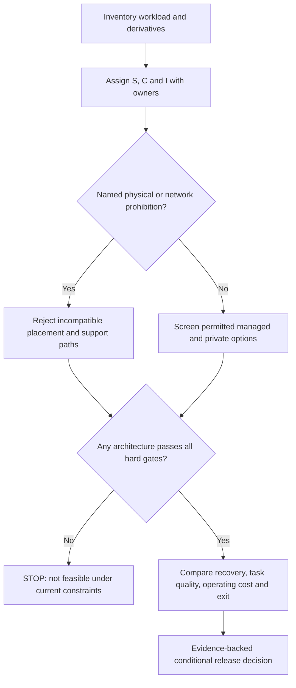

# Module 03 — Enterprise sovereignty requirements and strategy

> **Executive thesis:** Sovereignty investment earns approval only when it addresses an identified enterprise risk, continuity dependency, binding placement requirement or strategic capability gap, and when the proposed controls can be tested. A more expensive on-site or disconnected deployment is not automatically better than a controlled managed service for an eligible workload.

| Course context | Detail |
|---|---|
| Part / week | Part I — Foundations / Week 3 |
| Audience | Enterprise AI PM, architecture, risk and procurement leads |
| Prerequisites | [Module 01](01-sovereign-ai-fundamentals.md) and [Module 02](02-classifications-components-maturity-models.md) |
| Current progress | **Sections 3.1–3.3 complete; Sections 3.4–3.7, lab, assessment, solutions, social and critical reviews pending** |
| Planned PM output | Evidence-based sovereignty investment brief, stakeholder map and phased roadmap |
| Environment | Markdown and browser using fictional/synthetic data; no cloud spend required |
| Primary sources checked | 20 November 2026; NIST AI RMF 1.0 Core |
| Scope | Course-authored enterprise strategy framework, **not** statutory or provider certification |

## 1. Executive brief: what enterprise problem justifies the investment?

### 3.1 What enterprise problems justify sovereignty investments?

**Product decision:** Do **not** propose “sovereign AI” as a feature, procurement badge or infrastructure purchase. Identify the business process that cannot safely or reliably operate under the current dependency model, write the unacceptable failure in observable terms, and then ask which *minimal enforceable control set* removes that failure. Different workloads inside the same company can justify very different deployment patterns.

A UAE enterprise with three AI pilots illustrates the problem. A public-data employee policy assistant might fit a vetted managed endpoint; a factory engineering assistant might have a contractual **single named premises** restriction; a disconnected operational-reference system might require a **physical air gap**. A single cloud agreement could be convenient for procurement, but it would not erase the factory's signed site restriction or the operations team's network prohibition. Every organization, rule, price and event in the example below is **fictional**.

#### Start with a testable business loss, not an infrastructure preference

A credible sovereignty investment case begins with one of six enterprise problems. The categories below are **course-authored** decision prompts, not a regulator's list of sovereignty obligations.

| Business problem | Failure the business owner can describe | Candidate control and measurable evidence | When it may *not* justify local ownership |
|---|---|---|---|
| **Mandatory physical placement** | Restricted designs or their derivatives would be processed beyond an authorized facility | Named-premises processing invariant; network, backup, evaluation, support and update traces reviewed against the site boundary | A public/synthetic-content workload with no such signed restriction |
| **Operational continuity and resilience** | A provider outage or cross-border disruption leaves a critical process without an approved recovery route | Tested outage, local-fallback, rollback and recovery-time objectives | The process tolerates provider downtime and has a tested alternative |
| **Privileged control and incident response** | The enterprise cannot revoke vendor access, inspect routing changes or isolate a compromised component | Access-revocation drill, logs, key custody, approved change windows, incident tabletop | Supplier controls already satisfy the authority and evidence requirements |
| **Technological replaceability** | A licence, API, model format or unsupported hardware locks a high-value process to one supplier | Cold-start and model-substitution exercise; licence rights, task quality and migration effort | Short-lived noncritical pilot with a consciously accepted exit cost |
| **Restricted knowledge and competitive IP** | Engineering documents, retrieved chunks, embeddings or adaptations could flow to unapproved destinations | Classified data-lineage map and negative egress tests across inference, telemetry, training and recovery | Public material with no meaningful adverse derivative-transfer risk |
| **Supply-chain visibility and assurance** | Teams cannot establish where third-party software, models, updates and subcontracted support operate | Dependency inventory, provenance, support-access test, signed contract review and change-triggered retests | An adequate, verified supplier assurance package already exists |

**Counterexample:** If the only argument is “the CEO wants everything on GPUs we own,” the business case is incomplete. Ask which actual requirement changes with GPU ownership and which parts of the workload are still supplied, controlled, monitored or updated externally. On-site GPUs may add capital expense and staffing duties while leaving a remote fallback, licence server, observability sink or vendor administrator path unchanged.

#### Distinguish a legal obligation, a policy choice and a commercial risk

Do not present enterprise preferences as universal UAE laws. Assign each requested boundary to a **named authority and evidence record**: enacted law or contract where applicable, signed enterprise policy, customer purchase requirement, critical-process risk acceptance, or voluntary strategic goal. Legal/privacy teams determine jurisdictional applicability. The PM converts the resulting constraints into a workload-specific acceptance test; the PM does **not** invent a statute.

NIST's **AI Risk Management Framework 1.0**, published in **2023**, provides a useful process anchor. Its *Map 1.1* includes “prospective settings in which the AI system will be deployed” when documenting intended purposes and context.[^nist-map-31] Its *Manage 1.1* asks whether development or deployment “should proceed”.[^nist-manage-31] These are risk-governance questions. They do **not** require sovereign hosting, create a national residency law or define our six investment drivers.

The [course ontology](../taxonomy/ONTOLOGY.md) records a chain such as **BusinessProcess → exposedTo → FailureMode → motivates → Requirement → addressedBy → Control → testedBy → Test → produces → Evidence**. A second chain links **Authority → approves → Constraint** and **Actor → owns → Decision**. This *course-authored* relationship map helps prevent a board-level aspiration from silently overriding a data owner's stricter physical requirement.

#### Compare architecture options only after screening non-negotiable constraints

Use a two-pass choice. **Pass 1: hard gates** rejects candidates incompatible with the specified physical, network, licensing, minimum quality or authority conditions. **Pass 2: economics and delivery** compares only the candidates that could pass the gates, subject to observed rather than assumed controls.

| Deployment hypothesis | Public/synthetic policy assistant | Restricted factory IP at FACTORY-A | Physically air-gapped reference assistant |
|---|---|---|---|
| **Managed endpoint in an approved processing geography** | **CONDITIONAL:** verify exact service deployment, logs, support, contracts and failover | **REJECT** if any restricted processing or derivative leaves FACTORY-A, even for a same-country endpoint | **REJECT:** remote inference requires a network path |
| **Enterprise-operated regional data centre** | May be suitable if approved and tested | **REJECT** if it is not the *named physical factory premises* | **REJECT** if not the disconnected designated facility |
| **Local inference, RAG, audit and backup inside FACTORY-A** | Possible but may be unnecessarily expensive | **CONDITIONAL:** verify no restricted egress, capacity, local licences, admin support and recovery | Only if located in its own approved facility **and** every network path is removed |
| **Physically disconnected on-site enclave** | Generally disproportionate for this fictional public-content task | Could meet site constraint, with higher patching and operating burden | **CONDITIONAL:** demonstrate physical disconnection, offline artifact handling, local restore, licence rights and task suitability |

**The premises rule is about every restricted derivative, not just source files.** In the fictional factory case, prompts, embeddings, answers, evaluation samples, adaptations, crash reports, telemetry, training extracts, backups and support bundles must remain inside FACTORY-A. Even a country-resident cloud API violates this *single-premises* condition if restricted inference travels there.

**Air gap is a stronger rule.** It permits **no inbound or outbound network connectivity**, including remote monitoring, private links, temporary vendor access, online licence checks and cloud fallback. Offline media transfer can be designed with custody, integrity checks and on-site supervision, but does not turn an internet-connected deployment into an air gap. If locally runnable, permitted and suitably capable models cannot be obtained, report **NOT FEASIBLE UNDER CURRENT CONSTRAINTS** rather than substituting remote inference.

#### Worked investment choice: a fictional UAE industrial group

**Fictional enterprise and assumptions:** Gulf Works Group manages engineering assets in the UAE. Three product owners have requested AI support. None of the following is a claim about an actual UAE company, supplier, law, outage or measured cost.

- **POLICY-31:** Summarizes public policies and synthetic employee examples. The business problem is staff time lost locating current policy passages. The company has not imposed a named-premises restriction. A managed retrieval and inference service is an *eligible hypothesis* if contract, location, data retention, reliability and task accuracy pass review.
- **DESIGN-31:** Searches restricted engineering diagrams and maintenance procedures at **FACTORY-A**. A signed customer agreement prohibits **all restricted data or derivatives leaving that physical premises**. The business problem is safe access to documentation without breaching the agreed handling boundary. A regional cloud deployment is ineligible irrespective of benchmark quality; a local model and index with local monitoring and backup is conditionally eligible.
- **OT-31:** Enables consultation of approved synthetic operating guidance in a physically disconnected maintenance environment. The business problem is continued reference access during a deliberate total network isolation policy. An on-site offline tool is conditionally eligible, provided model rights, artifact supply, removable-media custody, power, safety review and restore are feasible.

**Investment comparison:** For POLICY-31, quantify annual employee hours saved by a measured task-time reduction, subtract the expected service and review costs, and compare with search or non-AI documentation improvements. For DESIGN-31, compare only *physically eligible* architectures; include GPU capacity, electricity, on-site administration, local model-quality testing, offline support and spares, fail-closed incident handling and lifecycle cost. For OT-31, include offline update qualification, media-handling procedures, tested restore, and potential reductions in capability versus cloud-connected models. Do **not** fabricate an ROI percentage, universal cost premium, model benchmark or local deployment feasibility.

A useful *illustrative, not measured* financial worksheet is:

```text
annual gross benefit = measured tasks/year × measured minutes saved/task
                       × fully loaded labor cost/minute × realized adoption rate
expected annual net value = gross benefit + avoided expected loss
                            − operating costs − remediation and assurance costs
risk-adjusted decision = eligible under all mandatory gates
                         AND net value beats the best eligible alternative
```

**Risk valuation caveat:** “Avoided expected loss” requires an owner-approved threat scenario, likelihood range and impact model. If credible estimates are unavailable, write **UNQUANTIFIED** and present sensitivities; never use an invented breach probability to make an on-site purchase look financially compelling. Also compare **do nothing, improve existing search, a managed eligible service, and an on-site candidate**. The fact that a workload is called sovereign does not exempt it from opportunity-cost analysis.

#### Failure investigation and root cause: strategy undermined by gateway defaults

**Observed in a fictional synthetic test:** DESIGN-31's team spends money on local accelerators and installs its retrieval index on-site. At normal load, all test prompts are served locally. During a simulated timeout, a supplier-provided gateway sends a synthetic restricted-label prompt to an external hosted model as an availability fallback. The outbound proxy records the attempted request. This shows a **failed architecture test**, not evidence of an actual production disclosure.

| RCA stage | Finding, correction and owner |
|---|---|
| **Expected vs. observed** | Requirement: all restricted data and derivatives stay in FACTORY-A, including degraded operation. Observed: synthetic gateway fallback aimed at an external model endpoint; **BLOCKED** |
| **Direct technical cause** | Remote fallback endpoint enabled in the model gateway's failure policy |
| **Contributing procurement/process cause** | Investment approval was based on GPU ownership and normal-path demos; contract and release review omitted gateway routing authority and failure paths |
| **Containment** | Platform lead removes external route, security preserves synthetic egress traces, and plant data owner holds approval pending investigation |
| **Corrective solution** | Enterprise-owned deny-by-default egress, an acceptable local fallback or controlled error, versioned route approvals and clearly scoped supplier support |
| **Retest and closure** | Re-run synthetic normal, timeout, crash, update, support and restore scenarios. Compare gateway configuration hash, DNS/proxy traces, operator sessions, backup destinations and model licences. Security and plant owner sign dated outcomes before the PM revisits go/no-go |

**Root cause:** The funding decision confused *ownership of compute* with *control of the entire inference and operations path*. A meaningful sovereignty business case funds the controls, people, capacity and acceptance evidence that make the constraint enforceable. A successful local demo is not proof that the deployed product remains local during failure.

#### PM artifact: a one-page investment qualification memo

| Field | Example decision for fictional DESIGN-31 |
|---|---|
| **Process, sponsor and value hypothesis** | Restricted engineering retrieval / plant operations sponsor; shorten document lookup while maintaining the signed handling boundary |
| **Hard constraint and approving authority** | FACTORY-A customer/site data owner; no restricted data or derivatives may exit the named premises |
| **Current failure and evidence** | **BLOCKED**, synthetic remote gateway fallback to an off-premises endpoint, test ID `SYNTH-31-TIMEOUT`, configuration/version retained |
| **Eligible alternatives** | Local inference and index with fail-closed egress, or a non-AI on-site search system; remote managed inference **ineligible** |
| **Success and economics** | Synthetic task-quality/latency suite, approved capacity and restore tests, estimated net value with ranges and explicit unknowns |
| **RACI and next milestone** | PM accountable for decision brief; platform responsible for correction; CISO/security validates egress; data owner approves boundary; legal/procurement reviews licences and vendor support |
| **Release disposition** | **NO-GO** for restricted launch until all hard gates pass and required evidence/contract review is complete; consider synthetic-only engineering trials under approved test conditions |

**Board decision rule:** Do not approve a capital request with the statement “on-prem means sovereign.” Require (1) a named business loss or binding constraint, (2) a counterfactual alternative, (3) a control evidence plan, (4) realistic operating obligations, and (5) a dated owner-signed decision. If all candidates fail a non-negotiable requirement, the answer is **not feasible under current constraints**, not the cheapest prohibited design.

#### Learner challenge (35 minutes)

Use the [Architecture & Learning Studio](../learning/index.html) and fictional-only inputs:

1. Load **Strict on-premises IP research assistant**, retain **Single premises only; no data or derivatives may leave**, and compare **On-prem production GPU servers inside the premises** with **Approved managed AI platform**. Predict the hard gate before looking at the simulator. Record which business objective the managed design fails and which supplier evidence would still be relevant for a less restricted workload.
2. Load **Air-gapped factory operations** and change connectivity from **Air-gapped: no inbound or outbound network** to **General internet access including external service endpoints**. Explain why even a private or allowlisted route would violate the physical network constraint.
3. Draft a two-column executive trade-off: one column for **eligible controls and evidence**, one for **benefit, total cost and opportunity cost**. Include a non-AI alternative. For each of POLICY-31, DESIGN-31 and OT-31, recommend **CONDITIONAL**, **BLOCKED** or **NOT FEASIBLE** with an accountable owner and test.
4. Write a six-part RCA for the gateway timeout failure, including the direct cause, procurement-process root cause, containment, fix, version-specific retest and acceptance owner.

**Submission:** A one-page memo, a three-workload eligibility matrix, a **risk-value assumption register** and one clearly falsifiable technical control test. The Studio is an educational rule engine; its output does not inspect a real environment, certify a vendor or decide UAE legal applicability.


### 3.2 Classify workloads by data sensitivity, criticality, and impact

**Decision:** Classify the *workload and every data flow*, not the model vendor. Three independent axes answer different questions: **sensitivity** determines who may see or process information; **criticality** determines how long the process may fail; **impact** determines the consequence of a wrong, unsafe or unauthorized output. None alone proves that a particular UAE law mandates an on-premises deployment. Assign an accountable authority to each restriction before selecting architecture.

#### A three-axis classification that changes procurement

This matrix is a **course-authored assessment instrument**, not an official UAE government classification scheme. Replace illustrative tiers with the organization's approved classification policy and legal team's applicability determination.

| Axis | Working tiers | Questions to answer | Control evidence |
|---|---|---|---|
| Data sensitivity | S0 public/synthetic; S1 internal; S2 confidential; S3 contractually or operationally restricted | Does the input, retrieval corpus, embedding, output, log, support bundle or backup inherit restrictions? Who authorizes declassification? | Asset register, lineage, data-owner approval, actual endpoint and storage destinations |
| Business criticality | C0 discretionary; C1 recoverable; C2 time-bound essential; C3 interruption-intolerant under approved safety/continuity policy | What are the approved recovery time objective (RTO) and recovery point objective (RPO)? What safe manual alternative exists? | Signed business impact analysis, failure drill, recovery runbook, timed restore results |
| Decision impact | I0 informational; I1 reversible staff assistance; I2 consequential operational recommendation; I3 safety-, rights- or high-value decision support | Who acts on the output? Can errors be reversed? Is a human empowered to reject it? | Hazard/impact analysis, evaluation results, human authorization workflow, incident escalation |

**Classification is not an additive score.** An S3/C0/I0 archival assistant can require a stricter placement boundary than an S0/C3/I2 public-information incident dashboard. Conversely, a low-sensitivity tool can still demand local resilience because outages interrupt critical operations. Never average a prohibited egress path away with a high model-quality score.

**Inheritance rule:** A derivative stays at its source's restriction level unless the named data owner authorizes a documented transformation and its residual disclosure risk. Hashes, embeddings, summaries, telemetry and backups are not automatically “non-sensitive.” For mixed datasets, either isolate the restricted partition with verified access controls or classify the combined processing path at the highest applicable tier.

#### Fictional UAE portfolio: three classifications, three distinct decisions

All names, documents, agreements and test IDs below are **fictional synthetic training data**. The site-only and air-gap conditions are **scenario premises**, not assertions about UAE-wide legal requirements.

| Workload | Classification and authority | Failure to design against | Initial eligible architecture | Release evidence |
|---|---|---|---|---|
| POLICY-31, synthetic policy search | S0 / C1 / I1; HR product owner | Outdated policy citation or unavailable service | Managed service **conditional** on contract, accuracy, retention and approved processing paths; simple search is a viable alternative | Versioned source citations, answer abstention test, uptime and retention review |
| DESIGN-31, restricted drawings | S3 / C2 / I2; FACTORY-A data owner and signed customer handling rule | Prompt, embedding, support trace or backup leaves **FACTORY-A** during normal or degraded operation | Local model, index, observability and restore inside the named premises, **conditional** on all-route negative egress testing | Egress deny test under timeout, DNS failure, support access, crash, patch and restore; owner-signed route inventory |
| OT-31, disconnected operational reference | S1 / C3 / I3; designated site safety authority | Remote inference or unapproved connectivity introduced during outage; unsafe answer treated as instruction | Physically disconnected local reference with approved human procedures, **conditional** on safety and capability tests | Physical port/radio audit, offline licence and update test, timed restore, abstention and operator-override drill |

**Why impact is separate from sensitivity:** OT-31 uses synthetic, relatively low-sensitivity material, yet a wrong recommendation could affect a safety-critical human workflow. The training assistant must never autonomously actuate equipment. The operator remains responsible under the fictional site's approved procedure. A high-accuracy benchmark is not a substitute for safe failure and authorization boundaries.

#### Architecture selection: hard constraints before performance



For **premises-only**, require that all restricted processing and derived artifacts remain at the *named physical premises*, not merely within a country or a vendor geography. For a **physical air gap**, prohibit every inbound and outbound network path, including private circuits, remote support, telemetry, licence activation and emergency cloud fallback. If an architecture needs any such path, mark **REJECT**; if no local licensed model or safe offline operating mode exists, mark **NOT FEASIBLE**, not “approved with monitoring.”

#### Failure-mode exercise: classification lost at the observability boundary

**Fictional test observation:** DESIGN-31 passes a normal inference check, but a simulated GPU timeout creates a diagnostic event containing a synthetic drawing title. An inherited S1 logging default sends the event to an off-premises telemetry collector. A proxy denies the request and records test `SYNTH-32-LOG-EGRESS`. This is a **failed attempted-egress test**, not a real data leak.

| RCA element | Required disposition |
|---|---|
| Observation | Synthetic diagnostic payload attempted an off-premises destination; classify **BLOCKED** even though the proxy denied delivery |
| Direct cause | Telemetry agent inherited a lower-tier routing profile and did not inherit S3 derivative restrictions |
| Systemic cause | The data-flow inventory omitted diagnostics and the release checklist tested only the inference endpoint |
| Containment | Disable exporter; preserve sanitized traces and configuration hashes; halt restricted deployment |
| Remediation | Data owner labels all derivatives S3; platform lead uses local-only logging and deny-by-default outbound policy; security reviews update/support routes |
| Retest | Inject timeout, crash, upgrade, backup and support scenarios; verify no attempted external route and inspect logs, DNS, firewall and endpoint configuration |
| Decision | **NO-GO** until platform, security and FACTORY-A data owner sign dated evidence; remaining uncertainty must be recorded |

A network deny can prevent transmission while still exposing a configuration defect. **No packets delivered** does not mean **the application respected the intended routing policy**. Track both attempted and successful egress.

#### PM artifact: classification and control register

Copy this schema into a product requirements document or CSV; complete one row per *workload × flow*, not one row per vendor:

| Field | Required value |
|---|---|
| Workload ID and intended use | Stable ID, authorized users, prohibited decisions |
| Data and derivative inventory | Inputs, prompts, embeddings, answers, telemetry, support bundles, backups, training extracts |
| Sensitivity / criticality / impact | S0–S3 / C0–C3 / I0–I3, plus **named approving owners** |
| Source of constraint | Contract clause, signed policy, approved BIA or legal-team determination; link to version |
| Physical/network invariant | Explicit allowed premises, processing paths, admin paths and fail-closed behavior |
| Service objectives | Owner-approved RTO, RPO, accuracy threshold, abstention and human escalation |
| Architecture candidates | Eligible, rejected or unknown with exact disqualifying condition |
| Test evidence | Test ID, input fixture, expected and observed behavior, logs, build/config hash, date |
| Decision | GO / CONDITIONAL / NO-GO / NOT FEASIBLE, approver, review trigger and residual risk |

**Acceptance examples:** `SYNTH-32-EGRESS-01`: when DESIGN-31 inference times out, **zero** restricted requests, diagnostics or derivatives are attempted to external destinations; an explicit local error is shown. `SYNTH-32-AIRGAP-01`: OT-31 completes the offline reference task with all physical and logical network paths disabled; online licence or fallback demand produces a controlled failure, never reconnection. These are **proposed tests**, not tests executed against production equipment.

#### Learner challenge: 45-minute portfolio triage

1. Before opening any simulator, classify POLICY-31, DESIGN-31 and OT-31 on all three axes. State which classifications are assumptions and who must sign them.
2. Add a fourth fictional workload, `BILLING-32`: synthetic invoices, C2 month-end deadline, I2 payment-review recommendations, and no premises restriction yet confirmed. Compare a managed service, a private regional deployment and a named-premises installation. Mark unresolved legal and contractual placement questions **UNKNOWN**, not automatically permissible or prohibited.
3. For DESIGN-31, draw five data paths: inference, embeddings, telemetry, support and backup. Predict what happens when the model gateway fails. Use the [Architecture & Learning Studio](../learning/index.html) for a *synthetic policy comparison*, then explain why a simulated pass cannot establish physical isolation.
4. Submit a one-page classification/control register, one rejected alternative with reason, a proposed negative test, and a six-stage RCA for `SYNTH-32-LOG-EGRESS`. Include a non-AI fallback and a dated go/no-go decision owner.

**Assessment boundary:** Do not include a worked answer in this learner-facing section. Facilitator solutions belong in the separate Module 03 solution key when the module assessment is authored. The framework is educational and must not be represented as a legal classification, penetration test, independent audit or production certification.


### 3.3 Security and compliance requirements vs. additional sovereignty objectives

**Executive decision:** A secure, contractually acceptable AI workload is not necessarily *sovereign* under the enterprise's intended control boundary. Equally, a locally installed AI model is not automatically secure, compliant or operationally independent. Write the **security baseline**, **applicable legal/contractual duties**, and **additional sovereignty objectives** as separate claims with distinct approving authorities and tests. A passed access-control audit cannot waive a contractual named-premises prohibition; local GPU ownership cannot waive a security finding.

This distinction protects investment decisions. The PM should avoid paying for an on-site facility when existing verified controls already satisfy a less restrictive workload, but must refuse an attractive cloud endpoint when its execution or derivatives would violate a non-negotiable physical site or air-gap requirement.

#### Three claim types, three approval paths

| Claim category | What is actually being decided | Named evidence owner | Example of a test or approval that does **not** prove the other claims |
|---|---|---|---|
| **Security and safety baseline** | Can the system protect confidentiality, integrity and availability, manage identities, contain misuse, and fail safely? | CISO, platform security, relevant safety owner | MFA, encryption, key custody, red-teaming, tenant isolation, incident drill and recovery tests do **not** prove where every data derivative is processed |
| **Legal, regulatory and contractual applicability** | Which specific enacted laws, processor/contract clauses, customer handling rules, licences and records apply to *this* organization, activity and data? | Legal counsel, privacy officer, procurement, contract owner | A vendor's generic regional badge or self-described compliance certificate does **not** determine whether a particular contractual **FACTORY-A only** condition is fulfilled |
| **Additional sovereignty objectives** | Which locations, administrators, supply-chain dependencies, model rights, exit capabilities and national/enterprise autonomy goals should remain under specified control? | Named enterprise sponsor, data owner, CIO/CTO, architecture owner | A physically resident model does **not** prove remote support is disabled, usable offline rights exist, or regional dependencies can be replaced |

The categories can overlap: a no-egress control may support contractual handling and a strategic sovereignty objective, while a privileged-access restriction may support both security and operational autonomy. **Overlap is not equivalence.** Record each claim's independent acceptance criterion, evidence and reviewer. If counsel concludes a legal requirement does not apply, preserve that documented decision and still evaluate voluntarily adopted enterprise/site rules; the PM must not assume a legal exemption changes an unrelated contract.

**NIST evidence boundaries.** The NIST AI RMF 1.0 describes itself as “voluntary, rights-preserving, non-sector specific, and use-case agnostic.”[^nist-voluntary-33] Its **GOVERN 1** calls for organizational policies and procedures for mapping, measuring and managing AI risks, and **GOVERN 1.5** refers to ongoing monitoring and periodic review of the risk-management process.[^nist-govern-33] These are useful governance structures, but **not evidence of compliance with a particular UAE statute or proof of sovereign hosting**. NIST SP 800-207 states there is “no implicit trust” based only on network or physical location.[^nist-zt-33] That security principle means an on-site environment still needs verified identities and privileges; it does not declare a specific factory location sufficient.

#### Translate a policy sentence into a falsifiable claim

A common procurement sentence is: *“The vendor is secure, complies with local requirements and keeps our AI sovereign.”* That is three untested conclusions. Replace it with an authority-backed claim register:

1. **Security**: the enterprise permits only approved roles to request restricted retrieval. **Evidence:** role matrix, revoked-credential attempt, signed trace and an owner who can block release.
2. **Compliance/contract**: the named owner cites the **actual clause or legal applicability determination**, data categories, processing actors and allowed destinations. **Evidence:** reviewed obligation map and dated counsel or contract-owner disposition; not a claim invented by the course.
3. **Sovereignty**: *every restricted input and derivative remains inside the named factory premises*, including embeddings, responses, evaluation, telemetry, support and backup. **Evidence:** synthetic normal/timeout/failover/update/restore test with destination inventory and independent review.
4. **Resilience and autonomy**: inference can cold-start and recover without calling a prohibited remote endpoint, with a permitted model licence, capacity and support route. **Evidence:** offline licence review, cold-start capture, rollback and measured service objectives.

A status is **PASS FOR TESTED SCOPE**, **FAIL**, **UNVERIFIED** or **NOT APPLICABLE WITH RECORDED AUTHORITY** for each claim; never a universal “compliant and sovereign” badge. Contractual review cannot establish actual runtime behavior, and a runtime test cannot settle regulatory applicability.

#### Fictional UAE enterprise portfolio: different controls, different answers

**Scenario:** Gulf Works Group (fictional) proposes a common AI procurement agreement and a shared gateway. Its policy assistant uses synthetic data, its engineering assistant handles restricted drawings, and its disconnected operations reference has a strict physical network boundary. The rules and test observations here are invented, not descriptions of UAE law or a real vendor.

| Workload | Security baseline | Applicable obligation review | Extra sovereignty gate | Initial decision |
|---|---|---|---|---|
| **POLICY-33:** synthetic policy search | Enterprise IAM, abuse controls, retrieval citations and safe failure | Procurement checks terms, retention and any applicable requirements | Named permitted processing locations, supplier access review and a measured exit plan, if adopted | Managed service **CONDITIONAL**, after actual destination and contract evidence |
| **DESIGN-33:** restricted engineering RAG | Local least privilege, key custody, egress deny, incident and restore procedures | Contract owner verifies signed **FACTORY-A-only** handling clause; counsel reviews applicable law separately | All restricted files and derivatives must remain **inside one named physical factory premises** | Off-site managed inference **REJECTED**, even in the same country; local design **UNVERIFIED** until tested |
| **OT-33:** safety-sensitive reference system | On-site access controls, safe abstention, approved operator override and restore | Qualified owner reviews offline model licence, operational requirements and supplier terms | **Air-gapped: no inbound or outbound network path**, including remote support, licence checks and private links | Offline local stack **CONDITIONAL**; all connected candidates **REJECTED** |

For DESIGN-33, encryption during transmission does **not** make it acceptable for restricted prompts to leave FACTORY-A. Even a provider endpoint within the UAE fails the **one-physical-premises** requirement when restricted processing occurs outside the plant. For OT-33, a “private” network, temporary modem, vendor-support tunnel or internet allowlist is still connectivity and contradicts the declared air gap. Neither architecture may silently fall back to external inference after a timeout.

**Separation of concerns:** Security's role is to test whether the controls work. Legal's role is to determine applicable duties and contract interpretation. The enterprise sponsor and data owner define additional objectives and authorized exceptions. The PM assembles their signed evidence into a release recommendation, without issuing its own legal opinion or pretending the simulator performed an infrastructure audit.

#### Architectural trade-offs and veto logic

For POLICY-33, a managed endpoint may be less expensive to operate than enterprise-owned accelerators, but both need scoped data-retention, access and supplier-continuity testing. A locally deployed model may offer stronger runtime control but increase patch, capacity and incident duties. Neither option is **automatically** compliant or sovereign.

For DESIGN-33, eligibility comes first: the team may select a locally runnable third-party licensed model on enterprise GPUs, or a non-AI local search service. A distant enterprise-owned data center is still off the required plant site. For OT-33, even a licensed local model is **NOT FEASIBLE UNDER CURRENT CONSTRAINTS** if the required quality, safety, capacity or offline rights cannot be achieved. Record a hard **BLOCKED** or infeasible disposition rather than overriding the isolation policy.

**Explicit release logic:**

| Condition | Rule | Decision record |
|---|---|---|
| A confirmed attempted or successful prohibited data/derivative export | The physical-site veto stays active until root cause, correction and negative retest | **BLOCKED** |
| Air-gap requirement but any inbound/outbound network or online activation dependency | No connected design is eligible | **BLOCKED**, or **NOT FEASIBLE** if no valid offline solution exists |
| Legal or contract applicability unclear, but no confirmed technical violation | Do not presume either exemption or universal prohibition; seek signed specialist determination | **UNVERIFIED / REVIEW REQUIRED** |
| Security, obligations and sovereignty evidence all pass for the exact tested workload/version | Compare eligible quality, capacity, costs, resilience and exit; approve only within that scope | **CONDITIONAL GO**, with owner and revalidation triggers |

#### Failure/RCA: a security success masks a sovereignty failure

**Fictional synthetic observation:** The platform team installs an on-site model at FACTORY-A and enables strong MFA, storage encryption and a denied external firewall rule. Its security dashboard displays green. During a synthetic gateway timeout, the fallback resolver attempts to send a prompt fragment to a contracted cloud model endpoint. The firewall blocks delivery, but the request and diagnostic record show an **attempted off-premises transfer** that violates the intended routing rule. This does not prove that actual customer data were disclosed.

| RCA step | Finding, response, responsible owner |
|---|---|
| **Symptom** | Security controls blocked the external request, while the workload's **premises-only architectural acceptance test failed** |
| **Direct cause** | Gateway failure policy contained a remote managed-model fallback |
| **Contributing root cause** | Release sign-off conflated “secure transport and access controls” with “all restricted processing physically contained,” and skipped degraded-mode route inventory |
| **Containment** | Platform owner removes remote fallback; security preserves synthetic traces, checks historical destinations and determines whether investigation is needed; data owner holds restricted launch |
| **Corrective design** | Local fallback with sufficient licensed capacity, or explicit fail-closed response; deny-by-default egress, gateway configuration review, local diagnostic sink and audited supplier changes |
| **Verification** | Re-run synthetic normal/timeout/crash/upgrade/restore/support paths, inspect DNS/proxy/firewall and privileged sessions, compare build hashes and signed physical-site requirements |
| **Closure and owners** | CISO confirms security controls, data owner accepts no-egress evidence, procurement/legal reviews permissions, PM logs conditional go/no-go and retest trigger |

**Root cause:** Security controls operated as configured, but they were not designed to satisfy the *additional* sovereignty claim about routing. A blocked network request can protect this test and still reveal a configuration defect. The corrective action is to specify and verify **both** the security mechanism and the physical-location invariant.

#### PM artifact: obligation-to-control separation sheet

This is a reusable decision sheet for a PM and three owners, not a legal compliance certificate.

| Claim ID / owner | Source and exact rule | Acceptance evidence | State / escalation |
|---|---|---|---|
| **SEC-33 / CISO** | Internal security baseline: restricted retrieval requires signed roles and denied unauthorized access | Synthetic revoked-user test, key inventory, incident and restore plan | **UNVERIFIED** until completed |
| **OBL-33 / counsel + contract owner** | Signed FACTORY-A handling restriction; independently determine applicable laws | Contract clause/version, processor-role list, signed applicability/exception review | **REVIEW REQUIRED** |
| **SOV-33 / plant data owner** | No restricted material or **derivative** leaves the named premises | Synthetic network, diagnostics, backup, admin, evaluation and failover tests across lifecycle | **FAILED** on remote-fallback attempt |
| **AUT-33 / CTO + platform** | Acceptable local model, licence, support, cold-start and tested recovery | Offline clean install, model substitution, quality/capacity benchmark and rollback | **UNVERIFIED** |
| **Decision / product executive** | All mandatory gates satisfied for exact workload and version before release | Dated gate matrix with approving identities and evidence locations | **BLOCKED**, despite passed isolated security checks |

**Change control:** Reopen affected claims on a model, gateway, supplier-support, backup, contract, network, facility, or administrator change. If a requirement is changed by its authorized issuer, record its scope and effective date; never infer a waiver from a provider's product label.

#### Learner challenge (40 minutes): prove that three green checkboxes are not one approval

1. Draft three claim cards for DESIGN-33: **security**, **applicable contract/legal**, and **additional sovereignty**. Give each a distinct owner, test/evidence type and disposition. Why can MFA be PASS while the whole launch remains BLOCKED?
2. In the [Architecture & Learning Studio](../learning/index.html), start with **Strict on-premises IP research assistant** and **Single premises only; no data or derivatives may leave**. Toggle compute between **On-prem production GPU servers inside the premises** and **Approved managed AI platform**. Predict the hard gate and name the external destinations that a real auditor would trace.
3. Select **Air-gapped factory operations** and change connectivity from **Air-gapped: no inbound or outbound network** to **General internet access including external service endpoints**. Explain why a “private” route is not a permitted exception.
4. Write a release memo for the fictional failed fallback case. Distinguish the firewall's security success from the architecture's failed site invariant; include direct cause, process root cause, containment, local-only correction, negative retest, RACI and the explicit conditions for a changed decision.

**Submission:** A five-row obligation/control register, one architecture comparison, a seven-line RCA with owners, and a conditional release decision. Use synthetic data only. The Studio cannot verify legal applicability, inspect network traffic or certify a vendor; the facilitator answer key will remain in the separate Module 03 solutions artifact.

[^nist-voluntary-33]: NIST, *Artificial Intelligence Risk Management Framework (AI RMF 1.0)*, NIST AI 100-1 (**2023**), [Executive Summary](https://airc.nist.gov/airmf-resources/airmf/0-ai-rmf-1-0/), exact quoted passage checked on the official NIST HTML **20 November 2026**. Voluntary framework, not a UAE-specific legal requirement.
[^nist-govern-33]: NIST, *AI RMF 1.0*, [AI RMF Core, GOVERN 1 and GOVERN 1.5](https://airc.nist.gov/airmf-resources/airmf/5-sec-core/), exact categories checked on official HTML **20 November 2026**. The course-authored claim types and veto rules are not specified in the NIST document.
[^nist-zt-33]: NIST, *Zero Trust Architecture*, SP 800-207, final August **2020**, [official abstract](https://csrc.nist.gov/pubs/sp/800/207/final), “no implicit trust” phrase and location/ownership scope checked **20 November 2026**. This security guidance does not establish sovereign jurisdictional compliance.

**Next header:** 3.4, *Stakeholders: CIO, CTO, CISO, privacy, legal, business, procurement*. Module 03 remains a draft pending the remaining headings, lab, solutions, social teaching assets and two critical reviews.

[^nist-map-31]: NIST, *Artificial Intelligence Risk Management Framework 1.0*, NIST AI 100-1 (**2023**), [AI RMF Core, MAP 1.1 and MAP 1.4](https://airc.nist.gov/airmf-resources/airmf/5-sec-core/), directly checked **20 November 2026**. MAP 1.1 addresses documenting purposes, laws, expectations and prospective deployment settings; MAP 1.4 covers the clearly defined business value/context. **Neither** prescribes sovereign AI hosting or defines the course-authored investment categories.
[^nist-manage-31]: NIST, *Artificial Intelligence Risk Management Framework 1.0*, NIST AI 100-1 (**2023**), [AI RMF Core, MANAGE 1.1 and MANAGE 2.1](https://airc.nist.gov/airmf-resources/airmf/5-sec-core/), directly checked **20 November 2026**. MANAGE 1.1 addresses the go/no-go determination; MANAGE 2.1 includes consideration of viable non-AI alternatives and resource constraints. The course's two-pass architecture choice is an instructional synthesis, not a named NIST decision algorithm.
