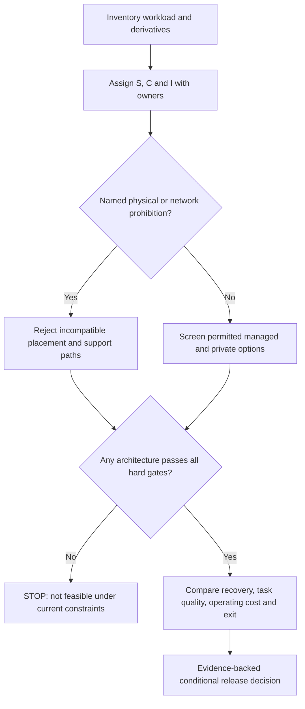

# Module 03 — Enterprise sovereignty requirements and strategy

> **Executive thesis:** Sovereignty investment earns approval only when it addresses an identified enterprise risk, continuity dependency, binding placement requirement or strategic capability gap, and when the proposed controls can be tested. A more expensive on-site or disconnected deployment is not automatically better than a controlled managed service for an eligible workload.

| Course context | Detail |
|---|---|
| Part / week | Part I — Foundations / Week 3 |
| Audience | Enterprise AI PM, architecture, risk and procurement leads |
| Prerequisites | [Module 01](01-sovereign-ai-fundamentals.md) and [Module 02](02-classifications-components-maturity-models.md) |
| Current progress | **Teaching sections 3.1–3.7, lab and assessment with separate solutions drafted; social assets and both critical reviews pending** |
| Planned PM output | Evidence-based sovereignty investment brief, stakeholder map and phased roadmap |
| Environment | Markdown and browser using fictional/synthetic data; no cloud spend required |
| Primary sources checked | 20 November 2026; NIST AI RMF 1.0 Core |
| Scope | Course-authored enterprise strategy framework, **not** statutory or provider certification |

## 1. Executive brief: what enterprise problem justifies the investment?

### 3.1 What enterprise problems justify sovereignty investments?

**Product decision:** Do **not** propose “sovereign AI” as a feature, procurement badge or infrastructure purchase. Identify the business process that cannot safely or reliably operate under the current dependency model, write the unacceptable failure in observable terms, and then ask which *minimal enforceable control set* removes that failure. Different workloads inside the same company can justify very different deployment patterns.

A UAE enterprise with three AI pilots illustrates the problem. A public-data employee policy assistant might fit a vetted managed endpoint; a factory engineering assistant might have a contractual **single named premises** restriction; a disconnected operational-reference system might require a **physical air gap**. A single cloud agreement could be convenient for procurement, but it would not erase the factory's signed site restriction or the operations team's network prohibition. Every organization, rule, price and event in the example below is **fictional**.

#### Start with a testable business loss, not an infrastructure preference

A credible sovereignty investment case begins with one of six enterprise problems. The categories below are **course-authored** decision prompts, not a regulator's list of sovereignty obligations.

| Business problem | Failure the business owner can describe | Candidate control and measurable evidence | When it may *not* justify local ownership |
|---|---|---|---|
| **Mandatory physical placement** | Restricted designs or their derivatives would be processed beyond an authorized facility | Named-premises processing invariant; network, backup, evaluation, support and update traces reviewed against the site boundary | A public/synthetic-content workload with no such signed restriction |
| **Operational continuity and resilience** | A provider outage or cross-border disruption leaves a critical process without an approved recovery route | Tested outage, local-fallback, rollback and recovery-time objectives | The process tolerates provider downtime and has a tested alternative |
| **Privileged control and incident response** | The enterprise cannot revoke vendor access, inspect routing changes or isolate a compromised component | Access-revocation drill, logs, key custody, approved change windows, incident tabletop | Supplier controls already satisfy the authority and evidence requirements |
| **Technological replaceability** | A licence, API, model format or unsupported hardware locks a high-value process to one supplier | Cold-start and model-substitution exercise; licence rights, task quality and migration effort | Short-lived noncritical pilot with a consciously accepted exit cost |
| **Restricted knowledge and competitive IP** | Engineering documents, retrieved chunks, embeddings or adaptations could flow to unapproved destinations | Classified data-lineage map and negative egress tests across inference, telemetry, training and recovery | Public material with no meaningful adverse derivative-transfer risk |
| **Supply-chain visibility and assurance** | Teams cannot establish where third-party software, models, updates and subcontracted support operate | Dependency inventory, provenance, support-access test, signed contract review and change-triggered retests | An adequate, verified supplier assurance package already exists |

**Counterexample:** If the only argument is “the CEO wants everything on GPUs we own,” the business case is incomplete. Ask which actual requirement changes with GPU ownership and which parts of the workload are still supplied, controlled, monitored or updated externally. On-site GPUs may add capital expense and staffing duties while leaving a remote fallback, licence server, observability sink or vendor administrator path unchanged.

#### Distinguish a legal obligation, a policy choice and a commercial risk

Do not present enterprise preferences as universal UAE laws. Assign each requested boundary to a **named authority and evidence record**: enacted law or contract where applicable, signed enterprise policy, customer purchase requirement, critical-process risk acceptance, or voluntary strategic goal. Legal/privacy teams determine jurisdictional applicability. The PM converts the resulting constraints into a workload-specific acceptance test; the PM does **not** invent a statute.

NIST's **AI Risk Management Framework 1.0**, published in **2023**, provides a useful process anchor. Its *Map 1.1* includes “prospective settings in which the AI system will be deployed” when documenting intended purposes and context.[^nist-map-31] Its *Manage 1.1* asks whether development or deployment “should proceed”.[^nist-manage-31] These are risk-governance questions. They do **not** require sovereign hosting, create a national residency law or define our six investment drivers.

The [course ontology](../taxonomy/ONTOLOGY.md) records a chain such as **BusinessProcess → exposedTo → FailureMode → motivates → Requirement → addressedBy → Control → testedBy → Test → produces → Evidence**. A second chain links **Authority → approves → Constraint** and **Actor → owns → Decision**. This *course-authored* relationship map helps prevent a board-level aspiration from silently overriding a data owner's stricter physical requirement.

#### Compare architecture options only after screening non-negotiable constraints

Use a two-pass choice. **Pass 1: hard gates** rejects candidates incompatible with the specified physical, network, licensing, minimum quality or authority conditions. **Pass 2: economics and delivery** compares only the candidates that could pass the gates, subject to observed rather than assumed controls.

| Deployment hypothesis | Public/synthetic policy assistant | Restricted factory IP at FACTORY-A | Physically air-gapped reference assistant |
|---|---|---|---|
| **Managed endpoint in an approved processing geography** | **CONDITIONAL:** verify exact service deployment, logs, support, contracts and failover | **REJECT** if any restricted processing or derivative leaves FACTORY-A, even for a same-country endpoint | **REJECT:** remote inference requires a network path |
| **Enterprise-operated regional data centre** | May be suitable if approved and tested | **REJECT** if it is not the *named physical factory premises* | **REJECT** if not the disconnected designated facility |
| **Local inference, RAG, audit and backup inside FACTORY-A** | Possible but may be unnecessarily expensive | **CONDITIONAL:** verify no restricted egress, capacity, local licences, admin support and recovery | Only if located in its own approved facility **and** every network path is removed |
| **Physically disconnected on-site enclave** | Generally disproportionate for this fictional public-content task | Could meet site constraint, with higher patching and operating burden | **CONDITIONAL:** demonstrate physical disconnection, offline artifact handling, local restore, licence rights and task suitability |

**The premises rule is about every restricted derivative, not just source files.** In the fictional factory case, prompts, embeddings, answers, evaluation samples, adaptations, crash reports, telemetry, training extracts, backups and support bundles must remain inside FACTORY-A. Even a country-resident cloud API violates this *single-premises* condition if restricted inference travels there.

**Air gap is a stronger rule.** It permits **no inbound or outbound network connectivity**, including remote monitoring, private links, temporary vendor access, online licence checks and cloud fallback. Offline media transfer can be designed with custody, integrity checks and on-site supervision, but does not turn an internet-connected deployment into an air gap. If locally runnable, permitted and suitably capable models cannot be obtained, report **NOT FEASIBLE UNDER CURRENT CONSTRAINTS** rather than substituting remote inference.

#### Worked investment choice: a fictional UAE industrial group

**Fictional enterprise and assumptions:** Gulf Works Group manages engineering assets in the UAE. Three product owners have requested AI support. None of the following is a claim about an actual UAE company, supplier, law, outage or measured cost.

- **POLICY-31:** Summarizes public policies and synthetic employee examples. The business problem is staff time lost locating current policy passages. The company has not imposed a named-premises restriction. A managed retrieval and inference service is an *eligible hypothesis* if contract, location, data retention, reliability and task accuracy pass review.
- **DESIGN-31:** Searches restricted engineering diagrams and maintenance procedures at **FACTORY-A**. A signed customer agreement prohibits **all restricted data or derivatives leaving that physical premises**. The business problem is safe access to documentation without breaching the agreed handling boundary. A regional cloud deployment is ineligible irrespective of benchmark quality; a local model and index with local monitoring and backup is conditionally eligible.
- **OT-31:** Enables consultation of approved synthetic operating guidance in a physically disconnected maintenance environment. The business problem is continued reference access during a deliberate total network isolation policy. An on-site offline tool is conditionally eligible, provided model rights, artifact supply, removable-media custody, power, safety review and restore are feasible.

**Investment comparison:** For POLICY-31, quantify annual employee hours saved by a measured task-time reduction, subtract the expected service and review costs, and compare with search or non-AI documentation improvements. For DESIGN-31, compare only *physically eligible* architectures; include GPU capacity, electricity, on-site administration, local model-quality testing, offline support and spares, fail-closed incident handling and lifecycle cost. For OT-31, include offline update qualification, media-handling procedures, tested restore, and potential reductions in capability versus cloud-connected models. Do **not** fabricate an ROI percentage, universal cost premium, model benchmark or local deployment feasibility.

A useful *illustrative, not measured* financial worksheet is:

```text
annual gross benefit = measured tasks/year × measured minutes saved/task
                       × fully loaded labor cost/minute × realized adoption rate
expected annual net value = gross benefit + avoided expected loss
                            − operating costs − remediation and assurance costs
risk-adjusted decision = eligible under all mandatory gates
                         AND net value beats the best eligible alternative
```

**Risk valuation caveat:** “Avoided expected loss” requires an owner-approved threat scenario, likelihood range and impact model. If credible estimates are unavailable, write **UNQUANTIFIED** and present sensitivities; never use an invented breach probability to make an on-site purchase look financially compelling. Also compare **do nothing, improve existing search, a managed eligible service, and an on-site candidate**. The fact that a workload is called sovereign does not exempt it from opportunity-cost analysis.

#### Failure investigation and root cause: strategy undermined by gateway defaults

**Observed in a fictional synthetic test:** DESIGN-31's team spends money on local accelerators and installs its retrieval index on-site. At normal load, all test prompts are served locally. During a simulated timeout, a supplier-provided gateway sends a synthetic restricted-label prompt to an external hosted model as an availability fallback. The outbound proxy records the attempted request. This shows a **failed architecture test**, not evidence of an actual production disclosure.

| RCA stage | Finding, correction and owner |
|---|---|
| **Expected vs. observed** | Requirement: all restricted data and derivatives stay in FACTORY-A, including degraded operation. Observed: synthetic gateway fallback aimed at an external model endpoint; **BLOCKED** |
| **Direct technical cause** | Remote fallback endpoint enabled in the model gateway's failure policy |
| **Contributing procurement/process cause** | Investment approval was based on GPU ownership and normal-path demos; contract and release review omitted gateway routing authority and failure paths |
| **Containment** | Platform lead removes external route, security preserves synthetic egress traces, and plant data owner holds approval pending investigation |
| **Corrective solution** | Enterprise-owned deny-by-default egress, an acceptable local fallback or controlled error, versioned route approvals and clearly scoped supplier support |
| **Retest and closure** | Re-run synthetic normal, timeout, crash, update, support and restore scenarios. Compare gateway configuration hash, DNS/proxy traces, operator sessions, backup destinations and model licences. Security and plant owner sign dated outcomes before the PM revisits go/no-go |

**Root cause:** The funding decision confused *ownership of compute* with *control of the entire inference and operations path*. A meaningful sovereignty business case funds the controls, people, capacity and acceptance evidence that make the constraint enforceable. A successful local demo is not proof that the deployed product remains local during failure.

#### PM artifact: a one-page investment qualification memo

| Field | Example decision for fictional DESIGN-31 |
|---|---|
| **Process, sponsor and value hypothesis** | Restricted engineering retrieval / plant operations sponsor; shorten document lookup while maintaining the signed handling boundary |
| **Hard constraint and approving authority** | FACTORY-A customer/site data owner; no restricted data or derivatives may exit the named premises |
| **Current failure and evidence** | **BLOCKED**, synthetic remote gateway fallback to an off-premises endpoint, test ID `SYNTH-31-TIMEOUT`, configuration/version retained |
| **Eligible alternatives** | Local inference and index with fail-closed egress, or a non-AI on-site search system; remote managed inference **ineligible** |
| **Success and economics** | Synthetic task-quality/latency suite, approved capacity and restore tests, estimated net value with ranges and explicit unknowns |
| **RACI and next milestone** | PM accountable for decision brief; platform responsible for correction; CISO/security validates egress; data owner approves boundary; legal/procurement reviews licences and vendor support |
| **Release disposition** | **NO-GO** for restricted launch until all hard gates pass and required evidence/contract review is complete; consider synthetic-only engineering trials under approved test conditions |

**Board decision rule:** Do not approve a capital request with the statement “on-prem means sovereign.” Require (1) a named business loss or binding constraint, (2) a counterfactual alternative, (3) a control evidence plan, (4) realistic operating obligations, and (5) a dated owner-signed decision. If all candidates fail a non-negotiable requirement, the answer is **not feasible under current constraints**, not the cheapest prohibited design.

#### Learner challenge (35 minutes)

Use the [Architecture & Learning Studio](../learning/index.html) and fictional-only inputs:

1. Load **Strict on-premises IP research assistant**, retain **Single premises only; no data or derivatives may leave**, and compare **On-prem production GPU servers inside the premises** with **Approved managed AI platform**. Predict the hard gate before looking at the simulator. Record which business objective the managed design fails and which supplier evidence would still be relevant for a less restricted workload.
2. Load **Air-gapped factory operations** and change connectivity from **Air-gapped: no inbound or outbound network** to **General internet access including external service endpoints**. Explain why even a private or allowlisted route would violate the physical network constraint.
3. Draft a two-column executive trade-off: one column for **eligible controls and evidence**, one for **benefit, total cost and opportunity cost**. Include a non-AI alternative. For each of POLICY-31, DESIGN-31 and OT-31, recommend **CONDITIONAL**, **BLOCKED** or **NOT FEASIBLE** with an accountable owner and test.
4. Write a six-part RCA for the gateway timeout failure, including the direct cause, procurement-process root cause, containment, fix, version-specific retest and acceptance owner.

**Submission:** A one-page memo, a three-workload eligibility matrix, a **risk-value assumption register** and one clearly falsifiable technical control test. The Studio is an educational rule engine; its output does not inspect a real environment, certify a vendor or decide UAE legal applicability.


### 3.2 Classify workloads by data sensitivity, criticality, and impact

**Decision:** Classify the *workload and every data flow*, not the model vendor. Three independent axes answer different questions: **sensitivity** determines who may see or process information; **criticality** determines how long the process may fail; **impact** determines the consequence of a wrong, unsafe or unauthorized output. None alone proves that a particular UAE law mandates an on-premises deployment. Assign an accountable authority to each restriction before selecting architecture.

#### A three-axis classification that changes procurement

This matrix is a **course-authored assessment instrument**, not an official UAE government classification scheme. Replace illustrative tiers with the organization's approved classification policy and legal team's applicability determination.

| Axis | Working tiers | Questions to answer | Control evidence |
|---|---|---|---|
| Data sensitivity | S0 public/synthetic; S1 internal; S2 confidential; S3 contractually or operationally restricted | Does the input, retrieval corpus, embedding, output, log, support bundle or backup inherit restrictions? Who authorizes declassification? | Asset register, lineage, data-owner approval, actual endpoint and storage destinations |
| Business criticality | C0 discretionary; C1 recoverable; C2 time-bound essential; C3 interruption-intolerant under approved safety/continuity policy | What are the approved recovery time objective (RTO) and recovery point objective (RPO)? What safe manual alternative exists? | Signed business impact analysis, failure drill, recovery runbook, timed restore results |
| Decision impact | I0 informational; I1 reversible staff assistance; I2 consequential operational recommendation; I3 safety-, rights- or high-value decision support | Who acts on the output? Can errors be reversed? Is a human empowered to reject it? | Hazard/impact analysis, evaluation results, human authorization workflow, incident escalation |

**Classification is not an additive score.** An S3/C0/I0 archival assistant can require a stricter placement boundary than an S0/C3/I2 public-information incident dashboard. Conversely, a low-sensitivity tool can still demand local resilience because outages interrupt critical operations. Never average a prohibited egress path away with a high model-quality score.

**Inheritance rule:** A derivative stays at its source's restriction level unless the named data owner authorizes a documented transformation and its residual disclosure risk. Hashes, embeddings, summaries, telemetry and backups are not automatically “non-sensitive.” For mixed datasets, either isolate the restricted partition with verified access controls or classify the combined processing path at the highest applicable tier.

#### Fictional UAE portfolio: three classifications, three distinct decisions

All names, documents, agreements and test IDs below are **fictional synthetic training data**. The site-only and air-gap conditions are **scenario premises**, not assertions about UAE-wide legal requirements.

| Workload | Classification and authority | Failure to design against | Initial eligible architecture | Release evidence |
|---|---|---|---|---|
| POLICY-31, synthetic policy search | S0 / C1 / I1; HR product owner | Outdated policy citation or unavailable service | Managed service **conditional** on contract, accuracy, retention and approved processing paths; simple search is a viable alternative | Versioned source citations, answer abstention test, uptime and retention review |
| DESIGN-31, restricted drawings | S3 / C2 / I2; FACTORY-A data owner and signed customer handling rule | Prompt, embedding, support trace or backup leaves **FACTORY-A** during normal or degraded operation | Local model, index, observability and restore inside the named premises, **conditional** on all-route negative egress testing | Egress deny test under timeout, DNS failure, support access, crash, patch and restore; owner-signed route inventory |
| OT-31, disconnected operational reference | S1 / C3 / I3; designated site safety authority | Remote inference or unapproved connectivity introduced during outage; unsafe answer treated as instruction | Physically disconnected local reference with approved human procedures, **conditional** on safety and capability tests | Physical port/radio audit, offline licence and update test, timed restore, abstention and operator-override drill |

**Why impact is separate from sensitivity:** OT-31 uses synthetic, relatively low-sensitivity material, yet a wrong recommendation could affect a safety-critical human workflow. The training assistant must never autonomously actuate equipment. The operator remains responsible under the fictional site's approved procedure. A high-accuracy benchmark is not a substitute for safe failure and authorization boundaries.

#### Architecture selection: hard constraints before performance



For **premises-only**, require that all restricted processing and derived artifacts remain at the *named physical premises*, not merely within a country or a vendor geography. For a **physical air gap**, prohibit every inbound and outbound network path, including private circuits, remote support, telemetry, licence activation and emergency cloud fallback. If an architecture needs any such path, mark **REJECT**; if no local licensed model or safe offline operating mode exists, mark **NOT FEASIBLE**, not “approved with monitoring.”

#### Failure-mode exercise: classification lost at the observability boundary

**Fictional test observation:** DESIGN-31 passes a normal inference check, but a simulated GPU timeout creates a diagnostic event containing a synthetic drawing title. An inherited S1 logging default sends the event to an off-premises telemetry collector. A proxy denies the request and records test `SYNTH-32-LOG-EGRESS`. This is a **failed attempted-egress test**, not a real data leak.

| RCA element | Required disposition |
|---|---|
| Observation | Synthetic diagnostic payload attempted an off-premises destination; classify **BLOCKED** even though the proxy denied delivery |
| Direct cause | Telemetry agent inherited a lower-tier routing profile and did not inherit S3 derivative restrictions |
| Systemic cause | The data-flow inventory omitted diagnostics and the release checklist tested only the inference endpoint |
| Containment | Disable exporter; preserve sanitized traces and configuration hashes; halt restricted deployment |
| Remediation | Data owner labels all derivatives S3; platform lead uses local-only logging and deny-by-default outbound policy; security reviews update/support routes |
| Retest | Inject timeout, crash, upgrade, backup and support scenarios; verify no attempted external route and inspect logs, DNS, firewall and endpoint configuration |
| Decision | **NO-GO** until platform, security and FACTORY-A data owner sign dated evidence; remaining uncertainty must be recorded |

A network deny can prevent transmission while still exposing a configuration defect. **No packets delivered** does not mean **the application respected the intended routing policy**. Track both attempted and successful egress.

#### PM artifact: classification and control register

Copy this schema into a product requirements document or CSV; complete one row per *workload × flow*, not one row per vendor:

| Field | Required value |
|---|---|
| Workload ID and intended use | Stable ID, authorized users, prohibited decisions |
| Data and derivative inventory | Inputs, prompts, embeddings, answers, telemetry, support bundles, backups, training extracts |
| Sensitivity / criticality / impact | S0–S3 / C0–C3 / I0–I3, plus **named approving owners** |
| Source of constraint | Contract clause, signed policy, approved BIA or legal-team determination; link to version |
| Physical/network invariant | Explicit allowed premises, processing paths, admin paths and fail-closed behavior |
| Service objectives | Owner-approved RTO, RPO, accuracy threshold, abstention and human escalation |
| Architecture candidates | Eligible, rejected or unknown with exact disqualifying condition |
| Test evidence | Test ID, input fixture, expected and observed behavior, logs, build/config hash, date |
| Decision | GO / CONDITIONAL / NO-GO / NOT FEASIBLE, approver, review trigger and residual risk |

**Acceptance examples:** `SYNTH-32-EGRESS-01`: when DESIGN-31 inference times out, **zero** restricted requests, diagnostics or derivatives are attempted to external destinations; an explicit local error is shown. `SYNTH-32-AIRGAP-01`: OT-31 completes the offline reference task with all physical and logical network paths disabled; online licence or fallback demand produces a controlled failure, never reconnection. These are **proposed tests**, not tests executed against production equipment.

#### Learner challenge: 45-minute portfolio triage

1. Before opening any simulator, classify POLICY-31, DESIGN-31 and OT-31 on all three axes. State which classifications are assumptions and who must sign them.
2. Add a fourth fictional workload, `BILLING-32`: synthetic invoices, C2 month-end deadline, I2 payment-review recommendations, and no premises restriction yet confirmed. Compare a managed service, a private regional deployment and a named-premises installation. Mark unresolved legal and contractual placement questions **UNKNOWN**, not automatically permissible or prohibited.
3. For DESIGN-31, draw five data paths: inference, embeddings, telemetry, support and backup. Predict what happens when the model gateway fails. Use the [Architecture & Learning Studio](../learning/index.html) for a *synthetic policy comparison*, then explain why a simulated pass cannot establish physical isolation.
4. Submit a one-page classification/control register, one rejected alternative with reason, a proposed negative test, and a six-stage RCA for `SYNTH-32-LOG-EGRESS`. Include a non-AI fallback and a dated go/no-go decision owner.

**Assessment boundary:** Do not include a worked answer in this learner-facing section. Facilitator solutions belong in the separate Module 03 solution key when the module assessment is authored. The framework is educational and must not be represented as a legal classification, penetration test, independent audit or production certification.


### 3.3 Security and compliance requirements vs. additional sovereignty objectives

**Executive decision:** A secure, contractually acceptable AI workload is not necessarily *sovereign* under the enterprise's intended control boundary. Equally, a locally installed AI model is not automatically secure, compliant or operationally independent. Write the **security baseline**, **applicable legal/contractual duties**, and **additional sovereignty objectives** as separate claims with distinct approving authorities and tests. A passed access-control audit cannot waive a contractual named-premises prohibition; local GPU ownership cannot waive a security finding.

This distinction protects investment decisions. The PM should avoid paying for an on-site facility when existing verified controls already satisfy a less restrictive workload, but must refuse an attractive cloud endpoint when its execution or derivatives would violate a non-negotiable physical site or air-gap requirement.

#### Three claim types, three approval paths

| Claim category | What is actually being decided | Named evidence owner | Example of a test or approval that does **not** prove the other claims |
|---|---|---|---|
| **Security and safety baseline** | Can the system protect confidentiality, integrity and availability, manage identities, contain misuse, and fail safely? | CISO, platform security, relevant safety owner | MFA, encryption, key custody, red-teaming, tenant isolation, incident drill and recovery tests do **not** prove where every data derivative is processed |
| **Legal, regulatory and contractual applicability** | Which specific enacted laws, processor/contract clauses, customer handling rules, licences and records apply to *this* organization, activity and data? | Legal counsel, privacy officer, procurement, contract owner | A vendor's generic regional badge or self-described compliance certificate does **not** determine whether a particular contractual **FACTORY-A only** condition is fulfilled |
| **Additional sovereignty objectives** | Which locations, administrators, supply-chain dependencies, model rights, exit capabilities and national/enterprise autonomy goals should remain under specified control? | Named enterprise sponsor, data owner, CIO/CTO, architecture owner | A physically resident model does **not** prove remote support is disabled, usable offline rights exist, or regional dependencies can be replaced |

The categories can overlap: a no-egress control may support contractual handling and a strategic sovereignty objective, while a privileged-access restriction may support both security and operational autonomy. **Overlap is not equivalence.** Record each claim's independent acceptance criterion, evidence and reviewer. If counsel concludes a legal requirement does not apply, preserve that documented decision and still evaluate voluntarily adopted enterprise/site rules; the PM must not assume a legal exemption changes an unrelated contract.

**NIST evidence boundaries.** The NIST AI RMF 1.0 describes itself as “voluntary, rights-preserving, non-sector specific, and use-case agnostic.”[^nist-voluntary-33] Its **GOVERN 1** calls for organizational policies and procedures for mapping, measuring and managing AI risks, and **GOVERN 1.5** refers to ongoing monitoring and periodic review of the risk-management process.[^nist-govern-33] These are useful governance structures, but **not evidence of compliance with a particular UAE statute or proof of sovereign hosting**. NIST SP 800-207 states there is “no implicit trust” based only on network or physical location.[^nist-zt-33] That security principle means an on-site environment still needs verified identities and privileges; it does not declare a specific factory location sufficient.

#### Translate a policy sentence into a falsifiable claim

A common procurement sentence is: *“The vendor is secure, complies with local requirements and keeps our AI sovereign.”* That is three untested conclusions. Replace it with an authority-backed claim register:

1. **Security**: the enterprise permits only approved roles to request restricted retrieval. **Evidence:** role matrix, revoked-credential attempt, signed trace and an owner who can block release.
2. **Compliance/contract**: the named owner cites the **actual clause or legal applicability determination**, data categories, processing actors and allowed destinations. **Evidence:** reviewed obligation map and dated counsel or contract-owner disposition; not a claim invented by the course.
3. **Sovereignty**: *every restricted input and derivative remains inside the named factory premises*, including embeddings, responses, evaluation, telemetry, support and backup. **Evidence:** synthetic normal/timeout/failover/update/restore test with destination inventory and independent review.
4. **Resilience and autonomy**: inference can cold-start and recover without calling a prohibited remote endpoint, with a permitted model licence, capacity and support route. **Evidence:** offline licence review, cold-start capture, rollback and measured service objectives.

A status is **PASS FOR TESTED SCOPE**, **FAIL**, **UNVERIFIED** or **NOT APPLICABLE WITH RECORDED AUTHORITY** for each claim; never a universal “compliant and sovereign” badge. Contractual review cannot establish actual runtime behavior, and a runtime test cannot settle regulatory applicability.

#### Fictional UAE enterprise portfolio: different controls, different answers

**Scenario:** Gulf Works Group (fictional) proposes a common AI procurement agreement and a shared gateway. Its policy assistant uses synthetic data, its engineering assistant handles restricted drawings, and its disconnected operations reference has a strict physical network boundary. The rules and test observations here are invented, not descriptions of UAE law or a real vendor.

| Workload | Security baseline | Applicable obligation review | Extra sovereignty gate | Initial decision |
|---|---|---|---|---|
| **POLICY-33:** synthetic policy search | Enterprise IAM, abuse controls, retrieval citations and safe failure | Procurement checks terms, retention and any applicable requirements | Named permitted processing locations, supplier access review and a measured exit plan, if adopted | Managed service **CONDITIONAL**, after actual destination and contract evidence |
| **DESIGN-33:** restricted engineering RAG | Local least privilege, key custody, egress deny, incident and restore procedures | Contract owner verifies signed **FACTORY-A-only** handling clause; counsel reviews applicable law separately | All restricted files and derivatives must remain **inside one named physical factory premises** | Off-site managed inference **REJECTED**, even in the same country; local design **UNVERIFIED** until tested |
| **OT-33:** safety-sensitive reference system | On-site access controls, safe abstention, approved operator override and restore | Qualified owner reviews offline model licence, operational requirements and supplier terms | **Air-gapped: no inbound or outbound network path**, including remote support, licence checks and private links | Offline local stack **CONDITIONAL**; all connected candidates **REJECTED** |

For DESIGN-33, encryption during transmission does **not** make it acceptable for restricted prompts to leave FACTORY-A. Even a provider endpoint within the UAE fails the **one-physical-premises** requirement when restricted processing occurs outside the plant. For OT-33, a “private” network, temporary modem, vendor-support tunnel or internet allowlist is still connectivity and contradicts the declared air gap. Neither architecture may silently fall back to external inference after a timeout.

**Separation of concerns:** Security's role is to test whether the controls work. Legal's role is to determine applicable duties and contract interpretation. The enterprise sponsor and data owner define additional objectives and authorized exceptions. The PM assembles their signed evidence into a release recommendation, without issuing its own legal opinion or pretending the simulator performed an infrastructure audit.

#### Architectural trade-offs and veto logic

For POLICY-33, a managed endpoint may be less expensive to operate than enterprise-owned accelerators, but both need scoped data-retention, access and supplier-continuity testing. A locally deployed model may offer stronger runtime control but increase patch, capacity and incident duties. Neither option is **automatically** compliant or sovereign.

For DESIGN-33, eligibility comes first: the team may select a locally runnable third-party licensed model on enterprise GPUs, or a non-AI local search service. A distant enterprise-owned data center is still off the required plant site. For OT-33, even a licensed local model is **NOT FEASIBLE UNDER CURRENT CONSTRAINTS** if the required quality, safety, capacity or offline rights cannot be achieved. Record a hard **BLOCKED** or infeasible disposition rather than overriding the isolation policy.

**Explicit release logic:**

| Condition | Rule | Decision record |
|---|---|---|
| A confirmed attempted or successful prohibited data/derivative export | The physical-site veto stays active until root cause, correction and negative retest | **BLOCKED** |
| Air-gap requirement but any inbound/outbound network or online activation dependency | No connected design is eligible | **BLOCKED**, or **NOT FEASIBLE** if no valid offline solution exists |
| Legal or contract applicability unclear, but no confirmed technical violation | Do not presume either exemption or universal prohibition; seek signed specialist determination | **UNVERIFIED / REVIEW REQUIRED** |
| Security, obligations and sovereignty evidence all pass for the exact tested workload/version | Compare eligible quality, capacity, costs, resilience and exit; approve only within that scope | **CONDITIONAL GO**, with owner and revalidation triggers |

#### Failure/RCA: a security success masks a sovereignty failure

**Fictional synthetic observation:** The platform team installs an on-site model at FACTORY-A and enables strong MFA, storage encryption and a denied external firewall rule. Its security dashboard displays green. During a synthetic gateway timeout, the fallback resolver attempts to send a prompt fragment to a contracted cloud model endpoint. The firewall blocks delivery, but the request and diagnostic record show an **attempted off-premises transfer** that violates the intended routing rule. This does not prove that actual customer data were disclosed.

| RCA step | Finding, response, responsible owner |
|---|---|
| **Symptom** | Security controls blocked the external request, while the workload's **premises-only architectural acceptance test failed** |
| **Direct cause** | Gateway failure policy contained a remote managed-model fallback |
| **Contributing root cause** | Release sign-off conflated “secure transport and access controls” with “all restricted processing physically contained,” and skipped degraded-mode route inventory |
| **Containment** | Platform owner removes remote fallback; security preserves synthetic traces, checks historical destinations and determines whether investigation is needed; data owner holds restricted launch |
| **Corrective design** | Local fallback with sufficient licensed capacity, or explicit fail-closed response; deny-by-default egress, gateway configuration review, local diagnostic sink and audited supplier changes |
| **Verification** | Re-run synthetic normal/timeout/crash/upgrade/restore/support paths, inspect DNS/proxy/firewall and privileged sessions, compare build hashes and signed physical-site requirements |
| **Closure and owners** | CISO confirms security controls, data owner accepts no-egress evidence, procurement/legal reviews permissions, PM logs conditional go/no-go and retest trigger |

**Root cause:** Security controls operated as configured, but they were not designed to satisfy the *additional* sovereignty claim about routing. A blocked network request can protect this test and still reveal a configuration defect. The corrective action is to specify and verify **both** the security mechanism and the physical-location invariant.

#### PM artifact: obligation-to-control separation sheet

This is a reusable decision sheet for a PM and three owners, not a legal compliance certificate.

| Claim ID / owner | Source and exact rule | Acceptance evidence | State / escalation |
|---|---|---|---|
| **SEC-33 / CISO** | Internal security baseline: restricted retrieval requires signed roles and denied unauthorized access | Synthetic revoked-user test, key inventory, incident and restore plan | **UNVERIFIED** until completed |
| **OBL-33 / counsel + contract owner** | Signed FACTORY-A handling restriction; independently determine applicable laws | Contract clause/version, processor-role list, signed applicability/exception review | **REVIEW REQUIRED** |
| **SOV-33 / plant data owner** | No restricted material or **derivative** leaves the named premises | Synthetic network, diagnostics, backup, admin, evaluation and failover tests across lifecycle | **FAILED** on remote-fallback attempt |
| **AUT-33 / CTO + platform** | Acceptable local model, licence, support, cold-start and tested recovery | Offline clean install, model substitution, quality/capacity benchmark and rollback | **UNVERIFIED** |
| **Decision / product executive** | All mandatory gates satisfied for exact workload and version before release | Dated gate matrix with approving identities and evidence locations | **BLOCKED**, despite passed isolated security checks |

**Change control:** Reopen affected claims on a model, gateway, supplier-support, backup, contract, network, facility, or administrator change. If a requirement is changed by its authorized issuer, record its scope and effective date; never infer a waiver from a provider's product label.

#### Learner challenge (40 minutes): prove that three green checkboxes are not one approval

1. Draft three claim cards for DESIGN-33: **security**, **applicable contract/legal**, and **additional sovereignty**. Give each a distinct owner, test/evidence type and disposition. Why can MFA be PASS while the whole launch remains BLOCKED?
2. In the [Architecture & Learning Studio](../learning/index.html), start with **Strict on-premises IP research assistant** and **Single premises only; no data or derivatives may leave**. Toggle compute between **On-prem production GPU servers inside the premises** and **Approved managed AI platform**. Predict the hard gate and name the external destinations that a real auditor would trace.
3. Select **Air-gapped factory operations** and change connectivity from **Air-gapped: no inbound or outbound network** to **General internet access including external service endpoints**. Explain why a “private” route is not a permitted exception.
4. Write a release memo for the fictional failed fallback case. Distinguish the firewall's security success from the architecture's failed site invariant; include direct cause, process root cause, containment, local-only correction, negative retest, RACI and the explicit conditions for a changed decision.

**Submission:** A five-row obligation/control register, one architecture comparison, a seven-line RCA with owners, and a conditional release decision. Use synthetic data only. The Studio cannot verify legal applicability, inspect network traffic or certify a vendor; the facilitator answer key will remain in the separate Module 03 solutions artifact.

[^nist-voluntary-33]: NIST, *Artificial Intelligence Risk Management Framework (AI RMF 1.0)*, NIST AI 100-1 (**2023**), [Executive Summary](https://airc.nist.gov/airmf-resources/airmf/0-ai-rmf-1-0/), exact quoted passage checked on the official NIST HTML **20 November 2026**. Voluntary framework, not a UAE-specific legal requirement.
[^nist-govern-33]: NIST, *AI RMF 1.0*, [AI RMF Core, GOVERN 1 and GOVERN 1.5](https://airc.nist.gov/airmf-resources/airmf/5-sec-core/), exact categories checked on official HTML **20 November 2026**. The course-authored claim types and veto rules are not specified in the NIST document.
[^nist-zt-33]: NIST, *Zero Trust Architecture*, SP 800-207, final August **2020**, [official abstract](https://csrc.nist.gov/pubs/sp/800/207/final), “no implicit trust” phrase and location/ownership scope checked **20 November 2026**. This security guidance does not establish sovereign jurisdictional compliance.

### 3.4 Stakeholders: CIO, CTO, CISO, privacy, legal, business, procurement

**Decision first:** A sovereign AI proposal is not ready for architecture selection until every hard constraint has a named issuer, every proposed exception has an authorized decision-maker, and one accountable product executive can stop release. A RACI chart that says “everyone approves” is not a control. **An unresolved veto is BLOCKED, not a low score to average away.**

#### A fictional UAE enterprise decision, with seven conflicting incentives

*All organizations, people, data and events in this case are fictional. “Al Noor Industrial Group” (ANIG) is an invented UAE manufacturer, not a reported deployment. The example uses synthetic documents and simulated access records.*

ANIG proposes three AI assistants: **POLICY-34**, a staff policy search service with approved synthetic content; **DESIGN-34**, an engineering assistant whose contract specifies that prompts, embeddings, logs, backups and derived outputs must stay **inside Plant A**; and **OT-34**, a disconnected maintenance assistant whose signed operations policy prohibits any inbound or outbound network, online activation, remote vendor session or connected failover. The PM has 45 days to recommend a pilot. A supplier advertises a “UAE region” endpoint; the CIO wants to avoid an additional GPU purchase; the plant director wants no remote access. None of these statements alone resolves the signed controls.

| Decision authority | What this person is accountable for | Evidence they must request | What they can and cannot waive |
|---|---|---|---|
| **Business owner / plant director** | Intended use, impact of downtime, data ownership and operational acceptance | Process criticality, accepted loss scenarios, named-site policy, fallback runbook | Can change business priority; **cannot silently waive** a signed site or air-gap constraint |
| **CIO / enterprise sponsor** | Portfolio funding, service continuity and operational ownership | Budget, service inventory, recovery evidence, exit plan | Can defer funding or reject the business case; cannot substitute budget approval for security or legal determination |
| **CTO / platform owner** | Feasible compute, deployment, integration, reliability and portability | Dependency bill, offline licence proof, packet/route tests, restore rehearsal, capacity benchmarks | Can reject an infeasible architecture; cannot redefine the contract's allowed premises |
| **CISO / security authority** | Threat model, identity, privileged access, monitoring and release security gate | Negative access tests, supplier-admin pathways, gateway policy, incident evidence | Can stop unsafe release; a green encryption/MFA report **does not certify** physical containment |
| **Privacy lead / DPO where designated** | Data inventory, personal-data handling, minimization and processor review | Data-flow and derivative map, retention/deletion matrix, purpose and role inventory | Can require privacy review or reject a proposed processing design; cannot issue a blanket legal exemption |
| **Legal / compliance counsel** | Interpretation of applicable laws and enforceability of signed terms | Exact contract clause, governing entity/jurisdiction, applicable-law analysis, approved variations | Determines legal position and authorized contract-change path; cannot claim a product label proves compliance |
| **Procurement / vendor-risk owner** | Contractual supplier obligations, subcontractors, support and exit rights | Subprocessor list, update/telemetry terms, support architecture, SLA, audit/termination provisions | Can block procurement; cannot make an untested technical dependency disappear |

**Separation of duties:** The CTO produces a deployment evidence packet, the CISO challenges its threat and access assumptions, the plant data owner verifies site-boundary acceptance, legal decides what the agreement actually requires, and the CIO approves resources **only after** hard-gate disposition. If one individual holds multiple roles in a small organization, record the overlap and require a second authorized reviewer for critical exceptions. This is a proposed course governance pattern, not a claim about UAE law.

#### Who decides what, and in which order?

Use a **decision-rights chain**, not a committee vote that can dilute a prohibition.

1. **Business owner defines the loss boundary.** For DESIGN-34, “any restricted derivative leaves Plant A” is a failure regardless of whether the destination is elsewhere in the UAE. For OT-34, “any connected dependency is required for normal or recovery operation” is a failure even if the supplier calls it private.
2. **Legal and privacy classify obligations.** They identify the actual contracting parties, signed clauses, potential personal data and applicable legal questions. Unresolved interpretation is **REVIEW REQUIRED**, not an invented statutory requirement.
3. **CTO inventories all paths.** Include prompts, vectors, evaluation data, crash reports, model weights, software updates, DNS, logs, support, backup, disaster recovery, licensing and administrators. “Inference is local” is not sufficient.
4. **CISO challenges every trust boundary.** Confirm that a permitted primary path does not conceal a prohibited timeout, support or incident fallback. Require independent negative tests of denied destinations and unauthorized identities.
5. **Procurement tests enforceability and exit.** Ask who can change telemetry defaults, which subcontractors can access operations, whether offline rights survive renewal and what happens if the supplier exits.
6. **Product executive records the outcome.** **GO** only for a specific workload, site, build and evidence set; **CONDITIONAL GO** when bounded non-veto evidence remains; **BLOCKED** when a hard gate fails; **NOT FEASIBLE** when no compliant design can satisfy essential quality or operational requirements.

A signed exception must identify the original issuer or properly delegated authority, the exact affected constraint, effective date, changed technical scope and retest. A supplier presentation, verbal executive preference or green scorecard is **not** an exception.

#### Architecture choices must follow the stakeholders' constraints

| Pattern | POLICY-34 (synthetic, approved) | DESIGN-34 (Plant A only) | OT-34 (disconnected) | Stakeholder decision |
|---|---|---|---|---|
| Managed endpoint in an approved UAE geography | Candidate, subject to actual supplier processing, retention, admin and legal review | **REJECT**: not physically inside Plant A | **REJECT**: connected service | CIO can compare cost only for eligible POLICY-34; legal and CISO still review |
| On-site GPU, local inference and local diagnostics | Candidate; may have unjustified operational cost | Candidate **only if** every derivative, backup, admin and support path is site-contained | Candidate **only if** no connected dependency and offline rights/recovery pass | CTO demonstrates, CISO tests, data owner accepts boundary |
| Offline non-AI search appliance | Candidate if task quality meets needs | Candidate when local content and logs remain on site | Candidate if installed, updated and restored through approved disconnected procedures | Business owner accepts lower functionality; procurement verifies offline licence |
| Hybrid with remote disaster recovery | Candidate if supplier and data handling are approved | **REJECT** if restricted data/derivatives reach remote DR | **REJECT** | No cost or resilience advantage overrides hard gates |

**Premises-only invariant:** DESIGN-34 is **BLOCKED** on any observed or configured route that can send restricted data or derivatives beyond Plant A, including diagnostic logs, cloud embeddings, backup, model evaluation and provider support. A network denial that blocks an attempted export is a useful security result **and** a failed routing-configuration acceptance test; investigate both.

**Air-gap invariant:** OT-34 must have no inbound/outbound network dependencies, private tunnels, cloud identity checks, remote support, online licence activation, connected updates or external failover. A proposed “emergency exception” is not enabled by default; if a new signed policy authorizes a different operating mode, classify and revalidate it as a changed requirement, not as an air-gap pass.

#### Decision escalation: a release meeting that must not average away a veto

**Fictional test evidence:** During a synthetic DESIGN-34 timeout drill, the gateway selects a cloud fallback target. A deny-all egress rule prevents the connection. The CTO marks “network isolation: PASS”; the product dashboard displays “ready.” The plant director reports that the signed Plant A-only routing criterion has failed. The CISO agrees the firewall worked, but asks whether similar fallback paths exist in backup, vendor support and model updates.

| Stage | Finding and owner | Required action and release state |
|---|---|---|
| Observed | Gateway's synthetic request targeted an off-premises endpoint; packet capture shows denial, not successful disclosure | **BLOCKED** for DESIGN-34; do not report a breach without evidence |
| Direct cause | Platform gateway retained remote timeout fallback | CTO removes remote target and checks the entire dependency graph |
| Systemic cause | CIO steering dashboard combined security status and site-containment status; procurement never supplied an operational route inventory | PM separates claims and evidence; procurement obtains vendor support/telemetry disclosures |
| Containment | CISO retains sanitized traces and checks whether any historical route succeeded; plant owner pauses restricted pilot | Keep data synthetic in lab; escalate real-world investigation under applicable incident process |
| Corrective design | Local-only fallback with validated capacity, or explicit fail-closed error; deny egress and remote administration | CTO and CISO jointly approve design for testing, **not** release |
| Negative retest | Normal, timeout, DNS failure, restore, patch, offline activation and supplier-support attempts, including privileged routes | Record build hash, destinations, packets, test operator and observed outcomes |
| Closure | Legal confirms exact contract scope; data owner accepts site evidence; CISO signs security finding; product executive decides | Only change to **CONDITIONAL GO** after all hard-gate tests pass and residual risks have owners |

**What would change the decision?** A new gateway configuration plus passing reproducible negative tests can remediate the routing failure. A signed contract amendment by authorized parties could change the permitted boundary, but then the system must be reclassified and the tests rewritten. Neither the CIO's urgency nor the vendor's region claim changes the present evidence.

#### PM artifact: decision-rights and evidence register

Copy this compact template into the pilot release packet. Keep the *issuer* separate from the *implementer* and the *approver*.

| Claim ID | Workload / signed constraint | Issuer and authorized change path | Implementer / challenger | Evidence and expiry trigger | Status |
|---|---|---|---|---|---|
| SITE-34 | DESIGN-34: all restricted data and derivatives remain inside Plant A | Plant data owner + contract authority; written amendment only | CTO / CISO | Route inventory, packet tests, backup/support proof; retest after gateway/vendor change | **FAILED** |
| GAP-34 | OT-34: no network dependency in operation, update or recovery | Operations authority; written safety/change control | CTO / plant security | Offline clean install, restart, patch, restore and licensing rehearsal | **UNVERIFIED** |
| SEC-34 | Role-restricted access and audited privileged sessions | CISO security policy | IAM lead / CISO test team | Revoked-user, break-glass, supplier-admin negative tests | **UNVERIFIED** |
| LEG-34 | Applicable law, contract, processor and data-transfer questions | Counsel + authorized contract parties | Privacy/procurement / legal reviewer | Clause inventory, documented applicability opinion, supplier terms | **REVIEW REQUIRED** |
| PROD-34 | Minimum useful task quality, latency and operator fallback | Business owner | PM / independent user assessor | Synthetic acceptance set, error budget, safe manual fallback | **UNVERIFIED** |

**Decision memo fields:** exact workload and environment; signed constraint versions; alternatives rejected and why; failed tests; unresolved legal questions; total-cost assumptions; named accountable release owner; evidence links; date of next review; change triggers. **Do not** replace these fields with a sovereignty percentage.

#### Learner challenge: run a 50-minute decision board

1. **Before looking at the matrix**, write seven one-sentence mandates, one per stakeholder. Mark which mandates are *hard gates*, which are *preferences*, and which require counsel's interpretation.
2. For DESIGN-34, compare managed UAE endpoint, Plant A inference and local non-AI search. State why an otherwise secure endpoint can still be ineligible. List five often-forgotten derivative or operational paths.
3. For OT-34, simulate a supplier's request to enable online activation during recovery. Write the proposed response, the policy issuer who would have to authorize a changed operating mode, and the minimum offline retest.
4. Fill the PM register with an **evidence state**, not a confidence score. Draft a one-page release decision after the blocked fallback attempt. Distinguish what the packet proves from what remains unknown.
5. **Counterfactual:** the supplier provides a signed “UAE-only processing” promise. Identify exactly which workloads, if any, become eligible without changing their signed constraints. Explain what technical evidence the promise does not supply.

**Submission:** a seven-role decision-rights sheet, three-option comparison, five-row control register, and a bounded go/no-go memo. Assessment must distinguish an *attempted* transfer from an *observed successful* transfer. The facilitator's worked answer belongs in the separate Module 03 solution key, not here.

**Source and ontology boundary:** This section's seven-role RACI and veto workflow are **course-authored teaching designs**. They operationalize the evidence and governance concerns discussed in [NIST AI RMF 1.0 Core, GOVERN and MAP](https://airc.nist.gov/airmf-resources/airmf/5-sec-core/) and [NIST SP 800-207](https://csrc.nist.gov/pubs/sp/800/207/final), whose specific source checks are recorded in Section 3.3 above; no new quotation or verification date is claimed here. Consult [the course ontology](../taxonomy/ONTOLOGY.md) for workload, control, dependency, evidence and authority relationships. Do not treat NIST as issuing a UAE-specific legal rule or this RACI as a regulatory standard.


### 3.5 Translate business risks into verifiable technical and operational controls

**Executive decision:** A business requirement becomes buildable only when the team can name **who issued it, which workload and data flows it covers, the prohibited event, the control that stops that event, the test that could falsify the claim, and the owner who accepts evidence**. “Use sovereign AI,” “secure the data,” and “deploy local GPUs” are aspirations or implementation preferences, not verifiable outcomes. Translate each business risk into a rule that survives normal operation, timeouts, support, updates, backup and restoration.

**Course-authored translation chain:** Business loss → observable risk event → authority-backed constraint → control claim → implementation/dependency → negative test → observed evidence → scoped release decision. This is an instructional method, **not an official UAE control framework**. Its ontology links [BusinessProcess, Requirement, Control, Test, Evidence, Reviewer and Decision](../taxonomy/ONTOLOGY.md) with stable identifiers so a changed gateway, supplier or contract can invalidate previously accepted evidence.

#### From four enterprise risks to testable acceptance criteria

**Fictional scenario:** Al Noor Industrial Group is an invented UAE manufacturer using synthetic workloads. The commercial clauses, site boundaries, incidents, roles and tests in this lesson are examples, not claims about actual legislation or real deployments.

| Fictional business risk and authority | Acceptance requirement | Control implementation | Evidence and release owner |
|---|---|---|---|
| **RISK-35-SITE:** Plant data owner could breach signed handling rule for DESIGN-35 | **REQ-SITE-35:** Restricted documents and all derivatives remain inside the named **FACTORY-A physical premises** during normal, degraded, support and recovery states | On-site inference and RAG, local vector index, logs, backup and model evaluation; denied external routing and supplier diagnostics | Synthetic marker traces, observed DNS/proxy/firewall destinations, config hash, change history; plant owner and CISO must approve |
| **RISK-35-AIR:** OT safety owner requires disconnected reference access | **REQ-AIRGAP-35:** OT-35 has **no inbound or outbound network connectivity**, including activation, support, update, recovery and emergency failover | Local model/identity, permitted offline licences, controlled removable-media intake, verified rollback and restore | Physical port and radio inspection, offline cold start, media custody, local restore and attempted forbidden network check; safety and security approval |
| **RISK-35-ACCESS:** Supplier retains control after contract expiration | **REQ-ACCESS-35:** All vendor privileged sessions, accounts and keys end on approved exit date; no residual remote diagnostic ability | Enterprise IAM, time-limited credentials, local logging, privileged session approval | Revoked-identity replay, stale token attempts, emergency support challenge, independent security review |
| **RISK-35-RECOVER:** Critical operations depend on network licence or remote recovery | **REQ-RECOVER-35:** Local service meets business-signed recovery targets without any forbidden connected dependency, and fails safely | Spare compute, versioned offline model bundle, local snapshots, controlled rollback and human fallback | Timed recovery drill, safe abstention test, licences, quality/capacity benchmark and on-site owner acceptance |

The **data boundary includes derivatives**: prompts, answers, embeddings, training extracts, adaptations, evaluation samples, telemetry, exception traces, support bundles and replicas. Encryption does not make an otherwise prohibited transfer acceptable. A managed endpoint **elsewhere in the UAE** is still off premises for REQ-SITE-35. A private circuit, allowlisted internet path or temporary supplier tunnel still breaks a *physical air gap*.

#### Turn every control claim into a positive and negative test

Normal inference alone demonstrates only that the normal path worked once. The evidence team must challenge the routes and privileges most likely to violate a requirement.

| Test ID | Synthetic execution and failure trigger | Measurable PASS criterion | FAIL or investigation trigger |
|---|---|---|---|
| **T-35-NORMAL** | Run tagged engineering retrieval, inference, evaluation and local log collection | All restricted data/derivatives stay at FACTORY-A and every processing destination is inventoried | Undocumented path, external trace, unapproved service account or missing observation |
| **T-35-TIMEOUT** | Delay local inference past the gateway deadline and observe fallback resolution | Only permitted on-site fallback or explicit controlled failure; **zero prohibited external attempts** | Any off-site inference/diagnostic request, even when a firewall blocks delivery |
| **T-35-SUPPORT** | Revoke vendor identity and test remote helpdesk and service-token paths | Access denied, locally logged, and no restricted support bundle exported | Successful privileged session, stale token, external collector or missing audit |
| **T-35-RESTORE** | Simulate patch failure, clean local restart, backup restore and model rollback | Approved local service restores within signed objectives, valid offline rights and safe fallback | Online licence or cloud DR dependency, missing rollback, restoration outside objective |
| **T-35-AIRGAP** | Inspect physical and logical interfaces; attempt online activation while running offline tasks | **No inbound and no outbound network**, including management; locally supervised media and integrity checks pass | Any network path, wireless device, private link, activation request or remote maintenance |

**Two outcomes can be true simultaneously:** The firewall's egress deny may **PASS**, while the application's forbidden routing attempt makes the territorial requirement **FAIL**. Never average these outcomes, and distinguish an attempted export recorded with *synthetic* markers from a proven disclosure of real customer data. Test results also expire when the validated model, gateway, logging agent, support contract, network or site changes.

The NIST AI RMF 1.0 Core says its actions “do not constitute a checklist.”[^nist-core-35] In **GOVERN 1.5**, NIST describes “Ongoing monitoring and periodic review” and assigns organizational review roles.[^nist-govern-35] These passages justify continuous evidence discipline, **not** a NIST-prescribed sovereign AI acceptance schema. NIST SP 800-207's zero-trust abstract says trust is not inferred “based solely on their physical or network location”.[^nist-zt-35] The local platform still needs identity and administrator tests. The course's acceptance records and hard physical vetoes are authored for this curriculum.

#### A ten-field requirement-to-evidence contract

For each risk × workload × processing flow, complete the following. A supplier presentation or a configuration screenshot is not enough to claim a test passed.

| Field | What an approver needs |
|---|---|
| **1. Claim ID, version** | REQ-SITE-35/v1, approved rule and update history |
| **2. Workload/data scope** | DESIGN-35, all restricted sources, derivatives and support/recovery paths |
| **3. Authority** | Named plant data owner and written exception procedure; separate legal interpretation when necessary |
| **4. Mechanism/owner** | Gateway route, deny-everything egress, local backup, IAM and responsible technical team |
| **5. Environment/version** | Model and tokenizer hashes, runtime release, gateway settings, synthetic dataset version |
| **6. Test action** | Normal, timeout, support, malicious/stale credential, update and restore injections |
| **7. Expected observation** | Explicit allowed destinations, zero forbidden external *attempts*, negative login and offline recovery |
| **8. Observed evidence** | Date, packet/DNS/proxy traces, admin sessions, snapshots and test artifacts |
| **9. Reviewed disposition** | PASS FOR TESTED SCOPE, FAILED, UNVERIFIED or NOT FEASIBLE, named reviewer and approvals |
| **10. Reopen trigger** | Change to model, gateway, supplier support, contract, facility, logging or backups |

**Hard-gate logic:** REQ-SITE-35 and REQ-AIRGAP-35 are checked **before** cost, throughput, response quality and maturity scores. If a mandatory boundary is violated, status is **BLOCKED**. If there is no licensable and capable local model, adequate compute or safe disconnected recovery within the required boundary, status is **NOT FEASIBLE UNDER CURRENT CONSTRAINTS**. A better remote model or country-resident API cannot become an unapproved fallback.

#### Failure drill: a green security dashboard and a red site invariant

**Fictional observation:** DESIGN-35 uses enterprise-owned GPU hardware and local RAG at FACTORY-A. The CISO's dashboard reports MFA enabled and external firewall egress blocked. During a synthetic timeout, the gateway tries a hosted model endpoint and writes the destination attempt to local logs. The firewall denies the request. No actual production data disclosure is claimed, but the required no-offsite-routing behavior **FAILED**.

| RCA phase | Finding and owner | Corrective solution |
|---|---|---|
| **Symptom** | Attempted remote model request in synthetic gateway failure; plant owner holds release | **BLOCKED** for restricted pilot, preserve sanitized evidence |
| **Direct technical cause** | Provider's fallback rule contains a remote endpoint | Remove route, deny fallback, or use approved local capacity |
| **Contributing process cause** | Procurement and platform reviews covered ordinary inference but omitted timeout, telemetry, support and recovery paths | Expand end-to-end data/control-plane inventory and release test coverage |
| **Containment** | Platform freezes gateway version; security checks historical destinations; data owner denies release | Remove unapproved destinations and revoke vendor privileges pending review |
| **Design correction** | Local-only model/diagnostic sink and tested backup with enterprise keys | Provide controlled failure if local service cannot meet load |
| **Independent retest** | Security reviewer observes normal, timeout, crash, patch, support and restore | Record exact source build, synthetic marker, egress attempts, roles, offline licensing and accepted limits |
| **Closure and approval** | CISO, plant owner, procurement/legal and PM sign separate bounded outcomes | Release only when hard gates pass and unresolved evidence has a named owner |

**Root cause in five why-questions:** Why was an offsite request attempted? Gateway default. Why was it installed? Availability target used an external provider. Why wasn't it rejected? Only the normal inference path was tested. Why? The “sovereignty” claim was written as **own a GPU**, not **contain all restricted flows in all states**. Why did governance miss it? No owner was assigned the negative degraded-mode test. Prevention requires a specific acceptance criterion, a test owner and version-triggered revalidation.

#### Architecture comparison and PM approval artifact

| Candidate | POLICY-35, synthetic public data | DESIGN-35, FACTORY-A-only | OT-35, physically air-gapped |
|---|---|---|---|
| Approved managed inference | **CONDITIONAL** after actual processing, logging, privileged access and contract checks | **REJECT** if any restricted content or derivative leaves FACTORY-A | **REJECT**: remotely hosted inference needs connectivity |
| Local third-party licensed model on enterprise GPUs | Possible; extra operating cost may not be justified | **CONDITIONAL** with on-site logging, support/backup, offline licensing, no egress and quality/capacity testing | Only if locally installed, disconnected and verified offline throughout lifecycle |
| Locally hosted non-AI document search | Could meet task at lower cost | Candidate when all restricted paths stay inside FACTORY-A | Candidate if safely operated and restored offline with authorized media |

**PM deliverable: risk-to-control traceability packet**

| Risk and authority | Acceptance requirement | Control owner / test IDs | Current synthetic status | Next action |
|---|---|---|---|---|
| RISK-35-SITE, plant owner | REQ-SITE-35, all restricted derivatives physically local | CTO/CISO; T-35-NORMAL, T-35-TIMEOUT, T-35-SUPPORT | **BLOCKED**: prohibited fallback attempt | Remove remote route and run negative retest |
| RISK-35-AIR, OT safety authority | REQ-AIRGAP-35, no network ever | OT engineering/security; T-35-AIRGAP, T-35-RESTORE | **UNVERIFIED** | Inspect physical network paths and offline recovery |
| RISK-35-ACCESS, CISO | REQ-ACCESS-35, no residual vendor control | IAM/security; T-35-SUPPORT | **UNVERIFIED** | Credential revoke and replay test |
| RISK-35-RECOVER, business owner | REQ-RECOVER-35, signed local recovery objectives | SRE/product; T-35-RESTORE | **UNVERIFIED** | Timed restore and manual safe fallback |

The PM maintains **issuer → requirement → control → test → evidence → reviewer → decision**, refusing to change a binding rule because a sponsor prefers a cheaper architecture. Cost, model quality, resilience and exit are evaluated **only among eligible candidates**. An authorized change of a site requirement must have a signed issuer, effective date, revised design and fresh acceptance tests.

#### Learner challenge (50 minutes)

1. Write the four fictional risk statements and assign the legitimate approving authority. For DESIGN-35, list **all** restricted derivative classes and control-plane paths.
2. Draft a *positive and negative* test for the physical boundary, privileged support, local recovery and offline model licence. State exactly what logs, packet traces or approvals would be preserved, and what observations constitute a failure.
3. Open the [Architecture & Learning Studio](../learning/index.html). Select **Strict on-premises IP research assistant** with **Single premises only; no data or derivatives may leave**. Compare **On-prem production GPU servers inside the premises** to **Approved managed AI platform**. Explain the difference between the simulator's scenario classification and an independently observed network trace.
4. Switch to **Air-gapped factory operations**, attempt **General internet access including external service endpoints**, then restore **Air-gapped: no inbound or outbound network**. Prepare an offline update and rollback test with physical media custody and no network.
5. Submit a one-page test matrix and go/no-go memo, including the direct cause and contributing process cause of T-35-TIMEOUT, ownership of every remediation, a non-AI alternative and the evidence necessary for a changed disposition. **BLOCKED** is an appropriate answer when a physical gate fails.

**Next header:** 3.6, *Decision frameworks, investment priorities, and alternatives*. Module 03 remains a draft until 3.6–3.7, the lab, assessment/solutions, social/HTML/PDF assets and two separately recorded module-level critical reviews are finished.


### 3.6 Decision frameworks, investment priorities, and alternatives

**Executive decision:** Invest in the lowest-cost *eligible* architecture that meets signed constraints and measurable task outcomes. A higher sovereignty score, cheaper cloud quote, or superior benchmark cannot override a physical boundary. In the fictional Gulf Works Group portfolio, the immediate priority is to remove DESIGN-35's prohibited remote fallback, establish a non-AI search baseline, and test the POLICY-35 managed option. The physically disconnected OT-35 assistant remains a feasibility study until offline licensing, recovery and physical isolation have evidence. This is a course-authored method, not a legal or regulatory standard.

#### Eligibility before weighted comparison

The PM records the issuer, authority, version and effective date of every requirement. A legal team validates any legal interpretation; a business owner cannot silently waive a customer's signed premises restriction. For each candidate evaluate six hard gates: G1 legal/contract authority; G2 physical location of prompts, documents, embeddings, adaptations, answers, diagnostics, telemetry and backups; G3 inbound and outbound connectivity; G4 privileged access, keys and support; G5 model/task quality and operational safety; G6 offline licences, restore and exit feasibility.

**Gate outcomes:** PASS requires observed evidence and reviewer acceptance. FAIL means REJECT or BLOCKED until remediated and retested. UNKNOWN means UNVERIFIED, NO RELEASE. Never convert UNKNOWN into PASS by using a provider brochure, synthetic simulator output or a weighted average.

| Alternative | POLICY-35, public/synthetic | DESIGN-35, FACTORY-A-only | OT-35, physical air gap |
|---|---|---|---|
| Existing non-AI search and process improvements | Eligible hypothesis | Eligible only when index, access logs, backups and support stay inside FACTORY-A | Eligible only when entirely offline and installed in designated enclave |
| Managed hosted retrieval and inference | Conditional on contract, location, access and test evidence | **REJECT**: any offsite restricted processing breaches the signed site rule | **REJECT**: remote inference requires connectivity |
| Enterprise-operated local inference and RAG | Conditional, potentially disproportionate | Conditional on all derivatives, admin, backup, telemetry and licensing staying inside FACTORY-A | Conditional on physically disconnected operation, offline artefacts and restore |
| Defer AI; retain documented manual procedure | Eligible | Eligible | Eligible; may be safest if offline feasibility is absent |

The **premises-only policy** covers *every* restricted derivative and every normal, timeout, maintenance, support, backup and disaster-recovery path. Same-country processing is not the same as processing inside FACTORY-A. The **air-gap policy** prohibits *all inbound and outbound network paths*, including VPNs, private links, remote support, online licence checks and fallback. Offline media movement requires custody and integrity controls; it does not create a network exception. If a capable, permitted, locally runnable model cannot be supported, report **NOT FEASIBLE UNDER CURRENT CONSTRAINTS**.

#### Decision tree and control-plane inventory

1. Identify the real user task and the best non-AI baseline. Name the authorized requirement issuer.
2. Draw data and control planes, including inference, retrieval, telemetry, IAM, software/model updates, licence checks, backups and remote support.
3. Run positive and negative tests against G1–G6. Record evidence identifiers, versions, owners and the exact observed result.
4. Reject failed candidates. Hold unknown candidates. Compare only those with sufficient evidence.
5. Score eligible options on task quality, five-year cost, resilience, exit and delivery effort. Perform sensitivity analysis and publish the assumptions.
6. Issue a bounded pilot approval with expiration, rollback and change-triggered retests. A provider/model/network/support change reopens relevant gates.

The [course ontology](../taxonomy/ONTOLOGY.md) expresses this as Authority → issues → Constraint; Workload → subjectTo → Constraint; Architecture → implements → Control; Test → produces → Evidence; Evidence → supports → GateDisposition; Decision → selects → EligibleAlternative. **Invariant:** no financial or quality score can convert a failed mandatory gate into approval.

#### Worked preference scorecard (fictional assumptions, not measured vendor results)

Suppose POLICY-35 has two candidates provisionally cleared for comparative analysis. Scores range from 1 (weak) to 5 (strong). Multiply each score by the percentage weight and divide by five; the result is points out of 100. A score is **not** a compliance percentage or certification.

| Criterion | Weight | Managed | Local | Evidence needed before approval |
|---|---:|---:|---:|---|
| Task quality and accessibility | 30% | 4 | 3 | Blind synthetic task study and accessibility review |
| Five-year cost | 25% | 4 | 2 | Quotations, energy, staffing, hardware refresh, usage ranges |
| Resilience and restore | 20% | 3 | 3 | Timed outage and recovery drill |
| Vendor exit and portability | 15% | 2 | 4 | Export and substitution exercise |
| Delivery time and staffing | 10% | 5 | 2 | Capacity and milestone evidence |
| **Total points out of 100** | **100%** | **72** | **56** | **Preference only after eligibility** |

Managed = (30×4 + 25×4 + 20×3 + 15×2 + 10×5)/5 = **72**. Local = (30×3 + 25×2 + 20×3 + 15×4 + 10×2)/5 = **56**. A managed exit score falling from 2 to 1 lowers its result to 69. A local quality score rising from 3 to 5 raises its result to 68. Both changes affect preference, **not** physical eligibility. The provisional managed preference applies only to POLICY-35, not the restricted factory or air-gap workloads.

#### Economics and investment sequencing

Estimate a five-year cost range for each eligible alternative: hardware, energy, model licence, staff, on-site support, local storage, security testing, recovery, patching, media custody, provider usage, exit and decommissioning. Use the formula **present-value cost = upfront spend + sum of each year's spend divided by (1 + discount rate) raised to that year**. State the discount rate, utilization, task volumes, staffing, model-quality thresholds and source of every price. No current UAE price or breach probability is asserted here. Where expected security loss cannot be credibly quantified, mark **UNQUANTIFIED** and show scenarios instead of manufacturing precision.

**Fictional first-quarter capacity:** The group can fund two four-week experiments but cannot release three new systems. DESIGN-35's prohibited fallback is a *mandatory defect remediation*, not a discretionary feature competing on ROI. Next compare permission-aware local document search against local LLM/RAG using identical synthetic tasks; if search meets the task acceptance threshold, do not buy GPUs merely for an AI label. POLICY-35 may enter a time-boxed managed proof of concept after supplier evidence and data-flow review. OT-35 stays blocked pending offline licence, physical isolation, removable-media handling and tested restore.

| Initiative | Gate or decision owner | Four-week exit evidence | Decision |
|---|---|---|---|
| Remove DESIGN-35 remote fallback | CTO and CISO, plant owner | Sanitized timeout, normal, support and restore traces showing no prohibited routing attempt | Block until negative tests pass |
| Local non-AI search baseline | Product owner and data steward | Task success, permissions, latency and observed usability | Prefer simpler solution if threshold met |
| POLICY-35 managed pilot | Procurement, privacy, PM | Approved flow map, synthetic task results, price range and exit drill | Conditional pilot, not blanket approval |
| OT-35 offline feasibility | OT safety and security | Physical connectivity inspection, offline licensing, media custody, local restore | No release while any gate unknown |

#### Failure mode, RCA and corrective action

**Fictional observation:** A procurement analyst gives a hosted DESIGN-35 option an attractive 84/100 weighted score. During a synthetic timeout the model gateway attempts a hosted fallback and vendor telemetry connection. The firewall denies both attempts. No real data transfer is claimed, but the enterprise's stipulated **no offsite routing attempt** invariant fails.

**Direct cause:** A default failover route and diagnostics destination were left enabled. **Process root cause:** The scoring template treated physical placement as a preference, while testing covered only normal inference. **Containment:** stop the release, preserve sanitized destinations and configuration versions, revoke unapproved support paths. **Correction:** remove remote routes, use an approved local fallback or fail closed, disable external diagnostics, and establish an offline licence/update plan. **Retest:** exercise timeout, crash, restore, patch, support credential reactivation and telemetry with independent observation by designated reviewers. **Disposition:** managed is REJECT for DESIGN-35 regardless of score; local is UNVERIFIED until its complete gate evidence passes. Firewall denial is a valuable control observation, not proof that the prohibited route was an acceptable design.

#### PM artifact: ADR-03-06 investment decision record

Submit a one-page record containing: workload ID; signed requirement issuer and date; classified derivatives; candidate architectures and non-AI baseline; G1–G6 outcome, test ID, evidence and reviewer; disqualified options; reproducible preference arithmetic; five-year cost ranges and sensitivity; task-quality threshold; release decision and expiration; rollback; change triggers; and named legal, security, operations and business signatories. A PM consolidates the recommendation but cannot unilaterally waive a signed contractual boundary.

**Acceptance criteria:** Reject hosted options for the premises-only and air-gap cases; distinguish simulator classifications from observed network evidence; include negative tests for degraded mode and privileged support; calculate weighted scores accurately; compare non-AI search; and identify the person who may authorize a revised constraint.

#### Learner challenge (50 minutes; no answers in the learner chapter)

1. Recalculate both score totals, then vary one weight and one score while maintaining a 100% weight sum. Explain why the hard-gate outcome does not change.
2. A vendor offers a cheaper same-country endpoint for DESIGN-35. Write the exact rejection reason and one decisive negative test.
3. A vendor proposes a private VPN for OT-35 online licence checks. Identify the violated invariant and specify an offline alternative or a not-feasible decision.
4. Write negative tests for remote timeout fallback, support credential reactivation and telemetry during local backup restore. Specify test input, observable artifact, fail criterion, reviewer and corrective action.
5. Complete ADR-03-06 and a four-week roadmap. State when non-AI document search should win, and what evidence could reverse that conclusion.

**Source boundary:** All company details, scores, constraints, budgets, outcomes and failure events above are **fictional educational assumptions**. No external vendor performance, legal applicability or production control is newly verified in this section. The earlier chapter's NIST risk-governance references remain contextual, not endorsements of this course-authored decision algorithm. These test designs are **not executed tests**.


### 3.7 Requirements traceability, success metrics, and governance

**Executive decision:** A sovereignty strategy is release-ready only when the team can trace **every binding requirement to a deployed control, a failing test, dated evidence and an authorized owner**, and can demonstrate that business outcomes justify the remaining cost and operating constraints. A dashboard with all-green labels is not acceptance. **A single confirmed premises or air-gap violation blocks the affected workload**, even if availability, accuracy and ROI look strong.

Module 03 now joins the investment case (3.1), risk triage (3.2), separate security and sovereignty duties (3.3), stakeholder authority (3.4), test contracts (3.5) and eligible-alternative ranking (3.6) into one **course-authored requirements governance system**. This is a reusable PM operating model, **not** a regulator's mandatory sovereignty scoring methodology.

#### Traceability graph: no orphan requirement, control or test

Use IDs and versions rather than a spreadsheet tab titled “compliant.” The [course ontology](../taxonomy/ONTOLOGY.md) relates **BusinessProcess → experiences → RiskEvent → motivates → Requirement → enforcedBy → Control → implementedBy → Component → challengedBy → Test → produces → Evidence → assessedBy → Reviewer → informs → ReleaseDecision**. The arrows are a **course-authored learning graph**. Actual artifacts may be stored in a requirements tool, source control, ticketing system or evidence repository, but they must retain links and revision history.

| Traceability object | Minimum accountable fields | Example, fictional UAE enterprise |
|---|---|---|
| **Business objective / risk** | ID, sponsor, baseline, consequence, relevant activity | OBJ-37: technicians locate approved procedures without unauthorized transfer of engineering IP |
| **Binding requirement** | ID/version, exact workload and derivative scope, issuing authority, exception rule, priority | REQ-SITE-37/v1: restricted material and derivatives remain within physical FACTORY-A |
| **Implementing control** | Named service, configuration version, operator, dependency and change owner | CTRL-GATE-37: local model gateway, no remote fallback, configuration digest |
| **Acceptance tests** | Positive and negative fixtures, expected behavior, environment, case IDs, reviewer | TEST-TO-37: synthetic timeout; zero prohibited external connection attempts |
| **Evidence** | Timestamp, run/build hash, environment and observed result, access/retention status | EVID-37: synthetic gateway, DNS and proxy trace, with controlled marker |
| **Decision** | PASS/FAIL/UNVERIFIED, approving owner, residual issues, expiry and reopen condition | DEC-37: BLOCKED after an attempted offsite fallback; reopen on corrected gateway/retest |

**Completeness rules:** Every *mandatory* requirement needs at least one control and one meaningful acceptance test; every test must identify the requirement and the observed build; every release decision must list the unmet or unreviewed requirements. A control reused by multiple workloads must be tested against each workload's own physical and legal boundary. Reuse code or policy templates when appropriate, **not one workload's evidence as another's proof**.

#### Separate business metrics, control metrics, and evidence freshness

A PM should maintain three scorecards, with explicit measured-versus-target columns. These are example indicators, **not fabricated measured outcomes**.

| Metric category | Example definition, owner | What would justify a claim? | Dangerous misuse |
|---|---|---|---|
| **Business usefulness** | Document search task completion and median time saved, product owner | Synthetic evaluation followed by authorized users' task tests against an agreed baseline | Claiming value from pilot usage without comparing non-AI search |
| **Quality and safety** | Answer support accuracy, inappropriate-action/abstention rate, safety lead | Repeatable, labelled test set, failure severity and review of safety-critical mistakes | A high average benchmark concealing one unsafe failure |
| **Continuity** | Recovery time objective (RTO), recovery point objective (RPO), successful rollback, operations lead | Dated cold-start and restore under loss of required services | Inferring offline viability from an online development environment |
| **Territorial assurance** | Number of prohibited destination attempts, derivative flow coverage, data owner + CISO | Synthetic traffic across normal, timeout, update, support, backup, restore with packet/DNS/proxy evidence | Calling a firewall's **blocked** external attempt a passed application no-egress route test |
| **Operational authority** | Privileged identities tested, vendor access revoked, IAM owner | Negative service-account, vendor-session and emergency-access tests | Treating an IAM policy document as observed revocation |
| **Portability and dependency** | Ability to replace model/runtime or operate without supplier activation, CTO | Permitted artifact licence, offline cold start, quality and rollback delta | Assuming open weights imply unrestricted licence, hosting independence or suitable model quality |
| **Evidence freshness** | Mandatory claims reviewed for exact version, with last test date and change triggers, governance lead | Linked test results and reviewer sign-off, periodically reopened on material change | Summarizing UNKNOWN evidence as green or averaging it away |

**The release gate is binary for mandatory constraints, not a weighted KPI.** A scorecard may show a rising share of reviewed controls or improving task time while the actual deployment remains **BLOCKED**. When a requirement is **UNKNOWN**, show the missing evidence and keep the release disposition **UNVERIFIED / REVIEW REQUIRED** until an authorized reviewer resolves it. When no feasible architecture can meet a strict boundary and minimum task or safety threshold, record **NOT FEASIBLE UNDER CURRENT CONSTRAINTS** rather than choosing an attractive ineligible option.

#### Three fictional workloads, one portfolio dashboard

The following is a **teaching-only UAE industrial portfolio**. FACTORY-A, the workloads, cost assumptions, test statuses and board decisions are invented. They do not describe an actual company, law, supplier, audit or production data transfer.

| Workload and outcome target | Mandatory requirement | Sample evidence state (fictional) | Initial disposition |
|---|---|---|---|
| **POLICY-37:** Reduce time locating public/synthetic HR policy passages | Only permitted named processing locations, approved supplier roles and scoped retention | Exact deployment evidence **NOT PROVIDED**; response quality **TESTED / NOT REVIEWED**; supplier terms **ASSERTED** | **UNVERIFIED**, managed endpoint a conditional candidate |
| **DESIGN-37:** Retrieve restricted engineering procedures | **All restricted sources and derivatives stay inside FACTORY-A**, during normal and degraded states | Synthetic crash trace shows offsite diagnostics **attempted and denied**; local GPU quality suite passed | **BLOCKED** due to failed site routing acceptance, regardless of quality |
| **OT-37:** Search approved offline operating guidance | **No inbound or outbound network** at any lifecycle stage | Isolation setting **CONFIGURED**; physical ports, media intake, restore and offline licence rights **NOT REVIEWED** | **UNVERIFIED**, no claim that a physical air gap was demonstrated |

**Case distinction:** A denied offsite request is not automatically an actual breach. The network deny control may be working, while the application's route configuration **fails** the site's forbid-all-offsite-attempts criterion. A local GPU also says nothing conclusive about evaluation data, crash telemetry, diagnostics, model updates, backup, vendor support or remote administrators. An allowlisted country-resident endpoint is **not** inside FACTORY-A. For OT-37, even a private network, modem, online activation or emergency remote-support link violates the **physical air-gap** requirement.

**Priority implication:** First fix hard territorial and air-gap blockers, then close mandatory evidence gaps, then compare cost/quality and optional autonomy benefits **among eligible alternatives**. If the platform cannot meet required quality, offline rights or recovery with any permitted design, document the infeasibility and propose a manual/non-AI fallback; do not silently relax the site or disconnected-operation rule.

#### Change governance: approvals expire when dependencies move

One new logging agent can invalidate a previously accepted claim without moving the primary model. The PM therefore owns a **change-trigger matrix**:

| Change class | Records that become stale | Required action before affected workload is released |
|---|---|---|
| Model, tokenizer, adapter or runtime update | Licence/quality/latency, routing, safety, portability | Versioned evaluation, cold-start/fallback, exit rights and approved rollback |
| Gateway, model provider, DNS, egress or failover | Location, security, diagnostics, resilience | Normal and degraded traffic retest, route config hash, reviewer disposition |
| Backup, support, monitoring or subcontractor change | Derivative locality, access roles, contract/supplier risk | Data-flow map, retention/destination and privileged-session negative tests |
| Physical site, network adapter or OT media-intake change | Named premises or air-gap claim | Facility/network inspection, offline recovery and approved change authority |
| Contract, policy or applicable legal interpretation | Issuer, constraint scope, exceptions and data handling | Specialist determination, signed requirement version, reclassification and tests |

NIST AI RMF 1.0's Core states that its actions “do not constitute a checklist.”[^nist-rmf-gov37] Its **GOVERN 1.5** calls for “Ongoing monitoring and periodic review” with appropriate responsibility.[^nist-rmf-gov37] Those are useful risk-governance ideas for monitoring evidence validity, **not** claims that NIST endorses the course's six-node release model or verifies any UAE workload. NIST SP 800-207 makes clear there is no automatic implicit trust from physical/network location.[^nist-zero37] Thus a local site still needs privileged-access and zero-trust tests.

**A good governance review asks:** What changed since the last accepted test? Which signed obligation applies now? Has any new actor or derivative crossed the boundary? Can we reproduce the reported result with the present build? Who has the authority to approve an exception? If the answer is missing, the claim is **UNVERIFIED**, not assumed safe because last month's chart is green.

#### Worked failure RCA: the scorecard that survived a changed gateway

**Synthetic event, not a real customer incident:** DESIGN-37 originally passed an on-site test for the then-current gateway. A later software update adds a hosted fallback and a cloud diagnostics collector. During a synthetic timeout, the gateway attempts to contact the hosted endpoint and the firewall blocks it. The PM dashboard still shows “territorial verified” because evidence is not linked to build hashes or reapproval triggers.

| RCA stage | Root-cause chain and owner | Corrective response |
|---|---|---|
| **Symptom and decision** | Attempted prohibited offsite route; data owner declares the current physical-site acceptance **FAILED / BLOCKED** | Freeze restricted rollout and preserve synthetic traces |
| **Direct technical cause** | Updated gateway/diagnostics introduced remote destinations | Remove those destinations, enforce denied egress and local-only collector |
| **Contributing governance cause** | Dashboard reused old evidence across a gateway version without invalidation | Link requirement, route and test to precise build, expiry date, change ticket and approver |
| **Containment and investigation** | Platform rolls back; security checks historical destinations, actual delivery and other paths; legal evaluates any duty separately | Do not announce a real breach without evidence; retain sanitized logs |
| **Negative retest** | Replay normal, timeout, crash, supplier helpdesk, backup, model patch and restore; observe packet/DNS/proxy and operator accounts | Zero prohibited *attempts* under the signed routing requirement, local recovery, licences, safe task quality |
| **Closure and ownership** | CTO supplies corrected build, CISO reviews security, plant owner accepts location, counsel/procurement resolves terms, PM records outcome | Signed bounded decision with date/version and reopen triggers |

**Root cause:** The product team converted a *historical test result* into a *permanent property of the platform*. The fix is version-scoped requirements traceability and change-triggered regression, not a higher weighted sovereignty score. A strong control program can still be **NOT FEASIBLE UNDER CURRENT CONSTRAINTS** if capable locally licensed models, offline restoration or safe service objectives cannot be delivered.

#### PM artifact: ready-for-gate board pack

Produce a concise **three-page synthetic executive pack**, with links to test evidence rather than pages of vendor marketing.

| Pack page | Required contents | Decision it enables |
|---|---|---|
| **1. Workload/value statement** | Business problem, named sponsor, classification S/C/I, signed physical/network constraints, non-AI alternative, benefit/cost assumptions and uncertainty | Is there a valid case for investment and is the workload eligible for proposed architectures? |
| **2. Traceability and evidence matrix** | Requirement ID/version → control → test → observed evidence → reviewer; include normal and degraded paths, derivative destinations, supplier rights and five highest-priority gaps | Which hard gates fail or lack reviewed evidence? |
| **3. Release and roadmap** | PASS/FAIL/UNVERIFIED per gate, exact build/site, accountable approver, 30/60/90-day priorities, recovery and rollback, retest triggers | Conditional GO, BLOCKED, NOT FEASIBLE or return for evidence? |

For a useful 30/60/90-day roadmap, **days 1–30** establish scope/authorities and eliminate obvious offsite dependencies; **31–60** build/test approved local/managed candidates with synthetic data, including negative scenarios; **61–90** rehearse recovery, supplier exit and sign-off for tested scope. These are **illustrative phases**, not promises that a plant can be ready in ninety days. An enterprise can stop or replan when feasibility fails.

#### Learner challenge (50 minutes): build the board's actual release evidence

1. Starting from [Sections 3.1–3.6](#1-executive-brief-what-enterprise-problem-justifies-the-investment), create **three traceability chains** for POLICY-37, DESIGN-37 and OT-37. Label the business sponsor, requirement issuer, control implementer, test observer and approving authority separately.
2. Define **four leading indicators** (for example, unreviewed site-flow count, coverage of failure-injection tests, revoked supplier identity tests, and stale evidence count) and **two outcome metrics** (task effectiveness and safe recovery). Give units, baseline to measure, target-setting owner and a falsifiable test plan. Do not fabricate measured values.
3. Use the [Architecture & Learning Studio](../learning/index.html) with **Strict on-premises IP research assistant** and **Single premises only; no data or derivatives may leave**. Compare **On-prem production GPU servers inside the premises** with **Approved managed AI platform**. Name exactly which hard gate can be simulated and what real packet traces or signed terms the Studio cannot inspect.
4. Load **Air-gapped factory operations**. Attempt **General internet access including external service endpoints** and explain why an allowlist cannot repair the air gap. Restore **Air-gapped: no inbound or outbound network** and propose a physical/offline acceptance drill.
5. Produce a mock three-page board pack and a one-paragraph **BLOCKED** release memo for DESIGN-37 after the gateway change. Include the direct cause, process-level RCA, corrective action, version-scoped retest and authorized sign-offs. Finish by recording a non-AI alternative for an infeasible design.

**Submission:** A dated requirement-to-control traceability table, a four-dimension evidence scorecard, a 30/60/90-day prioritized action roadmap, six defined metrics and an explicit go/no-go decision. All content must use fictional or synthetic inputs. The learner-facing assignment does not include the worked facilitator answer.

**Module 03 content checkpoint:** All seven TOC teaching sections, the [synthetic traceability lab](../labs/module-03/README.md), the learner assessment (Q1–Q5 plus full Q6 decision/RCA) and a **separate facilitator answer key and PM rubric** are drafted. The facilitator source is excluded from the learner website, though visible in this public repository. Designed HTML/portrait PDF social assets and post, accessibility checks, and two distinct technical/security/source and editorial/accessibility/assessment review gates remain **PENDING** before Module 04.

## Module 03 knowledge assessment and decision scenario

**Learner instructions (45–60 minutes):** Answer **Q1–Q5** and the **Q6 release-board scenario** using only *fictional or synthetic enterprise data*. For each answer, distinguish a binding requirement, a planned architecture, a test observation and an accepted decision. Cite any external claim; the scenario itself asserts no real UAE law, contract, supplier behavior or customer incident. The [Module 03 lab](../labs/module-03/README.md) and [course ontology](../taxonomy/ONTOLOGY.md) are permitted references. Do not look for model answers here; they reside in the separate facilitator solutions source, which is not published on the learner website.

### Questions 1–5: test product judgment, not definitions

**Q1. Decide whether sovereignty investment is necessary (4 points).** A fictional organization proposes local GPU ownership for a synthetic public-policy assistant because it “sounds sovereign.” Its existing managed search product meets an internal, named-location policy, but has not undergone an exit or logging review. Compare **do nothing / improve search / managed AI / on-site AI** as eligible *hypotheses*, explain which evidence is missing, and name two measurable business outcomes for an investment request. Do not invent an ROI or assume the managed product is compliant.

**Q2. Workload classification and exception authority (4 points).** Three fictional applications process public synthetic FAQs, restricted engineering drawings with embeddings, and offline operations procedures. Choose how to record each workload's **sensitivity, criticality and impact** without conflating these axes. A group CIO approves a country-resident provider; a plant data owner has a signed **one named physical factory premises** clause for engineering data and derivatives. Explain which permission governs the factory workload and exactly what would be required to change that constraint.

**Q3. Security, legal applicability and extra sovereignty (4 points).** A local model uses MFA and encryption but vendor administrators can open a support tunnel, and its backup agent sends crash diagnostics outside the factory. Write **three independent claims**, one for the security baseline, one for actual contract/legal applicability, and one for additional sovereignty. Give each a named responsible reviewer and a falsifiable test or professional determination. Could passed MFA tests authorize the diagnostic export?

**Q4. Traceability and evidence freshness (4 points).** A gateway was approved last month, but the model, telemetry agent and fallback route have since changed. A dashboard still shows “territorial M3” and “secure.” Build a concise chain of **risk → requirement → control → test → evidence → reviewer → release decision**. State which evidence must be invalidated, what normal/degraded-mode retests are required, and the status to show when a control's actual operation is unknown.

**Q5. Investment priorities and physical disconnection (6 points).** Compare three **fictional** candidates for a strictly physically air-gapped operational-reference workload: (A) public API in an approved country; (B) local GPU whose licence activates online; (C) locally runnable model with approved offline licences and media intake, but no completed recovery drill. Determine eligibility for each **before** cost/quality ranking, identify at least four evidence gaps for C, and state the disposition if C cannot meet the agreed minimum safety/quality or offline recovery criteria. Explain why “private link” and “approved support tunnel” cannot be exceptions to a genuine air gap.

### Q6. Enterprise release-board decision and full RCA (18 points)

**Fictional case: Gulf Works Group, FACTORY-A.** Its plant owner signs **REQ-SITE-Q6/v1**: *restricted sources, prompts, retrieval chunks, embeddings, outputs, model adaptations, logs, diagnostic bundles, evaluation data and backups may not be processed, transmitted or remotely accessed outside the named FACTORY-A physical premises*. The group has a separate **OT-Q6** reference environment with **no inbound or outbound network connectivity**. These constraints are hypothetical, not assertions of generally applicable UAE law.

The architecture team selects a third-party licensed model running on enterprise GPUs at FACTORY-A with a local vector database. Platform SRE owns the serving gateway, the CISO owns identity and egress tests, legal/procurement reviews the licence and supplier-support terms, and the plant data owner owns the physical boundary. The business sponsor requests a short time-to-value and a high task-quality score.

At **T0**, a prior synthetic normal-inference test passes and a spreadsheet labels territorial evidence “verified.” At **T1**, a gateway release introduces an external hosted-model fallback and a support diagnostic endpoint. At **T2**, a controlled local-model timeout produces a **synthetic restricted marker** in an attempted off-premises API request. The firewall denies delivery and logs the destination. There is **no verified evidence that real customer data were exported**. Quality benchmarks remain strong and a vendor presentation calls the platform “sovereign.”

Prepare a **two-page release-board memo**, with a separate **six-part RCA**, covering all of the following:

1. **Authority and scope:** Name the exact workload, signed restriction, affected derivatives, separately constrained OT workload and the person who can authorize an exception. Distinguish *named premises* from a country or cloud region.
2. **Expected versus observed:** State the planned route, the actual synthetic attempt, what the firewall successfully stopped, and why the architecture's route criterion nevertheless failed. Do **not** assert a real breach without evidence.
3. **Technical cause versus process root cause:** Distinguish the gateway's fallback/diagnostic settings from the missing degraded-mode, vendor-operator and version-triggered acceptance review.
4. **Containment and remediation:** Assign actions to SRE, CISO, plant owner, legal/procurement, business owner and PM. Offer a fully local fallback or explicit controlled failure; never substitute hosted inference for a hard premises or air-gap veto.
5. **Reproducible test and evidence packet:** Specify synthetic normal, timeout, crash, support, patch, backup/restore and exit trials, plus expected/actual DNS, proxy, firewall, gateway and privileged-session observations, version hashes, licence/quality/capacity checks, and a separate reviewer.
6. **Release decision, economics and roadmap:** Mark each hard gate PASS/FAILED/UNVERIFIED, recommend a bounded go/no-go, compare an eligible non-AI alternative, define four leading indicators and two outcome metrics *without invented measurements*, and give an actionable 30/60/90-day remediation/evidence sequence with sign-off triggers.

**Submission:** Questions 1–5, the Q6 release memo, a four-role responsibility matrix, a dated traceability/evidence matrix, six defined metrics, a prioritized roadmap, and an explicit release disposition. If all permissible designs fail minimum requirements, say **NOT FEASIBLE UNDER CURRENT CONSTRAINTS**. A high weighted score cannot compensate for a physical-boundary violation.

**Assessment status:** Learner questions and case are complete; **the module still requires social HTML/PDF assets, accessibility checks and two distinct critical reviews before Module 04**. The facilitator's answer key is deliberately separate from this learner text.


[^nist-rmf-gov37]: NIST, *Artificial Intelligence Risk Management Framework 1.0*, NIST AI 100-1 (2023), [AI RMF Core §5 and GOVERN 1.5](https://airc.nist.gov/airmf-resources/airmf/5-sec-core/). Short quoted strings and context were previously examined in Module 03 section 3.5; no new source retrieval is asserted here. This risk guidance does not prescribe the course-authored traceability or veto structure.
[^nist-zero37]: NIST, *Zero Trust Architecture*, SP 800-207 (August 2020), [official abstract](https://csrc.nist.gov/pubs/sp/800/207/final). The principle of no implicit trust from location is used as context, not as jurisdictional sovereignty certification.


[^nist-core-35]: NIST, *AI Risk Management Framework (AI RMF 1.0)*, NIST AI 100-1 (2023), [Core §5](https://airc.nist.gov/airmf-resources/airmf/5-sec-core/), exact excerpt checked on the official issuer HTML on **21 November 2026**. The teaching control matrix is course-authored.
[^nist-govern-35]: NIST, *AI RMF Core*, [GOVERN 1.5](https://airc.nist.gov/airmf-resources/airmf/5-sec-core/), exact phrase and contextual role/review requirement checked **21 November 2026**. This is voluntary governance guidance, not an official sovereign-AI deployment classification.
[^nist-zt-35]: NIST, *Zero Trust Architecture*, SP 800-207 (August 2020), [official abstract](https://csrc.nist.gov/pubs/sp/800/207/final), exact quotation verified **21 November 2026**. It discusses authorization, not particular UAE territorial laws.


[^nist-map-31]: NIST, *Artificial Intelligence Risk Management Framework 1.0*, NIST AI 100-1 (**2023**), [AI RMF Core, MAP 1.1 and MAP 1.4](https://airc.nist.gov/airmf-resources/airmf/5-sec-core/), directly checked **20 November 2026**. MAP 1.1 addresses documenting purposes, laws, expectations and prospective deployment settings; MAP 1.4 covers the clearly defined business value/context. **Neither** prescribes sovereign AI hosting or defines the course-authored investment categories.
[^nist-manage-31]: NIST, *Artificial Intelligence Risk Management Framework 1.0*, NIST AI 100-1 (**2023**), [AI RMF Core, MANAGE 1.1 and MANAGE 2.1](https://airc.nist.gov/airmf-resources/airmf/5-sec-core/), directly checked **20 November 2026**. MANAGE 1.1 addresses the go/no-go determination; MANAGE 2.1 includes consideration of viable non-AI alternatives and resource constraints. The course's two-pass architecture choice is an instructional synthesis, not a named NIST decision algorithm.
