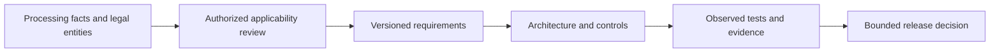

<!-- Module 05 | Part II | Week 5 | Status: educational draft; legal review pending
Author: course author with GPT-6 implementation assistance
Source inspection: 2026-11-22 | Independent legal review: NOT COMPLETED -->
# Module 05 — Laws, Regulation & Jurisdiction

> **Executive thesis:** Give counsel a precise processing activity, entity map and evidence packet. Turn the resulting legal interpretation into versioned architecture requirements, then test every lifecycle path against the approved boundary.

**Educational draft — legal review pending.** This chapter teaches how to prepare a review. It does not determine which law applies to a real organization. Its synthetic test outputs are records of an exercise, never legal or physical assurance. Module 04's outstanding source and manual review holds remain open.

| Field | Value |
|---|---|
| Part / week | II: Governance & policy / Week 5 |
| Difficulty / effort | Advanced / ten one-hour sessions |
| Prerequisites | Modules 01–03; Module 04 ecosystem evidence concepts |
| Key artifact | Regulatory applicability and architecture evidence matrix |
| Environment / cost | Python 3 standard library; local CPU; no GPU, account or paid service |
| Source inspection | 22 November 2026; exact scope in the evidence ledger |
| Study plan | [Hour-by-hour plan](../learning/schedule.html#module-05) |
| Practice | [Synthetic workflow lab](../labs/module-05/README.md) · [Eight-question deck](../social/module-05/CAROUSEL.html) |

## The decision: can this processing route be considered?

**Fictional scenario — Palm Industrial Group.** A UAE factory wants a maintenance assistant that retrieves drawings and transcribes technicians' questions. Its signed enterprise rule keeps raw inputs, embeddings, outputs, telemetry, evaluation records, support bundles and backups within **PLANT-A physical premises**. A second installation requires **no inbound or outbound network connectivity**. A supplier offers a UAE-hosted service with contractual data protection clauses and remote support.

The PM should request a route-specific legal review and reject architecture candidates that contradict those stated enterprise boundaries. A possible transfer mechanism is a question for counsel; it does not amend the factory's signed requirement. A private network to a domestic off-site service still leaves PLANT-A. If no eligible system can meet licence, quality, capacity and operating needs, record **NOT FEASIBLE UNDER CURRENT CONSTRAINTS** and evaluate a non-AI workflow.

This case is invented. It describes no actual supplier, customer, legal opinion or data export.

## Learning objectives

1. Separate territorial scope, processing purpose, entity role, legal transfer questions and enterprise policy.
2. Prepare distinct questions for UAE federal, DIFC, ADGM, Saudi and EU review without inventing universal localization rules.
3. Trace a legal interpretation into a requirement, owner, test, evidence record and reapproval trigger.
4. Include subprocessors, support, preprocessing, logs, activation, updates and recovery in a processing map.
5. Explain an adverse result with a bounded release decision and reproducible root-cause investigation.

## Ontology: from instrument to tested requirement

This **course-authored model**, linked to the [sovereignty ontology](../taxonomy/ONTOLOGY.md), is not an official regulatory classification:

**Authority → instrument → applicability question → authorized interpretation → requirement → processing route → control → test → evidence → review decision.**

| Entity | Record these properties | Avoid this shortcut |
|---|---|---|
| Processing activity | Purpose, individuals, data classes, retention and recipients | A country flag as the entire analysis |
| Legal entity | Establishment, role, contracting party and operator | Brand name substituted for actual recipient |
| Interpretation | Source version, pinpoint, assumptions, reviewer and expiry/revisit trigger | A PM marking a law applicable by intuition |
| Requirement | Exact boundary, affected artifacts, authority and exception process | A preference hidden in a weighted score |
| Evidence | Test version, observation, reviewer, date and limitations | A supplied document called proof without inspection |

An unknown applicable regime is an unresolved question. A known prohibited route is an adverse finding. Keep both in the record; do not average them into a readiness percentage.

## Teaching sections

### 5.1 UAE federal personal data protection framework

The official English text of Federal Decree-Law No. 45 of 2021 sets out scope and exclusions in Article 2. These include government data/entities, certain health and banking/credit data regulated by specific legislation, and establishments in free zones with special personal-data laws. Articles 22–23 address cross-border processing routes subject to conditions; they do not support a blanket claim that every personal-data operation must be physically hosted in the UAE.[^uae45]

**PM exercise:** Create one row per activity: the employer's staff directory, a factory drawing index and a customer support transcript. Mark the entity, purpose, potentially identifying content and requested legal decision. Do not declare an entire group exempt because one activity falls under another regime. Ask counsel to confirm the operative instrument and implementing measures for each activity.

For PLANT-A, maintain a separate enterprise-policy column. The factory boundary covers the complete named artifact inventory even where a legal analysis might permit a transfer. Record the issuer and version of that hypothetical policy; do not attribute it to the federal statute.

### 5.2 DIFC and ADGM data protection regimes

DIFC's Commissioner guidance distinguishes adequacy under Article 26, exceptions/safeguards under Article 27 and public-authority sharing under Article 28. ADGM's Office of Data Protection separately describes adequacy and Article 42 safeguards or derogations for other destinations. These are different review paths with their own conditions.[^difc][^adgm]

**Fictional comparison:** A DIFC procurement team asks an ADGM affiliate to operate a supplier-search assistant. The PM maps the actual recipient, personnel locations, backups and onward recipients, and asks each entity's reviewer to assess its role and transfer position. A shared corporate parent and a UAE address are insufficient descriptions of those facts.

**Deliverable:** Two separate review rows with a common route ID. Request the legal basis, transfer analysis, processor terms, onward recipients and unresolved assumptions. An adequacy list is a dated input to legal assessment, not a measurement of runtime geography. Do not infer that all mainland UAE recipients or all US recipients have the same treatment from a list entry.

### 5.3 Sector, government, and critical infrastructure considerations

The federal statute's scope exclusions make sector and entity classification material to the review.[^uae45] This lesson does not claim to inventory all banking, health, government, defence or critical infrastructure requirements. Treat that inventory as a required research and specialist-review task for a real project.

**Course method:** Identify the data owner and competent legal/security authority before supplier selection. Request the controlling instrument, classification policy, contract and facility rules. Record unresolved obligations as **PENDING**, with a responsible reviewer and a decision deadline.

For a fictional hospital, a clinical note assistant, public opening-hours assistant and employee policy assistant are three activities. Their purposes, risks and data flows differ. A tool that supports one does not automatically qualify for the others. Keep patient data out of this public learning lab; use generated examples only.

For an isolated utility terminal, inventory ordinary connections and maintenance paths: out-of-band management, hardware call-home, licence renewal, antivirus updates, time synchronization, support and disaster recovery. A reported physical air gap is an architecture claim requiring physical and operational inspection. A Python register cannot perform that inspection.

### 5.4 Saudi PDPL and relevant data transfer considerations

SDAIA's published amended PDPL Article 29 describes purposes and conditions for transfers or disclosures outside the Kingdom. The transfer regulation separately covers safeguards in Article 4, subsequent transfers in Article 5, revocation in Article 6 and specified risk-assessment cases in Article 7.[^ksa-pdpl][^ksa-transfer] A contract titled “SCC” is not a complete analysis of those provisions.

**Fictional scenario:** A Saudi employer proposes local inference, while a foreign support team receives diagnostic bundles. Ask what the bundles contain, who receives them, whether they include personal data, the purpose, onward routes and the proposed legal mechanism. Give counsel the route and facts; do not ask only “Is our model Saudi-compliant?”

**Practice:** In the lab, `SAUDI-TRANSFER-QUESTION` remains **UNVERIFIED** while its transfer review is pending. Its deliberately conservative synthetic country boundary is a course scenario policy, not a claim that the PDPL universally prohibits foreign processing. Test the difference by changing a contract field without changing the boundary: the boundary still governs the exercise.

### 5.5 GDPR, EU AI Act, and other global comparisons

GDPR Article 3 specifies territorial scope, while Chapter V begins with Article 44's transfer principles. The EU AI Act addresses a separate AI regulatory framework. The Commission's current implementation page includes phased application and amended high-risk transition dates; copying an old rollout chart can mislead.[^gdpr][^eu-ai]

**PM comparison method:** For each relevant market, ask separately about privacy scope, AI role and intended use, sector obligations, transfer conditions and contractual restrictions. This module establishes no blanket equivalence across EU, UK, US, India or GCC regimes and supplies no global legal clearance.

For a fictional education assistant serving EU users from the Gulf, record what it actually does: public FAQ, tutoring feedback, admissions ranking or student monitoring. Give reviewers that intended use, affected people and decision consequences. Do not classify every assistant identically because they share a foundation model. Before real launch, ask qualified reviewers to confirm the current operative text and application date for that use.

**Source discipline:** The evidence ledger records what was inspected on 22 November 2026. Reopen a time-sensitive instrument when the use, jurisdiction, recipient or implementation date changes. A retrieval date is not an enactment date or assurance that a page contains every amendment.

### 5.6 Residency, international transfers, contracts, subprocessors, and lawful access

DIFC guidance explicitly distinguishes processor-contract provisions from transfer safeguards and provides a separate public-authority sharing review path.[^difc] The course consequence is to keep several questions visible rather than use “DPA signed” as a universal green light.

| Review question | Evidence packet to request | Accountable role in the fictional project |
|---|---|---|
| Where is processing performed? | Per-artifact flow map, configured destinations, observed routes | Platform owner |
| Which entities receive or access data? | Contracting parties, operator roster, subprocessor register | Procurement + legal |
| Why is the processing permitted? | Versioned purpose and authorized legal interpretation | Legal/privacy reviewer |
| What if an authority requests access? | Request-handling and escalation process, applicable terms | Legal + security |
| What can a supplier change? | Notice, approval, audit and termination provisions | Procurement + service owner |
| What happens on failure or exit? | Tested fallback, restore, retention and deletion record | Operations + data owner |

These are course-authored evidence requests, not a list asserted to be mandatory under every regime.

**Hidden route exercise:** A transcription dependency sends audio outside PLANT-A before the local language model sees text. Local final inference does not cure that mismatch. Add preprocessing as a distinct route, including temporary buffers, confidence scores, embeddings, evaluation samples and crash dumps. Repeat for OCR and geospatial processing.

An air gap forbids network licensing and remote support in the fictional requirement, including temporary connections. Evaluate offline licensing, approved signed-media intake, malware screening, custody, rollback, local operators and recovery. If an indispensable dependency requires a network, report the conflict; only a competent authority can consider a requirement change.

### 5.7 How legal jurisdiction differs from operational or technical control

Use three separate questions: **Which instruments govern the activity? Who can operate or compel a change? Where do artifacts travel?** They interact but are not interchangeable. The diagram below is a course decision model.

A locally hosted server can have remote administrators or a remote backup destination. An enterprise-held encryption key is a control to evaluate; it does not establish the legal position of every recipient or remove all runtime paths. A foreign supplier might propose an offline system, but licensing, artifacts, operator access and actual installation remain questions to test.

**Counterfactual:** In [Architecture Studio](../learning/index.html), choose a premises-only use case, inspect all lifecycle paths, then change the boundary to country-only. Identify which candidates become eligible for assessment and which questions remain. Change it again to a physical air gap. Explain which network dependencies now fail. The Studio generates deterministic learning hypotheses; it does not read laws or evaluate real vendors.

### 5.8 Converting legal questions to reviewable requirements and evidence

Write a requirement so another reviewer can falsify it. Include the authority and date, exact activity, artifacts, allowed boundary, prohibited paths, test conditions, evidence owner and approval scope.

**Fictional REQ-05-PLANT:** “For the maintenance assistant, source drawings, audio, text, embeddings, outputs, operational logs, evaluation data, diagnostic bundles and backup copies remain at PLANT-A. No off-site support or fallback processing. Test normal, timeout, update, crash and restore paths before any restricted-data pilot.” The policy owner is fictional; this text is not a legal quotation.

A linked test packet should contain a build/configuration identifier, synthetic input, expected route, actual destination observations, allowed and denied traffic evidence, operator identity, backup/restore placement, reviewer and date. Absence of observed export in one test does not prove that all paths are safe.

Use these **course evidence states**:

- **BLOCKED:** A recorded prohibited route, rejected review or adverse test prevents release.
- **UNVERIFIED:** A destination, required path, review or test provenance is missing.
- **REVIEW_REQUIRED:** The fictional register is structurally complete and reports no veto; people must still assess it.
- **NOT FEASIBLE UNDER CURRENT CONSTRAINTS:** An authorized project conclusion after eligible alternatives fail minimum needs. The lab does not infer this from a budget alone.

The executable lab intentionally never outputs `PASS` or `COMPLIANT`. Its strongest result is a request for review.

## Hands-on lab and operational trade-offs

Open the [Module 05 lab](../labs/module-05/README.md). In 90–120 minutes, run 14 synthetic cases, alter at least three lifecycle paths, reproduce a hard failure and prepare an applicability matrix. The full study plan reserves additional time for interpretation, assessment and the PM artifact.

No model download, customer data or external endpoint is needed. On a 16 GB Apple Silicon laptop, the lab checks small JSON records using the Python standard library. It does not emulate a production platform, legal service or network appliance.

**Economics exercise (invented inputs):** If three reviewers spend two hours each at an assumed internal cost of 100 units/hour, review effort is `3 × 2 × 100 = 600 units`. Add operator training, offline-update handling, restore testing, model evaluation, evidence retention and licence costs separately. Compare architecture cost only after hard eligibility gates. Record estimates as assumptions, not prices or measured savings.

**Common failures:** Treating a domestic cloud as the named factory; reviewing inference while omitting ASR; accepting unsupported review labels; using legal transfer terms to waive a stricter policy; closing an incident after a firewall blocks one attempt; calling a model's downloadable weights proof of offline licensing.

## PM deliverable: applicability and architecture evidence matrix

Create a one-page executive decision plus a traceable appendix. Use one row per activity and route:

| Activity / route | Entity and role to confirm | Instrument / pinpoint | Reviewer question | Enterprise constraint | Control and negative test | Evidence / owner | Decision and revisit trigger |
|---|---|---|---|---|---|---|---|
| PLANT-A speech preprocessing | Recipient and operator unresolved | Authorized legal review pending | What data and onward recipients exist? | All derivatives remain at PLANT-A | Timeout must not invoke off-site ASR | Synthetic packet / platform owner | HOLD until evidence and review |

Definition of done: all nine lifecycle paths inventoried; applicability assumptions explicit; no invented statutory localization; adverse findings retained; gaps assigned to owners; versioned review reference; eligible alternatives and non-AI fallback; release scope and reapproval conditions stated. Feed this matrix into the Module 22 architecture blueprint and Module 24 executive defence.

## Module 05 knowledge assessment

**Q1.** Distinguish a data location, the territorial scope of a law and a named-site enterprise requirement. Give one fact needed for each.

**Q2.** A group operates mainland UAE, DIFC and ADGM entities. What activity and entity information should the PM give reviewers before selecting instruments or transfer mechanisms?

**Q3.** A Saudi workload has local inference and foreign diagnostic support. Which PDPL/transfer-regulation provisions and route facts should the reviewer inspect? Why is the contract title insufficient?[^ksa-pdpl][^ksa-transfer]

**Q4.** Design a negative test for an air-gapped speech assistant covering activation, support, updates and recovery. Identify what a JSON evaluator cannot establish.

**Q5.** **Real published source, fictional deployment.** DIFC's Commissioner describes Articles 26, 27 and 28 separately. A fictional PLANT-A buyer claims an Article 27 contract proves its off-site UAE service meets a plant-only rule. What conclusions does that guidance support, what remains unverified and which evidence could change the architecture decision?[^difc]

### Q6. Root-cause analysis: the support bundle nobody mapped

All events and records are fictional. Before testing, the team records **UNVERIFIED** because support and restore evidence are absent. The signed PLANT-A physical-premises rule covers all derivatives. For an alternative air-gapped terminal, no inbound or outbound network connectivity is allowed. A timeout produces a diagnostic bundle and an attempted request to an off-site support endpoint; the gateway denies it. There is **no verified evidence that real customer data were exported**. The proposal is to sign transfer clauses, suppress the warning and mark production ready.

Explain the state transition; separate observed attempted routing from confirmed disclosure; identify immediate technical cause and systemic process cause; preserve relevant evidence; assign mitigation owners; define normal, degraded, update and restore retests with negative controls; discuss the air-gap variant; state residual risks and a bounded closure decision. Include **NOT FEASIBLE UNDER CURRENT CONSTRAINTS** if every eligible alternative fails required quality or offline operation. A firewall block alone is not an application design acceptance.

Worked answers and scoring guidance are maintained separately from learner materials and excluded from the generated website.

## Key takeaways and next module

A precise processing map makes legal review actionable. An authorized interpretation becomes an engineering requirement only through a versioned boundary, accountable owner and observed test. Good contracts, geographical placement, operational control and model portability answer different questions.

Module 06 develops governance ownership and risk acceptance. Bring this module's unresolved questions and evidence matrix; do not relabel them as completed approvals to start the next lesson.

## Evidence ledger and source limits

Primary text/guidance below was opened on **22 November 2026**. English text is used for teaching; a real review must confirm operative language, amendments and applicable subordinate instruments. This is an inspected-source record, **not independent legal review**. Short quotations total no more than 25 words per source across this chapter.

| ID | Exact short quotation | Publisher / pinpoint | Supported scope and limit |
|---|---|---|---|
| UAE45 | “Government Data” | UAE Legislation, Decree-Law 45/2021, Art. 2(2)(a) | Scope exclusion in the inspected text; no group-wide exemption inferred |
| DIFC | “There are exceptions, however” | DIFC Commissioner, Data Export & Sharing, Art. 27 discussion | Separate transfer paths and public-authority questions; no customer clearance |
| ADGM | “one of the safeguards set out under Article 42” | ADGM ODP, Adequate Jurisdictions, final substantive paragraph | Conditional route for unlisted jurisdictions; no blanket country equivalence |
| KSA-L | “The Transfer or Disclosure shall be limited” | SDAIA, amended PDPL Art. 29(2)(C) | Transfer conditions exist; no universal localization conclusion |
| KSA-T | “the controller shall halt the transfer or disclosure” | SDAIA Transfer Regulation, Art. 6(2) | Revocation has consequences; examine exact conditions |
| GDPR | “General principle for transfers” | EUR-Lex, GDPR Art. 44 heading | Read Chapter V with territorial scope; not an approval for a hypothetical recipient |
| EU-AI | “with some exceptions” | European Commission, AI Act / Application timeline | Dynamic phased implementation; verify operative text and intended use |

[^uae45]: UAE Legislation, *Federal Decree-Law No. 45 of 2021 Concerning the Protection of Personal Data*, Arts. 2 and 22–23; official English PDF, https://www.uaelegislation.gov.ae/en/legislations/1972/download. Opened 2026-11-22. HTML landing page returned 403; the PDF text was available. Implementing instruments and customer applicability not independently reviewed.
[^difc]: DIFC Commissioner of Data Protection, *Data Export & Sharing*, sections on Arts. 26–28 and processor clauses, https://www.difc.com/business/registrars-and-commissioners/commissioner-of-data-protection/data-export-and-sharing. Opened 2026-11-22. Living guidance, no publication date asserted; not a substitute for the operative law and legal interpretation.
[^adgm]: ADGM Office of Data Protection, *Adequate Jurisdictions*, transfer discussion and Art. 42 reference, https://www.adgm.com/operating-in-adgm/office-of-data-protection/jurisdictions. Opened 2026-11-22. Living guidance; recipient-specific qualifications must be checked.
[^ksa-pdpl]: SDAIA Personal Data Protection Platform, *Personal Data Protection Law*, English display, amended Art. 29, https://dgp.sdaia.gov.sa/wps/portal/pdp/knowledgecenter/details/PDPL/. Opened 2026-11-22; select English. No reliance on the older unamended English text hosted elsewhere.
[^ksa-transfer]: SDAIA Personal Data Protection Platform, *Regulation on Personal Data Transfer Outside the Kingdom*, English display, Arts. 4–7, https://dgp.sdaia.gov.sa/wps/portal/pdp/knowledgecenter/details/RegulationonPersonalDataTransferOutsidetheKingdom/. Opened 2026-11-22; select English. Conditions must be read together with amended Art. 29.
[^gdpr]: European Union, *Regulation (EU) 2016/679*, Arts. 3 and 44, Chapter V, official EUR-Lex text, https://eur-lex.europa.eu/eli/reg/2016/679/oj/eng. Opened 2026-11-22. Customer territorial scope and transfer analysis remain reviewer questions.
[^eu-ai]: European Commission, *AI Act*, Application timeline, page marked last updated 19 October 2026, https://digital-strategy.ec.europa.eu/en/policies/regulatory-framework-ai. Opened 2026-11-22. Dated explanatory page; obtain current operative text and use-specific advice before relying on a deadline.
