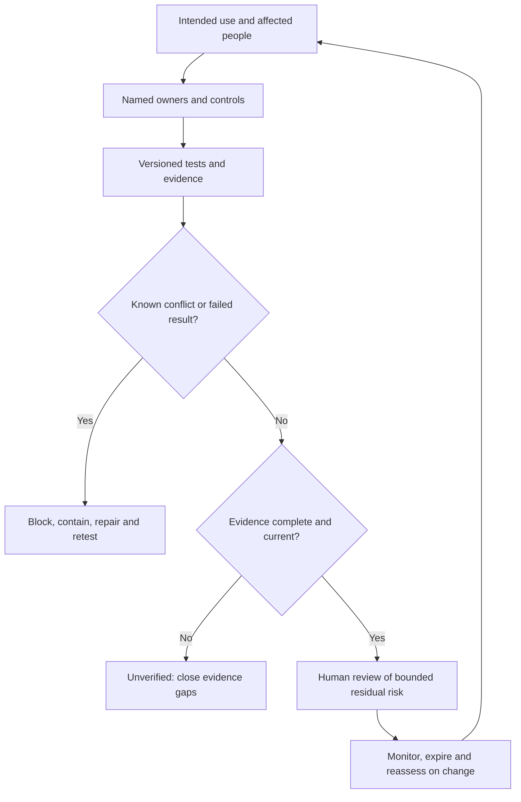

# Module 06 — Governance, Responsible AI & Risk

> **Executive thesis:** Give named people authority to restrict, stop and retest an AI system. A risk register becomes useful when each risk connects to an intended use, an observable control, versioned evidence and an accountable decision.

**Educational draft; independent assessment and manual accessibility review pending.** Source inspection: 25 November 2026. This chapter offers a course-authored operating model, not ISO certification, a legal opinion or proof of production safety. Two distinct author self-audits are recorded in the repository; independent review has not been completed.

| At a glance | Working scope |
|---|---|
| Part / week | II, Week 6; intermediate to advanced |
| Study effort | Ten one-hour sessions in the [study plan](../learning/schedule.html) |
| Prerequisites | [Requirements](03-enterprise-sovereignty-requirements-strategy.md) and [legal applicability](05-laws-regulation-jurisdiction.md) |
| Output | Governance charter, RACI, risk register and audit readiness plan |
| Lab | Python 3.11+, standard library, synthetic records, CPU only; no cloud account |
| Review boundary | Primary public guidance inspected; full paid ISO standards not inspected |

## 1. Executive brief: who can stop the release?

**Fictional UAE factory, PLANT-A.** An Arabic-English maintenance assistant retrieves approved manuals. Operators must validate the cited procedure before acting. The company requires every protected artifact and derivative to remain inside the named physical factory. A stricter variant has a physical air gap. These are scenario requirements, not statements of UAE law.

The product team shows a 1.58% overall error rate and requests launch. Arabic queries have a 30% error rate. A diagnostic export goes to a vendor campus in the same country. The release committee has a slide saying “human oversight” but no test showing that an operator can halt an unsafe answer. Three different problems require three different remedies: subgroup quality, physical routing and effective intervention.

**Decision:** Hold the proposed release. Retain a non-AI manual lookup process while owners repair and retest the specific failures. An executive's risk signature cannot make a known physical routing conflict satisfy the unchanged factory requirement. Changing that requirement would require a separate, explicit, authorized decision and fresh applicability review.

A narrow pilot can be reconsidered only against a stated use, build, population, environment and time window. Every favorable conclusion should identify what would invalidate it.

## 2. Learning objectives

By the end, you should be able to assign decision rights; distinguish frameworks, management standards and product controls; turn responsible-AI principles into test procedures; calculate subgroup error and evidence gaps; handle model change and incidents; and present a reviewable operating model with residual risk and a retest date.

## 3. Taxonomy, ontology & the mental model

Connect this module to the [shared ontology](../taxonomy/ONTOLOGY.md). The following extensions are **course-authored**, not an official NIST or ISO taxonomy.

| Entity | Meaning | Relationship or invariant |
|---|---|---|
| Intended use | Task, users, environment, permitted actions and exclusions | Release is bounded by intended use |
| Risk | A potential adverse outcome with a cause and affected party | Risk is treated by controls; severity is not a test result |
| Control | A behavior or constraint that reduces a specific risk | Control is evaluated by a test |
| Evidence record | Versioned observation with method, artifact and reviewer | Evidence applies to a specific build and scope |
| Decision authority | Person authorized to accept bounded residual risk or stop work | Authority owns a decision and expiry, not the truth of a metric |
| Incident | An observed adverse event or suspected control failure | Incident reopens controls and prior release assumptions |

A taxonomy groups risks, for example quality, security, privacy and operational harm. An ontology explains their connections: an Arabic retrieval failure affects operators, challenges a quality control and can reopen a release decision. Adding ten risk labels without those links makes the register harder to act on.

Evidence states are also separate from lifecycle stages. `UNVERIFIED` means required evidence is missing or unsuitable. `BLOCKED` means a known conflict or adverse result requires action. In this lab, even a complete favorable record becomes only `REVIEW_REQUIRED`. The program reads declarations; it does not authenticate the facility, reviewers or underlying tests.

## 4. Technical deep dive: an operating model with enforceable gates

### 6.1 Governance structures, ownership, and decision rights

Use three layers. Enterprise leadership sets prohibited uses, risk appetite and escalation rules. A portfolio group prioritizes investment and resolves cross-team dependencies. A product release group reviews the evidence for one version and operating scope. The layers must specify who can veto a release, who can approve a limited exception and who can operate the stop mechanism during an incident.

Separate the person implementing a control from the person challenging its evidence. An accountable owner remains responsible for the resulting decision; a validator provides a reasoned assessment. A legal reviewer answers applicability questions, an infrastructure owner demonstrates the site boundary, and an operator validates practical usability. None can substitute for all the others.

A course RACI assigns **R**esponsible execution, one **A**ccountable decision, **C**onsultation and **I**nformation per activity. Avoid “everyone accountable”: when an Arabic failure appears during a night shift, the operator needs one escalation contact and permission to suspend the assistant without waiting for a monthly committee.

| Activity | Responsible | Accountable | Consulted |
|---|---|---|---|
| Freeze intended use and exclusions | Product lead | Business owner | Operators, safety, legal |
| Test subgroup quality | Evaluation engineer | Validation lead | Arabic domain reviewer |
| Verify every site/network path | Platform engineer | Infrastructure owner | Security, operations |
| Authorize bounded pilot | Release coordinator | Delegated business authority | Independent validator, legal as applicable |
| Stop and contain an incident | Duty operator | Incident commander | Product, infrastructure, affected users |

This is an illustrative assignment. A small team may combine some roles, but should record conflicts and use an external challenger when it cannot provide credible separation. The lab flags duplicated named roles as an evidence gap rather than claiming this simplified rule is a universal standard.

### 6.2 NIST AI RMF and generative AI risk considerations

NIST AI RMF 1.0 organizes work into Govern, Map, Measure and Manage. Govern operates across the other functions; the functions support iteration rather than a mandatory sequence. NIST explicitly says: “Actions do not constitute a checklist”. Its resource page currently notes that a revision is in progress; this lesson pins the 2023 framework.[^rmf]

For the fictional assistant, our mapping is: Govern assigns stop authority; Map identifies operators and incorrect-procedure harm; Measure tests retrieval and subgroup failures; Manage restricts scope, repairs controls and monitors changes. That mapping is a teaching interpretation, not a NIST assessment result.

The July 2024 generative-AI profile discusses risks including confabulation, harmful bias, privacy and human-AI configuration. Suggested action MS-2.5-003 says “Review and verify sources and citations”. MS-2.5-001 cautions against extrapolating from narrow anecdotal assessments.[^genai] A course application is to test whether the retrieved manual actually supports the answer and whether operators over-trust plausible wording. A response with a citation can still cite the wrong procedure.

### 6.3 ISO/IEC 42001 and related governance/security standards

ISO's public summary describes ISO/IEC 42001:2023 as specifying requirements for “an Artificial Intelligence Management System (AIMS)”. It concerns organizational policies and processes for establishing, maintaining and improving AI management. ISO distinguishes this from ISO/IEC 23894 risk guidance and lists ISO/IEC 27001:2022 in an AI/information-security package.[^aims]

ISO/IEC 23894:2023's public abstract says its guidance can be “customized to any organization and its context”.[^risk] Use these public descriptions to ask about organizational scope, risk processes and information-security coordination. This lesson has not inspected the full paid standards, their complete clauses or an organization's audit evidence. It offers no clause-by-clause conformity checklist and makes no certification claim.

In procurement, ask for the actual certificate if one is claimed, its issuer, validity, scope and exclusions. Then separately request evidence about the proposed workload and site. Even an authentic organizational certificate would not itself establish that this build's telemetry remains in PLANT-A. The latter statement is course reasoning about the difference between organizational scope and a concrete routing claim.

### 6.4 Fairness, transparency, accountability, explainability, and oversight

The OECD principles, updated in May 2024, include fairness/privacy, accountability, safety and “Transparency and explainability”.[^oecd] These are a useful vocabulary for questions; they do not settle this fictional customer's legal duties.

Turn each principle into a task-specific observation. For fairness, decide who could receive worse outcomes and which error causes harm. Language cohorts are a diagnostic starting point, not a complete account of fairness. Stratify by dialect, manual type and operational task when justified, while controlling privacy risks and sample limitations. Do not infer a protected characteristic from language alone.

Define error before calculating it. In the lab, an error is an answer marked incorrect against a synthetic reference. In a real maintenance study, “wrong procedure,” “unsupported instruction” and “refusal of an answerable question” have different consequences and may need separate measures. The lab's 10% error ceiling, 10 percentage-point disparity limit, minimum sample of 20 and 30-day evidence window are illustrative course rules. They are neither statutory thresholds nor statistical guarantees.

For transparency, tell operators the assistant's scope, version and escalation route. For accountability, retain the decision owner, rationale, expiry and appeal route. For explainability, NISTIR 8312 distinguishes explanation, meaningfulness, explanation accuracy and knowledge limits.[^xai] Our application is to show a supporting manual passage in language an operator understands, check that it supports the answer, and refuse tasks outside approved use. A fluent explanation of a wrong answer is a failure, not a compensating benefit.

For oversight, test a person with realistic workload, time pressure and uncertainty. Can they notice a wrong cited procedure, stop downstream action and switch to an approved manual process? Record detection time, intervention success and disagreement resolution. A named supervisor without time, competence, information or stop authority is an untested control.

### 6.5 Model risk management and intended-use boundaries

Maintain a system inventory, not merely a list of model names. A release identity should cover weights/version, retrieval index, approved source corpus, prompt template, tool permissions, parser/OCR, configuration and evaluation set. Changing any element can invalidate old evidence even when the model weights stay the same.

Write intended use as a contract: “Arabic-English retrieval of approved maintenance manuals for trained operators; advisory lookup only; no direct machine control; no personnel scoring.” Identify supported languages, sites, machines and fallback behavior. Automatic work-order approval or machine actuation is a changed use and needs a new assessment. A sales request is not release authorization.

Treat uncertainty explicitly. Zero observed errors in five Arabic samples is not evidence of zero risk. Store the denominator and sampling method, identify missing tasks and arrange a larger representative evaluation. Synthetic lab counts teach the calculation; they do not establish statistical confidence, production prevalence or safety-critical acceptability.

### 6.6 Risk registers, controls, testing, and audit evidence

A useful row connects cause to consequence: stale Arabic manual indexing causes incorrect procedure retrieval, which may mislead an operator. Record affected users, severity, uncertainty, preventive/detective controls, owner, evidence identifier, open action and review date. Keep inherent risk before treatment separate from residual risk after evidenced controls. Multiplying ordinal severity and likelihood scores can prioritize discussion, but does not turn uncertainty into measured probability.

The lab calculates error as `errors / n` for each supplied group and aggregate error as `sum(errors) / sum(n)`. In its masked-language case, 98 errors in 9,800 English queries plus 60 in 200 Arabic queries give 158/10,000 = 1.58% overall. The Arabic rate is 30%; the difference from English's 1% is 29 percentage points. The aggregate does not cancel the subgroup failure.

Each control needs an outcome, test ID, evidence pointer, reviewer, date and build ID. A file's existence is not a passing outcome. A passing observation for v2 does not validate v3. A current test with an adverse result blocks even when other records are missing. An unresolved incident also blocks the lab's proposed release. Risk acceptance text is deliberately ignored by the evaluator.

### 6.7 Design an enterprise AI management operating model

Use five recurring activities: intake and inventory; impact/use definition; control implementation and validation; release decision; monitoring and incident/change review. Define entry/exit criteria and owners for each, plus a fast stop path that bypasses routine meeting cadence. For PLANT-A, include trained Arabic reviewers and a site infrastructure owner rather than relying entirely on a central model team.



*Course-authored decision graph, version 1. A known failure takes priority over incomplete evidence. Human review follows favorable evidence; monitoring reopens the scope.* The website includes a static SVG and an expandable source equivalent.

Create an audit readiness index keyed by system/build, intended use, control ID, observation and decision. Preserve access and retention restrictions: evidence can contain prompts, embeddings, OCR extracts and diagnostic details, so its own storage and review routes belong inside the boundary register. An auditor's request does not automatically authorize an off-site copy.

## 5. UAE/GCC case and global comparison

For this fictional UAE factory, all protected information and derivatives must stay in PLANT-A. Cover inference prompts/outputs, training/evaluation material, embeddings/vector indices, speech/OCR, diagnostics, telemetry, backups, support/activation and failover. Also inventory model weights, logs, update media and privileged administration within these paths. A country-resident managed service still conflicts with a factory-only requirement if any protected artifact leaves the physical site.

For the air-gap variant, network isolation adds a separate constraint. Plan on-site recovery, controlled removable-media transfer, approved offline updates and activation, malware screening and operator procedures. A local model with online licence activation or remote vendor support is a blocked proposal under that unchanged rule. The lab checks declarations about these paths; actual packet capture, configuration inspection, recovery drills and media controls remain future real-world evidence.

Compare with a fictional country-bound research assistant whose policy permits another facility in the same country. The lab permits that site difference under `country`, while rejecting it under `premises`. This demonstrates policy scoping, not a claim that a particular jurisdiction permits the processing. Carry the open applicability questions from Module 05 into legal review.

## 6. Practical lab: challenge a governance register

Open the [complete lab guide](../labs/module-06/README.md). Run 16 synthetic cases and 16 regression tests locally:

```bash
python3 labs/module-06/evaluate.py labs/module-06/cases.json
python3 -m unittest discover -s labs/module-06 -p 'test_*.py' -v
```

Python 3.11+ is the only lab dependency. No model, Docker, GPU, cloud account, external API, paid resource or customer information is required. The evaluation stage uses no network. It is suitable for the Apple Silicon/16 GB course baseline; actual verification here used Python 3.14 on macOS, not every supported machine.

Compare the complete record, masked-language error, undersampling, off-site diagnostics, air-gap activation and stale-build cases. Preserve the original manifest, create a proposed repair in a separate copy and show which observation justifies each status change. Do not edit `expected_status` to make a failing test pass.

**Acceptance:** Calculate subgroup metrics from counts; name every known blocker and missing control; show hard conflicts surviving executive acceptance text; preserve build/date provenance; produce a bounded retest request. No output is named “compliant”, “certified” or production “pass”. A synthetic repair earns further review only.

## 7. The AI PM decision playbook

Decide whether to fund a constrained pilot, postpone it or retain manual lookup. Ask the CTO which changed components invalidate evidence; ask operators whether intervention is practical; ask infrastructure to demonstrate site/air-gap behavior; ask legal which applicability questions remain unresolved; ask finance to fund validation and fallback capacity.

Apply non-negotiable gates before weighted preferences. Compare pilot value, evaluation cost and support burden only among designs that can satisfy the physical requirement. A high business-value score cannot average away an off-site diagnostic route.

## 8. Economics, operating model, and trade-offs

An illustrative planning model is `validation effort = languages × task families × reviewed examples × minutes per example / 60`. With 2 languages, 4 task families, 50 examples and 3 minutes each, a first review takes 20 reviewer-hours before adjudication, reruns and oversight drills. These are invented planning inputs, not market prices or a validated sample-size recommendation. Doubling languages doubles that part of the effort; scarce domain reviewers can become the bottleneck.

Budget also for on-site recovery hardware, offline update testing, incident cover and maintaining the manual fallback. Narrowing intended use reduces the validation surface but limits product value. Adding automatic actions expands both harm potential and required control evidence. Revisit this trade-off before promising roadmap dates.

## 9. Anti-patterns and failure cases

- A committee without stop authority produces discussion without containment. Name the duty role and exercise it.
- An aggregate metric hides a failing cohort. Retain denominators and task-level failure analysis.
- An old evidence folder validates the wrong build. Link every observation to release identity and scope.
- An organizational standard is used as a product routing claim. Inspect the actual system and paths.
- A postmortem ends at “the model hallucinated.” Trace the erroneous retrieval, missing evaluation and release decision that allowed exposure.

## 10. PM deliverable and capstone connection

Produce a two-page charter plus three compact tables: RACI, risk/control/evidence register and audit readiness index. Include use/exclusions, affected users, hard boundaries, delegated stop/release authority, conflict handling, incident escalation, change triggers and decision expiry. The register must contain one subgroup quality risk, one boundary risk, one oversight risk and one recovery risk.

**Definition of done:** Each risk has an owner and test; every evidence reference names the build/date/outcome; unresolved items have an action and retest owner; the incident procedure has a usable fallback; a release decision states residual risk and scope without certifying it. Use the separate facilitator rubric for marking. The capstone will reuse these identifiers across its PRD, architecture, release pipeline and executive defense.

## 11. Module 06 knowledge assessment

**Q1.** Assign responsible, validating and accountable roles for the factory assistant. Which decision must an operator be able to make before the next committee meeting?

**Q2.** Explain the different jobs of NIST AI RMF, ISO/IEC 42001 public management-system description and a build-specific control test. What evidence is missing from a bare certificate claim?

**Q3.** A manager proposes ranking candidate architectures by averaging quality, cost and sovereignty scores. One option exports protected diagnostics off site. Explain your decision procedure under the unchanged factory requirement.

**Q4.** Design one measurable test each for explanation accuracy and meaningful human oversight. State who reviews failures and which evidence becomes invalid after a retrieval-index change.

**Q5.** Microsoft documents a PDF scorecard accompanying Azure Machine Learning's Responsible AI dashboard and says it can be shared offline.[^dashboard] In the **hypothetical** air-gapped PLANT-A proposal, a salesperson treats this as proof that the whole evaluation pipeline can run offline inside the factory. Which documented behavior is established, which deployment claims remain unverified, and what evidence would change your decision? This is not a report of a Microsoft customer incident.

### Q6. Decision and root-cause scenario

Before a v3 pilot, the register is `UNVERIFIED`: only v2 oversight evidence exists. A v3 test then observes 98/9,800 English errors, 60/200 Arabic errors and an off-site diagnostic export. The proposed fix improves the system prompt; the owner wants to close the incident because the aggregate error is below 2%.

Specify status transitions, direct and systemic causes, affected controls, containment, accountable owner and mitigation. Define a dated, build-linked retest that distinguishes prompt quality from retrieval and routing repairs. State the residual uncertainty and the strongest justified closure decision. Do not assume the proposed prompt change worked.

**Scenario challenge:** A customer requests automatic machine actuation next week. Explain how intended-use change affects the charter, evidence and roadmap. Worked answers and scoring are in the separate source-repository facilitator key; they are excluded from the public reader build.

## 12. Key takeaways

Give governance a concrete stop action and a decision owner. Preserve subgroup failures and version-specific evidence. Treat physical boundaries as gates. Reopen the review when use, data, components or incidents change the conditions of the original decision.

## 13. Evidence ledger, quotations and further reading

All sources inspected 25 November 2026. Quotes are short extracts; interpretations and course procedures are ours. ISO entries rely only on public summaries, not full standards. Guidance is not presented as local binding law.

| ID | Exact short quotation | Source and pinpoint | Bounded interpretation |
|---|---|---|---|
| G1 | “Actions do not constitute a checklist” | NIST AI RMF 1.0, Core introduction[^rmf] | Framework functions need contextual application |
| G2 | “Review and verify sources and citations” | NIST AI 600-1, MS-2.5-003, printed p. 31[^genai] | Test support for generated claims |
| G3 | “an Artificial Intelligence Management System (AIMS)” | ISO/IEC 42001:2023 public overview[^aims] | Organizational management scope |
| G4 | “customized to any organization and its context” | ISO/IEC 23894:2023 public abstract[^risk] | Context matters to risk guidance |
| G5 | “Transparency and explainability” | OECD AI Principles overview, values heading[^oecd] | Principles inform questions, not this site's certification |
| G6 | “Knowledge Limits” | NISTIR 8312, executive summary p. ii[^xai] | Bound explanation and operating scope |
| G7 | “share them offline” | Microsoft Learn, dashboard introduction[^dashboard] | Describes scorecard sharing, not offline processing |

[^rmf]: NIST, *AI Risk Management Framework 1.0*, Core (2023), https://airc.nist.gov/airmf-resources/airmf/5-sec-core/. Page states revision in progress. Verified: 2026-11-25.
[^genai]: NIST, *Artificial Intelligence Risk Management Framework: Generative Artificial Intelligence Profile*, NIST AI 600-1 (July 2024), https://nvlpubs.nist.gov/nistpubs/ai/NIST.AI.600-1.pdf, suggested actions MS-2.5-001 and MS-2.5-003, printed p. 31. Verified: 2026-11-25.
[^aims]: ISO, *ISO/IEC 42001:2023*, edition 1 (December 2023), public overview and FAQ, https://www.iso.org/standard/42001. Full paid standard not inspected. Verified: 2026-11-25.
[^risk]: ISO, *ISO/IEC 23894:2023*, edition 1 (February 2023), public abstract, https://www.iso.org/standard/77304.html. Full paid standard not inspected. Verified: 2026-11-25.
[^oecd]: OECD, *AI Principles overview*, updated principles May 2024, https://oecd.ai/en/ai-principles, values-based principles. Verified: 2026-11-25.
[^xai]: NIST, *Four Principles of Explainable Artificial Intelligence*, NISTIR 8312 (September 2021), executive summary p. ii, https://nvlpubs.nist.gov/nistpubs/ir/2021/NIST.IR.8312.pdf. Verified: 2026-11-25.
[^dashboard]: Microsoft Learn, *Assess AI systems by using the Responsible AI dashboard*, Azure Machine Learning API v2 documentation, introduction and components, https://learn.microsoft.com/en-us/azure/machine-learning/concept-responsible-ai-dashboard?view=azureml-api-2. Publisher-described functionality; no product deployment tested here. Verified: 2026-11-25.

## 14. Publish, practice and what comes next

Use [Architecture & Learning Studio](../learning/index.html), generate a premises-only or air-gapped proposal and examine its evidence challenge. The rule-driven tutor now points evidence-state remediation here. Export a synthetic decision record and assign owners, versioned tests and a review expiry using this chapter's charter.

Change one constraint from premises to country scope and compare which routes become candidates. That counterfactual changes the scenario requirement; it does not establish legal permission. Studio keeps learning progress locally, supports explicit export and never authenticates vendor or facility claims.

Explore the [eight-question HTML carousel](../social/module-06/CAROUSEL.html) and [accompanying post](../social/module-06/POST.md). Module 07 will turn these governance decisions into an end-to-end physical-to-application reference architecture, with explicit data, compute, management and control planes. The seven-topic learning package is available as a draft while independent assessment and manual accessibility review remain open.
