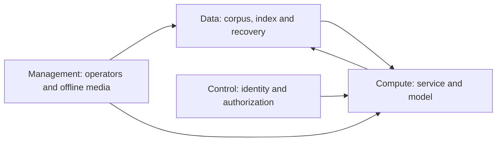

# Module 07 — End-to-End Sovereign AI Stack & Reference Architecture

**Educational draft; independent assessment and manual accessibility review pending.** Source inspection: 25 November 2026. All factory examples and the four-plane taxonomy are course-authored. This lesson does not certify a product, facility or legal-compliance result.

| At a glance | Scope |
|---|---|
| Week / effort | Week 7; [ten one-hour study sessions](../learning/schedule.html#module-07) |
| Prerequisites | Modules 03, 05 and 06 |
| Artifact | Architecture decision record and executive justification |
| Lab | Python 3.11+, CPU, synthetic graph; no cloud cost |

## 1. Executive brief

A local model server is one component of an enterprise architecture. For the fictional PLANT-A maintenance assistant, the PM must decide whether every dependency can operate under the same physical and connectivity constraints. A cloud identity dependency or off-site recovery copy can invalidate an otherwise local inference design. Preserve the Module 06 intended-use limit: advisory manual lookup, not automatic machine actuation.

## 2. Learning objectives

Trace physical-to-application dependencies; distinguish the four course planes; model every lifecycle route; classify hard conflicts separately from gaps; and defend an architecture decision with scoped evidence and a retest owner.

## 3. Taxonomy and ontology

Extend [shared ontology](../taxonomy/ONTOLOGY.md) with Component, Plane, TrustZone, LifecyclePath, Dependency and ArchitectureDecision. Component participates in a plane, operates at a site and has an owner. A lifecycle path connects components, carries artifacts and is assessed against a requirement. An architecture decision selects a bounded option based on constraints and evidence. A zone label never establishes authorization by itself.

## 4. Technical deep dive

### 7.1 Physical-to-application stack

Start at the facility: power, cooling, physical access and network termination. Then identify compute/chips, storage and network devices; host operating systems and runtimes; model serving, retrieval and policy services; application interfaces and users. Trace shared dependencies back down the stack. An on-site application that depends on remote key release is not self-contained merely because its web server sits in the building.

Allocate owners at each layer. The product lead should be able to ask who restores the model service, who approves an offline package and who can alter the network route. A vendor contract that excludes one operational layer leaves a responsibility gap that belongs in the decision record.

### 7.2 Data, compute, management, and control planes

In this course model, the data plane stores and transforms information; the compute plane executes workloads; the management plane handles administration and operations; the control plane determines policy, identity and routing decisions. One product can implement several functions. Split these into distinct graph nodes when their owners, locations or privileges differ.

Kubernetes documents a control plane and worker nodes, with an API server, scheduling and state management distinguished from node runtime responsibilities.[^kubernetes] This is a concrete component example, not an official definition of the course’s four-plane taxonomy. We have not deployed a cluster in this lab.

This separation reveals hidden dependencies. A local inference process may have a remote management console. A local vector index may use an external embedding service. A control-plane outage may prevent login even while compute remains healthy. Draw the operational dependency as an edge rather than treating it as a footnote.

### 7.3 Lifecycle from ingestion and training to deployment and retirement

Map ingestion/staging, training and evaluation, embeddings, speech/OCR, inference, outputs, diagnostics, telemetry, backup, support, activation, updates, failover and retirement. Intermediate and failed-operation artifacts deserve the same attention as final responses. Retirement includes deletion scope, remaining replicas, access removal and evidence retention; deleting one endpoint does not establish removal of every copy.

The lab declares fourteen path purposes and rejects an incomplete inventory as unverified. This is a completeness rule for the teaching fixture, not proof that every real workload has exactly fourteen paths. A real application may need several edges per purpose and additional purposes.

### 7.4 Boundaries of control, trust zones, and privileged administration

NIST SP 800-207 rejects implicit trust based solely on physical or network location.[^nist] Our course application therefore evaluates location and authorization separately. A physical boundary concerns where components and artifacts exist. A trust boundary concerns which identity or administrative authority can act. Crossing a zone requires an explicit authorization model even inside one building. Physical location alone does not validate a service credential, tenant permission or support session.

For the air-gap scenario, every network transport is a conflict. The alternative update path uses controlled media in the declared graph; actual media screening, signatures, rollback and custody still require evidence. The lab cannot authenticate those procedures and never promotes a declared path to production approval.

### 7.5 Enterprise reference architectures

Compare factory-local advisory lookup, a country-bound managed option and manual lookup fallback. The managed option is not feasible under the unchanged factory-only requirement when components operate off site. It can be considered only in a separately authorized scenario with different constraints. Keeping manual lookup available may reduce continuity risk while the AI pilot remains blocked.

Reference diagrams should show infrastructure and administrative paths as well as the happy-path user request. Make recovery and update edges visible. Attach a plain-language walkthrough so a reader can identify the same assumptions without interpreting a graph language.

### 7.6 Architecture for variable sovereignty requirements

Use a counterfactual that changes one requirement at a time. Changing physical-premises scope to country scope may admit another domestic campus; it does not imply an international transfer is lawful. Changing connectivity from air gap to controlled network access introduces policy, monitoring and dependency questions rather than automatically approving the new path.

Distinguish infeasible combinations from incomplete evidence. A known off-site copy violates a premises rule. An undocumented backup destination is unverified. Preserve both conclusions if the same design has both problems. Business value and favorable tests elsewhere cannot cancel the known conflict.

### 7.7 Architecture decision records and trade-off analysis

An ADR records the decision, alternatives, constraints, consequences, evidence and reversal triggers. Reuse control IDs from the governance charter. Compare cost and performance only after hard gates; record uncertain estimates rather than filling gaps with vendor claims.

The lab exports safe editable Mermaid and a three-state triage result. The PM deliverable adds what the program cannot decide: customer value, ownership, legal applicability, operating capacity and acceptable residual risk. A complete synthetic graph reaches REVIEW_REQUIRED, leaving the decision bounded and accountable.



*Course-authored plane view. Data and compute exchange context/results; management controls ingestion, update and recovery operations; identity and authorization gate execution. The lab exports the more detailed fourteen-purpose component graph. Neither diagram is observed infrastructure evidence.*

## 5. UAE/GCC case and reference walkthrough

The **fictional UAE PLANT-A** assistant supports Arabic-English manual lookup. The application has no permission to actuate machinery. Every declared component and protected artifact must stay at the factory; a stricter variant has no network transports. These are enterprise scenario rules, not assertions about UAE law. Module 05's unresolved legal questions still require qualified review.

Walk through ingestion to a local corpus, embeddings into an on-site index, context assembly, model execution and the returned advisory answer. Then follow the less visible edges: operator diagnostics, identity/activation, backup/restore, failover and update media. Training and speech/OCR paths remain in the inventory even if unused in an initial pilot; record why they are disabled and how an unauthorized activation would be detected. Do not erase a dependency just because it is infrequent.

For comparison, a separately authorized country-bound scenario may permit a domestic campus. That scope change alters feasibility; it does not establish lawful processing or make the campus physically part of PLANT-A. Country, site and authorization are separate properties in the decision record.

The lab's four planes are conceptual responsibilities, not four mandatory servers. Splitting every function into a separate appliance can add failure modes and cost without improving control. Combine functions only where ownership, privilege and failure containment remain reviewable. At minimum, make the shared dependency explicit so one service outage is not counted as several independent failures.

## 6. Practical lab and evidence

Use the [lab guide](../labs/module-07/README.md), synthetic `factory.json` and the standard-library validator. From the repository root:

```bash
python3 labs/module-07/validate.py labs/module-07/factory.json
python3 labs/module-07/validate.py labs/module-07/factory.json --mermaid
python3 -m unittest discover -s labs/module-07 -p 'test_*.py' -v
```

Python 3.11+, CPU only, no model, Docker, cloud account or paid service. Preparation requires obtaining the public files; the evaluation stage uses no network. Default target is the Apple Silicon/16 GB course baseline; verification here uses Python 3.14 on macOS. Allow 60–90 minutes for graph mutations and the first decision record. No cleanup bill or cloud resource remains.

Fourteen tests exercise every declared lifecycle purpose, all four planes, duplicate-node conflicts, unknown edge conflicts, malformed input, build provenance and safe diagram export. The program checks declarations, not a real packet trace or facility. Favorable records remain REVIEW_REQUIRED. Known location/network conflicts and declared failed tests block. Missing ownership, paths, authorization or references remain UNVERIFIED unless a known blocker also exists.

**Acceptance:** Submit the original and changed graph, explain each status transition, export editable Mermaid and identify one assumption the tool cannot authenticate. Show that off-site diagnostics or online activation cannot become feasible merely by changing a protection flag. Never upload customer information or credentials.

## 7. The AI PM decision playbook

Ask infrastructure which dependencies are needed during cold restart and restore. Ask security who can change identity, egress and signing policies. Ask operators how they use the fallback when the assistant is unavailable. Ask legal whether the chosen processing activities and recipient relationships have been reviewed. Ask procurement what happens to offline rights, updates and support after contract expiry.

Evaluate hard constraints first. Among feasible options, compare performance, operating burden, recovery capability and exit effort. Keep an explicit rejected-option row: it records why an attractive managed alternative fails the unchanged premises or air-gap requirement. If stakeholders want a different requirement, document the authority, consequences and new review rather than silently relaxing the graph.

## 8. Economics and operating trade-offs

Use a dependency budget as well as a hardware budget. A service that needs local identity, key services, package repositories and recovery may require more staff and testing than its model-serving process suggests. Avoid presenting “no inference API bill” as total cost of ownership.

An illustrative effort calculation is `14 lifecycle purposes × 2 tested modes × 30 minutes = 14 tester-hours`. These invented planning inputs exclude defect investigation, repeated tests, domain evaluation and infrastructure provisioning. They are not a production benchmark or sufficient test coverage. If failure/restore behavior takes 90 minutes per purpose, the same planning model becomes 42 hours. Show this sensitivity before committing to a launch date.

## 9. Anti-patterns and failure analysis

A rectangle labelled “on-prem” hides a remote support path. Expand management and update dependencies. A trust-zone label substitutes for authorization. Test access decisions at the crossing. A diagram is treated as runtime evidence. Link it to observations for a specific build and date. Duplicate component IDs hide an adverse location. Retain and investigate both declarations instead of letting the last record win.

Retirement is also an architectural decision. Include snapshots, indices, logs, keys, support copies and evidence-retention obligations. A successful deletion API call for one object does not demonstrate that all derivatives and backups were retired.

## 10. Distinct PM deliverable and capstone connection

Produce the [ADR](../labs/module-07/ADR.md), with intended use, unchanged constraints, three options, four-plane diagram, lifecycle table, hard-gate results, operating-cost assumptions and bounded recommendation. Reuse Module 06 risk/control identifiers and assign one accountable owner, validator, expiry and change trigger.

Definition of done: every component has an owner/site/plane/zone; every path has artifacts, endpoints, authorization, test and build-linked result; every rejection cites an unchanged rule; missing evidence has an owner and dated retest; the chosen option includes fallback and residual uncertainty. The 20-point rubric is separate from the knowledge assessment. The capstone will reuse this record for its implementation backlog and executive defense.

## 11. Six decision questions

**Q1.** A local model relies on remote embedding generation and a domestic off-site backup. Identify the planes and lifecycle paths that matter under the unchanged PLANT-A requirement.

**Q2.** Why must physical site, trust zone and authorization be separate properties? Apply NIST's location/trust distinction without treating its guidance as this customer's binding law.[^nist]

**Q3.** A graph omits activation and retirement but shows every prompt remaining local. Explain the evidence state and what would be needed to change it.

**Q4.** Compare a factory-only architecture with a country-bound counterfactual. Which requirement changes, which ownership/tests still matter, and why can a weighted score not authorize the change?

**Q5.** AWS Outposts racks documentation describes a necessary service link to an AWS Region for management and traffic, including updates.[^outposts] In a **hypothetical** physically air-gapped factory proposal, the salesperson says an on-site rack proves disconnection. Which documented dependency challenges the proposal, and what evidence would be needed for a separately specified alternative? This is not a claim of a real AWS customer incident or a statement about every AWS product.

### Q6. Decision and root-cause scenario

Before testing, the architecture is UNVERIFIED because support and recovery destinations are undocumented. A controlled v2 test then observes an off-site diagnostic copy and a network activation call in the physical-air-gap scenario. The proposed fix removes the diagnostic arrow from the drawing, keeps activation online, and adds a high sovereignty score.

State the next status, direct causes, systemic gap, containment, accountable owner, repairs and a dated retest. Explain why editing a diagram or adding a score does not change observed behavior. Specify how the review returns to UNVERIFIED or REVIEW_REQUIRED after evidence changes, and identify what this synthetic tool still cannot establish.

**Scenario challenge:** The customer adds automatic work-order execution. Identify the intended-use, permissions, oversight and failure-containment decisions that reopen. Do not inherit the advisory-only release evidence without scoping the change.

## 12. Key takeaways

Model every privileged and lifecycle dependency. Treat location, connectivity and authorization as independent constraints. Preserve known conflicts even when graph classification is incomplete. Use a diagram to organize evidence and ownership, then make a bounded decision that can be reopened.

## 13. Inspected primary-source ledger

Inspected 25 November 2026. Quotes are short exact extracts. The four-plane taxonomy, graph completeness rules, scoring and factory scenario are course-authored interpretations, not official standards or legal obligations.

| ID | Exact extract | Source/pinpoint | Interpretation and limit |
|---|---|---|---|
| A1 | “no implicit trust” | NIST SP 800-207, official abstract[^nist] | Location alone does not authorize access; not a site-residency certificate |
| A2 | “control plane and one or more worker nodes” | Kubernetes, Core Components[^kubernetes] | Concrete component split; not the course's four-plane definition |
| A3 | “a necessary connection” | AWS Outposts racks service-link introduction[^outposts] | Regional dependency must appear in the architecture; no deployment tested |

[^nist]: NIST, *Zero Trust Architecture*, SP 800-207 (August 2020), official abstract, https://csrc.nist.gov/pubs/sp/800/207/final. Verified: 2026-11-25.
[^kubernetes]: Kubernetes project, *Kubernetes Components*, Core Components, rolling documentation (page modification shown as 2026-05-30), https://kubernetes.io/docs/concepts/overview/components/. Verified: 2026-11-25. No cluster deployed or specific cluster version certified here.
[^outposts]: AWS, *Connectivity through service link*, Outposts racks user guide, introduction and management-traffic list, rolling documentation, https://docs.aws.amazon.com/outposts/latest/userguide/service-links.html. Verified: 2026-11-25. Product behavior is publisher-described; no account, rack or network was inspected. An attempted older whitepaper URL was inaccessible and is not relied upon.

## 14. Publication readiness and next module

Practice in [Architecture & Learning Studio](../learning/index.html) and compare a premises-only proposal with a country-scope counterfactual. The deterministic tool proposes requirements and evidence; it does not discover infrastructure. Attempt the architecture challenge, retain the first answer and export your reasoning with the lesson link. Independent assessment and manual accessibility review remain pending. Module 04's HOLD and Module 05/06 draft limits are unchanged.

Read the [question-led carousel](../social/module-07/CAROUSEL.html) and [post draft](../social/module-07/POST.md). Separate facilitator solutions are excluded from the learner build.

Module 08 will deepen data classification, transformations, embeddings, lineage and deletion semantics. Carry this module's artifact and lifecycle IDs into that work rather than creating an unrelated data inventory.
