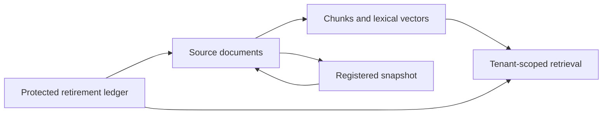

# Module 08 — Data Sovereignty & Engineering

> **Executive thesis:** Apply ownership, access, location and lifecycle rules to every derivative, not only the source file. A retrieval result is reviewable when its source, transformation, tenant scope, retention state and recovery behavior can be traced.

**Educational draft; independent assessment and manual accessibility review pending.** Primary-source inspection: 27 November 2026. All enterprise examples are fictional. The lab demonstrates logical controls with synthetic data; it does not establish legal compliance, anonymization, geographic placement or secure erasure.

| At a glance | Scope |
|---|---|
| Week / effort | Week 8; [ten one-hour sessions](../learning/schedule.html#module-08) |
| Prerequisites | Requirements, legal questions, governance and architecture in Modules 03, 05–07 |
| Deliverable | Data-flow/control specification with retention and recovery rules |
| Lab | Python 3.11+, SQLite, CPU only; no model or cloud account |

## 1. Executive brief: retire the document, not just its first copy

A **fictional UAE PLANT-A maintenance assistant** ingests Arabic-English manuals for advisory lookup. Protected information and derivatives must stay in the named factory. A stricter variant permits no network transport. These are enterprise scenario assumptions, not claims about UAE law.

A steward retires an outdated manual. The original no longer appears in the document table, but an old snapshot contains its chunks and token vectors. After a restore, the manual can return unless the retirement decision survives independently and is enforced before serving results. Treat that as a data-lifecycle design failure, not a cosmetic search issue.

Keep the assistant in its approved advisory scope. Require evidence for live filtering, derived-artifact removal, known backups and restoration. Keep a manual fallback while control gaps remain. A zero-result query alone does not prove that all copies or physical remnants have disappeared.

## 2. Learning objectives

Classify artifacts and assign stewardship; trace transformations and provenance; distinguish lexical vectors from semantic models; test tenant filtering before ranking; implement bounded retention/deletion/restore controls; and defend a specification that separates observed results from unresolved privacy, legal and infrastructure questions.

## 3. Taxonomy, ontology and mental model

Extend the [shared ontology](../taxonomy/ONTOLOGY.md) with **DataArtifact**, **Transformation**, **LineageEdge**, **RetentionRule**, **Tombstone** and **Replica**. These are course-authored extensions. An artifact has an owner, purpose, classification, tenant scope and location; a transformation creates a derivative from identified parents; a retention rule governs a lifecycle decision; a tombstone records a logical retirement decision that recovery must respect.

A taxonomy groups artifacts by type or sensitivity. Lineage links a specific source to a chunk, vector, answer or snapshot. A classification label is a policy assertion, not an enforcement mechanism. A source hash records a content relationship; it does not establish who issued the content or whether processing is authorized.

## 4. Technical deep dive

### 8.1 Data classification, ownership, governance, and stewardship

For the course case, use public, internal and restricted labels with documented handling rules. The business owner decides purpose and acceptable use; the steward maintains quality, classification and lifecycle decisions; platform operators implement storage and access; qualified reviewers resolve legal/security questions. One owner should be accountable for each unresolved control.

Classify derivatives explicitly. Query text can reveal a confidential operational problem. An excerpt can reproduce a restricted manual. A vector, content hash or audit identifier can still convey sensitive information. In this lab, token-count vectors visibly retain words, so calling them anonymous would contradict the stored representation.

### 8.2 Data acquisition, pipelines, storage, transformations, and cataloging

Intake needs a purpose, source ID, owner, acceptable format, declared route and retention rule before indexing. Reject missing or conflicting declarations rather than silently selecting a cloud parser. Keep a catalog that links source versions, transformation code, outputs and operational owners.

The lab canonicalizes structured string fields, hashes the canonical source, chunks text and stores lexical vectors in child rows. Each retrieval result returns document/chunk IDs, classification and source hash. That makes a result traceable within the toy pipeline, but does not authenticate source truth. Reprocessing after parser or chunk-size changes creates a new evaluation question even if the source filename stays unchanged.

### 8.3 Structured, unstructured, and multimodal data

A structured record has named fields and schema expectations. Free text needs parsing and segmentation. Images/audio add preprocessing and intermediate representations whose paths can differ from final inference. Include original files, extracted text, temporary buffers, transcripts, confidence values and error diagnostics in the inventory.

The fixture uses text, string-valued JSON records, **pre-written synthetic OCR text** and **pre-written synthetic transcripts**. No image recognition or speech recognition runs. Arabic token matching is demonstrated, not dialect understanding. A production OCR/ASR extension needs separate workload evaluation and on-site/offline validation; a local final answer does not excuse off-site preprocessing.

### 8.4 Embeddings, vectors, derived data, and retrieval-specific concerns

This lab's vector is a word-frequency dictionary, scored with cosine similarity. It is a transparent lexical exercise with no trained semantic model. Synonyms without shared tokens can score zero. A good-looking match demonstrates token overlap, not factual correctness, safety or relevance across all tasks.

Filter the caller's tenant scope in SQL **before** ranking or returning excerpts. The library accepts a trusted tenant parameter; it does not authenticate a person. In production, an identity gateway must derive that scope and authorize every operation. Exposing the library directly would allow a caller to request another tenant's scope. Do not market this test as complete tenant isolation.

A derivative inherits the source's handling restrictions unless an authorized, evidenced change is made. Changing format or replacing names with IDs is not sufficient justification for relaxing the factory boundary. Include cached queries, retrieved context and output exports, not just the index.

### 8.5 Lineage, provenance, retention, deletion, and backups

Store parent IDs, source representation/hash and transformation identity so a steward can find affected derivatives. Define retention against an explicit clock or event, not an unexplained date column. The demo uses a fixed historical clock, 2026-11-26, for reproducibility. Real clients must not control the service retention clock.

Expiry excludes records from retrieval before row removal. Retirement writes a durable tombstone to a separate ledger, then deletes the live document and child chunks/vectors. SQLite documents that foreign keys must be enabled per connection; the lab both enables and checks that setting.[^foreignkeys] The relationship alone is not proof that a control ran; tests inspect the child-row result.

The SQLite Backup API documents a snapshot copy.[^backup] A snapshot taken before retirement can contain prior content. Our application layer therefore preserves its separate ledger and reapplies tombstones after restore before results are exposed. This behavior is implemented and tested here; it is not an automatic SQLite retention feature.

Deleting live rows is not a secure-erasure conclusion. SQLite's secure-delete documentation describes table-scope limitations, including potential traces in virtual-table shadow tables.[^securedelete] This lab does not use FTS or implement a comprehensive erasure procedure. Unknown copies, journals, storage snapshots and physical media remain outside its assurance.

### 8.6 Data egress, geographic controls, and cross-boundary flows

Reject a declared source country, site or preprocessing destination that conflicts with the unchanged policy. Reject network transport under the physical-air-gap variant. Switching to connected operation does not relax the physical-site rule; the tests exercise that distinction.

The program writes under an owned local root, but cannot discover whether that folder is synchronized, remotely mounted or replicated. Inspect the actual infrastructure before making a residency claim. Keep the Module 07 lifecycle register: prompts, derived vectors, speech/OCR, diagnostics, telemetry, backups, support, activation, updates and failover all need approved paths. No support or activation service exists in this small demo; that does not establish their absence from a deployed system.

### 8.7 Privacy-enhancing methods and synthetic data

Minimization reduces what is collected and retained. Access controls restrict who can use it. Encryption changes who can read stored or transmitted bytes when keys are controlled. Pseudonymization changes identifiers but can leave linkage paths. These measures address different questions; none independently moves a server or proves anonymity.

NIST's de-identification guidance asks agencies to evaluate goals, sharing models and release risks, and discusses synthetic data and re-identification studies.[^nist] Its governmental scope is not a legal determination for the fictional factory. Our course application is to define the intended release, attacker knowledge and measurable privacy risk before claiming that a transformed dataset is safe.

The fixture is invented from scratch and does not learn from customer records. A real synthetic-data generator trained on sensitive records requires its own leakage and utility evaluation. This lesson does not implement differential privacy, secure multiparty computation or an anonymization guarantee. Keep those as separately specified alternatives rather than attaching their names to a word-count exercise.



*Course-authored lineage view: source documents create chunks/vectors and registered snapshots. A separate protected retirement ledger governs live deletion and retrieval; snapshot restoration reapplies that ledger. The diagram is an index into tests, not a map discovered from infrastructure.*

## 5. UAE/GCC case and comparison

For fictional PLANT-A, every derivative remains protected within the factory requirement. An Arabic manual's synthetic transcript, vector and diagnostic metadata must not be treated as harmless merely because they differ from the original file. Attach ownership and expiry to each artifact and record how the control is enforced.

Compare a separately authorized country-bound service using another domestic facility. Its wider location rule changes feasibility but still requires purpose, recipient, authorization and qualified legal review. It cannot be substituted under the unchanged factory-only rule. The course does not prescribe statutory retention periods or decide which privacy regime applies.

## 6. Reproducible lab and measurable evidence

Read the [lab guide](../labs/module-08/README.md), then run:

```bash
python3 labs/module-08/pipeline.py
python3 -m unittest discover -s labs/module-08 -p 'test_*.py' -v
```

Python 3.11+ standard library/SQLite, CPU only; no Docker, model, cloud account or cost. The demo owns a temporary directory and cleans it up. Verification here uses Python 3.13 on macOS; the course target remains Apple Silicon/16 GB. Allow 90 minutes for the lab and lifecycle mutations.

Expected synthetic observations: one tenant-A result before retirement; an UNVERIFIED retirement state while a registered backup exists; zero tenant-A results after restoring that old backup with tombstones reapplied. Tenant B remains retrievable under its own supplied scope. Nineteen tests cover provenance, classification, expiry, cascade deletion, restore/reopen, input rejection and bounded snapshot handling.

Acceptance requires the actual output, a lineage table, one negative test and a bounded conclusion. Removing a registered snapshot can support further review; it never proves every copy or physical remnant is gone. Do not use secrets or real customer records.

## 7. AI PM decision playbook

Ask data owners which processing purpose justifies each artifact. Ask infrastructure where temporary files, replicas and recovery copies actually reside. Ask security how identity determines tenant scope and who can bypass the application. Ask legal how retention, deletion requests and holds should interact. The lab does not implement legal holds; unresolved conflicts require review, not an overwritten expiry field.

Apply hard boundary gates before comparing retrieval quality and cost. A managed embedding service may be technically attractive but remains infeasible under a conflicting factory requirement. A local pipeline can be a candidate while authorization, quality and physical storage evidence remain unresolved.

## 8. Economics and operating trade-offs

Estimate work from formats, tenants, transformations and lifecycle events. For example, `4 formats × 2 tenant scopes × 3 lifecycle checks = 24 test families` is an invented planning model, not proof of adequate coverage. Additional parsers, locales, replicas and recovery modes increase the review surface.

Include stewardship, data quality, re-indexing, backup retention, incident response and deletion verification in operating costs. A cheap vector representation can be unsuitable for the task; a costly semantic model can still fail access or residency requirements. Record dated inputs for real estimates and explain which assumptions change the recommendation.

## 9. Anti-patterns and failures

Deleting the source while leaving derivatives searchable is incomplete retirement. Restoring an old snapshot without current tombstones can reintroduce retired content. Logging full queries can create an unreviewed copy. A hash proves neither authority nor anonymity. A tenant dropdown is not authentication. A folder named “local” is not physical-location evidence.

For each, define an owner, observable negative test and retest trigger. Keep failed observations distinct from missing evidence, and do not average a known violation into a favorable score.

## 10. PM deliverable and capstone connection

Complete the [data-control specification](../labs/module-08/CONTROL_SPEC.md). Include source, chunks/vectors, requests/results, ledger metadata and snapshots; map each to purpose, owner, tenant, classification, location, retention trigger, derived copies and recovery behavior. Reuse Modules 06/07 control and lifecycle IDs.

Definition of done: ownership is explicit; production scope derives from verified identity; transformation/lineage is reviewable; expiry and retirement have negative tests; backups/restore and ledger recovery are covered; unknown copies and legal questions have owners; a bounded recommendation includes residual uncertainty and review expiry. A separate 20-point PM rubric accompanies the specification. The capstone will reuse this as its ingestion/retrieval acceptance contract.

## 11. Six decision questions

**Q1.** Why can a query, vector, source hash or audit ID still require protection? Distinguish content lineage from authentic provenance and authorized use.

**Q2.** Explain what the lab's tenant filter demonstrates and what is missing before exposing it as an API. Where must production tenant scope come from?

**Q3.** A record expires on 2026-12-01 but has not been physically purged. What should a query on that date return under the course rule, and which later operations still need evidence?

**Q4.** An Arabic image is parsed by an off-site OCR service before local inference. Explain the factory-only decision and the evidence required for a proposed on-site alternative.

**Q5.** SQLite documents its Online Backup API as creating a snapshot.[^backup] In the **hypothetical course application**, an operator snapshots before retirement, deletes the live record and restores the old snapshot. Which documented behavior matters, what does the lab add to prevent retrieval resurrection, and what remains unproved about physical erasure? This is not a reported SQLite incident.

### Q6. Decision and root-cause scenario

Before a release, deletion is UNVERIFIED because derived-vector and backup handling are undocumented. A controlled test then observes an expired manual in retrieved context after an old backup is restored. An engineer proposes hiding the excerpt in the UI and renaming vectors anonymous.

State the status transition, direct and systemic causes, affected artifacts, containment, accountable owner, repairs and a dated retest. Explain how a protected deletion ledger and pre-ranking eligibility checks address different failure paths. Define bounded closure without claiming the synthetic tests prove secure erasure, authentication or legal compliance.

**Scenario challenge:** A customer asks to retain full query logs indefinitely for debugging. Record the purpose, minimization alternatives, tenant/access rules, retention/hold questions and approval authority before accepting the feature.

## 12. Key takeaways

Follow derivatives through transformation, retrieval, retirement and recovery. Filter eligible scope before scoring. Keep a protected retirement decision outside the snapshot being restored. Separate logical deletion, known-copy disposition and secure erasure. Use synthetic demonstrations to test mechanisms, then request the real evidence needed for a bounded deployment decision.

## 13. Source-quoted evidence ledger

Primary sources inspected 27 November 2026. Course policies, factory assumptions and toy algorithms are not official standards. SQLite features are described within their documented scope; no production storage system was assessed.

| ID | Exact short quotation | Source and pinpoint | Interpretation and limit |
|---|---|---|---|
| D1 | “must be enabled separately for each” | SQLite foreign keys, §2[^foreignkeys] | Enable/check each connection; inspect actual child-row behavior |
| D2 | “snapshot” | SQLite Backup API, §1[^backup] | Copy can contain earlier state; application retirement policy is separate |
| D3 | “ordinary tables” | SQLite PRAGMA secure_delete limitation[^securedelete] | Do not extrapolate one deletion setting into comprehensive erasure |
| D4 | “potential risks” | NIST SP 800-188, abstract[^nist] | Evaluate release risks; not a universal anonymity threshold |

[^foreignkeys]: SQLite project, *Foreign Key Support*, §2 and §4.3, rolling documentation, https://www.sqlite.org/foreignkeys.html. Verified: 2026-11-27.
[^backup]: SQLite project, *SQLite Backup API*, §1, rolling documentation, https://www.sqlite.org/backup.html. Verified: 2026-11-27. The lab uses Python's SQLite backup interface locally; publisher behavior is not a retention guarantee.
[^securedelete]: SQLite project, *PRAGMA Statements*, secure_delete limitation, rolling documentation, https://www.sqlite.org/pragma.html#pragma_secure_delete. Verified: 2026-11-27. No comprehensive secure-erasure implementation or FTS database was tested here.
[^nist]: NIST, *De-Identifying Government Datasets: Techniques and Governance*, SP 800-188 (September 2023), abstract in the official PDF, https://nvlpubs.nist.gov/nistpubs/SpecialPublications/NIST.SP.800-188.pdf. Verified: 2026-11-27. Government guidance is not a legal determination for the fictional enterprise.

## 14. Practice, publication and next module

Use [Architecture & Learning Studio](../learning/index.html) to compare a premises-only proposal with a changed country-scope requirement. Inspect the data lesson and boundary challenge; retain the original attempt and export the lesson link. The deterministic Studio proposes evidence and controls, not discovered deployment facts. Keep confidential information out of learning journals.

Explore the [eight-question carousel](../social/module-08/CAROUSEL.html) and [post draft](../social/module-08/POST.md). Independent assessment and manual accessibility review remain pending. Module 09 will examine the compute/chip and accelerator choices needed to execute workloads within the established boundary, carrying these artifact/control IDs forward.
