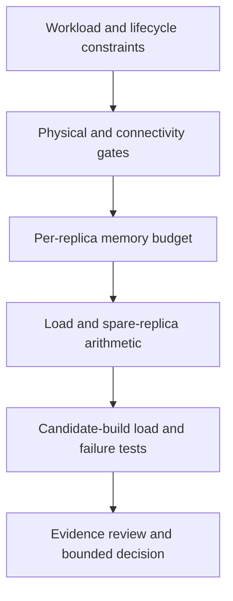

# Module 09 — GPUs, Compute, Networking & Platform Engineering

> **Executive thesis:** Size an admissible workload on the permitted compute, then test it under load and failure. Weight memory, average throughput and a healthy container each answer only part of the capacity question.

**Educational draft; independent assessment and manual accessibility review pending.** Sources inspected 27 November 2026. Enterprise examples and sizing inputs are fictional. The lab runs synthetic CPU work, not a language model or accelerator benchmark. A favorable worksheet result never certifies a deployment.

| At a glance | Scope |
|---|---|
| Week / effort | Week 9; [ten one-hour sessions](../learning/schedule.html#module-09) |
| Prerequisites | Module 07 architecture and Module 08 artifact/retention contract |
| Outcome | A compute-sizing decision with explicit memory, load, failure and evidence assumptions |
| Default lab | Python 3.11+, CPU, small loopback service; compatible Docker engine for container path |

## 1. Executive brief: a fitting model is not a ready service

A fictional UAE PLANT-A maintenance assistant must keep protected artifacts and operations within its factory. Its stricter variant permits no network connections. The team has a spreadsheet showing that a hypothetical model's weights fit in memory, but has not budgeted context, concurrent sequences or recovery capacity. Another team proposes cloud overflow during maintenance.

Approve a bounded synthetic feasibility exercise. Require per-replica memory and load assumptions, an approved lifecycle route inventory, load/error results and a failure rehearsal before making a production recommendation. A cloud overflow path conflicts with an unchanged factory-only rule even when it improves response time. Site constraints are gates, not items that can be averaged against price.

The course baseline is Apple Silicon with 16 GB memory. Its purpose is learning mechanisms cheaply. The fictional sizing example assumes **two separate devices**, each with a declared 12 GiB budget per replica. It does not imply that two model replicas fit on a 16 GB laptop. No model weights or paid compute are acquired in this lab.

## 2. Learning objectives

Distinguish accelerator capability from available memory; separate training, adaptation and serving profiles; explain cluster, network and scheduler duties; interpret container requests/limits; distinguish resource management from tenant security; calculate a conditional capacity and cost model; and defend evidence requirements under overload and replica loss.

## 3. Taxonomy, ontology and mental model

A resource taxonomy groups CPU, accelerator memory, host memory, storage, network and power. A workload profile groups online serving, batch inference, adaptation and training. Neither classification says which actual build met an acceptance criterion.

Extend the [course ontology](../taxonomy/ONTOLOGY.md) with **ComputeProfile**, **CapacityBudget**, **LoadObservation** and **ReplicaPlan**. A profile names model/runtime/build, input/output/context mix and concurrency. A budget assigns resources at a specific placement. An observation records duration, successful throughput, latency population and errors. A replica plan connects load, failure assumptions and approved locations. These are course-authored entities, not an official performance standard.

Reuse Module 08 DataArtifact/RetentionRule and Module 07 lifecycle IDs. A replica's copied index, prompts, diagnostics and recovery data retain the source handling rules. A resource quota is not authorization to process another tenant's documents.

## 4. Technical deep dive

### 9.1 GPUs, accelerator types, and memory constraints

A CPU executes general-purpose application work; an accelerator executes supported operations through a compatible software stack. Procurement must examine supported precision, kernels, usable memory, interconnects, drivers, runtime licensing and operating conditions. A product label does not establish that a particular model can load or meet the task's latency requirement.

Separate **storage size**, **resident weights**, **working allocations** and **available memory after other services**. The learning formula for packed weights is `parameters × bits / 8`. The worksheet converts decimal parameter counts to binary GiB with `2^30`; it omits format metadata, padding and implementation-specific buffers. Its runtime-overhead field is an explicit assumption that needs measurement.

For a simplified decoder with cached keys and values, the course estimates `KV bytes = 2 × layers × KV heads × head dimension × context tokens × bytes per element × concurrent sequences`. This assumes the specified K/V layout and full retained context. Actual architectures, cache management and runtimes can differ. Increasing context or concurrency can exhaust memory even when the weights fit. Adding aggregate memory across devices does not prove that a runtime can shard a model across them.

Docker's current documentation scopes Linux-container `--gpus` passthrough to Windows with the WSL 2 backend.[^gpu] The same page distinguishes other acceleration paths, including Docker Model Runner. Do not turn that scoped statement into a claim that every Docker-related GPU product is unavailable on macOS. This course's container exercise is CPU-only; no CUDA, Metal, Model Runner or GPU passthrough path is tested.

### 9.2 Compute profiles: training, fine-tuning, batch and online inference

| Profile | Primary planning question | Evidence to request |
|---|---|---|
| Training | Which weights, gradients, optimizer state, activations and checkpoints coexist? | Actual training configuration and peak-memory/run measurements |
| Fine-tuning | Which parameters are updated, and what activation/checkpoint costs remain? | Exact adaptation method, sequence/batch settings and task-quality results |
| Batch inference | Can approved data be processed before a deadline? | Full-job completion time, errors, restart behavior and output handling |
| Online inference | Can admitted requests meet latency and error criteria during realistic bursts? | Input/output/context mix, concurrency, cold/warm behavior, errors and tail latency |

A serving benchmark cannot price a training run by substitution. A short warm request cannot characterize a long-context multilingual session. Record prompt and output lengths, batch policy, concurrent sequences, quantization, model/runtime versions and sampling duration. Include retrieval, OCR/ASR and safety stages when they are part of the actual user path.

### 9.3 Clusters, storage, high-speed networks, and scheduling

A cluster joins multiple machines, but each process still needs a placement, resource budget and failure policy. Separate model parallelism across devices from independent service replicas. A scheduler can place work using declared resources; it cannot discover whether a fictional benchmark is representative.

Trace model/index distribution, checkpoint writes, storage reads, service calls and administrator traffic. For an invented transfer of `8 GiB` over an assumed effective `1 GiB/s`, `8 seconds` is a payload-only lower bound. Setup, contention, protocol overhead, verification and recovery add work. This arithmetic is not a measurement or a link-speed recommendation.

For the factory case, additional capacity must stay within the accepted physical boundary. Model distribution, image registries, DNS, licence checks, diagnostics, support and failover need explicit paths. Offline artifact intake needs provenance and media controls; a running container with no network is not proof that its host, hypervisor or supply chain is physically air-gapped.

### 9.4 Docker, Kubernetes, and infrastructure fundamentals

An image packages application files and runtime dependencies. A container is a running instance with configured resource and access boundaries. Docker documents that a container has no resource constraints by default.[^resources] Set limits deliberately and inspect the actual running configuration rather than assuming the Dockerfile imposed them.

The lab uses a read-only root filesystem, a non-root user, dropped capabilities, a process limit, a 128 MiB memory limit, a one-CPU quota and no network namespace connectivity beyond loopback. It publishes no host ports and mounts no host directories. Docker's port documentation warns about publishing ports; the lab avoids publishing altogether and probes with an owned `docker exec` process.[^ports] This is a bounded configuration test, not a general isolation or intrusion-resistance assessment. The runner checks the selected engine endpoint using Docker's context-over-host precedence.[^context] A Unix socket is a target-selection guard, not geographic proof.

In Kubernetes, resource **requests** inform placement and **limits** constrain runtime use. The official guide describes CPU limit enforcement through throttling and memory enforcement as reactive.[^kubernetes] A Pod can therefore be healthy at startup yet fail under real load. This module does not deploy Kubernetes; its worksheet asks which resource declarations and runtime observations would be required.

### 9.5 Resource quotas, isolation, and multitenancy

Resource management answers who may consume how much capacity. Authorization answers which data and operations an identity may access. Separate the two. A tenant with a CPU allocation still needs identity-derived retrieval scope, protected logs and approved data placement.

Consider noisy-neighbor load, privileged administration, shared caches, temporary storage and recovery copies. Test resource pressure together with denied cross-tenant access. The small lab has no identity gateway, tenant security boundary or sensitive data; its semaphore only limits concurrent synthetic work. Do not describe that admission control as tenant isolation.

### 9.6 Latency, throughput, availability, and capacity sizing

The worksheet's invented profile assumes a design peak of 2 incoming requests/s, 5 requests/s per replica and a 0.6 target utilization. Its arithmetic is `ceil(2 / (5 × 0.6)) = 1 active replica`; one additional spare gives two installed replicas. These are conditional planning inputs, not measured model capacity. A replica count alone does not prove that state, storage, identity and networks survive failure.

The hypothetical 7-billion-parameter, 4-bit model uses about 3.2596 GiB for weights under the simple formula. The specified context/cache assumptions add 2 GiB, and assumed runtime overhead adds 2 GiB. Adding a 20% margin gives about 8.7116 GiB per replica. The worksheet compares that result with the declared per-replica budget; co-located replicas need a separate host-packing assessment.

A p95 statistic describes a specified request population. The probe reports nearest-rank p95 for **successful requests only**, alongside error count and successful throughput. A low p95 can coexist with widespread rejection. The probe is closed-loop, bounded by a fixed number of clients, and includes an explicit synthetic delay. It does not generate a production arrival process or measure model tokens/s. Use a representative load design before setting a real SLO.

### 9.7 Utilization, power, hardware supply, and compute economics

Define useful completed work, accepted quality, tail latency and failure tolerance before optimizing utilization. Full device utilization can accompany unacceptable queuing; low utilization can accompany an admission bottleneck. Examine the entire pipeline rather than buying another accelerator from one dashboard reading.

The fixture invents an average 0.3 kW per device, 100 operating hours/month, two devices and 0.3 AED/kWh. Its energy arithmetic is 18 AED; adding a fictional 2,000 AED fixed monthly budget yields 2,018 AED, or 20.18 AED per 1,000 assumed successful requests. The assumed 100,000 monthly successes are a separate volume scenario, not continuous operation at peak load. These are teaching values, **not tariffs, hardware quotations or a measured electricity bill**. Replace them with dated inputs, consistent accounting periods and observed successful work.

A purchase decision also needs facility power/cooling, usable capacity under failure, software/model rights, supply lead time, support location, offline activation, repair spares and exit conditions. The toy formula omits those costs. A learning service needs no paid cloud extension; do not provision one to complete this module.



*Course-authored decision sequence. Known location, connectivity, memory or declared acceptance conflicts block the proposal. Missing or stale evidence remains unknown. Favorable supplied test declarations still require review; the diagram is not discovered infrastructure.*

## 5. UAE/GCC case and comparison

For fictional PLANT-A, a GPU in another domestic facility remains off-site. A remote OCR service, licence activation or backup target can breach the same requirement even when serving happens locally. Keep all fourteen Module 07 lifecycle declarations visible, including training and retirement. The worksheet checks declarations; it does not locate machines or observe egress.

Compare a separately authorized country-bound service using a domestic data center. That requirement change can widen feasible placement, but needs a new architecture, operator/access review and relevant legal assessment. This module's strict factory worksheet does not implement a country-only mode; do not change the site string to disguise a policy change. Module 10 will examine deployment patterns and their control trade-offs.

## 6. Reproducible lab and measurable evidence

Read the [lab guide](../labs/module-09/README.md). Use the course's Apple Silicon/16 GB baseline for the small CPU exercise:

```bash
python3 labs/module-09/size.py
python3 labs/module-09/run_host.py
python3 -m unittest discover -s labs/module-09 -p 'test_*.py' -v
# With a compatible, already authorized Docker engine:
python3 labs/module-09/run_container.py
```

The estimator returns UNVERIFIED for the supplied fixture because performance is assumed. Known route, memory, load/spare and declared latency/error failures block; favorable current-build test declarations reach REVIEW_REQUIRED at most. Twenty-five tests exercise arithmetic, invalid inputs, all lifecycle paths, overload reporting and the actual loopback service.

The host exercise starts and stops its own service. Container preparation downloads an official Python image, resolves its digest and builds from that digest. Runtime has no published port, external network or host mount. The runner inspects constraints, probes serial/concurrent work and removes its own container/tag; base images and build cache may remain. No global prune runs. See the guide for evidence status and failure cleanup. Allow 90 minutes; no GPU, model or paid account is required.

## 7. AI PM decision playbook

Ask architecture which processes share a memory and failure domain. Ask platform engineering for exact candidate-build profiles and what throttling, out-of-memory, rejection and restart signals mean. Ask security to trace identity, preprocessing, administrator, registry, telemetry, activation and recovery paths. Ask procurement for dated rights, support, facility and supply assumptions.

Apply feasibility gates before cost comparisons. Compare an on-site small model, an on-site scale-up/scale-out candidate and a manual fallback. A forbidden external service is not an admissible overflow option. Record which assumption could change the recommendation, who may change it and which evidence must then be repeated.

## 8. Operating model and trade-offs

Reserve capacity for the chosen failure case, but test the whole dependency chain. More replicas can increase idle cost and data-copy management. Longer contexts can increase cache requirements; batching can change throughput and latency together. Changing one setting invalidates comparisons when the rest of the profile is not held constant.

Treat the worksheet as a transparent negotiation document. Identify each supplied number as assumed, synthetic, measured in the candidate environment or supplier-claimed. Keep rejected requests in the denominator of service outcomes. Do not publish a financial forecast from a CPU hash probe or multiply a single-request result into a production SLA.

## 9. Anti-patterns and failure cases

Weights-only sizing overlooks working state. Aggregate accelerator memory hides placement/sharding constraints. Default container settings hide resource assumptions. Health checks hide overload. Successful-only latency hides rejected work. A high utilization or sovereignty score cannot clear an off-site failover path. A replica count cannot prove high availability. Each failure needs an owner, a specific adverse test and a review trigger.

## 10. PM deliverable and capstone connection

Complete the [compute-sizing worksheet](../labs/module-09/WORKSHEET.md): workload/profile, per-replica and host budgets, load/concurrency, admission/error criteria, failure model, topology and data-control crosswalk, cost sensitivity, evidence gaps and recommendation. Its separate 20-point rubric requires hard-gate remediation regardless of score.

Definition of done: assumptions and observations are distinguished; model/runtime/build and context mix are explicit; every protected route has a permitted destination; memory, load and failure calculations are reproducible; acceptance tests have owners and dates; costs have bounded inputs; missing evidence is retained. Carry the worksheet and Module 08 retention contract into the capstone's platform acceptance plan.

## 11. Six decision questions

**Q1.** Why can a model with fitting weight files still fail at serving time? Explain context, concurrent sequences, runtime allocation and per-device placement.

**Q2.** A request and limit are configured for a Kubernetes container. What do they help control, and what remains unproved about throughput, security and actual physical location?[^kubernetes]

**Q3.** Use the fixture to explain weights, KV memory, added margin, active replicas and the spare. Which assumptions require measurement before buying hardware?

**Q4.** A factory-only assistant uses a domestic off-site backup and remote licence activation. Explain the boundary decision and why more compute cannot repair it.

**Q5.** Docker's current documentation scopes `--gpus` passthrough to Windows with the WSL 2 backend and distinguishes other GPU acceleration paths.[^gpu] In a **hypothetical Apple Silicon course deployment**, a supplier proposes that flag as proof of CUDA capacity. What evidence and supported execution path would you require, and why does this module's CPU container test not settle the GPU question? No actual supplier incident is asserted.

### Q6. Decision and root-cause scenario

Before load testing, capacity is UNVERIFIED because the spreadsheet uses assumed performance. A controlled candidate-build test reports successful-request p95 of 90 ms, but 35% of requests receive 503 responses against a 1% error criterion. The health endpoint stays green and device utilization is low. An engineer proposes accepting the p95, adding a GPU and sending overflow to an external cloud service despite the unchanged factory-only rule.

State the status transitions, observed failure, direct-cause hypotheses and systemic gap. Name containment, accountable owners, diagnostic evidence, a repair plan and a dated retest. Explain how to distinguish an admission limit, CPU throttling, memory pressure and a downstream bottleneck. Define bounded closure without treating a purchased GPU or a synthetic HTTP test as production approval.

**Scenario challenge:** The team wants to run both replicas on one laptop and count one as a disaster-recovery spare. Record shared failure/memory domains and the observations needed before making that claim.

## 12. Key takeaways

Budget the whole running profile. Separate placement, resource controls, identity and empirical service outcomes. Count rejected work alongside latency. Test the failure model inside the accepted boundary. Use transparent arithmetic to expose assumptions, then request the evidence needed for an accountable recommendation.

## 13. Source-quoted evidence ledger

Primary documentation inspected 27 November 2026. Formulae, thresholds and factory assumptions are course-authored. No accelerator, Kubernetes cluster, factory or production service was assessed.

| ID | Exact short quotation | Source and pinpoint | Interpretation and limit | Checked |
|---|---|---|---|---|
| C1 | “no resource constraints” | Docker resource constraints, opening paragraph[^resources] | Configure and inspect limits; not a claim that limits prove security | 2026-11-27 |
| C2 | “CPU throttling”; “reactively” | Kubernetes resource management, enforcement section[^kubernetes] | CPU and memory enforcement differ; no particular workload outcome inferred | 2026-11-27 |
| C3 | “only available on Windows” | Docker Desktop GPU support, opening scope note[^gpu] | Applies to described `--gpus` passthrough, not every acceleration product | 2026-11-27 |
| C4 | “insecure by default” | Docker port publishing, Important note[^ports] | Inspect exposure; this lab publishes no host ports | 2026-11-27 |
| C5 | “overrides” | Docker CLI, DOCKER_CONTEXT environment-variable row[^context] | Inspect the effective context before accepting an endpoint | 2026-11-27 |

[^resources]: Docker, *Resource constraints*, opening and CPU/memory sections, rolling documentation, https://docs.docker.com/engine/containers/resource_constraints/. Verified: 2026-11-27.
[^kubernetes]: Kubernetes project, *Resource Management for Pods and Containers*, requests/limits and enforcement sections, rolling documentation, https://kubernetes.io/docs/concepts/configuration/manage-resources-containers/. Verified: 2026-11-27. No Kubernetes deployment was executed here.
[^gpu]: Docker, *GPU support in Docker Desktop for Windows*, opening note and prerequisites, rolling documentation, https://docs.docker.com/desktop/features/gpu/. Verified: 2026-11-27. Scope explicitly separates Linux-container `--gpus` passthrough from other acceleration such as Docker Model Runner; those other paths were not tested.
[^ports]: Docker, *Port publishing and mapping*, Important note and localhost examples, rolling documentation, https://docs.docker.com/engine/network/port-publishing/. Verified: 2026-11-27. Container network configuration is not proof of the physical host's entire network boundary.

[^context]: Docker, *docker CLI*, Environment variables, DOCKER_CONTEXT row, rolling documentation, https://docs.docker.com/reference/cli/docker/. Verified: 2026-11-27. This is endpoint-selection behavior, not assurance about the underlying host or build infrastructure.

## 14. Practice, publication and next module

Use [Architecture & Learning Studio](../learning/index.html) to compare a production laptop proposal with verified on-site compute while preserving the physical requirement. The deterministic tool now links capacity reasoning to this lesson and asks for memory, load and failure evidence. A dropdown does not benchmark a machine. Keep the original attempt and export the decision journal without confidential information.

Explore the [eight-question HTML carousel](../social/module-09/CAROUSEL.html) and [post draft](../social/module-09/POST.md). Independent assessment and manual accessibility review remain pending. Module 10 will compare cloud, private, hybrid and disconnected deployment patterns using these capacity and data-control contracts.
