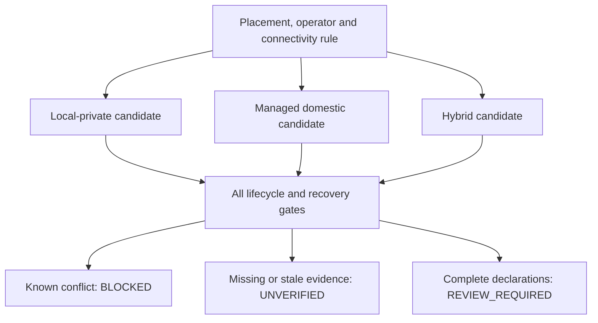

# Module 10 — Sovereign Cloud & Deployment Patterns

> **Executive thesis:** Select a deployment by its permitted data, administration and recovery paths. Compare performance and cost only after those paths satisfy the stated boundary. A familiar cloud label cannot repair an incompatible support or failover route.

**Educational draft; independent assessment and manual accessibility review pending.** Primary sources inspected 27 November 2026. The bank, provider alternatives, costs, preference scores and recovery minutes below are fictional. The local lab checks declarations and simulates a timeline; it neither deploys a cloud nor measures recovery of a real system.

| At a glance | Scope |
|---|---|
| Effort | Week 10; [ten one-hour sessions](../learning/schedule.html#module-10) |
| Prerequisites | Module 07 architecture, Module 08 data lifecycle and Module 09 compute evidence |
| Outcome | A deployment selection scorecard and architecture decision record (ADR) |
| Default lab | Python standard library, offline after obtaining course files; no account, Docker or paid service |

## 1. Executive brief: draw the recovery route before choosing the platform

A fictional UAE bank wants a document assistant inside BANK-A, its physical site. Its internal requirement covers protected prompts, source documents, embeddings, OCR results, diagnostics, backup copies and privileged operations. Three teams propose local-private infrastructure, a domestic managed service and local serving with external support/recovery. The managed proposal has the highest preference score. It still fails an unchanged premises-only requirement.

The initial decision is a bounded learning prototype and an evidence plan. Separate the requirement owner from the person selecting a product. Record any request to widen the boundary as a proposed policy change with accountable approval and new tests. Do not change a site name in a spreadsheet and describe it as the same requirement.

A second requirement exposes a harder problem: survive total loss of BANK-A while keeping every protected copy exclusively inside BANK-A. An off-site replica violates the first rule; a same-site replica cannot independently survive destruction of that site. Escalate the incompatible objectives. A temporary manual service or explicit outage can be safer than an unauthorized data transfer, but its business acceptability also needs an owner.

## 2. Learning objectives

Classify deployment and connectivity separately; trace runtime and administrative dependencies; distinguish country from premises; define host and site failure cases; calculate separate recovery-time and recovery-point windows; inventory infrastructure state and supply-chain dependencies; and defend a conditional choice that a preference score cannot override.

## 3. Taxonomy, ontology and mental model

Deployment taxonomy asks who shares and operates an environment. Placement asks where each component and artifact exists. Connectivity asks which paths can operate. Recovery asks what failure the service survives. These are separate dimensions, not an ordered ladder from public to sovereign.

The [course ontology](../taxonomy/ONTOLOGY.md) adds **DeploymentCandidate**, **PlacementRule**, **RecoveryObjective** and **RecoveryExercise**. A candidate has lifecycle routes and an operator model; a rule constrains their destinations and connectivity; an objective names failure scope, allowable downtime and recovery-point age; an exercise records observations or, here, explicitly supplied simulation events. These are course-authored concepts, not a compliance certification scheme.

Reuse Module 07's fourteen lifecycle purposes and Module 08's derived-data/retirement contract. Add an explicit **iac_state** route for infrastructure plans, state, inventory and related recovery metadata. This does not reclassify every infrastructure file as customer content; it requires classification instead of silently excluding the administrative plane. The toy fixture treats all fifteen routes as protected.

## 4. Technical deep dive

### 10.1 Public cloud, sovereign-managed cloud, private cloud, and on-premises

NIST's private-cloud definition allows exclusive organizational use with different ownership/management arrangements and on- or off-premises placement.[^nist] Thus, “private” does not settle physical location. On-premises describes a location; a local server is not automatically a cloud with the essential cloud characteristics. The lab's local-private pattern is an illustrative architecture label, not a measured NIST cloud conformance result.

Treat “sovereign-managed” as a proposal requiring a specific service, contract, operator model and evidence. Ask which resource, support team, identity system, key operation and recovery destination the term covers. A domestic facility can satisfy one country-level rule while failing a physical-building rule. A provider's service description is evidence about documented behavior, not proof of a customer's effective configuration.

| Candidate | Potential decision advantage | First evidence question |
|---|---|---|
| Local-private | Direct placement and operating choices | Which hidden external administration or update dependencies remain? |
| Managed domestic service | Reduced platform operating work | Do actual processing, privileged support and recovery paths match the requirement? |
| Hybrid | Different components can use different environments | Which exact artifacts cross each interface, including failure traffic? |

Do not choose from this table alone. It intentionally makes no vendor eligibility claim.

### 10.2 Hybrid, edge, and distributed designs

An edge processor can reduce upstream traffic while still exporting raw audio, OCR diagnostics or crash bundles. Draw the artifact transformation and destination at each step. “Only metadata” is a classification claim to inspect, not permission. The Module 08 retention rule follows the derived artifact into its new copy and backup.

In the fictional hybrid option, inference remains at BANK-A but telemetry, support, backups, failover and IaC state move to DC-B. That is a materially different architecture from all-local operation. An approved country-only variant could admit some such routes, but it still requires operator, network, identity and evidence review. Country authorization does not automatically authorize remote administrators or every domestic recipient.

Distributed design also creates coordination dependencies: identity, DNS, time, routing, artifact registries and shared storage. State which ones must function during a network partition. If local serving depends on external identity or activation, a local model endpoint alone does not establish disconnected availability.

### 10.3 Connected, restricted-connectivity, and air-gapped systems

A connected design permits reviewed external paths. A restricted design permits a smaller explicit set, such as approved endpoints and maintenance windows. The course's physical-air-gap scenario permits no network connection; media transfer, physical access and offline update intake need separately controlled procedures. A firewall rule, private link or network-disabled process does not prove that the surrounding host, management plane and facility meet that physical condition.

Classify normal, degraded and recovery operation separately. A system that uses an online license check once per day has a time-dependent dependency. Record the allowed disconnected duration, credential expiry, queue/storage limits, escalation path and supported recovery behavior. Never invent those limits from the word “edge.” This module's simulator has none of those vendor capabilities.

For a real comparison, AWS documents a necessary service-link connection between Outposts racks and the home Region, including management/update traffic.[^outposts] That connected product behavior must be reconciled with the customer's rule. Private connectivity can change transport; it does not make the connection absent.

### 10.4 Remote access, support, update, and control risks

Inventory the administrative plane with the same care as inference. Who can read a support bundle? Where does a privileged session execute? Which endpoint receives update telemetry? Can a provider reset credentials or initiate recovery? Where are approval and session records retained? Require exact role and artifact paths, rather than assuming a local rack implies local operators.

Separate package preparation from production runtime. Connected preparation might acquire a permitted artifact and record its digest, licence, provenance and dependency manifest. Intake into an isolated environment needs authenticity checks, approval, scanning, rollback and accountable media handling. A digest can detect a changed artifact against a trusted reference; it does not establish who created the reference or whether the software is safe.

The lab makes no network requests and obtains no artifacts. Its `network` and `operator` fields are declarations to challenge. Changing those JSON values does not enforce a firewall or revoke an administrator. Missing inventory stays UNVERIFIED; a known forbidden destination stays BLOCKED even on an unknown or duplicate route.

### 10.5 Availability zones, resilience, and disaster recovery

Start with the failure scope: process, host, storage, network, administrative domain or entire site. A cloud availability-zone name or two room labels are not proof that all required dependencies fail independently. Identify shared power, access, identity, storage and operator paths. Do not equate two replicas with protection against every failure.

Recovery time objective (RTO) bounds acceptable interruption; recovery point objective (RPO) bounds acceptable data-loss time. AWS's recovery guidance treats the two independently and relates them to business and dependency constraints.[^recovery] Targets are requirements; a drill produces an observation. A supplier SLA, declared backup interval and simulated event time are different evidence types.

The fixture places a recoverable checkpoint at minute 8, failure at minute 10 and restoration at minute 14. Its **simulated** recovery window is 4 minutes; its recovery-point age at failure is 2 minutes. Those meet invented objectives of 10 and 2 minutes for the declared host-loss case. The code simply subtracts supplied times. It does not restore a database, validate transaction consistency or measure a real RTO/RPO.

The same-site target cannot establish whole-site disaster recovery. Under an unchanged BANK-A-only rule, a whole-site-loss objective is infeasible in this toy design. Record the conflict instead of silently widening geography. Even an approved second site would need restoration, source/derived-data consistency, retention, identity and load verification.

### 10.6 Infrastructure as code, supply chain, and portability

Infrastructure as code (IaC) records desired resource configuration so a change can be inspected and repeated. It does not guarantee that providers, credentials, packages, licences, state and operational knowledge are portable. A reproducible configuration still depends on available and approved implementation inputs.

Terraform's documentation distinguishes redacted display from state storage: marking a value `sensitive` does not by itself omit that value from state/plan files.[^state] This is a reason to classify and control state, not a claim that every backend has identical protections. The documentation also describes supported ephemeral/write-only mechanisms; inspect exact provider support before relying on them. This lab does not install Terraform, generate real state or use credentials.

An exit rehearsal should name an authorized target, rebuild prerequisites, state/import handling, model/runtime rights, transformed data, recovery dependencies, acceptance tests and cleanup. Include the location of the tool running the deployment. A remote CI worker or state backend can become an unrecorded control path. Keep secrets and real infrastructure state out of the public course repository.

### 10.7 Placement decisions based on controls, performance, and cost

Use two stages. First evaluate admissibility: placement, connectivity, authorized operators, recovery objectives and evidence scope. Then compare nonblocked candidates with complete declarations. Preference scores measure stated priorities, not sovereignty. The lab ranks only REVIEW_REQUIRED candidates; it issues no PASS or deployment approval.

The invented local option scores 70 and costs 12,000 AED/month; the managed option scores 95 and costs 8,000; hybrid scores 90 and costs 10,000. The latter two are excluded under the default premises/operator policy. These figures are fictional, with no supplier quotation, tariff or financial forecast implied. Rankings cannot manufacture missing capacity evidence from Module 09.

For a real business case, use consistent periods and bounded cost inputs: facilities, staffing/on-call, duplicate capacity, support, networking, artifact intake, recovery tests, migration and downtime. Show sensitivity to utilization and failure assumptions. A cheaper candidate that violates a hard requirement is a request to change the requirement, not an admissible low-cost selection.



*Course-authored comparison. The static diagram shows the fictional destinations and decision sequence; it discovers no provider infrastructure. Scores cannot clear the gates.*

## 5. UAE/GCC case and counterfactual

For BANK-A, choose the local-private option only as the provisional subject of further investigation. Its review status does not prove local identities, real egress prevention, production capacity or legal compliance. The managed and hybrid proposals have recorded hard conflicts under the default policy.

Run a counterfactual with `scope: country`, permitted country `AE` and separately authorized operator roles. Keep the original policy and decision record. A country-only change can remove a site conflict; it cannot remove an unapproved foreign derivative, air-gap network path, exceeded recovery objective or unknown dependency. This is a fictional internal policy exercise, not advice about UAE bank regulatory obligations.

## 6. Reproducible local lab

Read the [lab guide](../labs/module-10/README.md) and the three candidate inventories in `deployments.json`.

```bash
python3 labs/module-10/compare.py
python3 -m unittest discover -s labs/module-10 -p 'test_*.py' -v
```

The default result is local-private REVIEW_REQUIRED, managed and hybrid BLOCKED, with only local-private ranked. Compare all fifteen protected route declarations and the checkpoint/failure/restore events against the diagram. Change one field at a time: premises to country, allowed operator, network permission, recovery site, objective, missing purpose or stale build. Retain before/after results and explain why each status changed.

Acceptance is a tested learning result with explicit limits: reproduce the four-minute/two-minute simulation, preserve known conflicts when classification is incomplete, exclude blocked or unverified candidates from ranking, and demonstrate the site-loss/single-site conflict. Allow 60–90 minutes. The program reads a bounded fixture and writes JSON to standard output. It creates no cloud resources, opens no service, reads no credentials and needs no cleanup beyond any output file the learner chooses to save.

## 7. AI PM decision playbook

Ask the business owner which outage and data loss are tolerable, and whether degraded/manual operation is acceptable. Ask architecture which dependency fails with each site or operator. Ask platform engineering for load and restoration evidence on the exact candidate build. Ask security for privileged-session, support, update, state and telemetry paths. Ask qualified legal/procurement reviewers for the applicable obligations and contractual scope without assuming the course has settled them.

The [bank scorecard and ADR](../labs/module-10/ADR.md) separates hard gates from ranked preferences. Assign each unresolved claim an owner, test, evidence location and review date. State the exact change that would reopen the recommendation. A good decision can be “no admissible production option yet.”

## 8. Economics and operating trade-offs

Self-operation moves duties to the enterprise; managed operation changes retained and delegated duties. Both need evidence. A second approved site adds recovery and staffing costs; a strict single-site boundary can limit recovery choices. Restricted connectivity adds update, support and observability work. A portability investment can lower future exit effort but must be checked against actual rights and rebuild dependencies.

Use the fixture's invented costs only to practice exclusion and conditional ranking. Estimate financial consequences separately from the deterministic simulation. Four declared minutes do not predict outage cost or availability over a year.

## 9. Anti-patterns and failure cases

“Domestic” substituted for “inside this site”; “private” substituted for operator control; “encrypted” substituted for permitted transfer; inference reviewed while support/state escapes; two replicas substituted for site recovery; a backup schedule substituted for restored data; an IaC file substituted for an exit rehearsal; a high score substituted for admissibility. For each, identify the missing path or test and the person who owns correction.

## 10. PM deliverable and capstone connection

Submit the [deployment selection scorecard and ADR](../labs/module-10/ADR.md), distinct from the lab output. Include the original policy, three alternatives, full lifecycle and administrative inventory, two recovery objectives, failure scope, hard exclusions, preference assumptions, cost sensitivity and a conditional recommendation. Its separate 20-point rubric requires hard-gate correction regardless of score.

Carry the chosen pattern and unresolved recovery/dependency evidence into the capstone. Module 09's capacity worksheet and Module 08's retention/restoration controls remain requirements; this module does not replace them.

## 11. Six decision questions

**Q1.** Why do private cloud, on-premises and a domestic managed service answer different questions? Use the NIST definition and the BANK-A requirement.[^nist]

**Q2.** Which protected paths can make a hybrid design inadmissible even with local inference? Include IaC state, support and derivatives.

**Q3.** Interpret the fixture's checkpoint 8, failure 10 and restoration 14 against its objectives. What is simulated, and what still needs a real recovery test?

**Q4.** A BANK-A-only system must survive destruction of all of BANK-A. Why can neither a same-site target nor an unauthorized off-site target settle that requirement pair? Name the decision owner and safe interim behavior.

**Q5.** AWS documents a necessary Outposts racks service link to the home Region.[^outposts] A **hypothetical** supplier proposes that product for a physically air-gapped bank because it sits on-site and uses a private connection. What does the source establish, what conflicts with the scenario, and what exact product/operating evidence would change the assessment? No real bank deployment or incident is asserted.

### Q6. Decision and root-cause scenario

Before a real recovery drill, the project is UNVERIFIED. A declaration-only simulation ranked local-private REVIEW_REQUIRED. In a fictional candidate-build drill on 27 November 2026, the host recovers in 7 minutes, within a 10-minute objective, but the restored data is 6 minutes old against a 2-minute objective. Engineers discover a stale backup job and propose enabling a default off-site recovery destination that violates the unchanged BANK-A-only rule.

State separate evidence transitions for the observed data-loss failure and proposed forbidden path. Explain probable direct cause, systemic gap, containment, diagnostic evidence, accountable owner, mitigation and a dated retest. Define bounded closure that checks restored data/retention and all protected destinations. Explain why an acceptable recovery time and high preference score do not clear the failure.

**Scenario challenge:** Formally approved country-only placement is introduced while air-gap and enterprise-only administration remain unchanged. Which conflicts can disappear, which remain, and which new evidence must be collected?

**Separate answer key:** `assessments/solutions/10-sovereign-cloud-deployment-patterns-solutions.md`. Worked answers and rubrics are excluded from the public reader build.

## 12. Key takeaways

Choose permitted routes before a label. Separate data, control and recovery operation. Treat site-loss objectives and site-only requirements as explicit constraints. Rank only admissible, sufficiently specified candidates, then request real evidence. A simulation can reveal inconsistent plans without proving an operable deployment.

## 13. Source-quoted evidence ledger

All four sources inspected 27 November 2026. Formulae, fixture names, costs and numerical observations are course-authored. No managed service, bank, cloud account or recovery infrastructure was inspected.

| ID | Exact short quotation | Source and pinpoint | Interpretation and limit | Checked |
|---|---|---|---|---|
| C1 | “on or off premises” | NIST SP 800-145, section 2, private cloud[^nist] | Exclusive use does not settle placement; not a sovereign-service certification | 2026-11-27 |
| C2 | “The service link is a necessary connection” | AWS Outposts racks guide, opening paragraph[^outposts] | A private transport still connects; exact product scope matters | 2026-11-27 |
| C3 | “treat the two independently” | AWS REL13-BP01, Implementation guidance[^recovery] | Recovery time and point need separate criteria; targets are not achieved measurements | 2026-11-27 |
| C4 | “Terraform stores those secrets in its state and plan files” | HashiCorp, Manage sensitive data, opening paragraph[^state] | Redaction alone is insufficient; inspect backend and supported omission mechanisms | 2026-11-27 |

[^nist]: Peter Mell and Timothy Grance, NIST, *The NIST Definition of Cloud Computing*, SP 800-145 (September 2011), section 2, deployment models, printed page 3, https://nvlpubs.nist.gov/nistpubs/Legacy/SP/nistspecialpublication800-145.pdf. Verified: 2026-11-27.
[^outposts]: AWS, *Connectivity through service link*, Outposts racks user guide, opening and traffic list, https://docs.aws.amazon.com/outposts/latest/userguide/service-links.html. Documentation inspected as served; no publication date asserted. Verified: 2026-11-27.
[^recovery]: AWS, *REL13-BP01 Define recovery objectives for downtime and data loss*, Implementation guidance, https://docs.aws.amazon.com/wellarchitected/latest/framework/rel13-bp01.html. Documentation inspected as served; no publication date asserted. Verified: 2026-11-27.
[^state]: HashiCorp, *Manage sensitive data in your configuration*, Terraform documentation v1.17.x as displayed, opening, Background and Hide sensitive variables and outputs, https://developer.hashicorp.com/terraform/language/manage-sensitive-data. No Terraform executable installed for this module. Verified: 2026-11-27.

## 14. Publish, practice and continue

Read the [eight-question HTML carousel](../social/module-10/CAROUSEL.html), its [portrait PDF](../social/module-10/QUESTIONS.pdf) and [question-led post](../social/module-10/POST.md). HTML is the preferred accessible version; the exported PDF is untagged. Source and editorial self-audits are in `reviews/module-10/`; independent review, manual assistive-technology and real infrastructure validation remain NOT COMPLETED.

Use the [Architecture & Learning Studio](../learning/index.html) to vary placement, operators, connectivity and capacity. It is a deterministic teaching tool with browser-local state and explicit exports. Proposed paths are not discovered infrastructure. Existing question IDs, first-answer retention and scoring remain compatible; deployment guidance adds a candidate-build recovery/evidence duty.

Next, Module 11 examines model strategy, rights and serving choices inside the accepted deployment boundary. The complete [240-hour plan](../learning/schedule.html) remains available while later lessons are explicitly planned.
