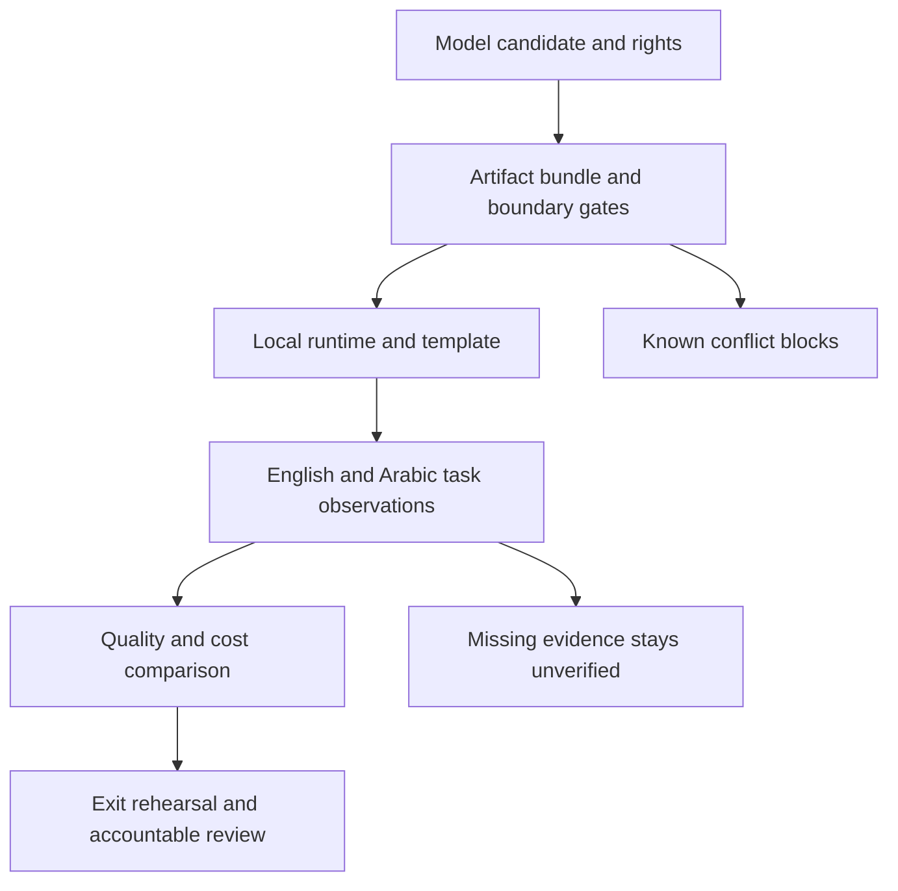

# Module 11 — Sovereign Models & Model Strategy

> **Executive thesis:** Choose an admissible model and a complete operating bundle before comparing quality and cost. Downloadable weights do not establish permission, Arabic task quality, a working exit or a private deployment.

**Educational draft; independent assessment and manual accessibility review pending.** Primary sources checked 27 November 2026. BANK-A, its policy, quality criteria and commercial examples are fictional. The lab runs a real small public model on eight synthetic prompts. Its output is an observation about that exact run, not production accuracy or an enterprise recommendation.

| At a glance | Scope |
|---|---|
| Effort | Week 11; [ten one-hour sessions](../learning/schedule.html#module-11) |
| Prerequisites | Module 08 data controls, Module 09 compute, Module 10 deployment |
| Outcome | A model-choice matrix with rights, artifacts, subgroup results and exit tests |
| Lab | Small pinned public model; CPU on Apple Silicon; online preparation then local-only evaluation |

## 1. Executive brief: decide what must remain replaceable

A fictional UAE bank needs an English/Arabic employee assistant at the physical BANK-A site. The internal policy protects prompts, outputs, weights, embeddings, speech/OCR, diagnostics, telemetry, backups, support, activation and recovery. The proposed inference service must operate without a network connection or remote administrator. These are scenario requirements, not an interpretation of UAE law.

The shortlist contains a downloadable model, a larger local model requiring additional runtime review and an external API with a better claimed benchmark. The API cannot become eligible under the unchanged physical and network rules. The downloadable model still needs a rights review, artifact inventory, reproducible runtime and language-specific evaluation. Neither nationality nor model size substitutes for these checks.

Make two decisions separately: permit a synthetic teaching experiment, and authorize a production system. A failed Arabic exact-label test need not prevent studying tokenization. It does prevent describing that exercise as meeting the fictional bank's declared bilingual quality criterion. Carry that distinction into the capstone acceptance record.

## 2. Learning objectives

Explain tokens, attention, prefill and generation in decision terms; distinguish weights access from open-source system access and legal permission; inventory model and serving artifacts; choose between training, adaptation, hosting and external inference; evaluate Arabic/domain slices with explicit denominators; compare quality and cost only among admissible candidates; and design an exit rehearsal that reconstructs application behavior.

## 3. Taxonomy, ontology and mental model

Use three independent classifications: **access** (API-only, downloadable weights, modification materials); **strategy** (train, adapt, host, consume); and **operating boundary** (site, country, operator and connectivity). A permissive-looking access category does not establish a permitted deployment. The Open Source Initiative's Open Source AI Definition 1.0 specifies freedoms and modification materials; an available weight file alone does not establish the complete definition.[^osi]

The [course ontology](../taxonomy/ONTOLOGY.md) extends existing **ModelArtifact** with revision, hashes, tokenizer and template. **LicenseReview** records scope, reviewer and disposition. **EvaluationSlice** records task, language and denominator; **ModelRun** binds outputs to the artifact/runtime/settings; **ExitRehearsal** records reconstruction evidence. These are course-authored working objects, not legal classifications or a certification standard.



The diagram reads from rights and location gates through a complete bundle to separate subgroup results. Comparison follows eligibility. Final review retains provenance and exit gaps; a favourable fixture never becomes an automatic production approval.

## 4. Technical deep dive

### 11.1 Transformer and LLM essentials for product decisions

A tokenizer converts text into model-specific token IDs. A causal language model predicts continuations of a token sequence; a chat interface serializes roles and messages into that sequence.[^template] Attention makes contextual relationships available to the model; the original Transformer paper introduced an architecture based on attention rather than recurrence or convolution.[^attention] Neither mechanism is a retrieval permission system or a truth check.

Use a serving decomposition when planning capacity: **prefill** processes the input context; **decode** generates successive tokens; the runtime retains intermediate state while generating. A longer prompt and more simultaneous requests change resource needs even with unchanged weight files. Reuse Module 09's measured memory/load exercise rather than calculating capacity from parameter count alone. Module 13 develops optimization; this chapter's lab uses one CPU process and records load and per-request generation time without claiming p95 or throughput under concurrency.

A tokenizer and chat template belong to the versioned model bundle. The Transformers documentation explains that different models can use different chat control tokens.[^template] Treat a template change as a candidate-build change. If a replacement runtime uses a different template, repeat representative task tests before describing the exit as behaviorally equivalent.

### 11.2 Open source, open weights and proprietary access

Use precise statements about what is available and under what terms. API access gives a caller an interface to a service; it does not imply possession of weights. Downloadable weights allow an artifact to be obtained, subject to their terms; they do not by themselves provide the training code/data information required by OSI's definition.[^osi] Avoid assigning an entire system an open-source label from a repository badge.

| Question | Inspectable evidence | Decision consequence |
|---|---|---|
| Can we obtain the exact bundle? | Revision and complete inventory | Missing tokenizer or template leaves the rebuild incomplete |
| Can the intended entity use/modify/redistribute it? | Actual terms and scoped review | A download success is not permission approval |
| Can we operate it within the boundary? | Runtime and dependency tests | Remote activation or fallback can block a local design |
| Can we replace it without losing the task? | Exit and task regression | File conversion is only one step |

These are procurement questions. They do not resolve ownership of third-party training inputs, every possible output or jurisdiction-specific IP questions. Assign those questions to qualified reviewers rather than a deterministic recommendation engine.

### 11.3 Licences, artifacts, provenance and IP

Preserve the original model card and its linked terms with a dated decision. Apache License 2.0 includes redistribution conditions covering a licence copy, change notices, retained notices and applicable NOTICE attribution; section 7 disclaims warranties.[^apache] This is a reading guide for the cited text, not a legal opinion or a claim that every upstream component shares that licence.

Inventory weights, tokenizer vocabulary, special tokens, configuration, chat template, inference implementation, adapters, quantization metadata and dependency versions. A hash detects a change relative to a trusted reference; a newly generated hash alone cannot prove who supplied an artifact or whether it is safe. Record both acquisition provenance and subsequent integrity checks. Adapted weights need their own build record and rights/data review.

The lab pins a full repository commit and records SHA-256 values for nine allowlisted files. Hugging Face documents full-length commit revisions and filtered downloads.[^download] The model card declares Apache-2.0; its inventory has no separate LICENSE file, so the preparation record links the full licence and archives the card instead of claiming to have found an absent file. No third-party weights are redistributed in this repository.

### 11.4 Train, adapt, host or consume external inference

Training from scratch creates a distinct data, compute and evaluation programme. Adaptation changes an existing model using a narrower learning process; it still requires base-model rights, authorized data, reproducible artifacts and task evaluation. Hosting selects where and how an existing bundle runs. Consuming external inference delegates serving to a service whose requests and operational paths need their own review.

| Strategy | Evidence that could justify it | First reason to stop |
|---|---|---|
| Train | Unique task/data need and funded experiment plan | No defensible data or evaluation baseline |
| Adapt | Repeatable baseline gap and permitted adaptation data | Leakage or rights gap before training |
| Host | Admissible bundle and operating capacity | Unsupported runtime or prohibited dependency |
| External inference | Permitted destinations and contracted service scope | Unchanged premises/air-gap conflict |

A poor answer on a factual document task can originate in missing evidence, retrieval, template handling or evaluation design. Diagnose it before budgeting a training programme. Module 12 develops RAG; Module 13 compares adaptation methods. No fine-tuning or training occurs in this lab.

### 11.5 Model serving and private inference components

A proposed private service needs an authenticated gateway, request policy, tokenizer/template, inference runtime, local artifact store, observability, update process and recovery plan. Add embeddings, rerankers, OCR or speech where the workload needs them. A local generation process does not contain an upstream external transcription call. Apply the protected boundary to each artifact and each mode: normal, restart, update, degraded service and recovery.

For the BANK-A air-gap scenario, prepare permitted files on an authorized connected staging machine; review and transfer them using controlled media; verify integrity inside the disconnected environment. Test startup without package indexes, model hubs, telemetry, remote support or licence activation. The lab sets library offline/local-only options and denies Python socket connection/name-resolution calls. It does **not** establish physical isolation, OS firewall enforcement or the behavior of every native library. Do not call a connected laptop air-gapped because this process finished.

### 11.6 Arabic, multilingual and domain needs

Evaluate the task and intended language variety separately. A global average can hide a failed Arabic slice. Record denominators, exact criteria and raw outputs. For an actual bilingual bank pilot, add qualified review of Modern Standard Arabic, relevant dialects, code switching, financial terminology, numerals, right-to-left presentation and refusal behavior. Those reviews are proposed work, not completed by the eight lab prompts.

SmolLM2's card states that the models primarily understand/generate English and warns about inaccurate or biased content.[^smollm] It is chosen for a small teaching run, not as an Arabic production recommendation. The Jais family card describes Arabic/English models, and its getting-started example requires a custom model class with `trust_remote_code=True`.[^jais] We inspect that document without downloading or executing its custom code. A candidate with better claimed Arabic fit can introduce an additional code-review and provenance task; its card is not independent proof of bank-task performance.

### 11.7 Selection by performance, cost, portability and autonomy

First exclude known policy conflicts. Preserve missing evidence as unverified. Then compare task quality, memory/load behavior, cost and operability on a named build. Use separate language criteria and adverse examples; show every denominator. A fictional 100% exact-label criterion over four cases per language is a teaching gate, not a sensible estimate of production accuracy or a confidence interval.

The model-choice matrix should pair each preference with evidence: latency with load and errors; price with utilization/staffing; portability with a reconstructed service; autonomy with rights and operating dependencies. A low-cost model that fails the required task is not a cheaper solution to that task. An expensive eligible candidate may still lose to a simpler manual process when demand is low.

## 5. UAE/GCC case study and global comparison

**Claim:** BANK-A can run a bilingual assistant locally. **Claimant:** a fictional internal team, not a named vendor deployment. **Available evidence:** a real small-model CPU experiment, artifact hashes, raw responses and synthetic language slices. **Missing evidence:** actual site placement, rights approval, qualified Arabic/domain assessment, authentication, service load, update/support and recovery controls. **Buyer action:** require separate owners and dated tests before any real employee data.

Compare a second fictional organization whose approved country-level policy permits a reviewed domestic service and remote support. Its admissible shortlist can differ without changing the bank's rule. Keep the geography and operator changes explicit; do not transfer either organization's conclusion to another jurisdiction or product SKU. Jais and SmolLM2 are documented examples, not evidence that either organization deployed them.

## 6. Hands-on lab: run and evaluate a small local model

Use the [complete lab procedure](../labs/module-11/README.md). Online preparation obtains a pinned public SmolLM2-135M-Instruct bundle. The second process verifies nine hashes, refuses custom code and uses local CPU generation over eight synthetic prompts. It records actual English/Arabic exact-match counts, token counts, timing, platform, runtime and settings. No credentials, cloud account, Docker or private data are needed.

```bash
python3.13 -m venv /tmp/sovereign-model11-env
/tmp/sovereign-model11-env/bin/pip install -r labs/module-11/requirements.txt
/tmp/sovereign-model11-env/bin/python labs/module-11/prepare.py /tmp/sovereign-model11-artifacts
/tmp/sovereign-model11-env/bin/python labs/module-11/run_local.py /tmp/sovereign-model11-artifacts /tmp/model11-observation.json
python3 -m unittest discover -s labs/module-11 -p 'test_*.py'
```

Acceptance means the declared experiment ran and produced inspectable evidence, including failures. Check that outputs exclude the input prompt; every case has a language and expected label; the build and hashes are recorded; no missing denominator is described as success; and altered files are rejected. If dependencies or downloads fail, record NOT COMPLETED rather than substituting invented model output. Budget roughly 1 GB for weights/dependencies with room for installer caches; actual disk/RAM depend on platform. There is no paid-service spend.

## 7. The AI PM decision playbook

Product owns task criteria and intended users; model engineering owns bundle/runtime reproduction; security owns code/media/network review; counsel owns scoped rights review; procurement owns supplier terms and exit obligations; qualified language/domain reviewers own appropriateness. Avoid assigning all five decisions to the person who ran a notebook.

Use the [model-choice matrix](../labs/module-11/MODEL_MATRIX.md). Ask engineering what changes the evaluated build, security which restart path can call out, counsel which use and redistribution acts were reviewed, finance what utilization assumption drives cost and users which Arabic errors are unacceptable. Revisit the choice when any answer changes.

## 8. Economics, operating model and trade-offs

Illustrative arithmetic only: a local option with AED 3,000 monthly fixed operations plus AED 0.01 per completed request costs AED 3,100 at 10,000 requests; an external option at AED 0.20/request costs AED 2,000. Their numerical break-even is 3,000/(0.20−0.01), about 15,790 requests. These are invented inputs, not provider prices, and exclude staffing changes, procurement and retries.

Apply eligibility first: the external option remains blocked for the unchanged bank policy even below break-even. Then sensitivity-test successful requests, output length, review costs, idle time, hardware replacement and model-update regressions. Token counts from the toy runner cannot price a larger serving stack or establish concurrency capacity.

## 9. Anti-patterns and failure cases

- **Weight download treated as approval:** require scoped rights, build and operating evidence.
- **English average presented as bilingual quality:** show separate cases, counts and review gaps.
- **Changed tokenizer with old benchmark:** bind observations to the complete new bundle.
- **Silent remote fallback after local failure:** stop processing or use an explicitly authorized alternative.
- **Newly computed checksum called authenticity:** retain trusted acquisition evidence as a separate requirement.
- **Fine-tuning proposed before diagnosis:** isolate data, retrieval, template, task and measurement causes.

## 10. PM deliverable and capstone connection

Produce the [model-choice matrix and evidence plan](../labs/module-11/MODEL_MATRIX.md), distinct from the generation lab. Definition of done: named workload/boundary, at least three clearly labelled alternatives, hard exclusions, scoped rights disposition, complete bundle, language denominators, declared economics, exit procedure, accountable owners and retest dates. Its rubric totals 20 points; threshold 12 never overrides a hard conflict or missing approval.

The capstone consumes an eligible model-service interface with explicit limitations. A model experiment supplies evidence to that decision; it does not supply authentication or enterprise acceptance. Carry raw-output privacy and retention into Module 12's retrieval system.

## 11. Knowledge check

**Q1.** What can a downloadable weight file establish, and what modification materials and permissions remain separate questions?

**Q2.** Why must a changed tokenizer or chat template invalidate reliance on the old task observation?

**Q3.** BANK-A permits no external processing. A higher-scoring API advertises domestic storage. What decision and evidence requests follow?

**Q4.** An eight-case run has perfect English labels and no Arabic cases. What quality claim is supportable, and what is missing?

**Q5.** The real Jais family model card's getting-started example requires custom code, whereas the fictional bank has approved only audited inference code. What must happen before considering that model, and what technical evidence could change the decision? The bank is hypothetical; no real incident is claimed.[^jais]

### Q6. Decision and root-cause scenario

On 27 November a fictional BANK-A candidate is UNVERIFIED pending bilingual and restart evidence. Four English cases pass. Four Arabic cases fail their exact-label criterion. The operator proposes switching to an external Arabic endpoint on failure and marking the model “accepted” using the English score. The licence reviewer has not signed the intended-use review, and the runtime/template revision was omitted from the scorecard.

Give the before/after evidence states; distinguish observed symptoms from confirmed causes; identify at least two plausible model/template/evaluation causes that need testing; contain the fallback; assign model, security, rights and product owners; define remediation and a dated retest before closure. Explain the bounded decision if local Arabic results later improve but the rights review stays missing.

**Scenario challenge:** Compare host, adapt and external inference for the unchanged bank rule and a second organization with an explicitly wider boundary. Defend the assumptions that reverse the choice.

Separate worked answers and scoring: `assessments/solutions/11-sovereign-models-model-strategy-solutions.md`. No solutions are embedded here.

## 12. Key takeaways

A model choice is a rights, bundle, task and operating decision. Keep hard constraints ahead of preferences, measure relevant slices and preserve failed results. Test a reconstructed service before claiming an exit; keep a synthetic experiment's acceptance separate from production authorization.

## 13. Evidence ledger, quoted sources and further reading

The quotations below are exact short extracts checked 27 November 2026; interpretations are editorial. Product documentation is a provider statement, not an independent deployment audit.

| Claim | Exact short extract | Primary source / pinpoint | Interpretation and limit |
|---|---|---|---|
| C1 | “based solely on attention mechanisms” | Vaswani et al., abstract[^attention] | Historical architecture statement; no task guarantee |
| C2 | “Data Information” | OSI 1.0, preferred form[^osi] | Weights alone do not settle system openness |
| C3 | “You must give any other recipients of the Work or Derivative Works a copy of this License” | Apache 2.0, section 4(a)[^apache] | One redistribution condition; full terms still matter |
| C4 | “different models may use different formats or control tokens” | Transformers, chat templates[^template] | Bundle template with the evaluated build |
| C5 | “full-length hash” | Hub download guide, specific version[^download] | Pin acquisition revision, then verify artifacts |
| C6 | “primarily understand and generate content in English” | SmolLM2 card, Limitations[^smollm] | Teaching choice does not establish Arabic suitability |
| C7 | “requires a custom model class” | Jais family card, Getting started[^jais] | Code review needed; this lab does not execute it |

[^attention]: Vaswani et al., *Attention Is All You Need*, arXiv:1706.03762v7, revised 2 August 2023, abstract, https://arxiv.org/abs/1706.03762v7. Verified: 2026-11-27.
[^osi]: Open Source Initiative, *Open Source AI Definition*, version 1.0, preferred form to make modifications, https://opensource.org/ai/open-source-ai-definition. Publication date not established here. Verified: 2026-11-27.
[^apache]: Apache Software Foundation, *Apache License, Version 2.0*, January 2004, sections 4 and 7, https://www.apache.org/licenses/LICENSE-2.0. Verified: 2026-11-27. Qualified rights review remains required.
[^template]: Hugging Face, *Transformers: Chat templates*, documentation inspected 2026-11-27, https://huggingface.co/docs/transformers/main/en/chat_templating. Main documentation may differ from the pinned lab package; the lab records its tested runtime and actual template behavior.
[^download]: Hugging Face, *Download files from the Hub*, specific version and filter sections, https://huggingface.co/docs/huggingface_hub/guides/download. Verified: 2026-11-27; no publication date asserted.
[^smollm]: HuggingFaceTB, *SmolLM2-135M-Instruct model card*, commit 12fd25f77366fa6b3b4b768ec3050bf629380bac, Model Summary, Limitations and License, https://huggingface.co/HuggingFaceTB/SmolLM2-135M-Instruct/blob/12fd25f77366fa6b3b4b768ec3050bf629380bac/README.md. Verified: 2026-11-27. Provider claims; local measurements are separately recorded.
[^jais]: Inception/Cerebras, *Jais Family Model Card*, Details and Getting started, https://huggingface.co/inception42/jais-family-590m-chat. Verified: 2026-11-27; original inceptionai URL redirected to inception42. No weights/custom code executed for this example.

## 14. Website, social derivative and next steps

Read the [lab](../labs/module-11/README.md), [PM matrix](../labs/module-11/MODEL_MATRIX.md), [eight-question carousel](../social/module-11/CAROUSEL.html), [portrait PDF](../social/module-11/QUESTIONS.pdf) and [post draft](../social/module-11/POST.md). HTML is preferred; the PDF is untagged. Sources, mobile reflow, diagram and actual output evidence are recorded in the two author reviews; independent assessment and manual accessibility remain pending.

The [Architecture & Learning Studio](../learning/index.html) adds model-bundle, language-slice and exit evidence questions to generated plans and links portability remediation here. It remains a deterministic browser-only tool; it does not select a verified vendor model, contact an LLM or infer licence permission. Change the operator or compute choice to expose a hard conflict; exports preserve those constraints and related lessons. Existing question identities and saved first attempts remain compatible. Next: Module 12 Sovereign RAG Systems.
