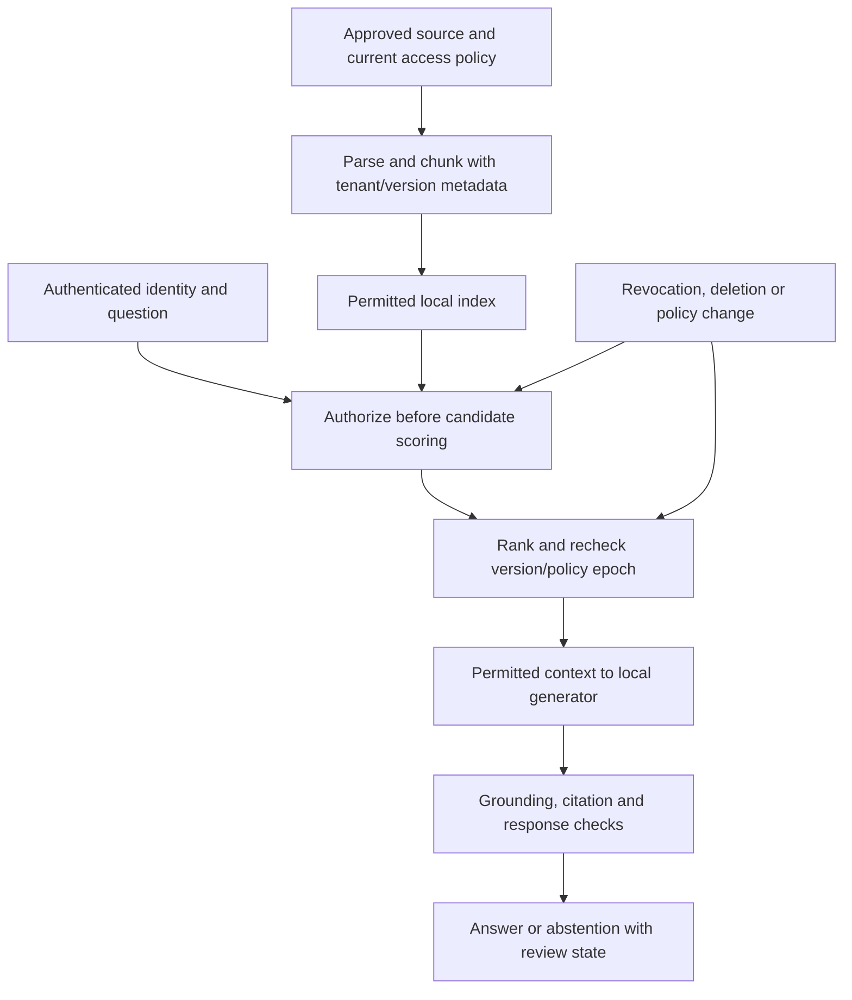

# Module 12 — Sovereign RAG Systems

> **Executive thesis:** Restrict the evidence a user can retrieve before ranking or generation. A local model with a globally searchable index can disclose a forbidden document without any data crossing a national border.

**Educational draft; independent assessment and manual accessibility review pending.** Primary sources checked 28 November 2026. BANK-A, tenant policies and acceptance thresholds are fictional. The lab includes real sparse-vector retrieval and one actual local-model generation. Its six synthetic retrieval cases and one English model response are teaching observations, not an enterprise security or bilingual-quality benchmark.

| At a glance | Scope |
|---|---|
| Effort | Week 12; [ten one-hour sessions](../learning/schedule.html#module-12) |
| Prerequisites | Modules 08 data controls, 10 deployment and 11 model strategy |
| Outcome | Permission-aware retrieval design and a security acceptance record |
| Lab | Synthetic tenants, local sparse vectors, access/lifecycle tests and actual local generation |

## 1. Executive brief: decide which evidence may enter the answer

A fictional UAE bank wants an employee assistant inside the physical BANK-A site. Staff can read travel policies; only HR can read payroll exceptions. The infrastructure team puts generation on an on-site server but builds one index from every department and affiliated company. A prompt saying “do not reveal restricted documents” cannot compensate for handing their text to the model.

The decision is whether the retrieval system preserves the source access contract through ingestion, ranking, context, output and operations. Locality and authorization answer different questions: where the system operates, and who may learn what. Review both before optimizing answer quality. Keep legal applicability separate; this hypothetical site-only rule is not a statement that UAE law requires every bank document to remain in one building.

The lab exposes the mechanism with two tenants asking the same travel question, an HR-only policy, an obsolete document and a quarantined instruction. It also runs a real small model on permitted evidence. The model gives the correct number with extra prose and fails the declared exact-format rule. Preserve that result: finding the right source and delivering an acceptable answer are separate tests.

## 2. Learning objectives

Map retrieval-augmented generation from source to answer; distinguish sparse vectors, neural embeddings and ranking; carry permissions through chunking and index lifecycle; apply identity before candidate scoring; bind context and citations to permitted source versions; distinguish retrieval, grounding and task-quality failures; and produce measurable residency, leakage, revocation and response criteria with accountable owners.

## 3. Taxonomy, ontology and mental model

**Retrieval-augmented generation (RAG)** supplies retrieved evidence to a language generator. Lewis et al.'s original research combined a pretrained sequence model with a dense Wikipedia index; this course's small application is a different teaching architecture, not a reproduction of its experiment.[^rag] Retrieval alone returns evidence; an extractive baseline copies an authorized span; generation produces new tokens conditioned on that evidence. Label each correctly.

The [course ontology](../taxonomy/ONTOLOGY.md) introduces **RetrievalIndex** (source versions, embedding/ranking configuration, boundary), **RetrievalPolicy** (principal, tenant/groups, current eligibility), **RetrievedContext** (permitted chunks, versions, policy epoch) and **GroundingCheck** (claim/evidence criterion and result). They relate an authenticated actor to eligible data, an index to its source versions, a context to a policy and a generated claim to cited evidence. These are course-authored working constructs, not a standard or legal certification.



Read the flow from source approval to answer, with identity entering before ranking and lifecycle changes entering both retrieval and final context checks. The [editable SVG](../diagrams/module-12-rag.svg) shows these gates without JavaScript. Logs, caches, support and recovery sit inside the same declared operating boundary; they are not exempt because the main arrow is local.

## 4. Technical deep dive

### 12.1 Retrieval-augmented generation architecture

Separate ingestion from request serving. Ingestion reads permitted repositories, parses content, retains provenance/access metadata, builds chunks and updates an index. Serving authenticates the caller, resolves current permissions, searches eligible candidates, reranks if configured, constructs context, generates a response and checks its claims/citations before release. Source changes and identity changes can invalidate previously prepared evidence.

A policy assistant should retrieve the effective policy version, not whichever obsolete wording has the strongest similarity. Define freshness as a business requirement: when a document is withdrawn, how quickly must queries, caches, queued work and downloaded exports stop using it? A bounded answer can be “the evidence is unavailable or stale.” Silently consulting an external endpoint is not a valid recovery path under BANK-A's unchanged physical-site/air-gap rule.

RAG can support provenance by retaining source references, but a displayed reference does not show that every generated sentence follows from that source. Treat retrieval success, factual support and acceptable task behavior as distinct evidence records. Fine-tuning cannot be presumed to repair a missing access control; Module 13 compares adaptation after diagnosis.

### 12.2 Loading, parsing, chunking, embeddings and indexing

A loader needs a source owner, allowed types, revision, tenant, access list and deletion signal. Parsing may invoke OCR, decompression or document conversion; each introduces code and data destinations. Validate inputs and sandbox untrusted formats in production. An external OCR call can break a site-only design before indexing starts. The lab accepts small plain-text JSON fixtures and does not claim parser/malware assurance.

A chunk is a retrieval unit cut from a document. Small chunks can miss exceptions spanning sections; large chunks consume context and mix unrelated information. Overlap can preserve continuity while duplicating content. Preserve document ID, version, offset and access metadata on every chunk. If permissions vary within a document, either ingest independently protected sections or enforce the narrower effective permission; never average permissions across a chunk.

An embedding represents content numerically for similarity search. Neural embeddings can capture some semantic relationships but require their own model/runtime and evaluation. The lab deliberately uses sparse TF-IDF vectors: word counts weighted by how common each word is in the authorized corpus. It normalizes vectors and computes cosine similarity. This makes scoring inspectable without claiming semantic equivalence. A production index may use approximate search to reduce computation; its missed-neighbour/latency trade-off must be measured on eligible data, not assumed from the library name.

Version the complete index build: source snapshot, parser, chunk policy, embedding model/configuration, vocabulary if relevant, index parameters and policy mapping. An embedding-model change can require re-embedding and retrieval regression. An ACL-only change can require immediate eligibility/cache updates even without changing vector values. Encryption protects stored bytes; it does not decide which service principal may retrieve plaintext.

### 12.3 Search approaches, reranking and retrieval quality

Keyword search is useful when users know an exact identifier; dense search can help paraphrases; hybrid search combines distinct signals. A reranker examines an eligible candidate set more closely. It cannot restore a source omitted by the first stage, and it must not receive forbidden text merely to decide that the text is irrelevant. Treat external reranking as another processing destination.

Measure stages separately. Recall@k asks whether relevant authorized evidence appears among k candidates; reciprocal rank rewards an early relevant result; precision asks how many returned candidates are relevant. Define relevance labels and denominators before comparison. Include unanswerable questions: always returning something can inflate apparent usefulness while increasing unsupported answers. Keep raw examples so a metric change can be investigated.

The fixture reports six expected-document-or-abstention outcomes, including two abstentions. That is not recall over a complete relevant-document set, an estimate of leakage rate or a neural-search benchmark. Its Arabic case tests literal overlap with one source, not dialect/paraphrase understanding. A real Arabic policy assistant needs expert labels for terminology, Arabic variants, code switching and right-to-left presentation, with held-out cases and separate subgroup results.

### 12.4 Identity-aware retrieval and document permissions

Resolve identity from a trusted authentication boundary. A question containing “I am HR” or a caller-provided `tenant=B` field cannot elevate access. Apply effective tenant and group/document policy before search vocabulary, scoring, reranking or generator context. Filtering a global top-k result afterward can leak through intermediate systems and can omit allowed evidence displaced by forbidden candidates.

PostgreSQL 18 documents that enabled row security with no applicable policy uses default deny; it also documents owner, superuser and `BYPASSRLS` exceptions.[^rls] A database badge therefore does not establish the deployed application's effective access behavior. Inspect its actual connection role and policy composition, then test denial through the real retrieval route. The lab uses a fixed identity registry and Python checks; it does not run PostgreSQL or implement a production identity provider.

Permissions can change between search and generation. The lab binds chunks to a policy epoch and source version, then rechecks at context construction; revocation makes an old result unusable. In a distributed service, define how policy snapshots, leases or transactions extend to answer delivery and queued requests. A single-process fixture is not evidence that a remote ACL event will arrive within a required deadline.

### 12.5 Tenant isolation, sensitive data and data flow controls

Choose physical separation, separate collections or shared storage with enforced row/document policy based on the threat model and operating cost. A tenant-ID column alone is insufficient if application queries, service roles, backups or administrator paths bypass it. Test both exact shared titles and adversarial tenant markers, because relevance scores must never select the permission boundary.

A response cache needs identity/tenant/group scope, normalized request, source/model/index versions and policy state, or an equivalent proven design. Revocation must invalidate cached context and responses. Query embeddings, vector values, candidate IDs, debug traces and crash dumps can themselves carry sensitive information. Audit useful events without copying raw protected material by default; restrict and expire any explicitly approved diagnostic sampling. The lab omits caches and persists only synthetic observations.

For BANK-A, inventory originals, OCR output, chunks, embeddings, reranker requests, prompts, outputs, logs, telemetry, backups, remote support, licence activation, update staging and failover. All protected operational paths must satisfy the physical-site constraint; “same country” is a different requirement. Controlled offline media and separately authorized staging need review and manifest verification. Python offline flags and socket denial in the exercise do not establish OS or physical isolation.

### 12.6 Grounding, evaluation datasets and failure analysis

Grounding means an answer's material claims are supported by permitted evidence under a declared criterion. Citation validity checks whether the referenced version/span exists and is accessible; support checking asks whether that span entails the claim. Both can pass while the answer fails a task rule such as the required format. A model-as-judge can add observations, but its verdict needs calibration and cannot grant document access.

Build cases with identity, language, effective policy version, expected evidence, permitted answer/abstention behavior and reviewer rationale. Separate development from held-out cases; report counts and failures by task and access class. Seed revoked sources, absent answers, conflicting versions and malicious instructions. Record the source/index/model builds and raw output so a regression can be attributed to a changed component.

Diagnose in order: was the fact present and permitted, parsed correctly, chunked with its exception, retrieved/ranked, supplied unchanged and interpreted correctly? Then inspect output policy and evaluator. In the actual lab, authorized travel evidence reaches the model and the returned “7 days” matches the fact. The complete response includes extra words, so the predeclared exact-format test fails. Training, a wider permission scope or an external fallback is not justified by that observation alone.

### 12.7 Leakage prevention and responsible response behavior

Treat retrieved text as data, including documents from an approved repository. A malicious edit can contain instructions; OWASP explicitly warns that RAG does not fully mitigate prompt injection.[^injection] Source approval and ingestion screening reduce some exposure but do not prove every approved sentence harmless. The fixture quarantines one explicitly untrusted document; its `trusted` flag is a declaration, not a security detector.

Keep authorization and tool/action permissions outside model discretion. The local prompt asks the model to treat evidence as data, but that instruction is not an isolation boundary. This chapter's generator has no enterprise tools and releases no automatic action. Module 14 adds scoped tools, approvals and independent action controls. Apply separate output constraints for sensitive content and high-impact advice; a citation does not authorize sharing its source with an unauthorized recipient.

Use explicit abstention when evidence is missing, stale, conflicting or forbidden, with enough explanation to help the user without revealing a hidden document's title or existence. Log a bounded incident event and preserve appropriately authorized evidence if a disclosure occurs. Stop affected retrieval and invalidate caches before chasing a better model score. Do not promise zero leakage from passing a small synthetic fixture.

## 5. UAE/GCC case study and global comparison

**Illustrative UAE case:** BANK-A's policy covers one building, on-site operators and disconnected serving. An otherwise stronger managed in-country embedding service is BLOCKED under that unchanged requirement. Local generation plus foreign OCR is also BLOCKED. An approved source edit or HR-group revocation must change eligibility through the answer path; site residency does not excuse an internal disclosure.

**Comparative hypothetical:** A second organization permits specified domestic processing and reviewed operator/support paths. A managed retrieval service can become a candidate if its actual identity model, source lifecycle, data destinations and contractual scope are evidenced. The changed choice follows the changed boundary, not a country stereotype. No law, real deployment or vendor conformance is inferred; qualified jurisdiction/sector review remains separate and Module 04's HOLD is preserved.

## 6. Hands-on lab: build local permission-aware RAG

Read the [reproducible lab](../labs/module-12/README.md). Run from the repository root:

```bash
python3 -m unittest discover -s labs/module-12 -p 'test_*.py'
python3 labs/module-12/rag.py --output /tmp/module12-retrieval.json
```

Use a fresh path. Acceptance for the teaching fixture: six expected retrieval/abstention cases, no forbidden fixture content in the caller's context, and adverse tests for changed ACL/version, cross-identity context and tampered citations. The optional actual-generation command reuses Module 11's separately prepared model environment and verified local files; no weights are redistributed. It conditions real CPU generation on one permitted source span.

Retained observations: six of six expected retrieval outcomes; one English generation returns “The answer is: 7 days before departure”, failing the declared exact-format criterion while containing the correct fact. Forty-four lab tests pass. These are synthetic teaching observations; no production authorization, Arabic generation quality, concurrent-load percentile or physical-air-gap claim follows. Extend with a policy-scoped cache and prove revocation before introducing performance claims.

## 7. The AI PM decision playbook

Ask the data owner who can read which current source; ask identity/security how caller claims become trusted permissions; ask platform where parsing, embedding, reranking, telemetry and recovery occur; ask evaluation which language/task/abstention criteria were agreed before testing. Assign an owner and deadline to each unknown rather than substituting a score.

Use the [Architecture & Learning Studio](../learning/index.html) to compare boundary choices and the permission challenge. It is a deterministic browser-only teaching tool, with local state and reviewable exports. A premise-only case must retain its hard conflict when a managed path is selected. Permission remediation links this chapter; changing a source/group policy requires context/cache review. The tool does not inspect actual enterprise identities, call a model or authorize access.

## 8. Economics, operating model and trade-offs

Separate ingestion/re-embedding cost from query serving and lifecycle operations. A larger top-k can improve evidence coverage while increasing rerank/generation work and irrelevant context. Permission-aware partitioning can improve isolation but adds provisioning and index-management work. Shared storage can reduce duplicated infrastructure while demanding stronger role/policy and administrator-path evidence. None of these trade-offs permits a forbidden candidate.

For planning, estimate authorized queries × measured retrieval/generation work, plus index rebuilds, ACL-event processing, evaluation, on-call, backup and exit rehearsal. Do not report this fixture's one generation time as p95 capacity or use invented cloud prices as quotes. Missing freshness/quality evidence can dominate a small compute saving. Module 13 measures bounded inference changes against quality criteria.

## 9. Anti-patterns and failure cases

- Search all tenants, then redact the displayed answer: forbidden text has already reached ranking/context systems.
- Trust the tenant named in a prompt: identity has moved into untrusted content.
- Delete the source but retain a usable old vector/cache: lifecycle propagation has failed.
- Call a cited answer grounded: reference existence does not establish support for every claim.
- Call the local process physically air-gapped: library flags do not inspect the facility or OS.
- Treat one quarantined string test as injection prevention: approved documents can also be malicious.

## 10. PM deliverable and capstone connection

Complete the [RAG requirements and security acceptance record](../labs/module-12/REQUIREMENTS.md). Definition of done: named subject/boundary and alternatives, explicit identity/permission contract, version/freshness/revocation criteria, separate retrieval/grounding/language metrics, all operational destinations, incident and exit tests, evidence gaps and accountable approvals. Its 20-point rubric supports revision; a suggested 12 never overrides a known conflict.

The capstone consumes a versioned, authorized evidence interface with bounded answer behavior. Carry source and policy versions into the model/evaluation build and agent action audit. Actual enterprise authorization, qualified language/security/legal review and independent assurance remain pending.

## 11. Knowledge check

**Q1.** Distinguish retrieval, an extractive baseline and generation. Which happened in each part of this lab?

**Q2.** Why can globally selecting top-k and then filtering permissions reduce allowed-answer quality and expose forbidden information?

**Q3.** Which chunk/index/cache metadata and tests must change when HR access is revoked while a request is queued?

**Q4.** A source is correctly retrieved and cited; the answer has the correct fact with prohibited extra prose. Which metric failed and which additional claims remain unproved?

**Q5.** PostgreSQL 18 documents row-security bypass roles and owner behavior. An architect says enabling RLS proves their RAG service cannot read other tenants. What actual role/policy/path evidence is needed? This is a documented product mechanism applied to a hypothetical design, not a reported incident.[^rls]

### Q6. Decision and root-cause scenario

On 28 November a fictional BANK-A pilot is UNVERIFIED pending lifecycle and task review. Staff receive an HR payroll span after their group membership was removed. Search ran before revocation; a global response cache reused the result after revocation. Debug telemetry copied the raw span to an external endpoint, contradicting the unchanged premises-only rule. A manager proposes masking the amount and calling the pilot accepted because five ordinary travel cases passed.

State the new evidence disposition, contain the release and telemetry path, separate observed causes from untested hypotheses, assign identity/retrieval/security/platform/product owners, define cache/ACL/telemetry remediation and a dated retest. Include revocation between retrieval and delivery, cold/warm caches, tenant/group adversaries and no external fallback. Explain why passing travel questions cannot close the access or physical-boundary conflict.

Worked answers and scoring remain separate: `assessments/solutions/12-sovereign-rag-systems-solutions.md`.

## 12. Key takeaways

Authorize before relevance scoring; preserve provenance and permission state through context and response. Test retrieval, support and task behavior separately. A local runtime, valid citation or passing fixture cannot replace current access, operating-boundary evidence and accountable release review.

## 13. Evidence ledger, quoted sources and further reading

Exact brief extracts below were checked 28 November 2026. Interpretations and course controls are editorial. PostgreSQL 18 is the inspected version, not a claim that it is latest; the lab does not execute that database. OWASP 2025 is an explicitly versioned security reference, not a claim to the latest list.

| Claim | Exact short extract | Primary pinpoint | Interpretation and limit |
|---|---|---|---|
| C1 | “combine pre-trained parametric and non-parametric memory for language generation” | Lewis et al., abstract[^rag] | Original research framing; this fixture is not its architecture/benchmark |
| C2 | “a default-deny policy is used” | PostgreSQL 18, section 5.9[^rls] | Applies when RLS is enabled with no applicable policy; bypass exceptions require inspection |
| C3 | “they do not fully mitigate prompt injection vulnerabilities” | OWASP LLM01:2025, introductory discussion[^injection] | RAG is not an injection guarantee; fixture quarantine is narrower |

[^rag]: Patrick Lewis et al., *Retrieval-Augmented Generation for Knowledge-Intensive NLP Tasks*, arXiv:2005.11401v4, revised 12 April 2021, abstract; accepted NeurIPS 2020, https://arxiv.org/abs/2005.11401v4. Verified: 2026-11-28. Historical research; no reproduced benchmark claimed.
[^rls]: PostgreSQL Global Development Group, *PostgreSQL 18 Documentation*, section 5.9, Row Security Policies, enabled/default-deny behavior and bypass-role paragraphs, https://www.postgresql.org/docs/18/ddl-rowsecurity.html. Verified: 2026-11-28. Version-specific product documentation; deployed roles/policies still need testing.
[^injection]: OWASP Gen AI Security Project, *LLM01:2025 Prompt Injection*, introductory discussion, indirect injections and prevention/mitigation sections, https://genai.owasp.org/llmrisk/llm01-prompt-injection/. Verified: 2026-11-28. Security guidance, not certification or proof of implemented defense.

The actual model's pinned card, rights, template, preparation and artifact references are in [Module 11](11-sovereign-models-model-strategy.md). Module 12 reuses that inspected bundle and records its nine hashes/settings; no new model-rights approval is claimed.

## 14. Website, social derivative and next steps

Read the [lab](../labs/module-12/README.md), [requirements record](../labs/module-12/REQUIREMENTS.md), [eight-question carousel](../social/module-12/CAROUSEL.html), [portrait PDF](../social/module-12/QUESTIONS.pdf) and [post draft](../social/module-12/POST.md). HTML is preferred; PDF is untagged. Author technical/editorial audits are separate from still-pending independent/manual assurance. The hourly schedule retains ten one-hour sessions. Next: Module 13 Fine-Tuning, Optimization & Evaluation, followed by scoped agent integrations in Module 14.
