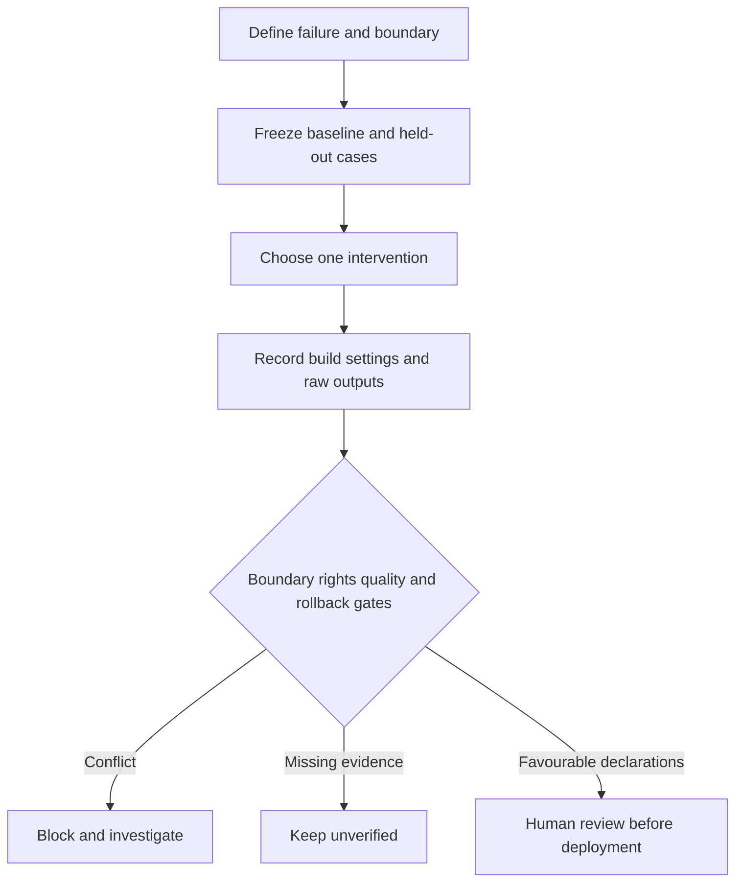

<!-- Module: 13 | Part: IV | Week: 13 | Status: draft | Author: course development agent | Updated: 2026-11-28 | Source review: 2026-11-28 | Independent review: NOT COMPLETED -->
# Module 13 — Fine-tuning, optimization and evaluation

> **Executive thesis:** Diagnose the failure before changing the model. Compare optimization candidates only after boundary, data-rights and task-quality gates; a faster failed answer remains a failed answer.

**Educational draft.** Sources and a real small-model CPU experiment are inspectable. Independent assessment, qualified Arabic/domain review and production assurance are NOT COMPLETED. Module 04 remains on HOLD; this chapter supplies no legal clearance.

**At a glance**

| Field | Value |
|---|---|
| Part / week | IV, Week 13 |
| Difficulty | Advanced |
| Study effort | Ten one-hour sessions: 3 reading, 4 lab/evidence, 2 PM memo, 1 assessment |
| Prerequisites | [Model strategy](11-sovereign-models-model-strategy.md), [sovereign RAG](12-sovereign-rag-systems.md) |
| Key artifact | [Optimization trade-off memo and evaluation plan](../labs/module-13/TRADEOFF_MEMO.md) |
| Lab | Python 3.13, CPU, pinned public model, synthetic cases; no GPU, Docker or paid service |
| Source review | 28 November 2026 |

## 1. Executive brief: choose the intervention that addresses the failure

A fictional BANK-A service must keep documents, prompts, model artifacts, adapters, diagnostics and backups inside its named premises. It has an Arabic/English answer-quality problem and a slow local endpoint. A proposed cloud fine-tune mixes three unresolved decisions: whether adaptation addresses the error, whether training is admissible, and whether the resulting service meets task and operating requirements.

Require a failure inventory first. Missing current policy text points toward retrieval; unclear instructions suggest a prompt/template experiment; persistent task-format failures may justify supervised adaptation after simpler changes; resource constraints call for serving experiments. These are course heuristics, not guarantees. Preserve a baseline and held-out evaluation so improvement can be disproved.

The lab changes CPU thread count while preserving model, template, cases, dtype and generation policy. It measures elapsed generation and keeps every raw continuation. Both profiles fail the tiny literal-label criterion. Faster observed timing supplies a performance observation, not an enterprise recommendation.

## 2. Learning objectives

1. Select prompting, retrieval, fine-tuning or serving changes from failure evidence.
2. Explain LoRA, quantization and batching without treating them as interchangeable.
3. Design versioned data, slice-aware evaluation and bounded performance experiments.
4. Reject faster candidates that violate a hard boundary or quality criterion.
5. Produce an optimization memo with owners, rollback and a dated retest.

## 3. Taxonomy, ontology and the mental model

The course [ontology](../taxonomy/ONTOLOGY.md) supplies the shared model. **OptimizationExperiment**, **ExperimentVariant** and **MeasurementPopulation** are course-authored classes, not a standard. An experiment compares variants bound to a ModelArtifact and produces ModelRun evidence. Its population states task/language/load coverage; EvaluationSlices preserve subgroup denominators. Dataset partitions and quality gates below are operational concepts, not additional undeclared ontology classes.

| Term | Meaning here | Decision implication |
|---|---|---|
| Fine-tuning | Updating trainable model parameters on selected examples | Requires data, rights, evaluation and artifact lifecycles |
| PEFT | Parameter-efficient fine-tuning using a subset or added parameters | Smaller trainable state does not remove base-model duties |
| LoRA | Low-rank trainable updates alongside frozen base weights[^lora] | Retain compatible base, adapter and target-module configuration |
| Quantization | Lower-precision weight representation, with method-specific trade-offs[^quant] | Verify hardware support and repeat task tests |
| Serving profile | Runtime settings for the intended service | Bind observations to settings and workload |
| Evaluation slice | A declared task/language/risk subgroup | Preserve cases and denominators, including missing slices |

**Invariants:** do not train on held-out test data, count repeated executions as independent task examples, compare incompatible workloads, or let an aggregate override a critical slice/boundary conflict. These are exercise requirements, not a claim that this lab enforces enterprise controls.



*Diagram: An experiment compares evidence; admissibility and quality precede deployment. The editable SVG provides the same flow and a text equivalent.*

## 4. How it works: seven engineering decisions

### 13.1 Fine-tuning compared with prompting and RAG

Label a small error sample with expected behavior, available context, retrieved sources, template, raw output and reviewer reasoning. Separate absent knowledge, failed retrieval, unsupported reasoning, instruction/format failure and an incorrectly specified evaluation. Do not assume a fine-tune repairs other components.

| Observed problem | First bounded experiment | Evidence that could change the choice |
|---|---|---|
| Current policy never reaches prompt | Repair retrieval and permission filtering | Authorized context is correct but generation fails |
| Correct content plus unwanted prose | Explicit output contract or constrained parser | Format failure persists on held-out examples |
| Specialist label/style behavior needed | Prompt baseline, then adaptation candidate | Approved representative examples and held-out gain |
| Slow endpoint with adequate quality | Profile prefill, decode, queueing and memory | Measured bottleneck supports another intervention |

In the course design, retrieval remains the canonical route for current, permission-scoped documents. Updating weights is not document-level access control or revocation. If training used a withdrawn source, investigate downstream datasets, checkpoints, adapters and release duties; do not promise exact removal from weights without a validated method and review.

### 13.2 PEFT/LoRA and training pipeline fundamentals

LoRA freezes pretrained weights and learns low-rank update matrices.[^lora] For one dense matrix of shape d×k, a rank-r update uses d×r and r×k matrices: r(d+k) trainable entries rather than dk. This arithmetic excludes biases, other trainable modules, gradients, optimizer state and activations; it is not total training memory.

Record approved data provenance and split membership, tokenization/template and masking, base revision, target modules, rank/scaling, optimizer, seed, checkpoints and evaluation history. An adapter without its compatible base/configuration is not a recoverable service. PEFT documents merging adapters into base weights; that result still needs a new build identity and retest.[^peft] This lab performs neither training nor merging.

For the fictional bank, training, tracking, checkpoints, evaluation traces, activation, support and recovery must satisfy its premises rule. An external training notebook or tracker conflicts with that unchanged requirement. Another organization can explicitly authorize a reviewed external environment; record the changed data/operator assumptions rather than transferring the bank's conclusion.

### 13.3 Quantization, batching, memory and inference optimization

The pinned Transformers guide explains lower-precision weight storage and lists hardware/method compatibility differences.[^quant] Smaller representation can change outputs and may require calibration; it does not guarantee lower service latency on every device. Do not copy an incompatible accelerator recipe into a CPU plan or estimate peak process memory solely from a weight file.

Budget weights, KV cache, temporary activations, runtime and concurrency separately. KV cache retains attention state for preceding tokens; assess its growth with context and simultaneous requests on the chosen implementation. Batching groups requests for execution. Waiting to fill a batch can increase an individual request's delay despite improved aggregate throughput. These are factors to measure, not results of the thread experiment.

The lab configures PyTorch intra-operation CPU threads before model work, following its documented requirement.[^threads] Separate processes run one- and two-thread profiles with one warm-up each. Float32 dtype, enabled cache, prompts and greedy generation capped at 24 new tokens remain fixed. No quantization, batching, accelerator, peak-memory or energy measurement is claimed.

### 13.4 Dataset preparation, experiment tracking and reproducibility

Use immutable case IDs, task/language labels, permission records, deduplication rules, annotation instructions and reviewer disagreements. Split at the leakage unit: related documents or near-duplicate conversations must not straddle training and test partitions. A time split needs an explicit cutoff. Iterate on development data; reserve held-out tests for the release decision.

Record files/revision, tokenizer/template, runtime, hardware, settings, case hashes and raw outputs. A seed describes execution but does not prove bitwise repeatability across kernels, versions or platforms. Hashes detect changes against a retained reference; they do not independently authenticate a supplier. New datasets/adapters create new artifact identities rather than overwriting prior evidence.

This lab trains nothing and has no training partition. Its eight synthetic cases explicitly reuse Module 11's cases. Three repeats expose execution variability; they do not turn four Arabic cases into twelve different examples. The runner refuses an existing evidence path, and the validator recomputes summaries from raw rows.

### 13.5 Quality, safety and task-level benchmarking

Separate quality, refusal/safety, exposure, latency and cost criteria. HELM's original study deliberately uses multiple metrics and records coverage gaps; it is a methodological reference, not certification for this workload.[^helm] A task may need source-groundedness, correct abstention, literal format and competent human judgment beyond a generic benchmark.

Define the performance clock. Our timer covers generation after input tokenization, excluding model load, HTTP and queueing. It is not time-to-first-token or production p95. Output length affects duration, so retain token counts and raw output. Aggregate generated tokens/second means total generated tokens divided by summed generation times; it is not multi-user throughput.

Define harmful behavior with a domain owner. Where relevant, test extraction, unsupported financial instructions, prompt injection and cross-tenant exposure. The lab's harmless labels test none of these risks. A model judge requires an approved data path and validated rubric; it must not silently move protected outputs off premises.

### 13.6 Arabic and sector-sensitive evaluation

Declare intended users, Arabic varieties, script conventions, code-switching, names, numerals and sector terminology. Qualified reviewers must define acceptable meaning/refusal and adjudicate disagreements. These are course evaluation requirements; a representative Arabic benchmark has not been run here.

The SmolLM2 card states its primary English scope.[^smollm] Four Arabic cases fail the literal rule under both profiles. Four English cases also fail; some include correct content plus extra prose. Literal failure therefore does not establish that every response is factually wrong, and tokenizing Arabic does not establish task readiness. Retain raw responses, subgroup counts and the qualified-review gap.

### 13.7 Quality-versus-cost and deployment trade-offs

Reject ineligible candidates, then identify those meeting task requirements. Within that set, compare cost per successfully completed task, latency under declared load, capacity, operating effort and rollback risk. Faster generation on one machine may not address a queueing bottleneck. Repeat target-infrastructure tests with warm/cold starts, concurrency and realistic lengths.

Quantized/adapted builds need their own held-out and adverse tests. Preserve an approved predecessor, check parsers/retrieval/tools, and define rollback triggers before a canary. If no eligible candidate passes, withhold release, narrow the use case or obtain a reviewed requirement change. Averaging away an adverse slice is not remediation.

## 5. UAE/GCC case study and global comparison

**Illustrative, not a real deployment:** UAE BANK-A has a contractual physical-site policy supplied by this scenario, not inferred from national law. An external cloud LoRA service would cross its training boundary. The PM can authorize a local synthetic experiment without thereby establishing rights, facility isolation or banking acceptance.

A fictional organization in another market permits reviewed external training on approved de-identified examples. It can consider more patterns after evaluating permissions, re-identification, operators, logs, backups and exit. The changed policy explains the shortlist; geography alone does not. Counsel must establish actual federal, free-zone and sector applicability. No jurisdiction-wide legal obligation is asserted here.

## 6. Hands-on lab: measure inference tuning locally

Use the [complete lab](../labs/module-13/README.md). Prepare Module 11's pinned public SmolLM2 bundle, then run a real CPU comparison with Python connections denied. No paid-service spend is required. Allow roughly 1 GB plus installer cache and working memory as a planning allowance. Teaching target: Apple Silicon M4 Pro/16 GB; inspect the record for the actual platform. No Docker, Ollama service, account or accelerator is required.

```bash
python3.13 -m venv /tmp/sovereign-model13-env
/tmp/sovereign-model13-env/bin/pip install -r labs/module-13/requirements.txt
/tmp/sovereign-model13-env/bin/python labs/module-11/prepare.py /tmp/sovereign-model13-artifacts
/tmp/sovereign-model13-env/bin/python labs/module-13/run_tuning.py /tmp/sovereign-model13-artifacts /tmp/model13-observation.json
python3 labs/module-13/experiment.py /tmp/model13-observation.json
python3 -m unittest discover -s labs/module-13 -p 'test_*.py'
```

Installation/preparation are online and separate from local execution. A Python guard is not physical air-gap proof; it does not inspect native libraries, OS services, removable media or support. Use no enterprise data. If setup fails, retain errors and mark NOT COMPLETED.

**Observed 28 November 2026 local time:** 48 generations, eight distinct synthetic cases and three repeats/profile. Median generation was 0.449638 seconds with one thread and 0.4364415 with two. Both profiles had zero literal successes among four English and four Arabic cases (0/12 repeated measurements per language/profile). These are local observations, not statistically established speedups, p95, production quality, energy or peak-memory results. Profiles were not counterbalanced; order, thermal and background effects remain possible.

Acceptance requires nine-file identity, 48 unique case/profile/repeat rows, fixed settings, separate language denominators, raw-derived summaries, honest status and overwrite refusal. Experiment completion is distinct from deployment acceptance. Optional cloud LoRA is **NOT PERFORMED** and requires its own approved environment, budget, data/rights review and cleanup.

## 7. The AI PM decision playbook

Product defines successful tasks and unacceptable consequences; language/domain specialists own qualitative review; model engineering owns build/experiment; platform owns capacity/rollback; security owns data/control paths; counsel owns use/training-data disposition. One notebook author cannot close every approval.

Ask which failure the intervention targets, what the aggregate hides, which clock/load were measured, which acceptable tasks form the cost denominator and where every derivative can exist. Put evidence beside each answer in the [memo](../labs/module-13/TRADEOFF_MEMO.md). Favourable declarations reach REVIEW_REQUIRED, not certification.

## 8. Economics, operating model and trade-offs

Invented teaching arithmetic: AED 6,000/month fixed plus AED 0.02 per attempt, 20,000 attempts and assumed 80% acceptable completion gives (6,000+0.02×20,000)/(0.8×20,000) = AED 0.40 per acceptable task. At 50%, it becomes AED 0.64. These are not provider prices or lab-derived completion rates; the actual label experiment has no successes and cannot support that denominator.

Include annotation, experimentation, review, idle capacity, incidents, revalidation and rollback. Report energy only with actual measurements and a defined boundary. Fewer generation seconds or nominal bits do not establish lower facility energy or total spending. Sensitivity-test volume, successful-task rate and staffing before capacity commitments.

## 9. Anti-patterns and failure cases

- **Fine-tuning before diagnosis:** inspect retrieval, template and scoring first.
- **Repeats counted as new examples:** retain unique IDs and execution counts separately.
- **Fast failed answers accepted:** keep boundary and quality gates dominant.
- **Adapter treated as complete model:** retain compatible base, configuration and runtime.
- **External training hidden behind local inference:** map training, tracking and recovery too.
- **File size called measured RAM/energy:** measure the claimed resource.

## 10. PM deliverable and capstone connection

Complete the [trade-off memo and evaluation plan](../labs/module-13/TRADEOFF_MEMO.md): diagnosis, alternatives, hard exclusions, controlled comparison, dataset partitions, slice criteria, observations, economics, rollback, owners and retest. Its 20-point rubric uses threshold 12 for learning progress; hard-gate gaps prevent release regardless of score.

The capstone receives a versioned candidate with explicit gaps. Module 14 agent actions cannot compensate for an unsuitable model by bypassing permissions or silently changing providers.

## 11. Knowledge check

**Q1.** Current-policy answers fail because authorized documents never reach the prompt. What would you test first, and what evidence would change that choice?

**Q2.** What belongs with a LoRA adapter for reproduction? Why do fewer trainable parameters not establish total memory or rights?

**Q3.** A two-thread profile generates faster on eight prompts. Which clock, denominators and workload limits accompany that claim?

**Q4.** Can three repeats of four Arabic examples establish twelve-example Arabic quality? Design the missing evaluation and reviewer roles.

**Q5.** The actual Transformers 4.57.3 overview lists methods with different hardware support.[^quant] A fictional BANK-A team copies a GPU-oriented recipe to an Apple CPU host and declares success from a smaller file. What must be verified/measured, and what evidence could reverse the decision? The customer/proposal are hypothetical.

### Q6. Evidence-state and root-cause scenario

On 28 November a fictional candidate is UNVERIFIED pending Arabic quality, rights and rollback evidence. An experiment reports 95/100 English but 3/10 Arabic, with shorter median generation time. The operator proposes aggregate-based release, counting repeated Arabic runs as new independent cases, and an external judge plus fallback API. BANK-A forbids off-premises processing. No raw baseline or adapter/base mapping was retained.

Give evidence-state transitions; distinguish observations from confirmed causes; identify plausible data/template/model/evaluation causes; contain external paths; assign roles, remediation and a dated retest. Explain closure if quality improves while rights/rollback remain missing. These figures are fictional, separate from actual lab results.

**Scenario challenge:** Recommend interventions for missing source content, format failure and latency under the unchanged premises rule. State evidence that could reverse each.

Separate answers: `assessments/solutions/13-fine-tuning-optimization-evaluation-solutions.md`.

## 12. Key takeaways

Choose from failure evidence. Freeze build and workload, retain raw responses and critical slices. Measure the claimed resource; compare cost only within the eligible, task-acceptable set. Keep experiment completion, publication and independent approval distinct.

## 13. Evidence ledger, quoted sources and further reading

Exact excerpts checked 28 November 2026; interpretations and gates are course-authored. Documentation describes intended behavior, not independent verification of this bank or deployment.

| Claim | Exact short extract | Source / pinpoint | Interpretation and limit |
|---|---|---|---|
| C1 | “freezes the pre-trained model weights” | LoRA abstract[^lora] | Updates retain the base dependency |
| C2 | “adapter weights can be merged with the base model” | PEFT, LoRA advantages[^peft] | Merged builds require identity/retest |
| C3 | “storing the weights in a lower precision” | Transformers 4.57.3 overview[^quant] | Not a latency/energy guarantee |
| C4 | “before running eager, JIT or autograd code” | PyTorch 2.9 warning[^threads] | Configure threads before model work |
| C5 | “we adopt a multi-metric approach” | HELM abstract[^helm] | Accuracy alone is insufficient |
| C6 | “primarily understand and generate content in English” | SmolLM2 Limitations[^smollm] | Arabic suitability remains unestablished |

[^lora]: Hu et al., *LoRA: Low-Rank Adaptation of Large Language Models*, arXiv:2106.09685v2, revised 16 October 2021, abstract, https://arxiv.org/abs/2106.09685v2. Verified: 2026-11-28. Research results not transferred to the lab.
[^peft]: Hugging Face, *PEFT: LoRA*, main documentation, advantages/merging, https://huggingface.co/docs/peft/main/en/conceptual_guides/lora. Verified: 2026-11-28. Mutable main requires source installation; conceptual reference only, no PEFT execution here.
[^quant]: Hugging Face, *Transformers 4.57.3: Quantization overview*, introduction and hardware-method table, https://huggingface.co/docs/transformers/v4.57.3/en/quantization/overview. Verified: 2026-11-28. Retest actual recipe compatibility; no quantized run here.
[^threads]: PyTorch contributors, *PyTorch 2.9: torch.set_num_threads*, function/warning, https://docs.pytorch.org/docs/2.9/generated/torch.set_num_threads.html. Verified: 2026-11-28. API contract, not performance prediction.
[^helm]: Liang et al., *Holistic Evaluation of Language Models*, arXiv:2211.09110v2, revised 1 October 2023; TMLR 2023, abstract, https://arxiv.org/abs/2211.09110v2. Verified: 2026-11-28. Original study, not this task's certification.
[^smollm]: HuggingFaceTB, *SmolLM2-135M-Instruct model card*, commit 12fd25f77366fa6b3b4b768ec3050bf629380bac, Limitations/License, https://huggingface.co/HuggingFaceTB/SmolLM2-135M-Instruct/blob/12fd25f77366fa6b3b4b768ec3050bf629380bac/README.md. Verified: 2026-11-28. Apache-2.0 declaration links full terms; intended-use review separate.

## 14. Website, social derivative and next steps

Read the [lab](../labs/module-13/README.md), [PM memo](../labs/module-13/TRADEOFF_MEMO.md), [question carousel](../social/module-13/CAROUSEL.html), [portrait PDF](../social/module-13/QUESTIONS.pdf) and [post draft](../social/module-13/POST.md). HTML is preferred; PDF is untagged. Author reviews record checks honestly; independent/manual accessibility and production assurance remain pending.

The [Architecture & Learning Studio](../learning/index.html) adds an optimization-evidence challenge covering batch, tail-latency and errors. It is deterministic, browser-only and educational, storing learning state locally by default; no legal authority or live model is implied. Never put confidential details in exports/public sync. Change a compute/operator assumption to expose conflicts despite attractive performance. Module 14 adds bounded tool actions, approvals and integrations.
