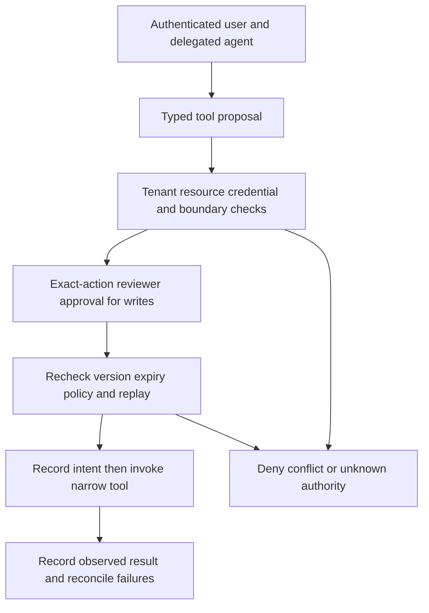

# Module 14 — Agents, APIs & Enterprise Integrations

> **Executive thesis:** Give the application a narrow, independently enforced action boundary before giving a model discretion over the next step. A plausible tool call, a valid credential and a human approval are three different decisions.

**Educational draft; independent assessment and manual accessibility review pending.** Primary sources checked 28 November 2026. BANK-A, its tickets, policies and economics are fictional. The lab executes real control logic against in-memory synthetic tools; it calls no language model, enterprise system or paid service.

| At a glance | Scope |
|---|---|
| Effort | Week 14; [ten one-hour sessions](../learning/schedule.html#module-14) |
| Prerequisites | Module 08 data permissions, Module 10 deployment, Module 12 retrieval |
| Outcome | Agent control-spec, abuse-case register and go/no-go rubric |
| Lab | Python standard library; CPU; no packages, network, credentials or Docker |

## 1. Executive brief: authorize the action at the system boundary

A fictional UAE bank wants an assistant to read a maintenance ticket and recommend closure. Closing a ticket changes an operational record, so the bank's teaching policy requires a separate reviewer. An attacker changes the resource ID after approval. A design that checks only whether the conversation contains the word approved can close the wrong record even when the model's recommendation was reasonable.

Keep proposal, authorization, approval and execution separate. Resolve the authenticated user from trusted infrastructure; bind an agent to that user's permitted delegation; obtain a credential for the actual downstream audience; authorize the tenant, resource and action; then consume an approval for that exact action. Recheck policy and resource version immediately before execution. The model can propose arguments but cannot issue its own authority.

BANK-A also requires processing at the physical BANK-A site without a network connection or remote operator. Country-level storage does not meet this unchanged scenario. Inventory prompts, outputs, weights, embeddings, OCR/speech, diagnostics, logs, telemetry, backups, support, activation, updates and recovery. Any protected off-site path blocks the design. No quality score or signed approval can override that conflict.

## 2. Learning objectives

Distinguish assistants, workflows and agents by who chooses the next step; specify typed tools and orchestration bounds; separate model-gateway policy from downstream authorization; model user, agent, credential and tenant identities; bind approvals to exact high-impact actions; design enterprise integration failure and recovery behavior; and define a developer contract preserving tenant isolation, idempotency and inspectable evidence.

## 3. Taxonomy, ontology and mental model

The [course ontology](../taxonomy/ONTOLOGY.md) supplies shared workload, tenant, identity, control and evidence concepts. This module adds course-authored working objects: **AgentIdentity** identifies the delegated application actor; **ToolAction** describes an allowed operation and resource; **ApprovalGrant** binds a reviewer to an exact proposal with validity constraints; **InvocationRecord** preserves an attempted action's decision and outcome. These objects are teaching constructs, not an official certification or identity protocol.

A user **delegates to** an agent; a scoped credential permits a tool action for a resource audience; an approval grant **authorizes an exact action** only after ordinary authorization; an invocation record **records an attempt**, not an automatic success. Preserve the user, agent and downstream service as distinct principals. A tenant ID supplied in generated JSON is a claim to validate, not trusted identity.



The diagram shows a proposal passing independent checks before execution. Approval is inside the authorization boundary; it does not replace it. Audit distinguishes intent, denial and completed return. An unknown downstream outcome requires reconciliation rather than an unqualified success label.

## 4. Technical deep dive

### 14.1 Assistants, workflows and agents

An assistant is a user-facing role and does not specify an execution architecture. A workflow follows programmed transitions; an agent lets a model choose intermediate steps and tools. Anthropic's 2024 engineering article uses this workflow/agent distinction, while noting that tooling has since changed.[^patterns] Use the distinction to decide which control surface needs testing, not to rank products by a marketing label.

For a fixed maintenance process, a workflow can read a ticket, produce a proposed disposition and wait for review. An agent may be justified when evidence collection varies substantially. Either design needs authorization. A model-controlled loop introduces termination conditions, accumulated context and repeated tool calls. Specify maximum steps, elapsed time, spend, retries and allowed operations; reaching a limit should return a bounded failure for review.

Test the same unauthorized tool proposal whether it comes from an LLM, a deterministic script, a replayed queue message or an adversarial client. The lab intentionally omits the language model to make this control boundary observable. A fluent conversation cannot establish correct authority.

### 14.2 Tool invocation and orchestration patterns

A tool is an application interface, not arbitrary code the model may invent. Define its name, schema, resource type, side effects, permission, idempotency behavior, timeout, error contract and response sensitivity. Prefer `ticket.close(resource, expected_version)` over unrestricted SQL, shell commands or arbitrary URL fetching. OWASP recommends minimizing tools, permissions and autonomous high-impact execution.[^agency]

The orchestrator parses a proposal, validates a strict schema and passes a normalized action to policy enforcement. Tool output is untrusted data. A retrieved ticket containing instructions to send credentials must not expand the registered tool set or gain authority. Separate instructions from retrieved content, but retain authorization at invocation even if that prompt boundary fails.

Parallel reads require per-call identity and a total budget; one success does not authorize a failed sibling. Retrying a write requires an idempotency or reconciliation contract. A timeout can mean no execution, completed execution with a lost response, or partial completion. Keep an UNKNOWN_OUTCOME state until a trusted status query resolves it; do not blindly repeat a payment, entitlement change or notification.

### 14.3 Model gateways, routing, access policies and audit logs

A model gateway can enforce permitted destinations, quotas, request classes and routing. It does not establish that a CRM record belongs to the user or that a ticket may be closed. Put resource authorization in the tool/downstream boundary too. OWASP's complete-mediation guidance assigns validation to downstream systems rather than model judgment.[^agency]

Route only among eligible endpoints. For the unchanged physical-site BANK-A rule, internet fallback is blocked even when the local model is unavailable. Include gateway logs, traces and errors in residency review. The no-data-egress claim fails if request bodies remain local but diagnostic export carries them outside.

Audit should identify the user/agent chain, tenant, tool version, action fingerprint, policy revision, approval reference, attempt ID, decision and observed outcome. Minimize content and restrict audit access. A hash of a predictable value can be guessed and is not anonymization. The lab records digests and fixed reason codes, not credentials or ticket text. Its in-memory list is neither tamper-evident storage nor an enterprise retention system.

### 14.4 Agent identity, credentials, permissions and action boundaries

Authenticate the user and application through trusted infrastructure; derive tenant context there. A separate agent identity makes delegated behavior attributable without treating the agent as the user. A downstream credential should have a narrow resource audience, scope, lifetime and rotation/revocation process. RFC 9700 describes access-token privilege and audience restriction.[^oauth] The lab demonstrates these checks with fixture handles, not real OAuth.

Avoid a shared administrator credential for every tenant. Check that the current user may delegate to the agent, the agent belongs to the tenant, the credential targets this service, the operation is within scope, the resource belongs to that tenant and the credential has not expired or been revoked. Read access does not become write access because a model generated a write proposal.

MCP is an integration protocol, not a grant of cross-system authority. Its versioned security guidance rejects accepting tokens not explicitly issued for the MCP server and describes token-passthrough risks.[^mcp] Keep client-to-server and server-to-downstream authorization distinct; inspect deployment-specific token exchange and consent. A session ID or tool listing is not adequate authentication or permission evidence.

### 14.5 Human approvals and high-impact actions

A reviewer needs a concrete action: who acts, for whom, on which resource, with which parameters and consequences. Bind approval to the canonical proposal, tenant, user, agent, resource/version, policy revision, expiry and a single-use identifier. Recheck these before the tool call. Approval for A-1 version 1 cannot authorize B-1, a changed proposal, an updated policy or replay after a timeout.

Separate authentication, authorization and approval. The reviewer must be eligible for that tenant and action; a signature over arbitrary content does not establish eligibility. Revoking a reviewer or changing the resource invalidates reliance on an old grant. The lab signs short-lived records with an ephemeral process key and checks a server-owned grant registry. This demonstrates binding and tamper rejection; it is not a deployable signing or key-management service.

Review adds delay and fatigue. Reserve it for explicitly classified consequences and show the exact action and current evidence. Measure rejection quality and backlog alongside completion time. A model's claim that a user already consented is not reviewer evidence. Production needs a tested consent interface, anti-forgery protection, strong authentication and accessible presentation; a Python fixture supplies none of those.

### 14.6 Integration with enterprise applications and internal data

A connector crosses a boundary into a system with its own permissions, data versions and transaction semantics. Inventory connector dependencies, credential store, catalog, queue, error handling, administrator access, backup and recovery. Keep Module 12 retrieval permissions and action permissions separate: seeing an invoice does not permit changing its payee.

Use optimistic concurrency: include the version reviewed, then reject a write if the resource changed. Distributed execution needs durable idempotency records, transactional intent/outbox where appropriate, downstream idempotency keys and reconciliation. A local lock cannot supply a general exactly-once guarantee. If the API executed but acknowledgment or result logging failed, classify the outcome as unknown and inspect the downstream record before retrying.

AWS Bedrock documents a return-control path supplying invocation inputs and a unique invocation ID to the developer application.[^return] This is a real interface example separating proposal/orchestration from application fulfillment. It is not evidence of human approval, tenant authorization or premises deployment. BANK-A is hypothetical; the lab calls no AWS service.

### 14.7 Multi-tenant developer platforms and API experience

Publish the contract around trusted tenant derivation, schemas, errors, versioning, request IDs, approvals, rate limits and retries. Developers need to reproduce denials without exposing another tenant's existence. Use synthetic fixtures and separate read/write examples. A generic success flag loses the distinction between accepted intent, pending review, denied action, unknown downstream outcome and completed operation.

Maintain tenant isolation in caches, queues, approval registries, idempotency keys, logs and recovery. A globally unique-looking ID does not eliminate authorization. The lab namespaces request replay detection by tenant and rejects cross-tenant resources, credentials and reviewers. Production also needs horizontal-scaling, offboarding, enumeration, log-access and service-account-compromise tests.

A self-service catalog should show tool owner, version, destination, side effect and scope. Treat a tool-definition update as a reviewed deployment: a harmless-looking name can conceal a new destructive operation. Repeat permission and boundary tests after schema, routing, credential or policy changes, not merely model changes.

## 5. UAE/GCC case study and global comparison

**Illustrative case:** BANK-A's physical-site maintenance assistant has two tenants and read/close operations. A cloud orchestrator scores better on task quality but stores traces and approval state outside BANK-A. The unchanged policy blocks it. A local orchestrator still needs actual placement, media/update controls, local identity/key infrastructure, independent testing and recovery evidence.

A fictional second organization permits an approved domestic managed service and reviewed remote support. Its eligible set may include that service, subject to actual terms, flows and permissions. This explicitly changes the contractual scenario; it is not a statement that UAE, Saudi, DIFC or ADGM law permits a service. Module 04's legal HOLD and qualified jurisdiction review remain separate. AWS and MCP documents illustrate interfaces and controls, not either organization's actual deployment.

## 6. Hands-on lab: gate a synthetic ticket agent

Use the [complete lab](../labs/module-14/README.md). Execute Python checks against two in-memory tenants, two agents and narrow read/close tools. Closure requires an eligible separate reviewer, an exact-action signed grant, current resource/policy versions, a valid credential and unused request/grant identifiers. No model or enterprise connector is configured.

```bash
python3 labs/module-14/gated_agent.py
python3 -m unittest discover -s labs/module-14 -p 'test_*.py' -v
```

Budget 60–90 minutes plus the PM exercise; Python 3.11+ standard library, any compatible CPU, no GPU or Docker and no paid-service spend. Expected: missing approval denied, exact approved closure completed, replay and cross-tenant attempt denied, exactly one synthetic tool invocation. The [retained observation](../labs/module-14/observed-control-run.json) contains synthetic evidence. Test approval tampering/expiry/revocation, concurrent replay, stale policy/resource, wrong audience/scope, failed audit and each protected artifact's boundary conflict.

Acceptance means control tests behave as declared, including denials. `DECLARED_ONLY` means the fixture satisfies its declared boundary, not actual premises or air-gap assurance. The process makes no network calls; this is not OS packet capture, identity-provider integration, a durable transaction test or site inspection. Extension: use a reviewed transactional store and demonstrate a crash between execution and acknowledgment without duplicating an action.

## 7. The AI PM decision playbook

Product owns allowed outcomes and high-impact classification. Security owns delegation, credential and approval policy; the enterprise application owner owns resource authorization and reconciliation; operations owns audit durability and recovery; qualified counsel/privacy reviewers own applicable obligations. Ask who can revoke a pending grant, how the downstream system rejects stale versions and which recovery dependency crosses the site boundary.

Use the [control-spec and abuse register](../labs/module-14/CONTROL_SPEC.md). Compare workflow, bounded agent and external managed orchestrator only after hard gates. Prefer the simplest eligible design that performs the task and is supportable by the team. Better task scores cannot compensate for unauthorized actions, missing owners or prohibited paths.

## 8. Economics, operating model and trade-offs

Illustrative arithmetic: 1,000 proposed closures/month, 20% manual review, four minutes/review and AED 120/hour reviewer cost gives 200 × 4/60 × 120 = AED 1,600/month review effort. These are invented inputs, not salaries or supplier prices. At 60% review the same assumptions imply AED 4,800. Add rejected/revised proposals, incidents, local infrastructure, credential rotation and idle capacity.

Measure completed correct authorized outcomes, not tool-call volume. Three retries can consume more resources without delivering another outcome. Queue delay can dominate model latency. Compare the same permitted boundary, workload, review criterion and recovery service; an ineligible external candidate cannot win on price.

## 9. Anti-patterns and failure cases

- **Approval as conversation text:** bind a trusted grant to the canonical action and enforce expiry/replay protection.
- **Read permission reused for writes:** check operation and resource independently.
- **Shared administrator credential:** use scoped delegation and test cross-tenant misuse.
- **Gateway treated as universal authorization:** enforce resource policy at each invocation.
- **Timeout retried as a fresh write:** reconcile the original request and preserve its idempotency identity.
- **Raw exception export after prompt redaction:** inspect diagnostics, support and recovery too.
- **Local lock called exactly-once delivery:** distinguish the single-process exercise from distributed guarantees.

## 10. PM deliverable and capstone connection

Complete the [control-spec, abuse register and go/no-go rubric](../labs/module-14/CONTROL_SPEC.md). Definition of done: named outcome/boundary, separate principals, exact schemas, per-operation permissions, reviewer eligibility, bound single-use approval, lifecycle controls, audit/reconciliation contract, denial tests, owners and dated retest. The 20-point course rubric never overrides a hard conflict or independent sign-off gap.

The capstone consumes an authorized action interface with a bounded failure contract. Carry approvals, revocation and unknown outcomes into Module 15's threat model. Passing the synthetic exercise is educational completion; enterprise approval stays pending.

## 11. Knowledge check

**Q1.** What distinguishes assistant, workflow and agent, and which distinction affects the location of authorization?

**Q2.** A user may view a ticket. Why can neither a model-gateway token nor an approval sentence authorize closure?

**Q3.** What must an approval bind, and which changes between review and execution force a new decision?

**Q4.** A tool times out after a write and the result log is missing. Which state and next action preserve correctness without claiming exactly-once execution?

**Q5.** The real AWS Bedrock return-control interface returns invocation inputs and an invocation ID. A fictional BANK-A developer says this proves human approval and premises compliance. What does the interface establish, and what technical evidence could change the deployment decision? No real bank deployment or incident is asserted.[^return]

### Q6. Decision and root-cause scenario

On 28 November an agent is UNVERIFIED pending permission and approval tests. A reviewer approves closing A-1 version 1. The model then changes the resource to B-1; the adapter accepts a shared administrator token and checks only a Boolean `approved` field. B-1 is closed. The team proposes hiding B-1 from search and retaining the adapter. External diagnostic export also conflicts with the unchanged BANK-A rule.

State evidence transitions, direct and systemic causes, containment, accountable owners, mitigation and a dated retest. Why can neither cleaner search nor good task scores close the issue? Define the bounded decision if exact-action authorization later passes but external diagnostics remain.

**Scenario challenge:** Design read, proposal, approval, execution and recovery interfaces for both section 5 organizations. State exactly which changed boundary assumptions alter the eligible architecture.

Separate answers: `assessments/solutions/14-agents-apis-enterprise-integrations-solutions.md`. No solutions are embedded here.

## 12. Key takeaways

A proposal is data to validate. Keep delegated identity, downstream permissions and high-impact approval distinct; bind the latter to the current exact action and consume it once. Preserve denial and unknown outcomes, test cross-tenant and changed-state cases, and apply the complete operating boundary before optimizing quality or cost.

## 13. Evidence ledger, quoted sources and further reading

Exact brief extracts checked 28 November 2026; interpretations are course analysis. Provider documents describe interfaces and recommendations, not independently audited customer deployments.

| Claim | Exact short extract | Primary source / pinpoint | Interpretation and limit |
|---|---|---|---|
| C1 | “orchestrated through predefined code paths” | Anthropic, What are agents?[^patterns] | Workflow terminology; original article dates from 2024 |
| C2 | “Implement authorization in downstream systems” | OWASP LLM06:2025, Complete mediation[^agency] | Independent enforcement; no production-safety proof |
| C3 | “access tokens SHOULD be audience-restricted to a specific resource server” | IETF RFC 9700, section 2.3[^oauth] | Restrict target; full token validation still needed |
| C4 | “MCP servers MUST NOT accept any tokens that were not explicitly issued for the MCP server.” | MCP 2025-11-25, Token passthrough[^mcp] | Separate audiences; lab is not MCP/OAuth |
| C5 | “alongside a unique `invocationId`” | Amazon Bedrock guide, return-control introduction[^return] | Invocation context; no inherent consent/location conclusion |

[^patterns]: Anthropic Engineering, *Building effective agents*, 19 December 2024, What are agents?, https://www.anthropic.com/research/building-effective-agents. Verified: 2026-11-28. Provider terminology; page notes tooling changes since publication.
[^agency]: OWASP Gen AI Security Project, *LLM06:2025 Excessive Agency*, Prevention and Mitigation Strategies, points 1–7, https://genai.owasp.org/llmrisk/llm062025-excessive-agency/. Verified: 2026-11-28. Security guidance, not legal determination.
[^oauth]: Lodderstedt, Bradley, Labunets and Fett / IETF, *Best Current Practice for OAuth 2.0 Security*, RFC 9700, January 2025, section 2.3, https://datatracker.ietf.org/doc/html/rfc9700#section-2.3. Verified: 2026-11-28. Lab does not implement OAuth.
[^mcp]: Model Context Protocol, *Security Best Practices*, 2025-11-25 documentation, Token Passthrough and Session Hijacking, https://modelcontextprotocol.io/docs/2025-11-25/tutorials/security/security_best_practices. Verified: 2026-11-28. Original specification URL redirects here; actual deployed authorization needs review.
[^return]: Amazon Web Services, *Return control to the agent developer by sending elicited information in an InvokeAgent response*, Amazon Bedrock User Guide, introduction and invocation-results flow, https://docs.aws.amazon.com/bedrock/latest/userguide/agents-returncontrol.html. Verified: 2026-11-28; publication date not established. Provider interface docs; no service, approval UI, region or premises deployment tested.

## 14. Website, social derivative and next steps

Read the [lab](../labs/module-14/README.md), [control-spec](../labs/module-14/CONTROL_SPEC.md), [eight-question carousel](../social/module-14/CAROUSEL.html), [portrait PDF](../social/module-14/QUESTIONS.pdf) and [post draft](../social/module-14/POST.md). HTML is preferred; PDF is untagged. Two same-author development audits separate completed checks from independent/manual review still pending.

The [Architecture & Learning Studio](../learning/index.html) is a deterministic browser-only teaching tool. Use workload, tenant, operator and connectivity constraints to expose conflicts; generated plans cannot prove actual authorization, compliance or facility capability. An action-control specification belongs with exported architecture and evidence gaps. Next: Module 15 AI Security & Threat Modeling.
