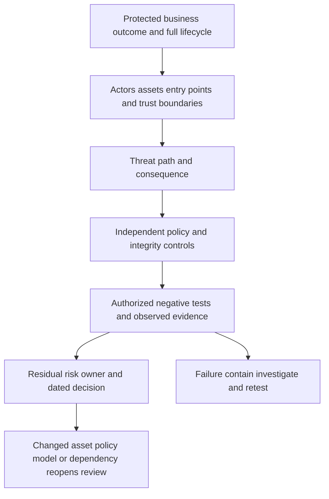

# Module 15 — AI Security & Threat Modeling

> **Executive thesis:** Design the application so that hostile instructions cannot grant new access or destinations. Approve a bounded security claim only when a named control, realistic negative test and accountable owner support it.

**Educational draft; independent assessment and manual accessibility review pending.** Primary sources checked 28 November 2026. BANK-A, its requirements, identities, documents and costs are fictional. The runnable lab executes synthetic policy checks without a model or external service. It does not measure prompt-injection detection, prove real authentication or establish physical isolation.

| At a glance | Scope |
|---|---|
| Effort | Week 15; [ten one-hour sessions](../learning/schedule.html#module-15) |
| Prerequisites | Module 08 data lifecycle, Module 12 retrieval, Module 14 actions |
| Outcome | Versioned threat model, prioritized abuse register and validation criteria |
| Lab | Python 3.11+ standard library; CPU; no credentials, packages, Docker or spend |

## 1. Executive brief: constrain the consequence before tuning the prompt

A fictional BANK-A employee asks a local RAG assistant to summarize maintenance guidance. An attacker edits one retrieved page to request export of all records. The relevant product question is whether the application has any authority to perform that export. A refusal from one model response does not answer it: another wording, document, language or model update may produce a different proposal. OWASP describes both direct user-input and indirect external-content injection and recommends privilege controls and adversarial testing.[^injection]

Start with the protected outcome: employees may read current permitted maintenance notes; they may not read another tenant's notes, run shell commands or send content externally. Put the corresponding decision outside the model. Then examine other paths: a poisoned dependency, stolen service account or debug endpoint could bypass the model entirely. A threat model should connect these paths to controls and tests, rather than turn a list of model attacks into a security approval.

BANK-A's unchanged teaching rule requires the physical BANK-A premises, offline network operation and on-site operators. Cover prompts, outputs, weights, embeddings, OCR/speech, logs, diagnostics, telemetry, backups, support, activation, updates, recovery and removable media. A protected external path remains BLOCKED even if every prompt-injection test passes. A compliant-looking declaration without inspection remains UNVERIFIED in enterprise review; the lab's narrower favorable state is explicitly DECLARED_ONLY.

## 2. Learning objectives

Identify assets, actors, entry points and trust boundaries; distinguish direct and indirect injection from poisoning and platform compromise; trace exfiltration from source through transformation to destination; separate artifact identity from publisher trust and behavioral safety; specify API/container/network controls and least privilege; maintain software/model inventories with provenance; and plan authorized security validation with measurable acceptance criteria, residual risk and retest triggers.

## 3. Taxonomy, ontology and mental model

The [course ontology](../taxonomy/ONTOLOGY.md) connects workloads, tenants, controls and evidence. This module introduces **ThreatScenario**, a specific asset, trust boundary, attacker capability, impact and owner hypothesis, and **SecurityValidation**, a bounded test recording build, scenario, expected outcome, observed result and residual risk. Existing Risk and Control concepts describe exposure and mitigation. A trust boundary is a change in authority or exposure, recorded as a scenario property. These are course-authored working objects, not certification categories or official severity scores.

A threat scenario **exposes** a Risk through its recorded trust boundary; a Control mitigates the path; a SecurityValidation **tests** the ThreatScenario and produces evidence tied to a system revision. A test failure does not automatically identify the only cause, and a test pass cannot establish every possible threat is mitigated. Keep the tested configuration and the protected business outcome in the evidence record.



The diagram begins with scope and ends with an accountable decision. Tests support a versioned claim; architecture or policy changes reopen the associated claim. OWASP's community threat-modeling framework asks about scope, what can fail, countermeasures and assessment.[^threat]

## 4. Technical deep dive

### 15.1 Threat models, trust boundaries and attack surfaces

An asset is something whose disclosure, alteration or unavailability harms the scoped outcome. Include source documents, credentials, model artifacts, tenant entitlements, actions, audit evidence and the ability to restore service. An entry point admits data or control: upload, retrieved document, connector response, model package, operator session, API route or update media. A trust boundary changes which principal controls a value or may act upon it. Crossing a machine boundary is sufficient neither to identify all trust boundaries nor to establish a control.

Draw two flows: normal task completion and administration/recovery. For each arrow record source principal, destination, data classification, permission decision, storage, retention and owner. The same PDF can be trusted as evidence of a maintenance policy but untrusted as instructions to the application. Publishing authority and execution authority are distinct.

Write a threat as a causal sentence: an editor changes a permitted source note; the model proposes an export; an unrestricted adapter executes it using a shared service credential; notes leave the premises. This exposes several intervention points. A threat titled simply prompt injection does not specify what must be prevented or where it can be tested. Prioritize consequence and practical reachability, while recording uncertainty instead of inventing numerical likelihoods.

### 15.2 Direct/indirect prompt injection and exfiltration

Direct injection enters through a user's request. Indirect injection arrives through material the model consumes, such as a document or tool response. The security distinction is the source of the instruction-like content, not whether the text contains a recognizable malicious phrase.[^injection] Encoding, different languages or instructions split across chunks challenge phrase-based filters; the lab deliberately uses no detector and makes no attack-coverage claim.

Separate prevention of a proposal from prevention of a consequence. A model may propose an unauthorized export; a tool registry without an export capability should reject it independently. Enforce trusted user and tenant identity, permitted resource access, exact schemas, operation scopes and destinations. Module 12's retrieval filtering reduces unauthorized context exposure; Module 14's action boundary controls subsequent effects. Neither substitutes for the other.

Trace exfiltration through transformations: a secret may become a URL parameter, image request, log message, embedding, error report or support attachment. Review rendering and telemetry too. If raw sensitive data reaches a model, an arbitrary text response to an unauthorized recipient remains a possible disclosure path even when tools are restricted. The lab's fixed read operation returns source text to a permitted fixture principal; it neither generates answers nor implements browser rendering, DLP, output-channel restrictions or model-level confidentiality.

### 15.3 Model supply chain, poisoned assets and artifact integrity

List the complete loaded bundle: weights, tokenizer, configuration, adapters, retrieval data, prompt templates, dependency wheels, container base and executable loading code. Review source, exact revision, license/use constraints, publisher access and update process. OWASP's supply-chain entry includes third-party packages, models, adapters and weak provenance.[^supply] An openly downloadable artifact is not automatically safe to load or permitted for every use.

A cryptographic digest identifies bytes relative to a trusted expected value. If an attacker replaces both an artifact and the manifest delivered beside it, a matching digest establishes only their mutual consistency. Establish the expected digest through a separately controlled review/distribution process. Signed attestations additionally require identity, trust-root, issuer, validity and policy verification; a signature alone does not establish model behavior or training-data rights.

The lab pins a harmless byte string against a code-owned digest and rejects modified bytes even when the caller supplies their new hash. This is a real digest comparison in a synthetic trust arrangement. It implements neither a signed release pipeline nor provenance verification, and a learner able to edit the trusted program can change its policy. Retain these limits rather than presenting a checksum demo as supply-chain assurance.

### 15.4 API, container, network and platform vulnerabilities

Model defenses cannot compensate for object-level authorization failures, exposed debug routes, over-privileged containers or vulnerable dependencies. OWASP's API project distinguishes object/function authorization, resource consumption, request forgery, inventory and unsafe API consumption.[^api] Evaluate the paths used by the deployment rather than assuming an AI-specific scanner covers conventional weaknesses.

For an inference API, specify authentication, resource authorization, request-size/token limits, concurrency, timeouts and safe error behavior. Enforce tenant/resource access before expensive or revealing work; resource IDs supplied by a client remain untrusted. For URL-fetching connectors, define allowed destinations and network enforcement, account for redirects and address changes, and test with authorized isolated fixtures. Removing arbitrary URL-fetch capability is simpler when the product does not need it.

For containers and hosts, review execution user, filesystem permissions, mounted secrets, host sockets, syscall restrictions, image identity, update ownership and runtime monitoring. A container is not a physical-site control or a complete isolation proof. Offline operation still needs a reviewed update path and recovery process; a malicious removable-media bundle can cross the boundary without internet access. The Module 15 exercise starts no server or container, scans no host and probes no external endpoint.

### 15.5 Zero-trust and least-privilege architecture

NIST SP 800-207 does not grant implicit trust solely because an asset or account is on a local network or enterprise-owned.[^zero] For BANK-A, premises residency constrains eligibility; it does not authorize every local process to read every local document. Keep placement and access-control claims separate.

Derive identities from trusted infrastructure, assign narrow privileges per component, and mediate resource access at the enforcing boundary. The ingestion service may write reviewed source records but should not manage identity policy. The inference process may read a filtered context but should not possess unrestricted support-export credentials. The update importer should verify a quarantined bundle before an authorized release changes the active artifact.

Specify revocation behavior, not just initial issuance. Recheck current permissions when building context and executing actions; invalidate caches and pending approvals when relevant policy changes. Test stopped identities and changed resource owners. The lab uses mutable public fixture registries to exercise these cases. It supplies no identity provider, secure session handling, service-mesh enforcement or protection against a hostile user modifying the Python process.

### 15.6 Software/model bills of materials and provenance

A bill of materials is a component inventory. For this teaching workflow record component identifier/version/digest, type, supplier/source, license review, dependency relationships, loading behavior, owner and vulnerability status. Extend the inventory to model weights, adapters, tokenizers, datasets and prompt templates rather than treating a model name as the entire system. OWASP recommends maintaining component inventories and evaluating AI/ML BOM options.[^supply]

Provenance describes where and how an artifact originated; it is complementary to an inventory. SLSA v1.2 distinguishes build provenance from source provenance.[^slsa] Verification asks whether an authenticated producer, build inputs and process match the consumer's expectations. Keeping a JSON document titled provenance without verifying its binding or issuer is evidence storage, not verification.

For an offline release, carry the inventory, reviewed hashes, approved trust roots, verification tooling and authorized update decision into the premises through the approved process. Record which active artifact each deployment actually loaded. A complete inventory can still contain a known vulnerable or behaviorally poisoned component; attach a treatment decision and tests. Licensing, security integrity and behavioral suitability require separate evidence and qualified reviewers.

### 15.7 Security validation and red-team exercises

Authorize the scope before testing: asset owner, environment, permitted methods, time window, data, rate/impact limits, observers, stop conditions and escalation contact. Begin in a disposable environment with synthetic records. Do not probe a provider, employer, production tenant or public endpoint without its owner's explicit authorization. This chapter's exercise stays entirely inside its local fixtures.

Define acceptance at the boundary. For a cross-tenant case, require denial before document content is returned and before any side-effect counter changes. For modified artifacts, require rejection before loading. For a missing audit service, define which operation fails closed. Preserve failing and passing cases and the system revision; do not count ten paraphrases of one path as ten independent security guarantees.

Use negative tests to challenge the claimed mechanism: spoofed tenant, revoked principal, stale owner, extra schema fields, changed artifact plus recomputed manifest, malformed boundary and protected external diagnostics. Separately evaluate a real model's attack success rate with an appropriate dataset and denominator when that system is available. The lab tests policy behavior and cannot report a model attack-success rate. Retesting follows model, prompt, permissions, dependency, connector, destination or operator changes, not only scheduled review.

## 5. UAE/GCC case study and global comparison

**Illustrative scenario:** BANK-A requires physical-site offline operation. Candidate A keeps inference local but sends error bodies to an external support platform. Candidate B keeps declared paths on site but has no inspected update/recovery evidence. A is BLOCKED by a known conflict; B remains pending real verification. A successful synthetic tool-denial test changes neither result.

A second fictional organization permits an approved domestic managed service and reviewed remote support. Its threat model may include authenticated remote administration and contracted telemetry, while still requiring tenant/resource isolation and artifact verification. This explicit policy change can alter eligible architectures. No UAE, Saudi, DIFC or ADGM legal conclusion follows; Module 04 remains HOLD and qualified applicability review is separate. The official NIST and OWASP sources describe general security methods, not either fictional organization's legal duties or deployment.

## 6. Hands-on lab: constrain hostile proposals

Read the [complete lab](../labs/module-15/README.md), then run:

```bash
python3 labs/module-15/security_gate.py
python3 -m unittest discover -s labs/module-15 -p 'test_*.py' -v
```

Budget 60–90 minutes. Expected: a permitted local read and an injected document returned as data; an export proposal and another tenant's read denied; exactly two fixed local reads across four demo cases. The [retained observation](../labs/module-15/observed-security-run.json) records an actual local synthetic execution. The test suite covers 35 named tests, including loops over fourteen lifecycle categories.

The injected source remains present in the permitted read response. That is intentional: the exercise constrains a fixed capability rather than claiming to recognize or neutralize hostile text. Inspect how a later forbidden export proposal is rejected. An unprotected downstream application could still misuse returned content. No model, browser, external network request, secret, exploit payload or real enterprise system is involved. Extend the threat register with unanswered model/output-channel and operational questions instead of claiming the toy gate solves injection.

## 7. The AI PM decision playbook

Use the [threat-model and validation template](../labs/module-15/THREAT_MODEL.md). Product owns the protected outcome and acceptable failure semantics. Security owns attack-path review and independent validation scope. Platform/application owners implement the relevant boundaries. Operations owns containment, update/recovery evidence and incident response. Qualified privacy/legal reviewers determine obligations separately.

Require every high-consequence scenario to have an owner, preventive/detective control, test, evidence state and residual decision. An owner accepting residual risk cannot silently waive an unchanged contractual premises rule. Make exceptions explicit, authorized and traceable to an actual changed requirement; do not relabel a conflict as a low score.

## 8. Economics, operating model and trade-offs

Illustrative planning arithmetic: six high-priority paths at two analyst hours each plus four hours to reproduce failures gives sixteen hours. At an invented AED 200/hour planning assumption, that is AED 3,200 of analysis effort. These are fictional inputs, not market prices or a prediction of review completeness. Add remediation, independent retest, evidence retention and update work separately.

A smaller tool surface can reduce review scope and product flexibility together. Keeping arbitrary export absent may be suitable for a maintenance reader and unsuitable for a genuinely approved export product. Compare eligible designs at the same workload, boundary and evidence level. Avoid cheaper-looking cloud comparisons that omit the physical-site requirement or local designs that omit patching and support ownership.

## 9. Anti-patterns and failure cases

- **One successful refusal treated as a security boundary:** test downstream authorization with a deliberately hostile proposal.
- **Keyword detector treated as injection immunity:** retain independent capability/resource/destination enforcement.
- **Artifact and manifest trusted together:** establish expected identity through a separately controlled channel.
- **An SBOM treated as approval:** evaluate the listed components and the actual loaded bundle.
- **Local network treated as trusted identity:** recheck current principals and resources.
- **External diagnostics ignored because inference is local:** inventory the full protected lifecycle.
- **Test count treated as production assurance:** record scope, revision, denominator, failure evidence and missing validation.

## 10. PM deliverable and capstone connection

Complete the threat model, inventory and prioritized validation register with the separate 20-point PM rubric. Definition of done: scoped business outcome; diagrams and lifecycle; explicit actors/authority; causal paths; controls and owners; authorized negative tests; evidence states; containment; residual decisions and dated retest triggers. A high rubric total cannot override a hard conflict or missing independent approval.

The capstone consumes this register alongside Module 12's retrieval permissions and Module 14's action contract. Module 16 adds custody/identity analysis; Module 17 adds operational observability and release gates. Passing the lab establishes educational exercise completion only.

## 11. Knowledge check

**Q1.** How do an asset, entry point and trust boundary differ? Give a boundary inside one physical machine.

**Q2.** Why can an indirect injection produce a hostile proposal without requiring the application to execute it? Identify controls for both unauthorized context and unauthorized effects.

**Q3.** An artifact and adjacent manifest have matching hashes. What trust question remains, and what would signature/provenance verification additionally require?

**Q4.** Why do least privilege, premises placement, a component inventory and a passing security test support different claims?

**Q5.** OWASP's real 2025 prompt-injection guidance recommends privilege control and adversarial testing.[^injection] A fictional vendor cites that guidance and one passing prompt as proof its BANK-A deployment is secure and physically isolated. What does the source establish, and what evidence could change each deployment claim? No actual vendor incident or deployment is asserted.

### Q6. Decision and root-cause scenario

On 28 November a fictional local RAG service is UNVERIFIED. A source editor injects export instructions. The model proposes `http_export`; a shared administrator adapter executes it and sends notes off-site. The team's prompt patch makes one example refuse; the unrestricted adapter and external diagnostics remain. State the evidence transition, direct and systemic causes, containment, accountable owners, mitigation and a dated retest. If independent action-policy tests later pass while diagnostics remain external, what bounded deployment decision follows?

**Scenario challenge:** Compare BANK-A with the second organization in section 5. Which changed policy assumptions alter eligibility, and which security tests remain necessary in both?

Separate answers: `assessments/solutions/15-ai-security-threat-modeling-solutions.md`. The public lesson contains no answer key.

## 12. Key takeaways

A security decision joins a scoped consequence, an enforcing control and bounded evidence. Treat generated instructions as data, verify artifact identity through trusted expectations, and inspect conventional platform paths as well as model behavior. Preserve known conflicts, missing evidence and verified test results as different states with named owners and retest triggers.

## 13. Evidence ledger, quoted sources and further reading

Brief exact extracts checked 28 November 2026. Interpretations and the BANK-A design are course analysis; guidance is not deployment evidence. Publication/update dates are not inferred where the page does not establish them.

| Claim | Exact short extract | Primary source / pinpoint | Interpretation and limit |
|---|---|---|---|
| C1 | “What can go wrong?” | OWASP community, Four Question Framework[^threat] | Structure a scoped analysis; no complete-coverage guarantee |
| C2 | “Restrict the model’s access privileges to the minimum necessary for its intended operations.” | OWASP LLM01:2025, mitigation 4[^injection] | Independent privilege boundary; no injection-immunity claim |
| C3 | “Weak Model Provenance” | OWASP LLM03:2025, risk 5[^supply] | Investigate trusted origin; not proof every published artifact is compromised |
| C4 | “no implicit trust granted to assets or user accounts” | NIST SP 800-207 abstract[^zero] | Local placement does not establish authorization |
| C5 | “Broken Object Level Authorization” | OWASP API Security Top 10 2023, API1[^api] | Test resource access independently of model prompts |
| C6 | “where, when, and how something was produced” | SLSA v1.2, Provenance[^slsa] | Verify origin/process claims; not model behavioral safety |

[^threat]: Victoria Drake / OWASP community, *Threat Modeling*, Overview and Four Question Framework, https://community.owasp.org/Threat_Modeling. Verified: 2026-11-28; page publication date not established. Community guidance, not a standard or deployment assessment.
[^injection]: OWASP Gen AI Security Project, *LLM01:2025 Prompt Injection*, Types and Prevention and Mitigation Strategies, https://genai.owasp.org/llmrisk/llm01-prompt-injection/. Verified: 2026-11-28. Risk guidance; lab does not measure model resistance.
[^supply]: OWASP Gen AI Security Project, *LLM03:2025 Supply Chain*, risks 1–6 and mitigation 4–6, https://genai.owasp.org/llmrisk/llm032025-supply-chain/. Verified: 2026-11-28. Security recommendations, not rights review or attestation verification.
[^zero]: Rose, Borchert, Mitchell and Connelly / NIST, *Zero Trust Architecture*, SP 800-207, August 2020, abstract, https://csrc.nist.gov/pubs/sp/800/207/final. Verified: 2026-11-28. General architecture guidance, not evidence of BANK-A deployment.
[^api]: OWASP Foundation, *API Security Project*, API Security Top 10 2023 overview, API1/API4/API7/API9/API10, https://owasp.org/projects/api-security-project. Verified: 2026-11-28. No real endpoint is tested in this package.
[^slsa]: SLSA / The Linux Foundation, *SLSA v1.2 Provenance*, introductory definition and track distinctions, https://slsa.dev/spec/v1.2/provenance. Verified: 2026-11-28; page publication date not established. Version 1.1 is retired; lab is not SLSA implementation or certification.

## 14. Website, social derivative and next steps

Use the [lab](../labs/module-15/README.md), [PM threat model](../labs/module-15/THREAT_MODEL.md), [eight-question carousel](../social/module-15/CAROUSEL.html), [portrait PDF](../social/module-15/QUESTIONS.pdf) and [post draft](../social/module-15/POST.md). HTML is the preferred accessible reading format; exported PDF is untagged. Author development audits do not replace independent/manual review.

The [Architecture & Learning Studio](../learning/index.html) provides deterministic educational guidance. Attach the protected outcome, causal threats, test records and open owners to its architecture export. It cannot certify security, legal applicability or facility isolation. Next: Module 16 Cryptography, Identity & Confidential Computing.
