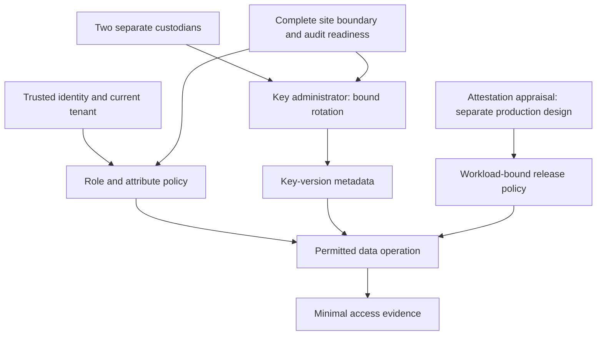

# Module 16 — Cryptography, Identity & Confidential Computing

**Educational draft · Week 16 · Last verified: 28 November 2026.** Decide who can cause protected data to become usable, through which identities, keys and administrative paths. An encrypted dataset can still be accessible to an overprivileged application or support operator. A confidential VM can still run outside the permitted physical site. Product, security and platform owners should approve these dimensions separately, with tested recovery and revocation.

**Outcome:** produce a key-custody and privileged-access review covering the complete AI lifecycle. The local exercise implements real Python policy checks and simulated key-version changes. It performs no encryption, authentication, attestation or hardware isolation. Module 04 remains HOLD; this technical chapter does not resolve legal applicability.

## 1. Learning outcomes and prerequisite decisions

By the end, distinguish encryption at rest, in transit and in use; describe custody beyond a customer-managed label; separate administration from data use; design identity and privileged-support restrictions; and specify evidence for attestation-based release. Diagnose rotation that leaves old data readable, then decide whether that behavior is required recovery or an unresolved compromise.

Prerequisites: [Module 03 control planes](03-enterprise-sovereignty-requirements-strategy.md), [Module 14 action authorization](14-agents-apis-enterprise-integrations.md) and Module 15 threat modeling. Carry forward a named subject, protected artifacts, approved operators and recovery boundary. Our **fictional BANK-A** requires every protected artifact and operational dependency to remain at its physical site, with on-site operators and controlled offline media. This is a scenario rule, not a UAE banking requirement.

## 2. Taxonomy and ontology contribution

The following **course-derived framework is not a regulation or standard**. Link it to the [course ontology](../taxonomy/ONTOLOGY.md); distinguish hierarchical classification from relations that permit an engineer to inspect a custody claim.

| Entity | Decision properties | Relationship |
|---|---|---|
| CustodyPolicy | tenant, permitted custodians, purpose, recovery location, policy revision | governs KeyVersion and PrivilegedAccess |
| KeyVersion (chapter detail) | identifier, lifecycle state, creation/retirement, dependent records | protects an artifact; supersedes another version |
| ServiceIdentity (chapter detail) | trusted issuer, tenant, audience, roles, lifetime, revocation | requests a permitted operation |
| AttestationReview | verifier, expected measurement, freshness, accepted claims, result expiry | informs a release decision for one workload |
| PrivilegedAccess (chapter detail) | eligible actor, scope, approvals, expiry, observed actions | permits a bounded administrative operation |

The shared ontology maps CustodyPolicy to CryptographicKey and AttestationReview to InfrastructureService. KeyVersion, ServiceIdentity and PrivilegedAccess are chapter-level implementation concepts, not additional shared classes. CustodyPolicy records key reference, decrypt and admin principals, support paths and revocation version; AttestationReview records verifier, freshness, reference measurement, workload binding and disposition.

Classify encryption by lifecycle state, keys by purpose and management boundary, identities by human/service role, and evidence by source and freshness. Relate each to actual data and operations. A table saying encrypted=yes cannot answer who may change policy or restore a retired key.

## 3. Architecture and trust boundaries

A data-encryption key protects a data object; a key-encryption key can wrap that key. Identity policy governs who may request an operation, while custody controls govern key material and lifecycle. Draw both the path to plaintext and the path that changes those permissions. Include identity administrators, deployment administrators, backup custodians and the verifier that may authorize key release.



**Figure 16.1.** Course-authored custody and access decision flow. The static SVG has the same labels and remains readable without scripts. Text equivalent: first establish current identity, tenant and ordinary permissions; separately authorize key administration through two custodians; associate data with a version; record a minimal decision. The dashed production attestation branch requires a real verifier and is outside the lab. A boundary conflict stops ordinary access and rotation regardless of favorable scores.

## 4. Technical deep dive: seven custody decisions

### 16.1 Encryption at rest, in transit, and in use

At-rest protection addresses stored representations, including backups and spill files. In-transit protection addresses a communication channel between identified endpoints. In-use protection addresses a specified execution threat model. List where each protection starts and terminates: TLS ending at a gateway leaves gateway memory and the next hop to examine. RFC 9846 specifies TLS 1.3 channel properties; its introduction distinguishes endpoint confidentiality from traffic-length concealment.[^tls]

Do not infer resource permission from a successful TLS connection. An authenticated service can still ask for another tenant's record. Certificate issuance, renewal, trusted roots, hostname verification and termination ownership belong in the operational review. The lab implements none of these protocols, so a successful local Python run cannot verify transport protection.

For AI, map raw files, OCR/speech intermediates, chunks, embeddings, prompts, model weights, outputs and caches. Then map swap, crash dumps, diagnostic bundles, traces and backups. A storage-encryption setting that excludes one temporary export does not satisfy an all-artifacts claim. A protected process can also intentionally produce an authorized output; decide who may receive that output.

### 16.2 Customer/enterprise-managed keys and custody

Treat customer-managed as a product-specific control description. Ask who generates, stores, copies, uses, disables, deletes and recovers the material; who changes the authorization policy; and whose infrastructure executes the operation. Separate material custody from policy administration and application access. A provider may host a key whose policy the customer manages; that is different from an on-premises key store under customer operation.

Build a permission graph from a support account to possible plaintext. Could it change the role, deploy altered application code, impersonate a service, restore an old backup or export a diagnostic? A nominal prohibition on direct key export is insufficient when another route can invoke decryption. Include emergency access, subcontractors, replicas and key-store activation dependencies in the graph.

Select custody against the threat and boundary. A locally operated service may be eligible for BANK-A, subject to actual evidence; a remotely operated external service conflicts with the unchanged scenario even when it offers stronger hardware protection. Do not reinterpret physical-site-only as domestic-region-only to make a candidate pass. No provider deployment is asserted here.

### 16.3 KMS, HSM, rotation, and separation of duties

A key management service coordinates policy and lifecycle operations. A hardware security module provides a hardware boundary for supported cryptographic operations; the product and configuration determine its assurance. Neither acronym describes the whole operating system. Inventory administrative access, recovery quorum, key backups, time sources, firmware/updates and failure dependencies. NIST SP 800-57 Part 1 Rev. 5 is a source for key-management planning, not evidence that a particular implementation has met it.[^keys]

Separate creating or rotating a key from permission to read data. In the exercise an administrator changes version metadata only after two distinct current custodians approve the exact key revision. None of those three roles can read the document by virtue of that role. The reader's tenant, role and clearance are checked separately. If a real administrator can deploy arbitrary code that reads plaintext, document that residual power rather than claiming complete separation.

Define rotation precisely. Does it replace wrapping material, rewrap data keys, create new data keys, migrate ciphertext, revoke application tokens or retire an old version? These are different operations. AWS explicitly documents that KMS-key rotation does not rotate generated data keys or re-encrypt protected data.[^rotation] That bounded interface example explains why rotation is not itself compromise remediation. It does not establish any AWS service as eligible for BANK-A.

Retaining old material may be necessary to restore historical records. Test which old backups remain readable, who can restore them and when retirement becomes deletion. If a data key is compromised, replace affected protection and address already disclosed plaintext; changing a wrapping key cannot undo disclosure. Test recovery before deletion, and preserve relevant records under the organization's approved retention policy.

### 16.4 Confidential computing, attestation, and limitations

A trusted execution environment (TEE) is a hardware-backed execution boundary with a defined set of protected assets and adversaries. Google describes data-in-use protection using a TEE; its own trust-boundary table distinguishes the guest administrator from the host infrastructure.[^tee] This is provider documentation, not an independent assurance report or a guarantee about every accelerator, model, guest operating system or application.

Attestation connects measured claims to a decision. In RFC 9334 the attester supplies evidence, a verifier appraises it under policy, and a relying party uses the result.[^rats] A production key-release design should bind accepted evidence to a permitted workload identity and purpose, approved measurement/version, trustworthy endorsement/reference material, freshness challenge and expiry. Protect the verifier and its policy changes; otherwise a genuine result under a permissive policy may release a secret to the wrong workload.

Ask what is measured and what remains outside: model weights loaded later, dynamically retrieved documents, output destinations, guest administrators, device paths, crash handling and recovery. Inspect CPU/GPU coverage for the actual configuration rather than transferring a CPU claim to an entire AI pipeline. A correctly attested workload can contain an application authorization defect. An attestation result is also not a physical-site certificate; location and operational sovereignty need separate evidence.

Fail closed when evidence is absent, stale, untrusted or does not bind the requested workload. If local verification requires an external endorsement service, define the offline validation, freshness and update process before promising an air gap. This chapter's lab deliberately supplies no attestation simulator that could be confused with a hardware proof. Its gate tests concern identity-policy fixtures and metadata only.

### 16.5 IAM, RBAC/ABAC, service identities, and secrets

Identity and access management (IAM) establishes subjects and decisions. Role-based access control (RBAC) groups permitted operations; attribute-based access control (ABAC) evaluates properties such as tenant, classification, device or environment. They can work together. Our gate requires the reader role and sufficient current clearance and matching resource tenant. A supplied document identifier alone grants nothing.

Use trusted identity infrastructure to derive subject, tenant, authentication context and service audience. Do not accept a tenant parameter from a model as authority. Scope a service identity to one purpose, restrict its lifetime and audience, and define revocation. Separate human initiation from service execution so an incident can identify both. NIST's zero-trust abstract rejects implicit trust based on location or ownership and separates authentication from authorization.[^zero]

Secrets belong in an appropriate reviewed store, not prompts, repositories, tool descriptions or verbose exceptions. Define bootstrap and renewal on disconnected systems. Offline operation still needs expiry, revocation distribution, trusted time and break-glass procedures. The lab's public session labels bypass authentication completely; anyone with the source can change the trusted fixtures. They demonstrate policy logic, not a deployable secret store.

### 16.6 Admin, support, and provider access control

Support is an access path with named actors, destinations, rights and consequences. Default to no standing data access; specify time-limited scope, eligible approvers, a concrete reason and the operation being approved. Record the approval and observed result without exporting protected content. Terminate access at expiry and test revocation during a session, including cached credentials and long-running jobs.

Emergency access needs a recoverable, monitored procedure. Determine who can initiate it, who reviews it, how ordinary operation is restored and which evidence proves the change. Separation must survive common administration: one person controlling the identity provider, key policy and audit store may bypass a three-role diagram. Model the effective powers of those systems and independent controls.

For BANK-A, remote support or an external diagnostic upload is a hard conflict. Screen sharing, clipboard, transcripts and vendor ticket attachments can move content despite local key custody. An organization that expressly permits reviewed remote support has a different scenario; it must inspect that service's access and terms. Do not convert that changed assumption into a legal conclusion for any GCC jurisdiction.

### 16.7 Measurable verification of sovereign controls

Write each claim as a falsifiable proposition with artifact, actor, operation, boundary and time. For example: a current tenant-A reader with clearance two can inspect A-doc metadata; a tenant-B principal, revoked reader or key administrator without reader authority cannot. Retest after policy, role, key-version or support changes. Tests should include successful authorized work as well as denials, so an unusable system does not appear secure merely by refusing everything.

Keep evidence states separate. Missing evidence is UNVERIFIED; a known protected external path is BLOCKED; favorable uninspected declarations are DECLARED_ONLY. For the lab those states concern a fixture inventory, not measured placement. Production approval additionally requires observed technical tests, reviewed operational procedures and accountable independent decisions where specified. A numerical score never changes an unresolved hard conflict.

For cryptographic verification, request actual configuration, accepted protocol versions, key inventory and access logs, recovery drills, attestation appraisal records where applicable, revocation timings and denied-path evidence. Establish source, integrity, freshness and owner for each record. Avoid raw prompt/key exposure in the verification process itself. Redacted metadata can remain sensitive and requires its own access and retention policy.

## 5. UAE/GCC case study and global comparison

**Illustrative case:** BANK-A considers a local key service with on-site custodians, an external customer-managed service, and an external confidential-computing service. The first is eligible for further investigation, not automatically approved. The other two conflict with the unchanged physical-site and operator requirements. Encryption strength or attestation cannot remove that conflict.

A fictional multinational permits designated managed infrastructure and approved support under its own reviewed policy. Its comparison may include the external candidates after inspecting actual deployment, identity, custody, lifecycle and recovery evidence. This is an explicit change of assumptions; no UAE, Saudi, DIFC, ADGM or other legal permission is inferred. Qualified applicability review stays open alongside Module 04 HOLD.

## 6. Hands-on lab: inspect authority and version lifecycle

Run the [complete lab](../labs/module-16/README.md) on Python 3.11+ standard library; no network, package, GPU, model or cloud account is needed. Budget 60–90 minutes plus the PM review. It changes small in-memory dictionaries and uses synthetic public fixture identities.

```bash
python3 labs/module-16/custody.py
python3 -m unittest discover -s labs/module-16 -p 'test_*.py' -v
```

Expected: administrator and cross-tenant reads denied; reader access allowed; a two-custodian version change allowed; the old record still points to version one; replay and support read denied. The [retained actual run](../labs/module-16/observed-custody-run.json) records seven attempts. Acceptance includes adversarial changes to clearance, roles, expiry, approvals, policy/key revision, boundary and audit availability. No encryption or decrypted value is produced. Key rotation is metadata simulation, not cryptographic evidence.

## 7. The AI PM decision playbook

Product owns the permitted workflow and acceptable interruption; security owns authentication, authorization, privileged-access and evidence requirements; key custodians own lifecycle and recovery procedures; platform operations owns implementation and tested availability. Assign qualified privacy/legal reviewers the applicability question, not a dictionary of Python results.

Complete the [custody review](../labs/module-16/CUSTODY_REVIEW.md). Ask who can independently cause plaintext access, who can change that answer, and how quickly a compromised service loses access. Record unresolved powers and operations rather than turning a customer-managed label into a pass. Choose the simplest eligible design the team can operate and recover.

## 8. Economics, operating model and trade-offs

Illustrative planning inputs: twelve monthly privileged operations, two reviewers at ten minutes each, and AED 150/hour internal effort yield 12 × 2 × 10/60 × 150 = AED 600/month review effort. These are invented values, not salaries or vendor prices. Double the review time and this component doubles; add implementation, audit, recovery drills, hardware support and idle capacity separately.

Compare equivalent threat models, workloads, boundaries and recovery requirements. Local custody may add operational dependencies and staffing. A managed service may reduce some operational work while adding external trust. Measure unavailable-key failure behavior and recovery time under the permitted boundary; never test a production key deletion merely to complete a classroom exercise.

## 9. Anti-patterns and failure cases

- **Encrypted therefore sovereign:** inspect key, identity, application, support and recovery paths.
- **Key administrator therefore reader:** separate data use and administration, including indirect powers.
- **Rotation therefore erased compromise:** distinguish wrapping-key change, data-key replacement and data migration.
- **Two approvals from one person:** enforce distinct eligible current custodians and action binding.
- **Attestation therefore approved location:** verify placement and full operating boundary independently.
- **Audit as raw request dump:** record minimal decision metadata under separate access controls.
- **Offline therefore authenticated:** establish trusted identity, expiry, time and revocation distribution.

## 10. PM deliverable and capstone connection

The [key-custody and privileged-access review](../labs/module-16/CUSTODY_REVIEW.md) includes a permission graph, lifecycle matrix, attestation release contract, test/evidence register and owners. Its separate 20-point educational rubric cannot override a boundary conflict. Completion means the artifact is reviewable, not that an enterprise deployment has been certified.

Carry permitted service identities, version dependencies, support restrictions, revocation and evidence freshness into Module 17 release and operations controls. The capstone needs an operating model that can deny compromised access while recovering legitimate work. Independent assessment, actual cryptographic assurance and facility evidence remain open.

## 11. Knowledge check

**Q1.** Where do at-rest, in-transit and in-use protections terminate, and why can valid TLS still permit a cross-tenant disclosure?

**Q2.** Which custody and effective-access questions remain after a vendor says customer-managed keys?

**Q3.** Why does wrapping-key rotation not establish remediation of a compromised data key, and what recovery dependencies must be tested before deletion?

**Q4.** What must a production attestation-based key-release policy bind and check, and which sovereignty claims remain separate?

**Q5.** The real AWS KMS rotation guide distinguishes key-material rotation from data-key rotation and re-encryption. A fictional team rotates a KMS key and claims all historical disclosure risk is removed. What does the documented operation establish, what remains unresolved, and what evidence would change the decision? No real customer incident is asserted.[^rotation]

### Q6. Decision and root-cause scenario

On 28 November a fictional BANK-A workload is UNVERIFIED. A privileged support user copies a public fixture session label into an application as if it were an authenticated credential. A shared administrator role changes key policy and reads another tenant's record. The team rotates a wrapping key, leaves the compromised application credential active and proposes an external attested fallback despite the unchanged site rule.

State the evidence transitions, direct and systemic causes, containment, accountable owners and dated retest. Explain which observations would permit limited local operation and which unresolved external path keeps the fallback BLOCKED. Distinguish authentication repair, tenant authorization, credential revocation, data-key/ciphertext remediation, independent assurance and already disclosed data.

**Scenario challenge:** Produce separate release decisions for BANK-A and the multinational in section 5, identifying the exact assumption change that alters eligibility. Separate answers: `assessments/solutions/16-cryptography-identity-confidential-computing-solutions.md`. No key is embedded here.

## 12. Key takeaways

Follow the path to usable data and the path that changes access. Keep data use, key administration, custody and recovery distinct; test current identity, tenant and purpose. Rotation changes a specified protection layer, and attestation appraises specified claims. Neither operation establishes physical residency or repairs every compromise.

## 13. Evidence ledger, quoted sources and further reading

Brief exact extracts checked 28 November 2026. Interpretation is course analysis; vendor descriptions are not independent deployment evidence. No legal obligation or product eligibility is claimed.

| Claim | Exact short extract | Primary source / pinpoint | Interpretation and limit |
|---|---|---|---|
| C1 | “Data sent over the channel after establishment is only visible to the endpoints.” | RFC 9846, section 1[^tls] | Channel property; endpoint authorization remains separate |
| C2 | “functions involved in key management” | NIST SP 800-57 Part 1 Rev. 5, abstract[^keys] | Lifecycle guidance; no particular product assurance |
| C3 | “It does not rotate the data keys” | AWS KMS, rotation note[^rotation] | Documented scope; not a remedy for disclosed plaintext |
| C4 | “The Verifier appraises Evidence via appraisal policies” | RFC 9334, introduction[^rats] | Trust decision depends on evidence and policy |
| C5 | “hardware-based trusted execution environment (TEE)” | Google overview, introduction[^tee] | Provider description; configuration and broader boundary need review |
| C6 | “no implicit trust granted to assets or user accounts” | NIST SP 800-207, abstract[^zero] | Local placement alone is insufficient authority |

[^tls]: Rescorla / IETF, *The Transport Layer Security (TLS) Protocol Version 1.3*, RFC 9846, July 2026, section 1, https://www.rfc-editor.org/info/rfc9846/. Verified: 2026-11-28. Obsoletes RFC 8446; no TLS implementation is tested here.
[^keys]: Barker / NIST, *Recommendation for Key Management: Part 1 – General*, SP 800-57 Part 1 Rev. 5, May 2020, abstract and publication landing page, https://csrc.nist.gov/pubs/sp/800/57/pt1/r5/final. Verified: 2026-11-28. Guidance rather than a local implementation audit.
[^rotation]: Amazon Web Services, *Rotate AWS KMS keys*, Developer Guide, opening rotation note and How key rotation works, https://docs.aws.amazon.com/kms/latest/developerguide/rotate-keys.html. Verified: 2026-11-28; publication date not established. Provider-specific semantics; no AWS resource was created.
[^rats]: Birkholz, Thaler, Richardson, Smith and Pan / IETF, *Remote ATtestation procedureS (RATS) Architecture*, RFC 9334, January 2023, introduction and sections 8.4/10, https://www.rfc-editor.org/info/rfc9334/. Verified: 2026-11-28. Informational architecture; no hardware evidence was collected.
[^tee]: Google Cloud, *Confidential Computing overview*, introduction and Impact of confidential computing on trust boundaries, page updated 10 November 2026, https://docs.cloud.google.com/confidential-computing/docs/confidential-computing-overview. Verified: 2026-11-28. Provider documentation; CPU/GPU/configuration scope and residual trust require separate review.
[^zero]: Rose, Borchert, Mitchell and Connelly / NIST, *Zero Trust Architecture*, SP 800-207, August 2020, abstract, https://csrc.nist.gov/pubs/sp/800/207/final. Verified: 2026-11-28. Architecture guidance, not proof of the lab's authentication.

## 14. Website, social derivative and next steps

Use the [lab](../labs/module-16/README.md), [custody review](../labs/module-16/CUSTODY_REVIEW.md), [eight-question carousel](../social/module-16/CAROUSEL.html), [portrait PDF](../social/module-16/QUESTIONS.pdf) and [post draft](../social/module-16/POST.md). HTML is preferred; the PDF is untagged. Same-author technical/editorial audits document tested behavior and remaining independent/manual review.

The [Architecture & Learning Studio](../learning/index.html) supplies deterministic teaching guidance. Add custody, identity and attestation evidence gaps to its exported architecture; a generated plan cannot prove actual protection or compliance. Next: Module 17 MLOps, LLMOps & Observability.
