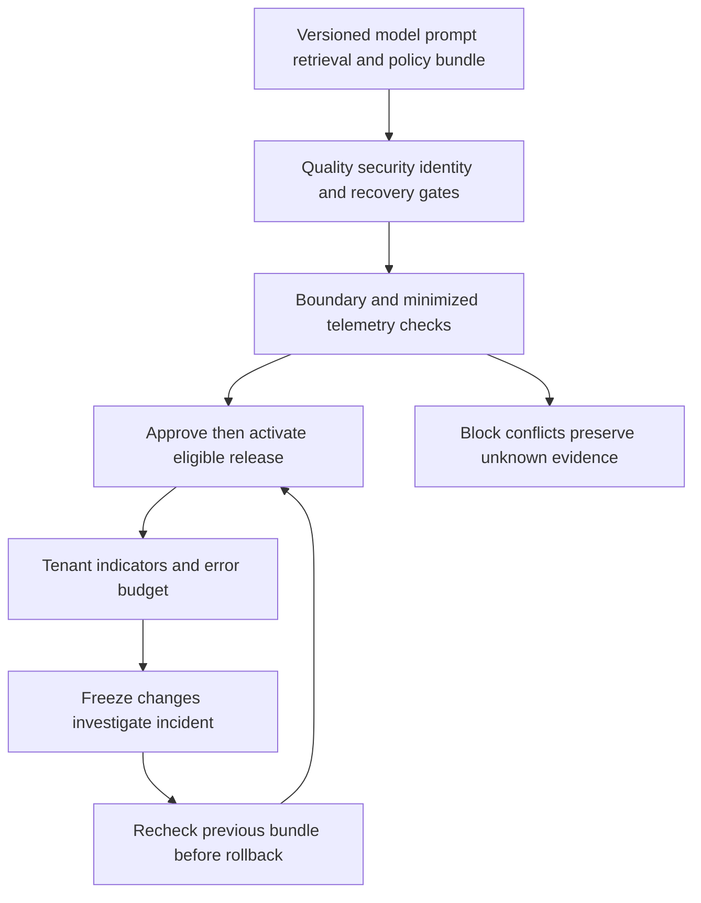

# Module 17 — MLOps, LLMOps & Observability

> **Educational draft.** Authored and sources checked: 28 November 2026. Synthetic operations lab, not a deployed model service. Independent review, production SLO validation and physical-site assurance remain NOT COMPLETED. Module 04 remains HOLD.

## 1. Executive brief

Approve a release as a complete, identifiable operating bundle. A model digest alone omits the prompt, retrieval corpus, permission policy, telemetry configuration and recovery dependencies that determine behavior. A change to any of these can invalidate yesterday’s quality or boundary evidence. Give the release an owner, a reproducible identity, explicit gates and a failure response before exposing users to it.

For the fictional BANK-A workload, prompts, OCR/speech outputs and every protected derivative must remain on its physical premises. An external trace collector violates that unchanged rule even if response quality improves and the collector encrypts its disks. A local deployment still needs actual facility, operator, connectivity and recovery evidence. This module’s checker can distinguish declared consistency, missing evidence and a known conflict; it cannot inspect a bank.

**Outcome:** build a bounded release controller, measure an explicit synthetic request population, reject a prohibited telemetry path and roll back an eligible previous bundle. Then write the [operating model](../labs/module-17/OPERATING_MODEL.md) that identifies the real evidence still needed. Read Modules 11–16 for model, retrieval, agent, security and identity constraints; operations must preserve those constraints during change.

## 2. Learning objectives and prerequisites

By completion, you should be able to identify an entire release, separate artifact registration from approval and activation, define release/rollback gates, distinguish quality drift from availability, design minimized telemetry, compute tenant-specific service indicators and error budgets, and connect incident response with resource ownership.

Prerequisites: model-choice evidence from Module 11, retrieval authorization from Module 12, measurement populations from Module 13, action boundaries from Module 14 and the security/identity reviews of Modules 15–16. The lab requires Python 3.11+ and its standard library. No model download, GPU, Docker, external account or paid service is required. The module’s ten one-hour study sessions can be used for reading, tracing the controller, adverse tests and the PM exercise; lab execution alone is not the complete learning activity.

## 3. Taxonomy, ontology and architecture

This is a **course-derived framework, not a regulation or standard**. Extend the [course ontology](../taxonomy/ONTOLOGY.md) with **ReleaseManifest**, **ServiceObjective** and **TelemetryPolicy**. ReleaseManifest binds model revision, prompt digest, policy version, runtime build and rollback target; it **uses** ModelArtifact. ServiceObjective records tenant scope, window, attempted/good/error populations and latency threshold; it **constrains** Workload. TelemetryPolicy declares allowed fields, redaction, retention and collector destination; it **governs** DataArtifact. Release gates and incident records are operating artifacts in this lesson, without implying additional formal ontology classes. The fixture uses an in-memory observation window and synthetic identifiers; it implements only a subset of the enterprise schema.

Classification groups controls into release, runtime, incident and cost operations. The ontology adds relationships and constraints: a passed quality gate cannot authorize a blocked telemetry destination; a previous release is not eligible for rollback if revoked; an absent event population is NO_DATA rather than perfect availability. These relationships matter when an enterprise architecture generator proposes a complete operating model.



The static diagram follows the same flow without JavaScript. Registration establishes an identifier, approval records a decision, and activation changes the serving pointer. Monitoring supplies evidence to incident decisions. Recovery revisits eligibility; it does not bypass the boundary in an emergency.

## 4. Technical deep dive

### 17.1 Model versioning and registry governance

A registry catalogs artifacts and relationships; it does not automatically approve them. MLflow’s registry documentation describes lineage, versioning, aliasing and metadata capabilities.[^registry] Decide who may register, annotate, approve, promote, revoke and delete a version. Separate those operations from permission to modify a serving alias. A human-friendly label is useful for discovery; the deployed release record needs immutable references and the exact approval context.

Bind model weights and tokenizer, inference runtime/container, prompt template, retrieval index/document snapshot, embedding configuration, permission policy, tool schema and telemetry policy. Record license/rights review and evaluation data versions. Some dependencies are dynamic: user groups, resource permissions and revocations must be checked at request time rather than frozen indefinitely into the release. Versioned intent and current authorization are complementary.

A digest establishes equality to particular bytes if computed and checked correctly. It does not establish that the artifact is safe, licensed, authentic or useful. Production provenance needs a trusted acquisition/build path, signed metadata where appropriate, protected registry permissions and independent verification. The lab hashes a canonical JSON manifest, while its fictional model digest is generated from a version string; runtime_build is the fixture build reference, not a measured platform attestation. No actual model or signed supply chain exists.

### 17.2 CI/CD, release gates and controlled deployments

Continuous integration tests a candidate; continuous delivery prepares a releasable package. Define each gate’s owner, evidence, expiry, applicability and failure behavior. A pipeline green badge may cover syntax while excluding Arabic quality, tenant leakage, support access or restore compatibility. Store the exact evaluated release identifier with results and reject mismatched evidence.

Use separate quality, security, identity, recovery and boundary decisions. Quality has a measurement population and thresholds; security has a threat scope and adverse tests; identity covers user/service authorization; recovery demonstrates compatible rollback/restore behavior. BLOCKED means a known conflict. UNVERIFIED means required evidence is absent or stale. A passed gate is not permission to ignore another failed gate.

A canary releases to a bounded population; a shadow run observes candidate outputs without replacing the primary response. Either can create additional data copies, resource spend and failure paths. Approve the destination and retention of mirrored prompts before using either strategy. Specify stop thresholds and a trusted control path. For a physical air gap, an external canary endpoint is ineligible even if it reduces implementation work.

Rollback needs its own threat and compatibility review. Kubernetes documents that deployment rollback restores only the Pod template portion, not arbitrary external state.[^deployment] A database migration, refreshed index, revoked model or changed authorization policy may not be undone by a container rollback. The lab changes a Python pointer after rechecking the previous release; it performs no database restore, Kubernetes action or distributed transaction.

### 17.3 Quality and drift monitoring

Availability answers whether the service returned an acceptable technical response. Task quality asks whether the response meets the intended user need. A fast HTTP 200 can still contain an unsupported answer. Define separate indicators for transport success, latency, grounding, permission correctness, abstention and language/domain slices. Keep a critical leakage event visible even when an average score remains high.

Input drift is a change in incoming data distribution; output drift is a change in response behavior; concept drift changes the relationship between inputs and intended outcomes. None alone establishes the cause. A new customer population, stale corpus, changed tokenizer, permission regression, evaluation contamination or sampling change can produce similar dashboards. Compare matched populations and record when labels become available.

Use sampled expert review with approved access, small minimized failure records, and reproducible offline tests. Do not export raw prompts merely because a dashboard needs examples. Arabic and English denominators must remain distinct where quality differs; ten repeated calls to one prompt are not ten independent tasks. Module 13’s failed literal-label observations remain failed. This module creates no new quality evidence and cannot close those gaps with an availability ratio.

### 17.4 Traces, logs, metrics and privacy-conscious observability

A trace follows a request across components; a log records events; a metric aggregates measurements. OpenTelemetry warns that telemetry collection can capture sensitive or personal information.[^telemetry] Select fields at the producer and constrain collectors, processors, exporters and storage. Redacting the application log while an SDK captures request bodies leaves an uncontrolled path.

An allowlist is easier to inspect than a list of prohibited field names. A release ID, bounded reason code, coarse latency bucket and synthetic tenant handle may suffice for an initial investigation. Request/trace IDs and tenant identifiers can still enable linkage. Hashing a low-entropy identifier does not anonymize it. Minimize access, retention and cross-system joins, and review metric-label cardinality to prevent unbounded cost or information exposure.

Inventory traces, exceptions, model gateway logs, evaluation samples, dashboards, alert payloads, support bundles and backups. Record administrator access, collector updates, activation services and failover destinations. BANK-A’s unchanged premises rule covers these artifacts. Encryption and a domestic region do not prove that plaintext administration, keys, telemetry or restore stay in the permitted facility. Production needs configuration inspection and observed network/control evidence, not a declaration alone.

The lab accepts a synthetic prompt argument but never writes it into events. It also omits request IDs from emitted telemetry, though an in-memory set retains them for deduplication. Its events remain sensitive operational metadata. The learner controls all process memory; there is no real log-access enforcement, durable storage, retention deletion or tamper evidence.

### 17.5 Tenant metering, quotas and reliability SLOs

A service-level indicator is a measurement; a service-level objective is its target. Google’s SRE workbook states that SLOs specify a target reliability level.[^slo] Define the population, observation window, event-time policy, numerator, denominator and missing-data behavior. A contractual SLA is a separate commercial/legal commitment; do not label a teaching target as an enterprise guarantee.

The synthetic indicator is good admitted requests divided by all admitted requests for one tenant. Good means the request succeeded and latency is at most 200 ms. The teaching target is 95%; ten admitted requests allow 0.5 bad requests, so one bad request consumes twice the budget. The observed ratio is 9/10, or 90%, and triggers FREEZE_AND_REVIEW. This tiny dataset illustrates arithmetic, not statistically reliable service performance.

Quota denials and duplicates are excluded from that particular denominator, explicitly. They require separate admission/availability indicators in production; silently excluding them from a user-facing availability claim would be misleading. The fixture counts a failed admitted request against quota and meters declared synthetic tokens. It checks tenant-specific limits but does not authenticate tenants, enforce a time-window rate limit, or measure tokenizer/billing correctness. Resetting the process resets its counters.

Error budgets support an agreed response, such as pausing discretionary changes while investigating. They do not permit spending through a security or premises violation. Define multi-window alerting and escalation for a real service, account for monitoring outages and delayed events, and test that the on-call team can operate the controls. A missing dataset is NO_DATA; it is not 100% success.

### 17.6 Incident handling and service operations

An incident record should identify detection time, impact scope, affected release and tenants, evidence location, containment, owner, communication, recovery and retest. Distinguish observed facts from hypotheses. Preserve timestamps and relevant minimized evidence without copying protected payloads into an external incident platform. A breach of the declared boundary may require immediate containment regardless of the error-budget calculation.

Choose containment that addresses the actual cause: stop a trace exporter, revoke a release, disable a tool, remove a compromised credential or return a bounded failure. Keep an unknown downstream action outcome visible until reconciliation. Rolling back model weights does not reverse a payment or erase an already exported trace. Assign separate service commander, technical investigator and stakeholder communication roles where team size permits.

A post-incident review should produce testable changes with owners and due dates. If a rollback fails because the previous release’s identity policy was revoked, restoring it blindly increases harm. Reassess current permissions, registry integrity, runtime compatibility and boundary eligibility first. This lab tests denial of a revoked rollback candidate, while leaving real recovery, human paging and distributed failure handling open.

### 17.7 Resource and cost visibility

Tie resource use to workload and release: input/output tokens, retrieval calls, cache hits, CPU/GPU time, memory, storage, telemetry ingestion and retained backups. Include idle reserved capacity, replication, operator time and failure/retry overhead. An average cost per successful response can hide rejected requests, expensive tenants and unused hardware.

Separate measured units, tariff assumptions and allocated cost. The lab measures neither money nor actual model tokens: the token count is learner-supplied synthetic data. A monetary estimate would require a dated, verified price and explicit utilization/allocation assumptions. A local installation still has acquisition, power, cooling, staffing, storage and lifecycle costs even if there is no per-request API invoice.

Set tenant budgets and capacity decisions after hard eligibility gates. Reducing telemetry retention may reduce spend but can impair incident evidence; collect less sensitive content and retain the necessary bounded operational record. Resource exhaustion is also a security and reliability risk. Test large labels, repeated failures and quota behavior before accepting self-service workloads.

## 5. UAE/GCC case study and global comparison

**Illustrative, not an actual bank:** BANK-A runs a premises-only internal assistant. Candidate v2 improves an invented task score but exports traces and alert payloads to an external service. That known conflict blocks activation. A local collector is only a candidate remedy: operators, dashboard storage, update delivery, backups and support still require evidence.

A second fictional enterprise permits an approved domestic managed service, with specifically authorized support and telemetry paths. Its eligible architectures differ because the contractual assumptions differ. This is not a determination of UAE, Saudi, DIFC or ADGM legal applicability. Keep Module 04 HOLD, qualified privacy/legal review and real provider terms separate from the architecture exercise.

## 6. Hands-on lab: release and observe a bounded fixture

Follow the [complete lab](../labs/module-17/README.md), then inspect the [actual retained observation](../labs/module-17/observed-operations-run.json).

```bash
python3 labs/module-17/release_ops.py
python3 -m unittest discover -s labs/module-17 -p 'test_*.py' -v
```

Allow 60–90 minutes for implementation inspection and adverse tests, then time for the operating-model exercise. Expected: two approved synthetic releases activate, ten tenant-a requests produce nine good events, the 95% target is missed, an eligible previous release becomes active, and an external-trace candidate is denied. Tests cover tampering, revocation, missing/failed gates, tenant quotas, duplicates, invalid numeric inputs, redacted events and rollback eligibility.

Acceptance is bounded to these declared Python controls. DECLARED_ONLY is not physical-site verification; a PASS string is not attached external test evidence. Extend the fixture with durable transactional state and a trusted identity boundary only under a separately reviewed design. Do not add real customer prompts to demonstrate logging.

## 7. The AI PM decision playbook

Ask which complete bundle is serving, who approved it, when evidence expires, what stops a rollout and what happens if monitoring fails. Product owns task outcomes and acceptable degradation; security owns abuse and identity gates; operations owns indicators and recovery; privacy/legal reviewers assess actual obligations. Give each gap a named role and retest date, not an ambiguous shared owner.

Use [OPERATING_MODEL.md](../labs/module-17/OPERATING_MODEL.md) to turn those questions into a rollout contract. A score helps compare eligible candidates; it cannot compensate for a blocked route, missing production evidence or unreviewed retention. Include tenant fairness and incident communication in the definition of done.

## 8. Economics, operating model and trade-offs

Prefer the simplest eligible monitoring stack the team can operate. More sampled traces may improve diagnosis but increase sensitive data handling and retention cost. Stronger release gates reduce avoidable changes while increasing lead time. Measure that delay, false alarms and investigator workload rather than assuming additional controls are free.

Maintain a change budget with accountable owners: planned model/index updates, urgent security fixes, rollback drills and observability changes. An exhausted reliability budget should trigger the agreed review; urgent fixes may still need a controlled exception with explicit risk ownership. No exception authorizes a prohibited physical-boundary path.

## 9. Anti-patterns and failure cases

- Serving a mutable label without retaining the evaluated immutable bundle.
- Calling request success a task-quality result.
- Treating missing telemetry as a perfect SLO.
- Omitting quota denials without declaring the population and separate user-facing indicator.
- Exporting raw exceptions after redacting normal logs.
- Reverting a container and claiming the database, permissions and leaked data were restored.
- Using average cost or reliability scores to override a known boundary conflict.

## 10. PM deliverable and capstone connection

Deliver a versioned operating model, gate/evidence table, tenant indicator definitions, privacy-conscious telemetry schema, on-call/escalation flow, resource budget and rollout/rollback checklist. The [20-point PM rubric](../labs/module-17/OPERATING_MODEL.md) is separate from the knowledge-check rubric. Record unresolved dependencies and a dated owner-specific retest.

The capstone consumes the complete release identity, its operating boundary, measurable objectives and failure actions. Educational completion is an inspected exercise and reviewed draft decision; real deployment approval remains pending. Continue into Module 18 for resilience, audit and vendor exit.

## 11. Knowledge check

**Q1.** Why does a model digest fail to identify a complete LLM release, and which references and dynamic checks must accompany it?

**Q2.** How do registration, approval and activation differ, and why must rollback repeat eligibility checks?

**Q3.** Define the synthetic SLI denominator and numerator. Calculate the ratio, bad-event allowance and consumed budget for ten admitted requests with one failed response at a 95% target.

**Q4.** Which telemetry fields and paths would you inspect before accepting a premises-only logging design, and why is hashing a tenant ID insufficient anonymization?

**Q5.** Kubernetes documents a real deployment rollback mechanism. A fictional team says this automatically restores an external database, retrieval permissions and deleted audit records. What does the documented mechanism establish, and what separate evidence is needed?[^deployment]

### Q6. Decision and root-cause scenario

On 28 November, candidate v2 is UNVERIFIED because recovery evidence is missing. A developer changes its quality gate to PASS and activates it through a mutable alias. An external trace exporter sends protected prompts off premises. Nine of ten synthetic requests succeed, while quota denials disappear from the dashboard. The team proposes raising the SLO tolerance and rolling back a revoked v1.

Describe the evidence transitions, direct/systemic causes, immediate containment, named accountable roles and a dated retest. What can passing a bounded release test change, and what remains blocked until the trace path and real operating evidence are resolved? Explain why neither the adjusted score nor a revoked rollback candidate closes the incident.

**Scenario challenge:** Produce operating models for both organizations in section 5; identify the exact changed contractual assumptions and unchanged technical review needs.

Separate answers: `assessments/solutions/17-mlops-llmops-observability-solutions.md`. Answers are not embedded here.

## 12. Key takeaways

Version the complete bundle, preserve current authorization, and keep registration, approval and activation distinct. Define measurement populations before displaying ratios. Minimize telemetry at collection, revisit rollback eligibility and preserve unknown outcomes. Real production and physical evidence remain separate from a synthetic control test.

## 13. Evidence ledger, quoted sources and further reading

Brief exact extracts checked 28 November 2026. Interpretations are course analysis; product documentation describes features rather than a customer deployment or independent assurance.

| Claim | Exact short extract | Primary source / pinpoint | Interpretation and limit |
|---|---|---|---|
| C1 | “versioning, aliasing, metadata tagging and annotation support” | MLflow registry introduction[^registry] | Registry capabilities, not approval or provenance proof |
| C2 | “only the Deployment's Pod template part is rolled back” | Kubernetes, Rolling Back a Deployment[^deployment] | Deployment rollback scope, not external-state restore |
| C3 | “inadvertently capturing sensitive or personal information” | OpenTelemetry, handling-sensitive-data introduction[^telemetry] | Telemetry needs privacy review; no verified local configuration |
| C4 | “specify a target level for the reliability of your service” | Google SRE workbook, Implementing SLOs introduction[^slo] | Target definition; course 95% example is invented |

[^registry]: MLflow project, *MLflow Model Registry*, latest documentation, introduction and registry workflow, https://mlflow.org/docs/latest/ml/model-registry/. Verified: 2026-11-28; publication date/version not established from page. No MLflow deployment is performed.
[^deployment]: Kubernetes project, *Deployments*, Rolling Back a Deployment, https://kubernetes.io/docs/concepts/workloads/controllers/deployment/#rolling-back-a-deployment. Verified: 2026-11-28. Live documentation, no fixed software version tested; lab is not Kubernetes.
[^telemetry]: OpenTelemetry project, *Handling sensitive data*, introduction and guidance, https://opentelemetry.io/docs/security/handling-sensitive-data/. Verified: 2026-11-28; publication date not established. General guidance, not legal applicability or configuration assurance.
[^slo]: Steven Thurgood and David Ferguson with Alex Hidalgo and Betsy Beyer, Google, *The Site Reliability Workbook*, Implementing SLOs, 2018, https://sre.google/workbook/implementing-slos/. Verified: 2026-11-28. Operational framework; synthetic target/window are course assumptions.

## 14. Website, social derivative and next steps

Read the [lab](../labs/module-17/README.md), [operating model](../labs/module-17/OPERATING_MODEL.md), [eight-question carousel](../social/module-17/CAROUSEL.html), [portrait PDF](../social/module-17/QUESTIONS.pdf) and [post draft](../social/module-17/POST.md). HTML is preferred; the PDF is untagged. Same-author audits document development checks and independent/manual gaps.

Use the [Architecture & Learning Studio](../learning/index.html) to carry release identity, observability destinations, tenant objectives and recovery gaps into an exported teaching architecture. Its deterministic recommendations cannot verify an actual service, key custody, compliance or physical boundary. Next: Module 18 Resilience, Audit & Vendor Exit.
