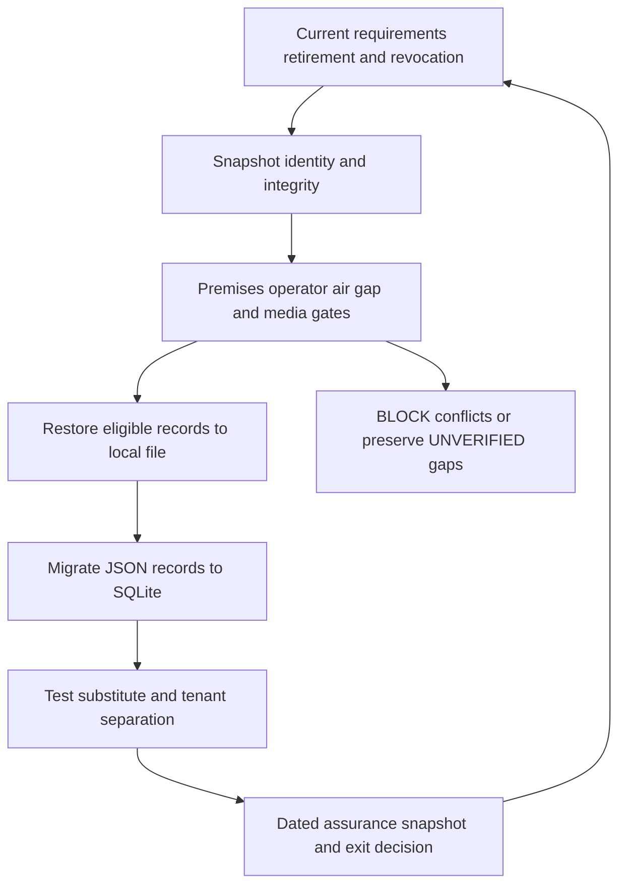

# Module 18 — Resilience, Audit & Vendor Exit

> **Educational draft.** Authored and primary sources checked: 28 November 2026. Actual synthetic local-file restore and format migration are demonstrated. Independent review, manual accessibility assessment, production RTO/RPO validation and physical-site assurance remain NOT COMPLETED. Module 04 remains HOLD.

## 1. Executive brief

Choose a recovery path that remains eligible during the incident, then test the complete business outcome. A backup job finishing does not establish that an assistant can recover with current permissions, usable model artifacts, compatible retrieval, protected keys and an authorized operator. Likewise, exporting a file does not establish that another provider can run the workload with equivalent behavior, rights and controls. Product approval needs evidence for the whole dependency chain.

For fictional BANK-A, prompts, responses, OCR and speech outputs, source documents and protected derivatives must remain on its physical premises. Backup, incident support, failover, license activation and migration are part of that rule. An external emergency endpoint is a known conflict even when it offers excellent recovery speed. Physical air-gap assumptions also prohibit live external connectivity; an approved media-handling procedure is a separate controlled path, not permission for an outbound connection.

The decision is whether to continue, degrade, restore or substitute under explicitly stated constraints. Use the [exit plan](../labs/module-18/EXIT_PLAN.md) to name owners, evidence gaps and retests. The lab restores real synthetic local bytes after deleting a file, migrates eligible records from JSON into SQLite and exercises a deterministic substitute. It measures neither production reliability nor actual model quality. Restored content remains subject to current retirement decisions.

## 2. Learning objectives and prerequisites

By completion, distinguish availability from recoverability; define recovery objectives and their measurement boundaries; design backup, incident and change controls; build a traceable assurance snapshot; evaluate model/data portability and substitution; and identify sovereignty drift during recovery. Explain which evidence is declared, observed, missing, stale or contradicted before recommending an exit decision.

Prerequisites are Modules 08–10 on data lifecycle and placement, Modules 11–14 on complete AI dependencies, and Modules 15–17 on threat, identity and release controls. Use Python 3.11+ with the standard library. No model download, cloud account, GPU, Docker or paid resource is required. Allow 60–90 minutes for lab inspection and adverse tests, plus reading, the PM artifact and assessment across the module's ten study sessions.

Bring the current retirement list, release identity, data permissions and incident assumptions from earlier modules. A successful exercise cannot erase Module 13's failed quality observations or Module 04's unresolved review status. Maintain those gaps in the capstone rather than replacing them with a new recovery PASS label.

## 3. Taxonomy, ontology and architecture

This is a **course-derived framework, not a regulation or standard**. Classification groups resilience work into prevention, continuity, recovery, migration and assurance. The [course ontology](../taxonomy/ONTOLOGY.md) adds relationships and constraints: **RestoreExercise** records snapshot identity, declared boundary, current retirement overlay, actual result and limitations; it **tests** ExitPlan for a Workload. **ExitPlan** records dependencies, substitution criteria, owners, contractual questions and dated triggers; it **reconstructs** ModelArtifact and its operational dependencies for a Workload. **AssuranceSnapshot** binds a dated evidence set to scope, reviewer, unresolved findings and expiry; it **evaluates** Control without certifying it. These entities are enterprise teaching records in ontology v1.8; the fixture implements only a small subset.

A restore is admissible only when known hard conflicts are absent and required current evidence is available. DECLARED_ONLY means fixture declarations are internally consistent. It is never a synonym for independently verified premises or air-gap control. A known external failover remains BLOCKED even when an unrelated artifact field is absent; missing required information alone is UNVERIFIED. Neither a high portability score nor a fast restoration time can compensate for a prohibited path.



**Text equivalent:** current requirements and retirement decisions constrain the snapshot. Integrity and complete declared-boundary checks precede any restore. Eligible records are restored, migrated and checked with a substitute. A dated assurance record feeds the next decision. Known conflicts stop the path; missing evidence stays visible. The [static SVG](../diagrams/module-18-resilience.svg) and [editable Mermaid](../diagrams/module-18-resilience.mmd) express the same flow without requiring network rendering.

## 4. Technical deep dive

### 18.1 Availability, resilience and recovery objectives

Availability concerns whether users receive an acceptable service during a defined population and observation period. Recoverability concerns returning a disrupted service to an acceptable state. Resilience also includes safe degradation and adaptation: a bank may suspend generative answers while retaining approved static procedures. That can be a better business outcome than serving unsupported answers through an ineligible external model. Define the user journey rather than treating a running process as success.

Recovery time objective, or RTO, is a target for the permitted recovery interval. Recovery point objective, or RPO, identifies the point in time to which data must be recovered. NIST SP 800-34 distinguishes these concepts and relates recovery decisions to business impact.[^planning] State the clock boundaries, acceptable data loss, decision owner and dependencies. Detection, declaration, provisioning, restore, reconciliation and user acceptance may consume different parts of an end-to-end outage. A stopwatch around file copying omits most of them.

For an AI assistant, define separate objectives for document ingestion, permissions, inference, search, audit records and irreversible tools. Restoring yesterday's corpus with today's authorization can be safe if explicitly designed; restoring yesterday's group memberships may expose retired material. An RPO statement must specify which state it covers and how cross-system consistency is checked. A restored index can be complete in row count while omitting the permission changes that make the rows usable.

Avoid inferring production targets from this exercise. The lab has three invented records, one process, warm local storage and no real users. It deliberately omits elapsed-time performance claims because machine load, cache and filesystem semantics would dominate such a tiny measurement. Production testing needs realistic sizes, independent failure domains, staffing, dependency outages and repeated runs with documented uncertainty.

### 18.2 Backups, restoration and business continuity

Inventory the complete recoverable bundle: documents, indexes, embedding configuration, model/tokenizer/runtime, prompts, policy references, keys or approved recovery procedures, registry metadata, tool schemas and operational evidence. Separate items recreated from a trusted source from items that require backup. An encrypted snapshot without recoverable, authorized key access is unavailable; a plaintext support export can create a new confidentiality failure.

Design retention and retirement together. An old backup may legitimately contain an obsolete document for a defined retention purpose, but that does not authorize re-exposing it in search. Preserve current deletion, legal-hold and retirement decisions in a protected control channel, then apply them before making recovered data accessible. Keep archive retention policy, authorized investigation and active-serving eligibility distinct. The lab's in-memory retirement set illustrates the overlay; it does not enforce legal deletion or durable policy custody.

Test restoration into a controlled destination rather than overwriting an active production service during a teaching drill. Confirm integrity, format/schema compatibility, tenant ownership, permissions, required dependencies and application behavior. NIST's recovery control addresses return to a known state after disruption, compromise or failure; it is guidance for a control design, not proof that a particular backup is safe.[^controls] Keep the incident's compromised components out of the trusted recovery path until investigated.

Business continuity can use an approved manual workflow, read-only service or delayed processing. Assign queue reconciliation and customer communication, including what must never be silently retried. An agent's unknown payment outcome is not resolved by restoring its conversation history. The local exercise replaces a fixed file name atomically within one directory; it has no distributed transaction, remote storage, crash-durability or operator failover guarantee.

### 18.3 Incident response and change control

Start an incident record with observed impact, affected tenants, release/snapshot references, detection and decision times, accountable commander and unresolved hypotheses. Minimize protected content in the record. The incident platform, support bundle, screenshots, trace export and collaboration tools all become data paths. A hurried incident channel outside the permitted boundary can violate the same requirements that constrained normal operation.

Contain the suspected cause before restoring. If a trace exporter leaked prompts, reverting weights does not retract exported copies. If credentials are compromised, restoring old configuration may reinstate them. If ransomware affected backup administration, an intact checksum from that same compromised authority is weak evidence. Identify the trusted verification source, preserve necessary minimized evidence and document the trade-off between recovery speed and investigation needs.

Emergency changes need scoped authority, exact artifact identity, a reversible action where feasible and a post-change check. A temporary exception must identify who can approve it and which requirements can be changed. BANK-A's hard premises rule remains unchanged in this scenario; an incident commander cannot invent permission to export protected data. If no eligible substitute exists, a bounded outage or manual process may be the correct decision.

Record rollback and roll-forward compatibility. A new schema, rotated key or retired model may make yesterday's release ineligible. Recheck current retirement, identity and license decisions before either path. Require reconciliation of pending tools and newly ingested records. The lab blocks a currently revoked model even when its original snapshot was valid, demonstrating that historical validity cannot freeze authorization indefinitely.

### 18.4 Compliance evidence and repeatable testing

Build an evidence chain from requirement to claim, control, test method, observed result, exception, owner and next review. Separate test inputs from the observation produced by running them. A source document describes a requirement or feature; it does not show that a customer's configuration implements it. A self-authored review can identify development defects but cannot become an independent audit by changing its file name.

An assurance snapshot should contain exact scope and date, bundle/snapshot hashes, test version, test environment, retained observations, reviewer identity and explicit exclusions. Define freshness for each item: a source quote can remain accurate while a provider's support route or artifact permission changes. Reopen the relevant decision when the dependency changes rather than waiting for an arbitrary annual review.

Use repeatable adverse tests as well as the happy path. Corrupt backup bytes, remove required evidence, introduce an external failover, revoke a model, change the schema and attempt cross-tenant substitution. Verify that denial leaves the prior live file unchanged where that property is promised. The included integrity check detects disagreement with a checksum held in memory. It is not a signature, authenticated provenance or tamper-resistant storage; an attacker controlling both file and expected digest can defeat that check.

Do not infer jurisdictional compliance from the presence of a NIST control identifier. These documents provide technical planning and control language; applicable obligations require qualified review of the actual organization and workload. This chapter makes no finding about UAE, Saudi, DIFC or ADGM legal duties. Module 04 HOLD, independent security review and physical-site evidence remain open regardless of the local test result.

### 18.5 Model/data portability and migration planning

Separate syntactic export from usable portability. A JSON file can preserve document text while losing tenant ownership, source rights, timestamps, permissions or lineage. Model weights may require a tokenizer, custom runtime, architecture support and license permissions. Embeddings can depend on a specific model and distance metric. A replacement index may need rebuilding and a new retrieval evaluation rather than copying opaque vector bytes.

Use a migration contract listing exported fields, omitted state, canonical identifiers, validation rules, supported versions and reconciliation. Define which behaviors must remain equivalent and which can change. Compare row-level content and tenant assignments, not only counts. Check retired records remain excluded and unknown tenants receive no results. Maintain a recoverable source and a bounded cutover plan until the destination passes the agreed acceptance scope.

PostgreSQL 18 documents archive-based database export and restoration, while warning that restoration can execute code selected by source superusers.[^postgres] This is a useful real mechanism to evaluate, not a recommendation to restore an untrusted dump blindly. Inspect trust, global objects, extensions and version compatibility in an actual database plan. The course fixture does not run PostgreSQL or import executable SQL; it parameterizes synthetic inserts into SQLite and compares canonical records.

Data-format equality still leaves semantic and operational gaps. Different retrieval ordering, tokenizer behavior, tool schemas or system prompts can alter task outcomes. Retest Arabic and domain slices, grounding, refusal and permission behavior with matched independent cases. The substitute here filters a tiny list of IDs. It is not a language model and produces no evidence of equivalent answer quality, latency, license rights or capacity.

### 18.6 Concentration, substitution and exit risk

Concentration risk arises when supposedly separate paths depend on the same failure source. Two vendors can share a cloud region, identity provider, network carrier, model architecture, chip supply or remote support team. Draw dependencies beneath the commercial logo. A multi-provider contract may add complexity without reducing the failure mode that matters to the workload.

For every critical dependency, ask what happens if its license, activation endpoint, support, model artifact or hosted API disappears. Keep local artifact custody and verified rights separate: having bytes does not guarantee lawful use, compatibility or support. Define notice periods, export access, deletion attestations, transition assistance and unresolved contract questions with procurement and legal owners. The lesson does not assert that any particular provider promises these terms.

Test substitution before an emergency. Specify quality, permissions, recovery, cost, operating boundary and reversibility acceptance. A high aggregate task score can hide a complete failure on Arabic or a privileged tool. Hard constraints must be eligibility gates before any weighted comparison. A cheap, fast external substitute remains ineligible under the unchanged physical-premises assumption.

Keep an exit trigger and a decision owner. Examples include repeated unresolved recovery failures, loss of artifact rights or newly prohibited operator access. A trigger starts a controlled review rather than automatically deleting the source system. Budget for overlap, index rebuilding, retraining operators, regression testing, retained evidence and service interruption. Synthetic tests cannot supply verified commercial prices or forecast a real transition duration.

### 18.7 Continuous assurance and sovereignty drift

Sovereignty drift means an actual or declared change weakens a workload's required control boundary. A newly external telemetry collector, remote support session, different backup destination or live activation dependency can change eligibility without altering user-facing features. Monitor the complete operating graph, not merely the selected model. Recovery and exit often introduce precisely these overlooked paths.

Compare assurance snapshots against current requirements and complete dependency inventories. Flag additions, removals, changed owners, expired evidence and changed permissions. Keep a hard conflict BLOCKED even if most controls still pass. Missing observations are UNVERIFIED rather than successful operation. A previous snapshot remains a dated record of what was assessed, not evergreen approval.

Choose retest cadence by change and impact. Rehearse after substantial schema, model, identity, storage or provider changes and on a justified routine schedule. Include human execution: the designated on-call staff must find instructions, access permitted tools and complete recovery without an unavailable vendor contact. Review whether the evidence platform itself can be recovered within the authorized boundary.

Close an exercise with observed outcomes, failed checks, accepted limitations and owner-specific dates. Reopen unresolved quality and physical-control gaps in the capstone. An automated test can improve confidence in a narrow implementation property; it cannot authorize a deployment or erase a regulatory question. Continuous assurance is a maintained decision process, not a perpetual green badge.

## 5. UAE/GCC case study and global comparison

**Illustrative, not an actual bank:** BANK-A needs an internal assistant during a premises outage. Its proposed external managed failover restores quickly but copies prompts, OCR output and logs outside its physical premises. That proposal is BLOCKED under the unchanged scenario. An on-site spare may be a candidate; its power, storage, operator availability, key recovery, activation and current artifact eligibility still require evidence.

A second fictional enterprise permits an approved domestic managed recovery site and specifically authorized remote support. It may compare different candidates because its contractual assumptions differ. Region, encryption and a vendor's sovereignty label alone do not establish that either design meets its complete requirements. This is a comparison of explicit teaching assumptions, not a statement about law or all GCC organizations.

Both organizations must reconcile retired content, validate migrated permissions and test continuity. BANK-A may prefer a bounded manual procedure if no eligible inference path remains. The second organization may choose managed recovery only after evidence for all permitted flows and operators is reviewed. Record the changed requirements rather than describing one architecture as universally superior.

## 6. Hands-on lab: restore, migrate and substitute

Follow the [lab guide](../labs/module-18/README.md) and inspect the [actual retained observation](../labs/module-18/observed-resilience-run.json).

```bash
python3 labs/module-18/resilience.py
python3 -m unittest discover -s labs/module-18 -p 'test_*.py' -v
```

The first command creates three synthetic records in temporary local files, captures a backup, records the current retirement of d2, deletes the live file, checks the declared boundary and restores eligible records. It migrates the remaining two records into a real temporary SQLite file and verifies exact field equality. The substitute returns only d1 for tenant a. External failover and revoked-model attempts are denied. Temporary files are removed when the exercise finishes; only the bounded observation is retained.

Acceptance requires passing adverse tests and inspecting actual results, not copying an expected-output paragraph. No production RTO/RPO, real model, remote backup, protected key custody, durable retirement service or physical boundary is implemented. The operator controls files and process memory. Use synthetic data only, including in additional failure examples.

## 7. The AI PM decision playbook

Begin with the harmed business process and permissible degradation. Name the recovery approver, incident commander, data/identity owners and vendor-exit decision owner. Ask for the exact dependency graph, current rights and retirement controls, restore acceptance criteria and bounded substitute evaluation. Preserve unknown downstream tool outcomes until separately reconciled.

Use [EXIT_PLAN.md](../labs/module-18/EXIT_PLAN.md) to turn these into a reviewable decision. Require evidence references and dates for each critical claim. A score can help compare eligible choices but cannot convert a known conflict into a pass. Give unresolved physical, contractual, domain and independent-review questions owners rather than implying they disappeared after a demo.

## 8. Economics, operating model and trade-offs

Recovery cost includes spare capacity, protected storage, key recovery, staff, drills and manual continuity. Exit adds overlapping subscriptions/infrastructure, data conversion, index rebuilding, evaluation and transition assistance. Separate measured usage from price assumptions and verified quotations. A free local fixture does not establish that production backup or migration is cheap.

Reduce complexity only after preserving required recovery properties. A single export format can simplify migration yet omit authorization state. Additional providers can reduce one concentration risk while increasing operations and testing workload. Estimate which risks each expense addresses and which remain. Review the cost of an unavailable service alongside the consequences of an ineligible recovery path.

## 9. Anti-patterns and failure cases

- Calling a successful backup job a demonstrated recovery.
- Timing a tiny copy and claiming production RTO or RPO.
- Restoring retired content or revoked permissions from historical state.
- Copying embeddings while losing model, permission or source lineage.
- Counting rows without checking tenant ownership and field equality.
- Treating checksum equality as trusted provenance or audit independence.
- Routing emergency failover or support outside the unchanged premises boundary.
- Calling two provider logos independent failure domains without dependency analysis.

## 10. PM deliverable and capstone connection

Submit a versioned exit plan with business impact and recovery objectives, full dependency inventory, backup/retirement policy, migration contract, substitute criteria, incident/change authority, concentration map, cost assumptions and a dated assurance register. The [20-point rubric](../labs/module-18/EXIT_PLAN.md) is separate from the 40-point knowledge check. Keep evidence, assumptions, observed results and unverified production claims distinct.

The capstone consumes the eligible recovery path, remaining gaps and responsible owners. Passing the lab demonstrates only bounded local properties. Production approval, qualified legal review, actual physical isolation, independent assessment and manual accessibility review remain pending. Module 04 remains HOLD.

## 11. Knowledge check

**Q1.** Distinguish availability, RTO and RPO. Why can timing a local file replacement establish neither production objective?

**Q2.** Which AI dependencies and current decisions must accompany a backup, and why can a historical permission snapshot be unsafe to restore?

**Q3.** The fixture captures d1 and d2 for tenant a and d3 for tenant b, then retires d2 before restore. What should be restored, migrated and returned for tenant a, and which equality checks matter?

**Q4.** What must an AssuranceSnapshot retain, and why do a checksum, a source quotation and a self-authored review each have limited evidential scope?

**Q5.** PostgreSQL documents a real archive-restoration mechanism and warns about source-superuser code execution. What trust and compatibility questions should an exit plan resolve before using it?[^postgres]

### Q6. Decision and root-cause scenario

On 28 November 2026, a fictional BANK-A team loses its live index. An old backup contains retired d2, and its former model is now revoked. The team proposes an external recovery endpoint, restores old permissions and reports a 99% portability score based only on record count. Backup checksums match, but operator and activation evidence are missing. It asks to close the assurance finding.

State the evidence transitions, direct and systemic causes, immediate containment, accountable roles and a concrete retest date. Explain what passing the synthetic restore/migration test could establish, which claims remain UNVERIFIED, and which known conflicts remain BLOCKED. Propose an eligible continuity option without weakening the physical-premises assumption.

**Scenario challenge:** compare both organizations in section 5 and identify exactly which contractual premises changed. Separate answers: `assessments/solutions/18-resilience-audit-vendor-exit-solutions.md`.

## 12. Key takeaways

Restore usable, currently authorized state. Test complete dependencies, field/tenant preservation and substitute behavior before relying on an exit route. Keep hard eligibility gates ahead of scores, and preserve missing evidence. A dated local observation can support a narrow claim while production, physical and independent assurance remain open.

## 13. Evidence ledger, quoted sources and further reading

Brief exact extracts checked **2026-11-28**. Interpretations are course analysis. No protected standard is reproduced, and source publication is not a customer implementation audit.

| Claim ID | Exact short extract | Primary source / pinpoint | Interpretation and limit | Checked |
|---|---|---|---|---|
| C1 | “The point in time to which data must be recovered after an outage.” | NIST SP 800-34 Rev. 1, Appendix G, p. G-2, Recovery Point Objective[^planning] | Defines a recovery point; no production objective measured here | 2026-11-28 |
| C2 | “recovery and reconstitution of the system to a known state” | NIST SP 800-53 Rev. 5, CP-10 control, p. 128[^controls] | Recovery control language; no certification or legal applicability finding | 2026-11-28 |
| C3 | “Restoring a dump causes the destination to execute arbitrary code of the source superusers' choice.” | PostgreSQL 18, pg_dump, Warning[^postgres] | Treat source trust as a restore dependency; SQLite fixture does not execute dumps | 2026-11-28 |

[^planning]: NIST, *Contingency Planning Guide for Federal Information Systems*, SP 800-34 Rev. 1 (May 2010), Chapter 3 business impact analysis and Appendix G glossary, https://nvlpubs.nist.gov/nistpubs/Legacy/SP/nistspecialpublication800-34r1.pdf. Verified: 2026-11-28. Technical planning guidance; lab assumptions are course-authored.
[^controls]: NIST, *Security and Privacy Controls for Information Systems and Organizations*, SP 800-53 Rev. 5 (September 2020), CP-10 and discussion, https://nvlpubs.nist.gov/nistpubs/SpecialPublications/NIST.SP.800-53r5.pdf. Verified: 2026-11-28. Quoted fixed revision, not a claim to latest catalog status or jurisdictional obligation.
[^postgres]: PostgreSQL Global Development Group, *PostgreSQL 18 Documentation: pg_dump*, Description and Warning, https://www.postgresql.org/docs/18/app-pgdump.html. Verified: 2026-11-28. Pinned documentation version; page publication date not established. No PostgreSQL deployment or database restore is performed by this lab.

## 14. Website, social derivative and next steps

Read the [lab](../labs/module-18/README.md), [exit plan](../labs/module-18/EXIT_PLAN.md), [eight-question HTML carousel](../social/module-18/CAROUSEL.html) and [post draft](../social/module-18/POST.md). HTML is preferred; any exported PDF is untagged. Same-author development reviews record actual checks and independent/manual gaps; they do not establish publication approval.

Carry RestoreExercise, ExitPlan and AssuranceSnapshot into the [Architecture & Learning Studio](../learning/index.html) and capstone decision record through the integrated course ontology. A deterministic teaching recommendation cannot inspect a facility, negotiate an exit contract or verify service recovery. Next: Module 19 on enterprise market and use-case discovery, subject to the curriculum's current authoring status.
