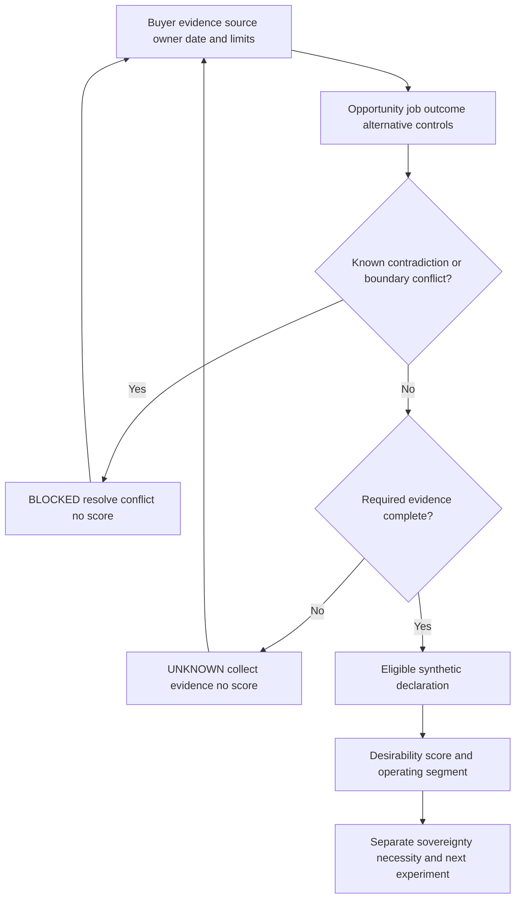

# Module 19 — Enterprise Market & Use Case Discovery

> **Educational draft.** Authored and primary sources checked: 28 November 2026. All five buyer interviews and opportunity scores are synthetic teaching fixtures. No market sizing, paid research, real customer data or production validation is claimed. Independent and manual review remain NOT COMPLETED. Module 04 remains HOLD.

## 1. Executive brief

Approve a discovery experiment before approving a sovereign platform investment. A sensitive workload can have a real user problem without requiring a dedicated physical installation. A buyer can demand control without having the budget, baseline or operational team to realize it. Product discovery must test both propositions and preserve the difference in the decision record.

This module asks which enterprise opportunities deserve the next bounded investigation. The answer depends on evidence of an existing job, a credible buyer, alternatives, constraints and economic assumptions. A high desirability score cannot authorize an external telemetry path when the fictional customer requires every protected artifact to remain in its building. Missing evidence stays UNKNOWN; a known contradiction is BLOCKED before ranking.

The practical outcome is a reproducible synthetic opportunity backlog and a separate [market opportunity assessment](../labs/module-19/OPPORTUNITY_ASSESSMENT.md). Neither establishes actual demand, willingness to pay or legal applicability. Carry the assessed opportunity into Module 20 only with explicit evidence gaps, experiment owners and conditions that could reverse the recommendation.

## 2. Learning objectives and prerequisites

You will map a buying center, distinguish sector labels from operational segments, write falsifiable value propositions, conduct neutral interviews, prioritize only eligible hypotheses and explain how scores change when assumptions change. You will also distinguish customer desirability from sovereignty necessity: one measures an expected customer outcome, while the other concerns the controls required to pursue that outcome.

Read Modules 03 and 05–06 for requirements and legal/governance boundaries, Modules 10–16 for feasible control patterns, and Modules 17–18 for operations and exit dependencies. A discovery promise about offline operation must survive those earlier constraints. Allow ten one-hour study sessions across reading, interview rehearsal, lab inspection, adverse tests and the PM artifact. The local lab uses Python 3.11+ standard library, CPU and negligible fixture memory; it requires no Docker, GPU, network, external account or purchase.

## 3. Taxonomy, ontology and decision architecture

This is a **course-derived framework, not a regulation or standard**. The [course ontology](../taxonomy/ONTOLOGY.md) should represent **BuyerEvidence**, **OpportunityHypothesis** and **DiscoveryDecision**. BuyerEvidence records the synthetic or real source, speaker role, context, observation date, owner, evidence state and limitations. OpportunityHypothesis describes a user, job, proposed outcome, alternative, required controls and a falsification test. DiscoveryDecision links the hypothesis to evidence, eligibility, score assumptions, unresolved questions and the next experiment.

The taxonomy groups opportunities by sector and by operating boundary. The ontology states relationships: BuyerEvidence **supports or contradicts** OpportunityHypothesis; OpportunityHypothesis **requires** ControlRequirement and **targets** Workload; DiscoveryDecision **evaluates** OpportunityHypothesis and **depends on** BuyerEvidence. Required controls constrain ranking. A missing baseline cannot silently become zero value, and a strong commercial case cannot cancel a prohibited data path. The Python fixture implements only a small subset, using dictionaries rather than a validated enterprise evidence store.

The [editable Mermaid source](../diagrams/module-19-discovery.mmd) shows the same mechanism. First preserve the source and uncertainty. Then inspect known conflicts, including all declared protected artifact locations, operators and connectivity. Resolve missing evidence before computing a comparable score. Finally assign a segment and a bounded next action. The static image and this walkthrough remain usable without JavaScript.



## 4. Technical deep dive

### 19.1 Enterprise customer profiles and buying centers

Define a customer profile at the level where a purchase decision can actually occur. Fictional FIN is a finance operations department performing policy lookup, rather than all banks in the GCC. Its users, risk owner, procurement route and operating budget are separate questions. An organization with sensitive documents may already have an adequate internal search service; sensitivity alone does not establish an unmet need.

Map the user, process owner, economic buyer, technical approver, security reviewer, privacy/legal reviewer, procurement lead and operator. One person may hold several roles in a small team, but their decision rights remain distinct. Ask who can approve a pilot, who can reject a data flow, who pays for ongoing support and who accepts the changed workflow. Enthusiasm from a user is evidence about their experience, not evidence that procurement will issue an order.

Record observable buying events: a signed pilot scope, approved synthetic test dataset, named review meeting or documented budget process. These are course examples of stronger commitments than a compliment about a demo, not conversion benchmarks. A letter of interest can still be conditional or nonbinding. Preserve its conditions and ask which competing project owns the same budget. A buying-center map should expose disagreements rather than average them into a single customer preference.

### 19.2 Finance, healthcare, telecom, government and industry cases

The following interviews are **invented**, authored on 28 November 2026. They are neither customer research nor representative sector evidence. The quoted speech belongs to fictional speakers and is not a source quotation. Do not cite these lines in a real market deck as interviews performed.

| Fictional interview | Job and synthetic statement | Discovery question | Fixture consequence |
|---|---|---|---|
| FIN, finance operations lead | “I need the current approved policy while resolving an exception.” | Which version is authoritative, and who accepts the answer? | Complete synthetic declarations, premises segment |
| HEALTH, hospital administration lead | “Staff waste time finding the latest procedure.” | What baseline and reviewer can establish improvement? | Missing baseline remains UNKNOWN |
| TEL, telecom support lead | “Agents repeat the same ticket summary work.” | Would an approved managed tool meet the actual constraints? | Managed segment, sovereignty preferred |
| GOV, public-service case owner | “Help staff find evidence within a case file.” | Where do traces and support copies go? | External telemetry conflicts with premises rule |
| IND, industrial maintenance lead | “Technicians need approved instructions during disconnection.” | Can updates and recovery operate without internet? | Internet-connected proposal conflicts with air gap |

These examples deliberately choose internal assistance rather than autonomous lending, clinical diagnosis or machinery control. That choice bounds the teaching exercise; it does not prove the applications are low risk. A staff-facing assistant can still reveal restricted case details or retrieve superseded instructions. Each opportunity needs an intended-use boundary, failure response and accountable domain reviewer.

Compare opportunities within an operational segment before generalizing across sectors. FIN and GOV share a physical-site constraint but differ in the evidence completeness of their proposals. TEL may be attractive without a dedicated installation. HEALTH cannot be ranked simply by borrowing FIN’s baseline. IND’s strong expressed need does not make an internet-dependent design viable.

### 19.3 Value propositions for sensitive workloads

Write a value proposition as a testable change in a named workflow: for a particular user doing a particular job, an eligible solution should improve a measured outcome relative to the existing alternative. Specify quality and control conditions alongside time savings. For FIN, the hypothesis could be faster retrieval of current policy while preserving document permissions and keeping protected derivatives on-site. This is an experiment statement, not a promised product result.

Separate business value, risk reduction and control value. Reduced handling time needs an observed baseline and a representative task sample. Reduced leakage exposure needs a threat scope, controls and adverse tests. Increased operator autonomy needs evidence about support, updates, keys, licensing and exit. Do not combine these into an unsupported statement that sovereignty creates a certain percentage of efficiency.

Define a stop condition before testing. If the current search service answers the same approved questions at comparable quality and less operating burden, the new product may have no incremental case. If the proposed assistant cannot cite the current policy, a short response time is insufficient. If every deployment alternative conflicts with the physical-site requirement, stop architecture selection and investigate feasibility rather than escalating the desirability score.

Use one outcome metric, one quality guardrail and one control guardrail in the initial pilot. For example, measure time to verified policy reference, rejection of superseded documents and denied external logging. The numerical thresholds must be agreed for the specific experiment; this lesson supplies no universal threshold. Record who decides whether a result is acceptable and how ambiguous outcomes will be handled.

### 19.4 Discovery interviews, jobs-to-be-done and constraints

A job-to-be-done describes the progress a person seeks in a concrete situation. Ask about the last exception resolved, the sequence of tools used, what failed, how the user checked the result and what happened next. A hypothetical feature preference is weaker evidence about actual behavior. GOV.UK recommends open, neutral questions and a focus on stories and real examples in its interview guidance.[^interviews]

A useful discussion guide starts with the existing job, then probes consequences, alternatives, constraints and buying process. Ask “What happened the last time you could not find the approved instruction?” before showing a prototype. Ask “Who would need to review this data path?” rather than “Would a sovereign platform solve your compliance problem?” The latter embeds both a solution and an unsupported legal premise.

Capture verbatim notes separately from interpretation. A speaker saying “nothing leaves our premises” requires clarification: does that cover prompts, OCR, speech, embeddings, weights, logs, diagnostics, backups, support, update tooling and recovery copies? Does premises mean a named building, campus, country or approved region? Who operates the service and under which authority? The fixture uses a physical-site definition for its premises cases, not a country boundary.

Keep contradictions visible. If the CISO requires a disconnected system while the operations owner requires live vendor support, record both statements, their authority and a decision owner. Do not resolve them by choosing the more commercially convenient interview. Consent, secure handling and minimal collection belong in the research plan; the lab uses invented lines to avoid collecting real personal or confidential information.

### 19.5 Prioritization by value, feasibility, risk and sovereignty necessity

Eligibility precedes prioritization. The lab first checks for contradicted evidence and known prohibited paths. It then checks whether evidence and required declarations are complete. BLOCKED means a known conflict; UNKNOWN means an unresolved gap. ELIGIBLE_FOR_DISCOVERY means only that this synthetic declaration passes the teaching rules and can receive a heuristic score. It is not approval to deploy or evidence that the interview happened.

Desirability combines value, feasibility, adoption and economics using illustrative weights of 0.35, 0.25, 0.20 and 0.20. Each dimension uses a declared 0–5 value and a reference to one of the fixture’s required evidence records. The score is 3.15 for FIN and TEL because their authored inputs are identical. That numerical equality does not establish equal markets or justify investment; it makes the scoring mechanism inspectable.

Sovereignty necessity is a separate field: required, preferred or not-established. Increasing necessity does not increase desirability. A highly constrained opportunity may be expensive and poorly adopted; a managed service may solve an attractive problem when stronger controls are only a preference. Risk appears as hard conflicts, missing evidence and experiment guardrails rather than a penalty that can be outweighed by sales potential.

Test sensitivity by changing one assumption at a time. Lower economics by one point and note the 0.20 change for an otherwise eligible case. Change FIN telemetry to external and the score disappears because the decision becomes BLOCKED. Delete HEALTH’s baseline and it stays UNKNOWN, regardless of optimistic numbers. The mechanism distinguishes an incremental trade-off from an eligibility failure.

### 19.6 Market segmentation, competitive alternatives and positioning

A useful segment shares a job, purchasing pattern and operating constraint that changes the offer. Sector is a starting label, not sufficient segmentation. Physical-site customers need a different support and recovery proposition from approved-managed customers. Disconnected-site customers additionally need offline acquisition, update and removable-media processes. Record these differences before deciding whether one platform package can serve them.

Compare the actual alternatives: existing document management/search, process redesign, manual expert review, approved enterprise assistants, a private retrieval application and postponement. Include doing nothing with its ongoing costs and risks. NIST’s MAP guidance includes consideration of non-AI or non-technology alternatives; this module’s segment definitions and commercial scoring are course constructs.[^map]

Position on demonstrated outcome and controls. A vendor’s statement about not training a foundation model is relevant to one data-use question. It does not answer physical placement, administration, telemetry, retention, tools or recovery. Microsoft’s Copilot privacy documentation distinguishes training from interaction storage and describes web-search query handling.[^copilot] A fictional premises-only buyer therefore needs further evidence before treating an enterprise assistant as an eligible alternative.

Build a comparison matrix with an evidence state in each important cell. “Unknown” is more useful than a checkmark based on a product category. Define the product edition, configuration, contract and verification date before making a vendor comparison. No feature ranking, current price claim or superiority claim is supplied by this lesson. A positioning statement should include the workload it excludes as well as the supported outcome.

### 19.7 Opportunity scoring and viability

A discovery score organizes investigation effort. Viability asks whether an eligible proposition can be delivered, operated, bought and renewed under explicit assumptions. Demand evidence, operator capacity, delivery economics, procurement timing, switching cost and exit requirements belong in that assessment. A prototype may establish technical possibility while leaving most of these questions open.

Use an assumption ledger alongside the backlog. For each assumption name an owner, source, date, confidence explanation, falsification test and next decision. Avoid a numerical confidence multiplier unless its meaning is defined and calibrated; multiplying subjective estimates can create precision without information. The fixture instead retains missingness and known conflict directly.

Select the next experiment by the decision it can change. A baseline measurement may unblock HEALTH. A telemetry architecture inspection may resolve GOV’s conflict after redesign. A customer interview cannot establish that IND’s internet-connected deployment is physically disconnected; that needs architecture and operational validation. If research confirms the constraint cannot be met affordably, reject the opportunity or change the offer openly with an authorized owner.

Carry an explicit decision horizon: approve a bounded synthetic evaluation, request evidence, redesign or stop. Do not equate ELIGIBLE_FOR_DISCOVERY with commercial viability. Even FIN’s complete fixture has no real buyer commitment, measured workflow improvement or verified facility. The next honest step is actual authorized research using minimal appropriate data, not a revenue forecast generated from five invented interviews.

## 5. UAE/GCC case study and global comparison

**Illustrative UAE/GCC scenario:** a regional enterprise portfolio contains FIN, HEALTH, TEL, GOV and IND. No organization, regulator or customer has supplied these interviews. The product team initially wants a single “sovereign assistant” offer. Discovery reveals three operating segments and several unresolved evidence states. The portfolio owner approves separate experiments rather than one universal claim.

FIN needs physical-site evidence and an operating model; TEL permits an approved managed alternative. GOV’s proposed external telemetry is blocked even if stored in the same country. IND requires disconnected operation, including updates and media controls. HEALTH needs an actual baseline before a value claim is made. These are authored constraints, not asserted UAE, Saudi, DIFC or ADGM legal obligations; qualified legal applicability remains a separate review.

As a global methodological comparison, GOV.UK’s interview guide teaches neutral inquiry into current user circumstances.[^interviews] Apply that discipline locally with appropriate language, accessibility and consent planning. It does not establish GCC buying behavior. The transferable lesson is to distinguish a method from regional evidence, and an illustrative portfolio from an estimate of market demand.

## 6. Hands-on lab: score evidence-backed synthetic interviews

Run the [complete lab](../labs/module-19/README.md) and inspect the [retained actual observation](../labs/module-19/observed-discovery-run.json).

```bash
python3 labs/module-19/discovery.py
python3 -m unittest discover -s labs/module-19 -p 'test_*.py' -v
```

Acceptance: FIN and TEL are eligible at 3.15, HEALTH is UNKNOWN, GOV and IND are BLOCKED, and the ranked backlog contains only FIN and TEL. Adverse tests cover every protected artifact, extra diagnostics routes, malformed inventories, external operators, air-gap connectivity, failed media/update review, missing evidence and invalid score numbers. No score is produced for blocked or unknown cases.

Allow 60–90 minutes for tracing, mutations and explanation. Cost is zero external service spend for the local fixture, excluding existing equipment and learner time. There is no network call or persistent research database. The output is reproducible synthetic reasoning; it does not inspect sites, authenticate interviewees, validate uploaded documents, measure market demand or verify legal compliance.

## 7. The AI PM decision playbook

Ask the process owner for a recent workflow example and baseline. Ask the economic buyer what funded decision a successful pilot can trigger. Ask architecture and operations which support, update and recovery dependencies are possible. Ask security/privacy/legal which constraints are binding, by whom, and with what evidence. A disagreement should produce a review task with an accountable owner.

Choose the cheapest ethical experiment that could reverse the current decision. Rehearse the interview guide before collecting real research. Define scope, retention, permitted data and review gates. Document negative findings and abandoned assumptions alongside promising opportunities, so the next team does not repeat a disproven pitch.

## 8. Economics, operating model and trade-offs

Use a worked estimate only with clearly invented inputs. Suppose a fictional team performs 100 eligible lookups weekly and a pilot proposes saving two minutes each: gross time released is 200 minutes weekly. That is not cash savings. Adoption, verification time, exceptions, rework, operator effort and the opportunity to redeploy time determine realized benefit. No such effect is measured in this module.

Model delivery and operating costs separately: integration, corpus stewardship, identity mapping, evaluation, hardware allocation, support, upgrades, incident response and exit. A premises-only package may need more field operations than a managed service. If the customer cannot staff offline updates, the offer may fail even with a useful model. Keep dated assumptions and ranges rather than inventing a market price.

## 9. Anti-patterns and failure cases

- Treating five authored interviews as a market sample or quoting them in a real sales deck.
- Converting absent evidence into zero and ranking it beside observed inputs.
- Awarding extra commercial points for strict sovereignty requirements.
- Averaging away a contradicted buyer requirement or prohibited telemetry route.
- Using a product’s training promise as proof of physical isolation.
- Calling released staff minutes cash savings without adoption and operating costs.
- Treating a local score or interview transcript as authenticated assurance.

## 10. PM deliverable and capstone connection

Complete [OPPORTUNITY_ASSESSMENT.md](../labs/module-19/OPPORTUNITY_ASSESSMENT.md), a distinct 20-point exercise. Deliver a buyer map, evidence ledger, operational segments, alternative comparison, eligibility-aware backlog and next-experiment plan. Identify which observations are synthetic and leave real commercial evidence open.

Definition of done: every material assumption has an evidence state and owner; every blocked or unknown opportunity has a reason and next action; scoring weights and sensitivity are reproducible; sovereignty necessity remains separate; and the chosen opportunity has a bounded experiment and reversal condition. The capstone inherits the workload, constraints and unresolved evidence, not a generic sector label or unsupported market estimate.

## 11. Knowledge check

**Q1.** Distinguish the end user, economic buyer, control approver and operator for a premises-only policy assistant. Which observation would establish only user interest?

**Q2.** Explain why missing baseline evidence and a known external telemetry conflict require different states. What should happen to each opportunity’s numeric ranking?

**Q3.** FIN and TEL share desirability inputs but differ in operating boundary and sovereignty necessity. How should their segments, alternatives and next experiments differ?

**Q4.** Design two neutral interview questions and one falsification test for a staff procedure-retrieval hypothesis. Include a non-AI alternative and an economic assumption to investigate.

**Q5.** Microsoft’s real Copilot privacy documentation discusses non-training of foundation models, stored interaction content and web queries.[^copilot] A **hypothetical** buyer proposes accepting this as proof of physical-site isolation. Which documented facts matter, what cannot be inferred, and what technical evidence could change the decision?

### Q6. Decision and root-cause exercise

 pre-test GOV is eligible based on a complete synthetic on-site declaration. A later architecture inspection finds external telemetry; its baseline evidence is also missing. The proposed fix is to increase value from four to five. State the evidence transitions, probable direct and systemic causes, containment, accountable owners, corrective action, dated retest and bounded closure decision.

Separate facilitator key: `assessments/solutions/19-enterprise-market-use-case-discovery-solutions.md`. Q1–Q5 and Q6 total 40 points; the PM artifact is scored separately.

## 12. Key takeaways

Desirability and necessity answer different questions. Evidence states are part of the decision, not decorations on a score. Segment around the job, purchasing route and operating boundary. A contradiction changes eligibility; a missing baseline changes the research plan. Preserve both before carrying a workload into a platform PRD.

## 13. Evidence ledger, quoted sources and further reading

All excerpts below were checked in the live official originals on **2026-11-28**. Course interviews, weights, labels, segments and financial examples are authored teaching constructs. Sources provide methodological or documented product context; they do not validate the fixture, estimate a market or establish legal obligations.

| Claim | Exact short source quotation | Primary pinpoint | Interpretation and limit |
|---|---|---|---|
| D1 | “Context is established and understood.” | NIST MAP 1[^map] | Context precedes design; not approval of this scoring method |
| D2 | “focus on stories and real examples” | GOV.UK, During the interview[^interviews] | Interview method; fictional examples are not observations |
| D3 | “aren't used to train foundation LLMs” | Microsoft, proprietary organizational data[^copilot] | Provider data-use statement; not isolation proof |
| D4 | “The stored data includes the user's prompt and Copilot's response” | Microsoft, Data stored about user interactions[^copilot] | Storage is a separate question from training |

[^map]: NIST, *AI RMF Playbook*, MAP 1 and MAP 1.1, https://airc.nist.gov/airmf-resources/playbook/map/. Verified: 2026-11-28. Live guidance; page notes AI RMF revision in progress. Publication date not established. Non-AI alternatives discussed in MAP 1.1; no course scores attributed to NIST.
[^interviews]: GOV.UK User research community, *Using in-depth interviews*, Design the interview and During the interview, published 21 February 2017, https://www.gov.uk/service-manual/user-research/using-in-depth-interviews. Verified: 2026-11-28. UK service research guidance, not GCC market evidence.
[^copilot]: Microsoft, *Data, Privacy, and Security for Microsoft Copilot*, How does Microsoft Copilot use your proprietary organizational data? and Data stored about user interactions, https://learn.microsoft.com/en-us/copilot/plan/microsoft-365-copilot-privacy. Verified: 2026-11-28. Live provider documentation, not independent configuration assurance; publication/update date not established in retrieved text. Product terms, models and enabled agents require specific review.

## 14. Website, social derivative and next steps

The [eight-question HTML carousel](../social/module-19/CAROUSEL.html) and [post](../social/module-19/POST.md) are public learning derivatives. HTML is canonical; an optional PDF export is untagged and requires its own review. Same-author technical/source/security and editorial/accessibility audits record actual checks and unresolved independent/manual work.

Carry BuyerEvidence, OpportunityHypothesis and DiscoveryDecision into the [Architecture & Learning Studio](../learning/index.html). Its deterministic feedback remains provisional: toggling a boundary should change eligible architecture and evidence requests, while toggling commercial preference cannot override a hard conflict. Export only synthetic assumptions; review any real research before storing or syncing it. Shared tutor integration, site generation and publication are coordinator tasks. Module 20 converts a defensible opportunity into platform strategy and a reviewable PRD; Module 04 HOLD remains unchanged.
