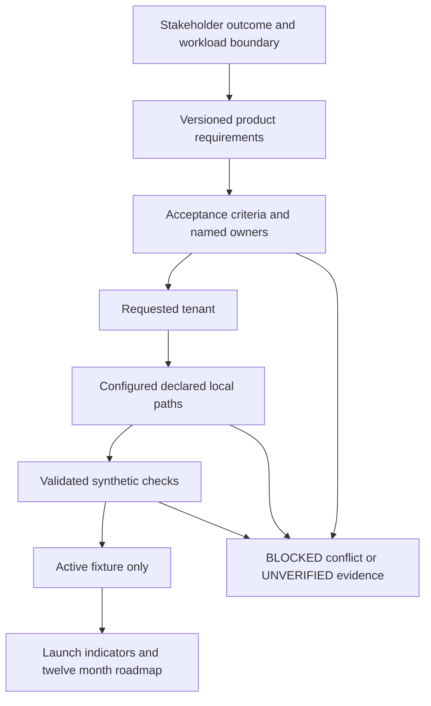

# Module 20 — Platform Product Strategy & PRDs

> **Educational draft.** Authored and primary sources checked: 28 November 2026. All organizations, performance targets, costs and roadmap dates below are illustrative. The lab is a trusted synthetic fixture, not an authenticated service. Independent assessment, manual accessibility review and production assurance remain NOT COMPLETED. Module 04 remains HOLD.

## 1. Executive brief

Fund a platform only when shared capabilities improve specific stakeholder outcomes and the team can operate its constraints. A catalog of models is not a strategy. The product decision is which workloads can safely move from request to useful operation, who owns that journey, and what evidence permits each transition. Write those decisions into a product requirements document, or PRD, before counting features or committing a launch date.

For fictional BANK-A, protected information and its derivatives remain inside the bank's physical premises. Replacing an overseas service with a domestic region does not satisfy this premise. An attractive gateway that requires remote administration or external activation remains ineligible. A weighted roadmap score helps compare eligible alternatives; it cannot compensate for a forbidden path, unknown acceptance evidence or an unowned operating responsibility.

**Outcome:** prototype tenant onboarding as explicit API operations, exercise adverse cases, and produce a [platform PRD](../labs/module-20/PLATFORM_PRD.md) with launch measures and a twelve-month sequence. The purpose is to distinguish a reviewable product promise from a clickable demo. Passing the fixture proves bounded Python behavior; it supplies neither legal approval nor proof of physical isolation, real authentication, service reliability or adoption.

## 2. Learning objectives and prerequisites

By completion, explain a platform thesis through stakeholder outcomes; distinguish buyer, administrator, developer and risk-owner needs; translate requirements into observable acceptance criteria; specify catalog, gateway and tenant responsibilities; design a retry-safe onboarding journey; prioritize with hard constraints before scores; and define product measures with meaningful denominators and failure actions.

Bring Module 19's workload discovery evidence and Modules 11–18's model, retrieval, integration, security, identity, operations and recovery constraints. A persuasive demand interview does not erase any of those constraints. Carry their unresolved evidence into the PRD rather than rewriting unknowns as assumed capabilities. No model inference or new task-quality experiment occurs here; prior quality gaps remain open.

The lab uses Python 3.11+ standard library and synthetic data only. No external account, paid tool, GPU, Docker or real identity provider is needed. Allocate ten one-hour sessions across reading, prototype inspection, adverse tests, stakeholder review and PRD revision. Running tests takes seconds; deciding which product promise those tests support requires considerably more care.

## 3. Taxonomy, ontology and architecture

This **course-derived framework is not a regulation or standard**. Link the [shared ontology](../taxonomy/ONTOLOGY.md) to three concepts. **ProductRequirement** records a stakeholder outcome, owner, scope, priority and evidence state. It **constrains** a Workload or platform capability. **AcceptanceCriterion** specifies preconditions, action, observation, threshold and failure decision; it **verifies** a ProductRequirement. **OnboardingTransition** records source stage, permitted action, actor scope, evidence and destination stage; it **requires** AcceptanceCriterion.

Taxonomy classifies requirements into functional behavior, nonfunctional constraints, operating responsibilities and commercial assumptions. Ontology explains their relationships: one requirement can require several criteria, one criterion can examine several paths, and a transition can depend on both passed behavior tests and unresolved physical evidence. Neither relationship count nor feature completion is a sovereignty percentage.



The [editable SVG](../diagrams/module-20-platform.svg) is the static equivalent. Read from the stakeholder outcome to requirements and acceptance criteria, then through requested, configured, validated and active fixture stages. A conflicting path or missing evidence interrupts advancement. Metrics feed the next product decision but never bypass a gate. The diagram describes the lab and decision process, not a deployed service or verified facility.

## 4. Technical deep dive

### 20.1 Platform vision, strategy and stakeholder outcomes

Define the platform's customer and repeated job before choosing its components. For BANK-A, a possible thesis is that internal teams need a consistent, reviewable route to deploy permitted document assistants. The intended outcome is shorter elapsed time from approved workload request to a supportable deployment with traceable controls. This differs from the feature statement that every team should have access to twenty models.

A strategy specifies where the platform will concentrate effort and which work remains outside its scope. Initial scope might include internal read-only assistants with a local corpus, a bounded gateway and controlled onboarding. Autonomous financial actions, training frontier models and serving external customers can remain later decisions requiring different evidence. Record why each exclusion matters to demand, risk and the operating team, with a named condition for reconsideration.

Separate customer discovery from solution confirmation. Ask teams to show their last request, delays, exception approvals and abandoned attempts. A complaint about slow access may reflect procurement, data permissions, documentation, scarce reviewers or unsupported hardware. Building a self-service button solves only some of those causes. Retain observations and dissent, then test the largest uncertainty through a small eligible workflow rather than inventing an adoption forecast.

Write a strategy hypothesis with a falsifier: if the first three eligible teams cannot complete the guided journey without repeated specialist intervention, investigate the bottleneck before adding catalog breadth. Three teams is an illustrative learning cohort, not market validation. The product lead owns interpreting this evidence with engineering and control owners; a roadmapped feature should not become the automatic answer to every failed hypothesis.

### 20.2 Personas: IT, AI engineer, security, developer and business owner

A persona should explain a decision and authority, not merely a job title. IT needs capacity, patching, restore and support ownership. The AI engineer needs model/version compatibility and evaluation paths. Security needs scoped access, testable abuse boundaries and incident evidence. The application developer needs an understandable interface and predictable errors. The business owner needs task outcomes, acceptable failure behavior and clarity about who funds ongoing use.

These needs can conflict. Faster onboarding can increase operations work; detailed troubleshooting may copy protected prompts; unrestricted model choice can create unreviewed licenses or hardware demand. Interview each role about the same complete journey and compare their evidence. A developer's successful first request is incomplete if operations cannot reproduce its configuration or the business owner cannot assess the answer's usefulness.

Distinguish the requester from the approver and operator. A workload owner can submit an intended purpose; a platform administrator can configure a tenant; security and data owners review their domains; operations accepts the service burden. A production design needs trusted identity and decision separation. The fixture's owner/reader handles only exercise policy branching and cannot establish that real people hold those roles.

Include failure and exit journeys in persona research. Ask how a developer recognizes a denied request, how a business owner learns that a release is paused, how an operator suspends one tenant, and how data is removed at retirement. An onboarding design that cannot explain suspension or recovery is missing product behavior. These questions also reveal which promises belong in documentation, support procedures and contracts rather than the API itself.

### 20.3 Requirements, nonfunctional constraints and traceability

A useful requirement states whose need is served, under which conditions, what must happen, and how a reviewer will know. Replace support tenant isolation with: a principal mapped to tenant-b cannot read or mutate tenant-a's onboarding record through any supported operation. Keep this criterion distinct from real authentication, which establishes the caller's identity and requires a separate design and evidence.

Nonfunctional requirements constrain how the system behaves: latency, reliability, privacy, capacity, accessibility, recoverability and permitted operating boundaries. Give each a measurement population, environment and failure response. A premises constraint is not an average target. One prohibited trace route blocks eligibility even if every other artifact is declared local and every performance result is favorable.

Maintain a trace from outcome to requirement ID, criterion, implementation operation, test, observation and decision owner. The lab maps R1–R6 to executable tests. A test name is not independent evidence by itself: inspect its assertions, adversarial population and retained result. The production PRD must also reference evidence that the fixture cannot produce, including identity integration, observed network paths and a tested restore.

Distinguish missing from failed evidence. UNVERIFIED means required evidence is absent or not accepted; BLOCKED means a known conflict. DECLARED_ONLY means a supplied inventory is internally consistent, not that a building was inspected. A course test can move a bounded behavior claim from untested to observed in the fixture. It cannot move actual facility assurance to approved without corresponding physical and operating evidence.

### 20.4 Model catalogs, gateways, governance features and tenancy

A model catalog supports discovery of permitted artifacts, rights, intended uses, evaluation limits and serving constraints. It should expose the release identity and approval context, not just a model's friendly name. An available artifact may still be unsuitable for one tenant's language, data classification or deployment boundary. Link to Module 11's licensing and model-choice work rather than treating a dropdown selection as approval.

A gateway is a controlled interface through which applications request model services. Product requirements should specify routing, allowed models, tenant policy, quotas, audit behavior, error handling and degraded operation. Centralization can simplify consistent policy but can also create concentration risk and an additional control plane. Define who changes routes and how an application learns that its previously permitted model is unavailable.

A tenant is an isolation and ownership scope; it is not necessarily a legal entity or billing account. Declare which resources are shared and which are isolated: configurations, indices, request history, quotas, keys, logs, backups and administrative rights. OWASP's API1 guidance calls for authorization on each record-accessing function.[^owasp] Hiding tenant records in the interface does not secure an underlying operation that accepts arbitrary identifiers.

The prototype binds each fixture principal to a tenant before handling any operation. Unknown handles and cross-tenant calls are denied. Returned records are copies so a caller cannot mutate internal state through an object reference. These choices show useful boundaries inside a single process, but the process owner can edit the registry and principal mapping. Production requires server-enforced identity, durable transactional state, protected administration and isolation tests across actual components.

### 20.5 APIs, onboarding, documentation and developer experience

An API contract makes supported inputs, outputs and error behavior reviewable. OpenAPI 3.1.1 describes a programming language-agnostic interface for HTTP APIs.[^openapi] That pinned specification is a source for interface description, not a claim that this lab runs HTTP or implements an OpenAPI validator. A schema can document authorization requirements; it cannot prove runtime authorization enforcement.

Onboarding is a state machine: a set of explicit stages and permitted transitions. The fixture permits REQUESTED to CONFIGURED to VALIDATED to ACTIVE_FIXTURE. Configuration requires a complete internally consistent local-path declaration. Validation requires all declared acceptance fields to be strictly true. Activation rechecks stored boundary and acceptance declarations. Skipping stages or presenting a false criterion fails without advancing the record.

Retries require a product contract. RFC 9110 defines idempotent methods through their intended repeated effect.[^http] The fixture uses an application replay key for its simulated mutations: the same tenant, key, operation and payload returns the previous result without another event. Reusing the key with different content fails. This is not a claim that arbitrary POST requests are inherently idempotent, or that an in-memory dictionary provides distributed exactly-once execution.

Document happy paths and failure recovery together. Provide a minimal synthetic example, scope rules, required fields, stage errors, replay behavior and what to do after an ambiguous timeout. The fixture has no network timeouts, concurrency, key expiration or durable replay ledger. A production contract must decide how long keys are retained, how concurrent retries serialize, how results survive restarts and how revoked authorization affects replay. Do not claim success from a cached response without defining what it represents.

Measure developer experience through observed completion, confusion and support intervention. Time to first permitted success differs from time to any successful request. Exclude tutorial shortcuts from production adoption reports, and show denied or abandoned attempts separately. Documentation is part of the supported product: version examples with the API and test them when behavior changes, especially tenant scope and error handling.

### 20.6 MVP, roadmap, prioritization and sequencing

A minimum viable product is the smallest complete eligible journey that can test an important product hypothesis. For BANK-A that can be one read-only workload, one approved model, one supported tenant pattern, documented onboarding and a reversible launch. Omitting restore, support ownership or an essential boundary review does not make the product minimal; it leaves a required decision unresolved.

Sequence dependencies rather than distributing attractive features evenly across quarters. Tenant identity and scope must precede broad self-service. An approved artifact process precedes catalog expansion. Metering definitions precede spend dashboards. Recovery evidence precedes commitments that depend on recoverability. Write the prerequisite and decision gate next to each roadmap item so a delay changes the sequence transparently.

Apply hard constraints first. Remove an option requiring prohibited remote support or off-site traces before assigning preference weights. For eligible options, an illustrative comparison could weight user value 40%, operator readiness 30%, delivery confidence 20% and future reuse 10%. Record the underlying evidence and sensitivity: two uncertain scores should not create false precision. A very high preference score does not reopen an excluded design.

Use a twelve-month roadmap as conditional learning and delivery intent. Each phase needs an outcome, owner, prerequisites and stop condition. Dates and staffing assumptions must be labeled illustrative until the team estimates work. Keep a reserve for findings, incidents and maintenance; otherwise the roadmap silently assumes every uncertain control passes first time. Revisit it after pilot evidence instead of treating an annual slide as an immutable commitment.

### 20.7 Product metrics, acceptance criteria and adoption

Separate product outcomes from operating health and eligibility. Outcomes include useful tasks completed and repeat use by approved teams. Journey measures include permitted onboarding completion and support dependence. Operating indicators include service availability and latency. Boundary conflicts and authorization failures remain visible guardrails, not scores averaged into adoption. A fast, popular product can still be ineligible.

Google's SRE workbook defines SLOs as target reliability levels.[^slo] Define the event population before choosing a number. For an illustrative pilot, onboarding completion might be approved eligible requests reaching a usable fixture within five working days divided by all approved eligible requests started during the cohort window. Show rejections, unapproved requests, pauses and abandonment separately so denominator selection cannot hide the user journey.

Targets require stop rules and owners. For example, a single confirmed cross-tenant disclosure stops expansion pending containment and retest, while a rising support rate triggers a documentation and workflow investigation. A target of no confirmed leakage is not evidence of complete protection: detection coverage and test limits remain necessary. Never interpret no incident reports as proof that no incident occurred.

An acceptance criterion needs a concrete observation. Given a tenant-a owner and a configured record, when activation is called before validation, then the operation denies transition and the stored stage remains unchanged. Pair positive checks with negative cases, and retain their actual run. Launch acceptance additionally needs a supported environment, known limitations, review roles and signed decisions; the synthetic fixture does not create any of these enterprise approvals.

## 5. UAE/GCC case study and global comparison

**Illustrative BANK-A:** a UAE institution wants reusable internal assistants, but its stated contractual premise is physical-site-only handling of prompts, OCR/speech outputs, embeddings, model weights, telemetry, backups and recovery copies. Operators are on site. If the workload is air-gapped, there is no connected network path and updates/media require separate review. An external model activation service or remote support dependency conflicts with this premise even if content is encrypted.

**Illustrative Enterprise-B:** a different organization permits an approved domestic managed service, with explicitly reviewed operator, support, telemetry and transfer paths. It may prefer a managed gateway because its actual requirements differ. This comparison does not establish UAE, Saudi, DIFC, ADGM or other legal applicability. Qualified reviewers must determine actual obligations and contracts. Keep Module 04 HOLD and legal evidence open rather than inferring a regional rule from either fictional customer.

## 6. Hands-on lab: prototype a bounded onboarding journey

Follow the [lab guide](../labs/module-20/README.md) and inspect [retained observations](../labs/module-20/observed-platform-run.json).

```bash
python3 labs/module-20/platform_flow.py
python3 -m unittest discover -s labs/module-20 -p 'test_*.py' -v
```

Expected: four transitions, four events, a repeated activation returning the original result without a fifth event, and an external-trace plan classified BLOCKED. Acceptance tests exercise tenant and role scope, input validation, stage skipping, replay conflicts, boundary dominance, incomplete acceptance fields, stored-policy changes and defensive copies. Each assertion is bounded to the fixture's in-memory behavior.

Inspect the distinction between recorded acceptance declarations and tests: passing true values into validate does not execute an external test system. The real test runner executes the controls, while the acceptance payload models what a transition would consume. Production must bind evidence to the exact configuration, protect it against tampering, define expiry and revocation, and record independent reviewer authority. No facility, identity provider or actual API server is contacted.

## 7. The AI PM decision playbook

Ask the business owner which task outcome justifies shared investment. Ask the CTO which capabilities truly repeat across teams. Ask security which caller and record scope must be enforced. Ask operations who can restore, pause and support the service. Ask privacy/legal and procurement which real terms and evidence constrain each data and administrative path. Ask developers to attempt the documented journey while observing confusion and retries.

Compare alternatives only after eligibility review: a guided internal service, a self-service developer portal or a managed integration can solve different bottlenecks. Choose the smallest supportable eligible option, record the evidence that could reverse it, and name the next review. If no option meets the premise, publish a blocked decision with remedial dependencies rather than forcing a favorable recommendation.

## 8. Economics, operating model and trade-offs

Treat the platform as an ongoing service. Costs include reserved compute, idle capacity, storage, backups, monitoring, identity integration, support, security review, documentation and upgrade work. Product reuse can reduce duplicated work while increasing central operations responsibilities. Estimate benefit from avoided repeated work and observed user outcomes, not model request volume alone.

The PM template uses illustrative planning units: three staff-months per month at AED 30,000 each plus AED 40,000 monthly infrastructure allocation equals AED 130,000 per month, or AED 1.56 million over twelve months before contingency. These are invented scenario inputs, not salary or cloud quotes. A 25% contingency yields AED 1.95 million. Test sensitivity to utilization, team capacity and support load before using any amount in a real investment proposal.

## 9. Anti-patterns and failure cases

- Counting catalog entries as customer value without an approved useful workload.
- Treating a public tenant identifier as authentication or an unpredictable ID as authorization.
- Retrying mutations without a scoped replay contract and durable production design.
- Calling all true fixture fields independent acceptance evidence.
- Skipping validation because configuration looked correct yesterday.
- Hiding rejected or abandoned requests outside an adoption denominator.
- Allowing preference scores or delivery deadlines to override a physical-boundary conflict.

## 10. PM deliverable and capstone connection

Complete [PLATFORM_PRD.md](../labs/module-20/PLATFORM_PRD.md): problem and strategy hypothesis, stakeholder decisions, workload/boundary scope, requirements and traceability, API journey, operating ownership, acceptance gates, launch KPIs, economics and twelve-month roadmap. Its twenty-point rubric is distinct from the forty-point knowledge/scenario key. A readable narrative with an untestable promise remains incomplete.

The capstone consumes these requirements to connect architecture, evidence and launch decisions. Definition of done includes a reproducible fixture run, inspected adverse tests, explicit remaining production gaps and a reviewed draft PRD with named owners. Educational completion does not authorize an enterprise launch. Module 21 adds procurement and commercialization decisions; commercial promises must preserve these accepted limitations.

## 11. Knowledge check

**Q1.** Distinguish a platform strategy hypothesis, a feature and a stakeholder outcome. What observation could falsify your hypothesis?

**Q2.** Write a tenant-scope acceptance criterion with preconditions, action, observation and failure decision. What does it leave unproven about identity?

**Q3.** Explain the fixture's replay key scope and behavior for identical retries, changed payloads and a restart. Why is exactly-once execution an unsupported claim?

**Q4.** Define a pilot onboarding completion metric, its denominator, exclusions, owner and stop rule. How would you prevent a favorable percentage hiding abandonment?

**Q5.** OpenAPI 3.1.1 is a real interface-description specification. A hypothetical team says a security declaration in its API document proves runtime object authorization. What does the specification establish, what does OWASP API1 require examining, and which technical evidence would change the decision?[^openapi][^owasp]

### Q6. Decision and root-cause scenario

On 28 November 2026, BANK-A onboarding is UNVERIFIED because identity integration and media-review evidence are missing. A team gives a remote-support design a 92/100 preference score and adds a true acceptance flag. The prototype reaches ACTIVE_FIXTURE. A simulated tenant-b attempt to access tenant-a is denied, but inspection finds a declared external trace path and a connected updater in an air-gap design. The team proposes renaming the stage LAUNCHED and excluding paused tenants from its completion dashboard.

Describe evidence-state transitions, direct and systemic causes, immediate containment, accountable owners, a concrete remediation and a dated retest. What do the denial and the successful stage transition each demonstrate? Which real and bounded claims remain unresolved? Explain how the roadmap and KPI contract should change before any launch decision.

**Scenario challenge:** compare BANK-A and Enterprise-B without changing BANK-A's premises assumption. Give each a conditional launch recommendation and the evidence needed to revisit it. Separate answers: `assessments/solutions/20-platform-product-strategy-prds-solutions.md`.

## 12. Key takeaways

Define the repeated customer job and falsifiable platform thesis first. Translate each promise into scoped requirements and observable criteria. Treat onboarding as controlled transitions, retries as an explicit contract, metrics as defined populations and roadmaps as conditional sequences. Hard boundary conflicts remain blocking regardless of feature completion, adoption or weighted preference.

## 13. Evidence ledger, quoted sources and further reading

Brief exact extracts checked 28 November 2026. Source documents describe interfaces, security guidance and measurement concepts. The course's product framework, fixture, targets and organizations are authored examples. Quotes are deliberately brief and total fewer than twenty-five words per original source.

| Claim | Exact short extract | Primary source and pinpoint | Interpretation and limit | Checked |
|---|---|---|---|---|
| C1 | “programming language-agnostic interface description for HTTP APIs” | OpenAPI 3.1.1, What is the OpenAPI Specification?[^openapi] | Describes interface capabilities; no runtime authorization assurance | 2026-11-28 |
| C2 | “the same as the effect for a single such request” | RFC 9110 §9.2.2[^http] | Intended repeated effect; no general exactly-once promise | 2026-11-28 |
| C3 | “in every function that uses an input from the client” | OWASP API1:2023, How To Prevent[^owasp] | Record authorization must cover relevant operations; fixture identity remains trusted | 2026-11-28 |
| C4 | “specify a target level for the reliability of your service” | Google SRE, Implementing SLOs introduction[^slo] | Reliability target differs from adoption or legal approval | 2026-11-28 |

[^openapi]: OpenAPI Initiative / Linux Foundation, *OpenAPI Specification*, version 3.1.1, 24 October 2024, introduction, https://spec.openapis.org/oas/v3.1.1.html. Verified: 2026-11-28. Deliberately pinned reference, not asserted latest; no OpenAPI runtime is tested.
[^http]: R. Fielding, M. Nottingham and J. Reschke, IETF, *RFC 9110: HTTP Semantics*, June 2022, §9.2.2 Idempotent Methods, https://www.rfc-editor.org/rfc/rfc9110.html#section-9.2.2. Verified: 2026-11-28. The lab simulates application replay behavior without HTTP.
[^owasp]: OWASP API Security Project, *API1:2023 Broken Object Level Authorization*, 2023 edition, How To Prevent, https://api-security.owasp.org/editions/2023/en/0xa1-broken-object-level-authorization/. Verified: 2026-11-28. Security guidance, not evidence that a particular deployment enforces it.
[^slo]: Steven Thurgood and David Ferguson with Alex Hidalgo and Betsy Beyer, Google, *The Site Reliability Workbook*, Implementing SLOs, 2018, https://sre.google/workbook/implementing-slos/. Verified: 2026-11-28. Course launch targets and dates remain illustrative.

## 14. Website, social derivative and next steps

Read the [lab](../labs/module-20/README.md), [platform PRD](../labs/module-20/PLATFORM_PRD.md), [eight-question HTML carousel](../social/module-20/CAROUSEL.html), [portrait PDF](../social/module-20/QUESTIONS.pdf) and [post draft](../social/module-20/POST.md). HTML is preferred; exported PDF is untagged. Same-author reviews record test coverage and gaps honestly; full-site integration, independent review and manual assistive-technology checks remain separate release work.

Use the [Architecture & Learning Studio](../learning/index.html) to carry workload boundary, operator/connectivity rules, tenant scope, acceptance evidence and roadmap dependencies into the exported teaching decision. Compare the counterfactual in which managed domestic hosting is actually permitted. The deterministic recommendation cannot verify a facility or grant legal approval. Continue to Module 21 for economics, procurement and go-to-market while preserving the product's evidence limits.
