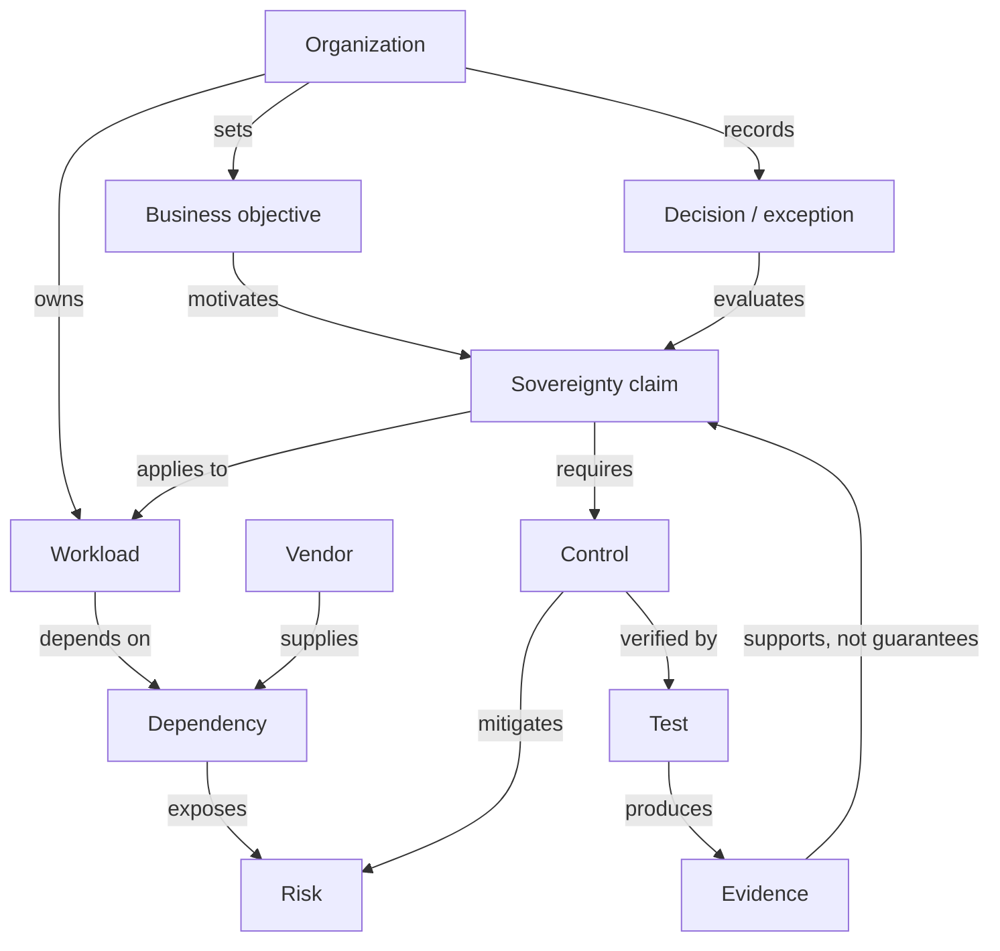

# The Sovereign AI Taxonomy & Ontology

> **Field guide · v1.1 · 17 November 2026.** This is a **course-authored decision framework**. It is not an official regulatory taxonomy, an independent certification, or a claim that full sovereignty is always achievable. Its purpose is to give AI PMs a consistent language for classifying systems, testing claims, and finding gaps.

## 1. Why a taxonomy and an ontology are different

A **taxonomy** organizes terms into categories. It answers: *which kind of sovereignty, deployment, workload, or dependency is this?* An **ontology** defines entities, properties, and relationships. It answers: *which organization controls this workload, which vendor supplies its model, which requirement creates a control, and which test produces supporting evidence?*

These are separate deliverables. A taxonomy prevents category confusion; an ontology lets product requirements and architecture evidence connect.

| Concept | Use | Anti-pattern |
|---|---|---|
| Taxonomy | Compare enterprise AI workloads consistently | Treating sovereign/private/secure as interchangeable labels |
| Ontology | Trace ownership, dependencies, controls, tests and evidence | A diagram of nouns with no relationship semantics |
| Maturity rubric | Track capabilities and gaps by dimension | Claiming a vendor-independent certification score |
| Assurance case | Support a bounded, evidence-backed claim | Assuming a data-center region proves everything |

## 2. The classification axes

### 2.1 Scope: whose sovereignty?

| Category | Boundary | Example (illustrative) |
|---|---|---|
| National | State-wide or national capability | Country-level compute strategy |
| Sectoral | Industry or regulated ecosystem | Shared banking platform with specific controls |
| Enterprise | One organization's governed AI estate | Enterprise-owned model gateway and key custody |
| Workload | One use case with defined requirements | A legal-document assistant with restricted support access |

**Enterprise-level sovereign AI is possible.** It means the company has defined what control it needs and can verify that control. It does *not* require proprietary chips, a fully trained foundation model, or ownership of every component. A single company can operate workloads with different sovereignty postures.

### 2.2 Control dimensions: what must be controlled?

1. **Territorial** — processing, storage, backups, embeddings, telemetry, disaster recovery, and transfer paths.
2. **Operational** — administrators, support access, patching authority, identity, incident response, shutdown rights, and key custody.
3. **Technological** — model weights and licenses, API portability, hardware and platform dependencies, data export, and credible vendor exits.
4. **Legal/contractual** — entities, jurisdictions, contracts, regulatory applicability assessed by counsel, and enforceable recourse.

A system can be strong in one dimension and weak in another. These four dimensions are the *course's organizing synthesis*, not a formal NIST or UAE certification taxonomy.

### 2.3 Deployment models

`public cloud` · `managed sovereign cloud` · `enterprise private cloud` · `hybrid` · `air-gapped` · `edge`

A deployment model is **not a sovereignty rating**. It describes architecture and operations. A private cloud can still depend on remote management, foreign support, or nonportable licenses; a managed service can implement strong contractual and technical controls for defined workloads.

### 2.4 Lifecycle and dependencies

Evaluate `data acquisition → training/adaptation → evaluation → inference → monitoring → retirement`. Dependencies include hardware, networking, cloud, model provider, identity, support, licensing, and disaster recovery. A sovereign inference claim does not automatically extend to training, telemetry, or backups.

### 2.5 Evidence strength

`assertion → contract / architecture → configuration / logs → repeatable technical test → independent attestation`

These are **not** universally ordered proofs of compliance. The fitness of evidence depends on the claim. A contract may be essential for a legal claim, while a technical egress test is essential for a network-control claim.

## 3. The ontology: map a claim to evidence

For legal requirements, add `Authority → LegalInstrument → Requirement → Control`. **Qualified reviewers**, not a graph rule, determine applicability to a specific entity and activity.

### 3.1 Core object vocabulary

| Object | Meaning | Minimum fields |
|---|---|---|
| `SovereigntyClaim` | Bounded statement of control | ID, scope, dimension, owner, criterion |
| `Workload` | AI system or use case under review | Purpose, users, data classes, geography |
| `Dependency` | External capability required by the workload | Provider, type, criticality, exit path |
| `Control` | Operational/technical/contractual mechanism | Owner, implementation, review frequency |
| `Test` | Reproducible evaluation of a control | Procedure, expected outcome, frequency |
| `Evidence` | Inspectable output linked to a test | URI, timestamp, source, limitations |
| `Decision` | Approved disposition of claim | Approver, date, state, exceptions |

The machine-readable [ontology.yaml](ontology.yaml) is the canonical vocabulary for exercises. It intentionally does not infer compliance.

## 4. A worked example: UAE inference is not the whole story

**Illustrative assertion:** “Our employee assistant is UAE-sovereign because inference runs in a UAE region.”

| Dimension | Necessary question | Example verification |
|---|---|---|
| Territorial | Do logs, embeddings, backups and support diagnostics also remain within the agreed locations? | Data-flow map, runtime config, tested egress rules |
| Operational | Can offshore support access data or invoke privileged actions? | Access path review, permissions, key-custody tests |
| Technological | Can the firm replace the model and gateway? | Export trial, open formats, failover rehearsal |
| Legal | Which entity, contract and legal duties govern processing? | Counsel-reviewed applicability matrix, signed terms |

**Decision:** Classify the inference-location fact as *supported only for the measured inference path*, not as a complete sovereignty conclusion. File unresolved items as evidence gaps or accepted exceptions; do not hide them in an average score.

## 5. Practical maturity rubric (course-created)

| Level | Description | Minimum demonstration |
|---|---|---|
| 0 — Unmapped | No inventory of AI systems and dependencies | Inventory absent |
| 1 — Declared | Claims and owners documented | Claims register |
| 2 — Designed | Controls and acceptance tests specified | Architecture + control map |
| 3 — Tested | Controls have repeatable evidence | Dated test results |
| 4 — Governed | Evidence and exceptions managed over time | Review history + incident and exit exercises |

Assess **each dimension separately**. Example: Territorial 3, Operational 1, Technological 2, Legal 2. Never collapse into a “certified sovereign” label. Unverified items should be shown as **unknown**, not assigned a favorable score.

## 6. PM acceptance gate

A claim can be promoted from *proposed* to *accepted* only when the accountable reviewer has (a) defined scope; (b) mapped relevant dependencies; (c) identified control owners; (d) inspected dated evidence or recorded an exception; and (e) specified review cadence. Legal acceptance also requires applicable legal review.

## 7. Source anchors and terminology boundaries

- **NIST (2023), AI RMF 1.0** uses the four functions “GOVERN, MAP, MEASURE, and MANAGE” (short direct quotation). This course's sovereignty ontology is **not** claimed to be a NIST ontology. Source: [NIST AI RMF publication](https://www.nist.gov/publications/artificial-intelligence-risk-management-framework-ai-rmf-10); [AI RMF Core](https://airc.nist.gov/airmf-resources/airmf/5-sec-core/). Accessed 17 Nov 2026.
- **OECD (2024), revised AI-system definition:** “a machine-based system” (short direct quotation). The OECD defines AI systems; it does **not** establish this course's enterprise sovereignty maturity levels. Source: [OECD AI definition](https://oecd.ai/en/dashboards/policy-initiatives/updated-oecd-definition-of-an-ai-system-4108). Accessed 17 Nov 2026.
- **UAE AI Office, National Strategy 2031:** the strategy positions UAE to become one of the “world leaders in A.I. by 2031” (short direct quotation). This is a national strategy context, not a proof of any enterprise product's sovereignty. Source: [UAE AI strategy](https://ai.gov.ae/strategy/). Accessed 17 Nov 2026.

**Editorial rule:** Every official quote is short and attributed. Every course-generated classification is expressly labeled. Vendor assertions are evidence to investigate, not facts to accept uncritically.

## 8. Module 08 data lifecycle extension

Course-authored extension, 27 November 2026. These entities describe the learning specification; they are not an industry schema or a claim that the toy lab implements every production control.

| Entity | Properties | Relationships and constraints |
|---|---|---|
| DataArtifact | ID, purpose, owner, tenant scope, classification, declared location | Produced by a transformation; governed by a retention rule; handling restrictions persist unless an authorized change is evidenced |
| Transformation | Code/version, input format, execution boundary | Consumes parent artifacts and produces derivatives; preprocessing is inside the boundary assessment |
| LineageEdge | Parent ID, child ID, transformation identity | Connects specific artifacts; a content hash does not authenticate their issuer |
| RetentionRule | Clock/event, expiry, hold authority, action | Governs eligibility and retirement; actual legal/contractual periods need qualified review |
| Tombstone | Artifact ID, tenant scope, retirement decision | Excludes retired content; must survive restoration of a snapshot that predates retirement |
| Replica | Parent snapshot/build/time, destination, recovery owner | Preserves the parent's restrictions; registered-copy disposition does not prove unknown copies or physical remnants are erased |

Keep identity-derived scope separate from a caller-supplied tenant parameter. Keep a physical-premises requirement separate from connectivity: permission to use a network does not authorize off-site preprocessing, support or recovery. The [Module 08 lesson](../chapters/08-data-sovereignty-engineering.md) and [data-control specification](../labs/module-08/CONTROL_SPEC.md) apply these relations to a synthetic local pipeline.
